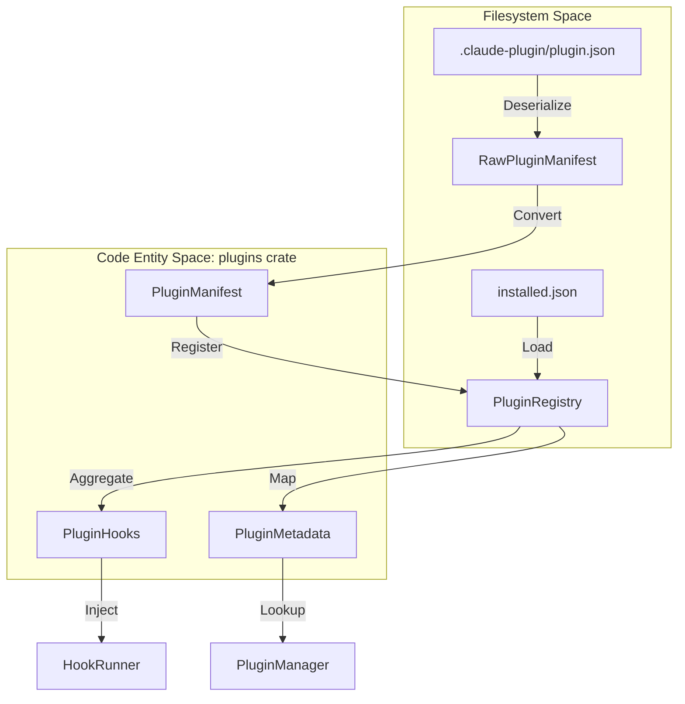
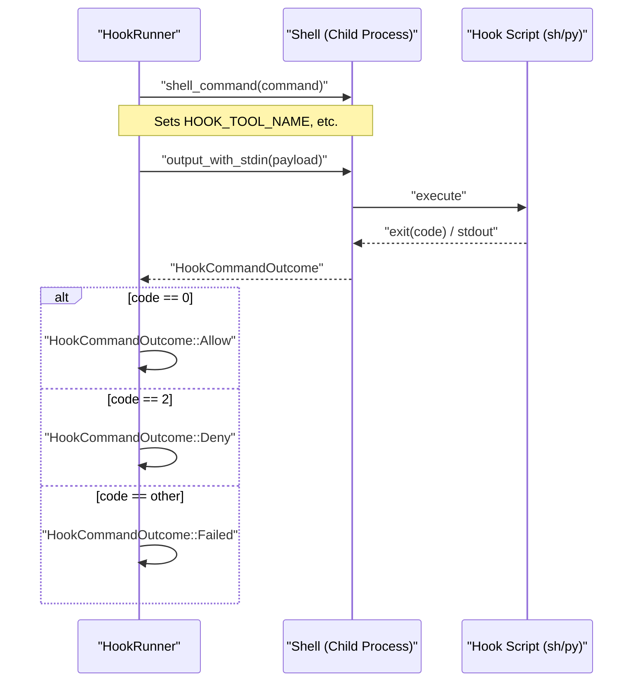

<!-- source: DeepWiki mcp.deepwiki.com · repo ultraworkers/claw-code · page 2.6 Plugin System · fetched 2026-10-27 -->

# Plugin System

<details>
<summary>Relevant source files</summary>

The following files were used as context for generating this wiki page:

- [rust/PARITY.md](rust/PARITY.md)
- [rust/crates/plugins/Cargo.toml](rust/crates/plugins/Cargo.toml)
- [rust/crates/plugins/bundled/example-bundled/.claude-plugin/plugin.json](rust/crates/plugins/bundled/example-bundled/.claude-plugin/plugin.json)
- [rust/crates/plugins/bundled/example-bundled/hooks/post.sh](rust/crates/plugins/bundled/example-bundled/hooks/post.sh)
- [rust/crates/plugins/bundled/example-bundled/hooks/pre.sh](rust/crates/plugins/bundled/example-bundled/hooks/pre.sh)
- [rust/crates/plugins/bundled/sample-hooks/.claude-plugin/plugin.json](rust/crates/plugins/bundled/sample-hooks/.claude-plugin/plugin.json)
- [rust/crates/plugins/bundled/sample-hooks/hooks/post.sh](rust/crates/plugins/bundled/sample-hooks/hooks/post.sh)
- [rust/crates/plugins/bundled/sample-hooks/hooks/pre.sh](rust/crates/plugins/bundled/sample-hooks/hooks/pre.sh)
- [rust/crates/plugins/src/hooks.rs](rust/crates/plugins/src/hooks.rs)
- [rust/crates/plugins/src/lib.rs](rust/crates/plugins/src/lib.rs)
- [rust/crates/plugins/src/test_isolation.rs](rust/crates/plugins/src/test_isolation.rs)
- [rust/crates/runtime/src/lsp_client.rs](rust/crates/runtime/src/lsp_client.rs)
- [rust/crates/runtime/src/mcp_tool_bridge.rs](rust/crates/runtime/src/mcp_tool_bridge.rs)
- [rust/crates/runtime/src/permission_enforcer.rs](rust/crates/runtime/src/permission_enforcer.rs)
- [rust/crates/runtime/src/plugin_lifecycle.rs](rust/crates/runtime/src/plugin_lifecycle.rs)
- [rust/crates/runtime/src/stale_branch.rs](rust/crates/runtime/src/stale_branch.rs)
- [rust/crates/runtime/src/team_cron_registry.rs](rust/crates/runtime/src/team_cron_registry.rs)

</details>


The `plugins` crate provides a structured framework for extending the functionality of the `claw-code` environment through external scripts, bundled extensions, and lifecycle hooks. It enables the system to intercept tool usage, define custom commands, and manage third-party integrations with a unified manifest-based approach.

## Plugin Architecture and Types

Plugins are categorized by their origin and installation method via the `PluginKind` enum [rust/crates/plugins/src/lib.rs:26-32]().

| PluginKind | Marketplace Label | Description |
| :--- | :--- | :--- |
| `Builtin` | `builtin` | Core plugins provided by the system [rust/crates/plugins/src/lib.rs:29, 48](). |
| `Bundled` | `bundled` | Plugins shipped alongside the application in the `bundled/` directory [rust/crates/plugins/src/lib.rs:30, 49](). |
| `External` | `external` | User-installed plugins managed via the `installed.json` registry [rust/crates/plugins/src/lib.rs:31, 50](). |

### Data Flow: Plugin Discovery to Registry
The system uses a `RawPluginManifest` [rust/crates/plugins/src/lib.rs:225-241]() for initial deserialization before converting it into the internal `PluginManifest` type. Metadata such as `id`, `name`, and `kind` is encapsulated in `PluginMetadata` [rust/crates/plugins/src/lib.rs:56-65]().

**Registry Initialization and Metadata Mapping**

Sources: [rust/crates/plugins/src/lib.rs:22-24](), [rust/crates/plugins/src/lib.rs:56-65](), [rust/crates/plugins/src/lib.rs:117-132](), [rust/crates/plugins/src/lib.rs:225-241](), [rust/crates/plugins/src/hooks.rs:60-62]()

## Plugin Manifest Schema

Every plugin must contain a manifest file located at `.claude-plugin/plugin.json` [rust/crates/plugins/src/lib.rs:24](). This file defines the plugin's identity, required permissions, and the specific hooks or tools it provides.

### Key Manifest Components
*   **Metadata**: `name`, `version`, `description`, and `default_enabled` [rust/crates/plugins/src/lib.rs:118-123]().
*   **Permissions**: A list of `PluginPermission` variants (`Read`, `Write`, `Execute`) [rust/crates/plugins/src/lib.rs:134-140]().
*   **Hooks**: Registration of scripts for `PreToolUse`, `PostToolUse`, and `PostToolUseFailure` events [rust/crates/plugins/src/lib.rs:67-75]().
*   **Lifecycle**: Scripts to run during `Init` and `Shutdown` phases [rust/crates/plugins/src/lib.rs:101-107]().
*   **Tools**: Definitions for custom tools via `PluginToolManifest`, including `input_schema`, `command`, and `required_permission` [rust/crates/plugins/src/lib.rs:169-178](). The `PluginToolPermission` enum gates these tools at `ReadOnly`, `WorkspaceWrite`, or `DangerFullAccess` levels [rust/crates/plugins/src/lib.rs:180-186]().
*   **Commands**: Custom slash commands provided by the plugin via `PluginCommandManifest` [rust/crates/plugins/src/lib.rs:218-222]().

**Example Manifest Snippet:**
[rust/crates/plugins/bundled/example-bundled/.claude-plugin/plugin.json:1-10]()

## Hook Execution System

The `HookRunner` [rust/crates/plugins/src/hooks.rs:60-62]() executes scripts associated with specific events in the tool execution pipeline. It communicates with hook scripts via environment variables and standard input (JSON payload) [rust/crates/plugins/src/hooks.rs:186-198]().

### Hook Events
The `HookEvent` enum defines the supported interception points [rust/crates/plugins/src/hooks.rs:10-14]():
1.  **PreToolUse**: Triggered before a tool is executed [rust/crates/plugins/src/hooks.rs:75-84](). Hooks can return an exit code of `2` to deny the tool execution [rust/crates/plugins/src/hooks.rs:203-205]().
2.  **PostToolUse**: Triggered after tool execution, receiving the tool's output and error status [rust/crates/plugins/src/hooks.rs:87-102]().
3.  **PostToolUseFailure**: Triggered when a tool execution fails [rust/crates/plugins/src/hooks.rs:105-119]().

### Hook Runtime Environment
The `HookRunner` populates the environment for the child process [rust/crates/plugins/src/hooks.rs:190-196]():
*   `HOOK_EVENT`: The event name (e.g., "PreToolUse") [rust/crates/plugins/src/hooks.rs:17-23]().
*   `HOOK_TOOL_NAME`: The name of the tool being intercepted [rust/crates/plugins/src/hooks.rs:191]().
*   `HOOK_TOOL_INPUT`: The raw JSON input provided to the tool [rust/crates/plugins/src/hooks.rs:192]().
*   `HOOK_TOOL_OUTPUT`: (Post-use only) The result or error of the tool execution [rust/crates/plugins/src/hooks.rs:195]().
*   `HOOK_TOOL_IS_ERROR`: "1" if the tool failed, "0" otherwise [rust/crates/plugins/src/hooks.rs:193]().

**Hook Execution Sequence**

Sources: [rust/crates/plugins/src/hooks.rs:121-174](), [rust/crates/plugins/src/hooks.rs:186-220]()

## Plugin Lifecycle and Health

The runtime manages the state of plugins through a dedicated lifecycle tracking system [rust/crates/runtime/src/plugin_lifecycle.rs:47-61]().

### Plugin States
Plugins transition through several states [rust/crates/runtime/src/plugin_lifecycle.rs:47-61]():
*   `Unconfigured`: Initial state before configuration is loaded.
*   `Starting`: The plugin is initializing.
*   `Healthy`: All associated servers/hooks are operational [rust/crates/runtime/src/plugin_lifecycle.rs:51]().
*   `Degraded`: Some servers failed, but the plugin remains partially functional [rust/crates/runtime/src/plugin_lifecycle.rs:52-55]().
*   `Failed`: The plugin could not start or all servers are down [rust/crates/runtime/src/plugin_lifecycle.rs:56-58]().

### Health Monitoring
The `PluginHealthcheck` struct tracks the status of a plugin and its underlying servers [rust/crates/runtime/src/plugin_lifecycle.rs:136-141](). It uses `ServerHealth` [rust/crates/runtime/src/plugin_lifecycle.rs:38-43]() to aggregate status from multiple backend processes (e.g., MCP servers).

**Plugin Lifecycle State Machine**
```mermaid
stateDiagram-v2
    [*] --> "Unconfigured"
    "Unconfigured" --> "Validated"
    "Validated" --> "Starting"
    "Starting" --> "Healthy": "All servers up"
    "Starting" --> "Degraded": "Partial server failure"
    "Starting" --> "Failed": "Critical failure"
    "Healthy" --> "ShuttingDown"
    "Degraded" --> "ShuttingDown"
    "ShuttingDown" --> "Stopped"
    "Stopped" --> [*]
```
Sources: [rust/crates/runtime/src/plugin_lifecycle.rs:47-61](), [rust/crates/runtime/src/plugin_lifecycle.rs:218-224]()

## Implementation Details

### Registry Management
The `PluginRegistry` manages persistent state in `installed.json` [rust/crates/plugins/src/lib.rs:22](). It aggregates hooks from all enabled plugins into a single `PluginHooks` structure via `aggregated_hooks()` [rust/crates/plugins/src/hooks.rs:70-72]().

### Test Isolation
To prevent ambient plugin state from affecting CI/CD, the `test_isolation` module provides an `EnvLock` [rust/crates/plugins/src/test_isolation.rs:13-16](). It redirects `HOME`, `XDG_CONFIG_HOME`, and `XDG_DATA_HOME` to temporary directories [rust/crates/plugins/src/test_isolation.rs:30-33]().

### Bundled Examples
The repository includes reference implementations:
*   **example-bundled**: Demonstrates basic hook structure with `pre.sh` and `post.sh` [rust/crates/plugins/bundled/example-bundled/.claude-plugin/plugin.json:6-9]().
*   **sample-hooks**: Used for integration testing of the execution pipeline [rust/crates/plugins/bundled/sample-hooks/.claude-plugin/plugin.json:1-10]().

Sources:
- [rust/crates/plugins/src/lib.rs]()
- [rust/crates/plugins/src/hooks.rs]()
- [rust/crates/plugins/src/test_isolation.rs]()
- [rust/crates/runtime/src/plugin_lifecycle.rs]()
- [rust/crates/plugins/bundled/example-bundled/.claude-plugin/plugin.json]()

---

