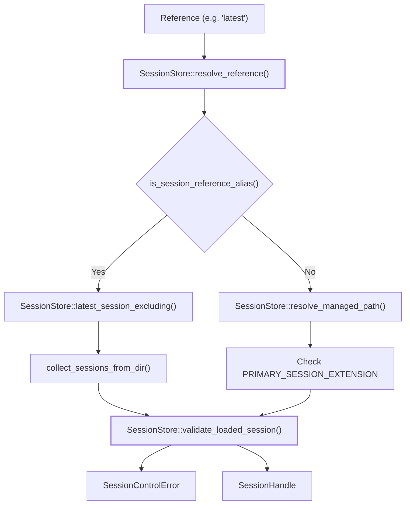

<!-- source: DeepWiki mcp.deepwiki.com · repo ultraworkers/claw-code · page 2.7 Worker Boot and Lane System · fetched 2026-10-27 -->

# Worker Boot and Lane System

<details>
<summary>Relevant source files</summary>

The following files were used as context for generating this wiki page:

- [.github/scripts/check_doc_source_of_truth.py](.github/scripts/check_doc_source_of_truth.py)
- [rust/crates/api/Cargo.toml](rust/crates/api/Cargo.toml)
- [rust/crates/claw-analog/src/lib.rs](rust/crates/claw-analog/src/lib.rs)
- [rust/crates/runtime/Cargo.toml](rust/crates/runtime/Cargo.toml)
- [rust/crates/runtime/src/bash.rs](rust/crates/runtime/src/bash.rs)
- [rust/crates/runtime/src/bash_validation.rs](rust/crates/runtime/src/bash_validation.rs)
- [rust/crates/runtime/src/branch_lock.rs](rust/crates/runtime/src/branch_lock.rs)
- [rust/crates/runtime/src/lane_events.rs](rust/crates/runtime/src/lane_events.rs)
- [rust/crates/runtime/src/mcp.rs](rust/crates/runtime/src/mcp.rs)
- [rust/crates/runtime/src/mcp_client.rs](rust/crates/runtime/src/mcp_client.rs)
- [rust/crates/runtime/src/mcp_stdio.rs](rust/crates/runtime/src/mcp_stdio.rs)
- [rust/crates/runtime/src/recovery_recipes.rs](rust/crates/runtime/src/recovery_recipes.rs)
- [rust/crates/runtime/src/session_control.rs](rust/crates/runtime/src/session_control.rs)
- [rust/crates/runtime/src/trident.rs](rust/crates/runtime/src/trident.rs)
- [rust/crates/runtime/src/trust_resolver.rs](rust/crates/runtime/src/trust_resolver.rs)
- [rust/crates/runtime/src/worker_boot.rs](rust/crates/runtime/src/worker_boot.rs)

</details>


The worker boot and lane system provides a foundational control plane for reliable, machine-orchestrated agent startup and execution. It moves beyond raw terminal scraping by implementing an explicit state machine for worker lifecycles, a trust-gate resolution mechanism, and a structured event system for "lanes" (task-specific execution contexts).

## Worker Boot State Machine

Every worker in the runtime follows a strict lifecycle managed by the `WorkerStatus` enum [rust/crates/runtime/src/worker_boot.rs:31-39](). This ensures that high-level orchestrators do not attempt to deliver prompts before the underlying environment is ready.

### Worker Status Transitions
*   **`Spawning`**: The initial state when the worker process is being allocated [rust/crates/runtime/src/worker_boot.rs:32]().
*   **`TrustRequired`**: The worker is blocked by a security trust prompt (e.g., "Do you trust the files in this folder?") [rust/crates/runtime/src/worker_boot.rs:33]().
*   **`ToolPermissionRequired`**: The worker is blocked waiting for authorization to use a specific tool [rust/crates/runtime/src/worker_boot.rs:34]().
*   **`ReadyForPrompt`**: The environment is fully initialized and waiting for the initial task [rust/crates/runtime/src/worker_boot.rs:35]().
*   **`Running`**: The worker has accepted a prompt and is currently executing [rust/crates/runtime/src/worker_boot.rs:36]().
*   **`Finished`**: The task completed successfully [rust/crates/runtime/src/worker_boot.rs:37]().
*   **`Failed`**: An unrecoverable error occurred during boot or execution [rust/crates/runtime/src/worker_boot.rs:38]().

### Diagram: Worker Lifecycle and Code Entities
This diagram maps the logical states to the `WorkerStatus` variants and the `WorkerEventKind` triggers that drive transitions.

```mermaid
stateDiagram-v2
    [*] --> Spawning: "WorkerStatus::Spawning"
    Spawning --> TrustRequired: "WorkerEventKind::TrustRequired"
    TrustRequired --> ReadyForPrompt: "WorkerTrustResolution::ManualApproval"
    Spawning --> ToolPermissionRequired: "WorkerEventKind::ToolPermissionRequired"
    ToolPermissionRequired --> ReadyForPrompt: "Permission granted"
    Spawning --> ReadyForPrompt: "WorkerEventKind::ReadyForPrompt"
    ReadyForPrompt --> Running: "WorkerStatus::Running"
    Running --> Finished: "WorkerEventKind::Finished"
    Running --> Failed: "WorkerFailure"
    
    note right of Spawning
        rust/crates/runtime/src/worker_boot.rs
        Enum: "WorkerStatus"
        Enum: "WorkerEventKind"
    end note
```

**Sources:**
* [rust/crates/runtime/src/worker_boot.rs:31-53]()
* [rust/crates/runtime/src/worker_boot.rs:75-89]()
* [rust/crates/runtime/src/worker_boot.rs:93-96]()

## Trust Resolution and Misdelivery Recovery

The system includes automated handlers for "fragile boot" scenarios where security gates or shell misconfigurations block startup.

### TrustResolver and Tool Permissions
The system identifies when external security gates block progress. 
*   **Trust Detection**: The logic detects cues like "trust the files in this folder" and emits a `WorkerEventKind::TrustRequired` event [rust/crates/runtime/src/worker_boot.rs:78]().
*   **Resolution Modes**: Trust can be granted via `WorkerTrustResolution::AutoAllowlisted` or `ManualApproval` [rust/crates/runtime/src/worker_boot.rs:93-96]().

### Prompt-Misdelivery Detection and Recovery
A common failure mode is "shell misdelivery," where a task prompt lands in a raw bash shell instead of the agent's input buffer.
*   **Detection**: The system tracks `WorkerPromptTarget` to identify if a prompt hit the `Shell`, `WrongTarget`, or `WrongTask` [rust/crates/runtime/src/worker_boot.rs:100-105]().
*   **Recovery Recipes**: The `RecoveryStep::RedirectPromptToAgent` step is part of the `FailureScenario::PromptMisdelivery` recipe [rust/crates/runtime/src/recovery_recipes.rs:79-80](). The system enforces a policy of one automatic recovery attempt before escalation [rust/crates/runtime/src/recovery_recipes.rs:4-7]().

### Startup Evidence
If a worker fails to boot without clear logs, the system collects a `StartupEvidenceBundle` containing the `last_lifecycle_state`, `pane_command`, `transport_healthy`, and `mcp_healthy` status [rust/crates/runtime/src/worker_boot.rs:162-198](). The `StartupFailureClassification` then categorizes the error into specific causes like `PromptAcceptanceTimeout` or `WorkerCrashed` [rust/crates/runtime/src/worker_boot.rs:125-140]().

**Sources:**
* [rust/crates/runtime/src/worker_boot.rs:100-105]()
* [rust/crates/runtime/src/worker_boot.rs:125-140]()
* [rust/crates/runtime/src/worker_boot.rs:162-198]()
* [rust/crates/runtime/src/recovery_recipes.rs:18-26]()
* [rust/crates/runtime/src/recovery_recipes.rs:77-86]()

## Lane Event System

Lanes represent logical units of work. The system emits machine-readable `LaneEventName` objects to allow external monitors to track progress.

### Key Event Types (`LaneEventName`)
*   **`lane.started`**: Initial execution began [rust/crates/runtime/src/lane_events.rs:7-8]().
*   **`lane.ready`**: Worker is ready for prompt [rust/crates/runtime/src/lane_events.rs:9-10]().
*   **`lane.green` / `lane.red`**: Status of validation checks within the lane [rust/crates/runtime/src/lane_events.rs:15-18]().
*   **`lane.finished` / `lane.failed`**: Terminal states for the lane [rust/crates/runtime/src/lane_events.rs:25-28]().
*   **`branch.stale_against_main`**: Detected that the current work branch is behind the main branch [rust/crates/runtime/src/lane_events.rs:37-38]().

### Failure Taxonomy
Failures are classified into specific categories via `LaneFailureClass` [rust/crates/runtime/src/lane_events.rs:70-83]():
*   `PromptDelivery`: Failed to get the task into the agent [rust/crates/runtime/src/lane_events.rs:71]().
*   `TrustGate`: Blocked by security prompt [rust/crates/runtime/src/lane_events.rs:72]().
*   `BranchDivergence`: Work branch is too far behind main [rust/crates/runtime/src/lane_events.rs:73]().
*   `McpHandshake`: Failures in the Model Context Protocol layer [rust/crates/runtime/src/lane_events.rs:78]().

**Sources:**
* [rust/crates/runtime/src/lane_events.rs:6-50]()
* [rust/crates/runtime/src/lane_events.rs:70-83]()

## SessionStore and Workspace Isolation

The `SessionStore` ensures that sessions are isolated by workspace fingerprint to prevent collisions between parallel instances [rust/crates/runtime/src/session_control.rs:10-12]().

### Workspace Fingerprinting
The store derives a unique fingerprint from the canonical path of the workspace root [rust/crates/runtime/src/session_control.rs:33-43](). Sessions are stored on disk at `<data_dir>/sessions/<workspace_hash>/` [rust/crates/runtime/src/session_control.rs:64-68]().

### SessionControl and Error Taxonomy
The `SessionStore` enforces safety checks during resolution:
*   **`resolve_reference`**: Resolves aliases like "latest" to a specific `SessionHandle` [rust/crates/runtime/src/session_control.rs:95-102]().
*   **`WorkspaceMismatch`**: An error variant within the `LaneFailureClass` taxonomy [rust/crates/runtime/src/lane_events.rs:81]().
*   **`SessionControlError`**: Handles errors related to missing sessions or validation failures [rust/crates/runtime/src/session_control.rs:156-159]().

### Diagram: Session Resolution Flow
This diagram shows how `SessionStore` resolves a reference to a specific file on disk.



**Sources:**
* [rust/crates/runtime/src/session_control.rs:20-48]()
* [rust/crates/runtime/src/session_control.rs:95-136]()
* [rust/crates/runtime/src/session_control.rs:138-159]()

## Recovery Recipes and Branch Management
Automated recovery for the six canonical failure scenarios (TrustPromptUnresolved, PromptMisdelivery, StaleBranch, CompileRedCrossCrate, McpHandshakeFailure, PartialPluginStartup) is handled by the recovery system.

For details, see [Recovery Recipes and Branch Management](#2.7.1).

---

