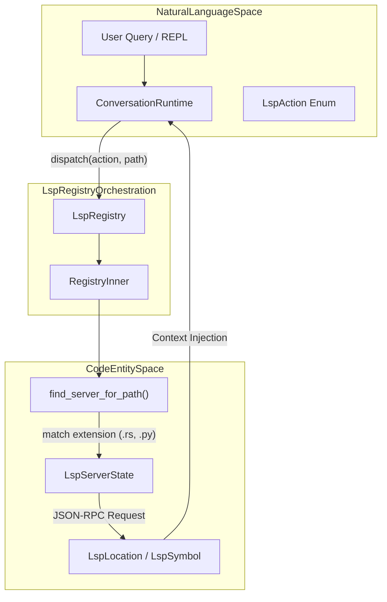
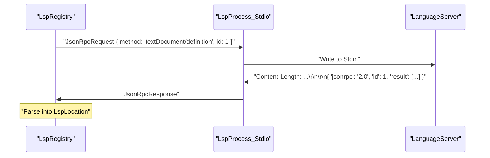
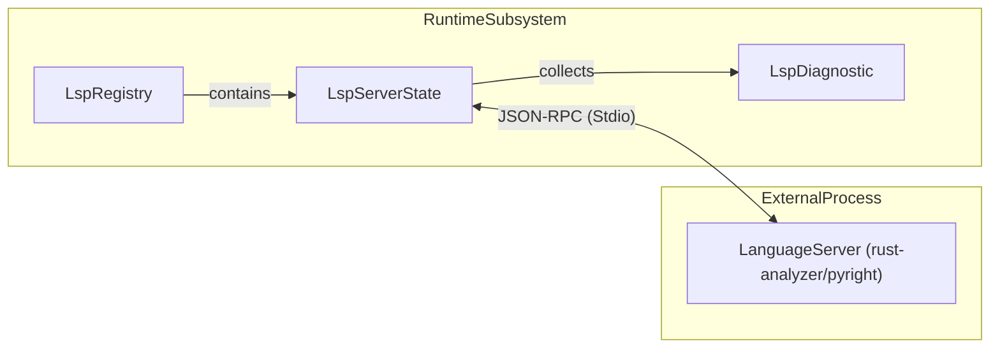

<!-- source: DeepWiki mcp.deepwiki.com · repo ultraworkers/claw-code · page 2.8 LSP Integration · fetched 2026-10-27 -->

# LSP Integration

Relevant source files

The following files were used as context for generating this wiki page:

- [.claude/sessions/session-1775007846522.json](.claude/sessions/session-1775007846522.json)
- [rust/Cargo.lock](rust/Cargo.lock)
- [rust/crates/runtime/src/lsp_client.rs](rust/crates/runtime/src/lsp_client.rs)
- [rust/crates/runtime/src/mcp_tool_bridge.rs](rust/crates/runtime/src/mcp_tool_bridge.rs)
- [rust/crates/runtime/src/permission_enforcer.rs](rust/crates/runtime/src/permission_enforcer.rs)
- [rust/crates/runtime/src/plugin_lifecycle.rs](rust/crates/runtime/src/plugin_lifecycle.rs)
- [rust/crates/runtime/src/stale_branch.rs](rust/crates/runtime/src/stale_branch.rs)
- [rust/crates/runtime/src/team_cron_registry.rs](rust/crates/runtime/src/team_cron_registry.rs)
- [rust/crates/rusty-claude-cli/Cargo.toml](rust/crates/rusty-claude-cli/Cargo.toml)
- [rust/crates/rusty-claude-cli/src/input.rs](rust/crates/rusty-claude-cli/src/input.rs)
- [rust/crates/tools/Cargo.toml](rust/crates/tools/Cargo.toml)
- [rust/crates/tools/src/lib.rs](rust/crates/tools/src/lib.rs)

The LSP (Language Server Protocol) integration in `claw-code` provides the infrastructure for communicating with external Language Servers. It enables the runtime to perform static analysis, retrieve symbol definitions, find references, and collect workspace diagnostics. This information is primarily used for context enrichment, providing the LLM with real-time code intelligence during conversation turns.

The core implementation resides in `runtime/src/lsp_client.rs` [rust/crates/runtime/src/lsp_client.rs:1-3]().

## Architecture Overview

The integration follows a registry-based pattern where the `LspRegistry` orchestrates multiple language servers. Communication is performed using JSON-RPC over a standard `stdio` transport, mirroring the architectural patterns used for MCP (Model Context Protocol) servers in the same crate.

### Data Flow: Natural Language to Code Entity Space

The following diagram illustrates how a user request (Natural Language Space) triggers LSP actions to resolve code entities (Code Entity Space) like definitions and symbols.

**LSP Action Dispatch Flow**

Sources: [rust/crates/runtime/src/lsp_client.rs:110-117](), [rust/crates/runtime/src/lsp_client.rs:151-172](), [rust/crates/runtime/src/lsp_client.rs:236-240]()

## Key Components

### LspRegistry
The `LspRegistry` maintains a thread-safe map of active language servers and their current states using an `Arc<Mutex<RegistryInner>>` [rust/crates/runtime/src/lsp_client.rs:110-117](). It handles server discovery based on file extensions and dispatches structured actions.

- **`register(language, status, ...)`**: Adds a new language server to the internal `RegistryInner` map [rust/crates/runtime/src/lsp_client.rs:125-143]().
- **`find_server_for_path(path)`**: Maps file extensions (e.g., `.rs` to `rust`, `.py` to `python`, `.ts` to `typescript`) to the appropriate registered server [rust/crates/runtime/src/lsp_client.rs:151-172]().
- **`dispatch(action, path, ...)`**: The primary entry point for executing LSP commands like `hover` or `definition` [rust/crates/runtime/src/lsp_client.rs:236-240]().
- **`add_diagnostics(language, diagnostics)`**: Updates the cached diagnostics for a specific server [rust/crates/runtime/src/lsp_client.rs:181-193]().

### LspAction
An enumeration of supported operations that can be requested from a language server.

| Variant | LSP Method Mapping | Description |
| :--- | :--- | :--- |
| `Diagnostics` | `textDocument/publishDiagnostics` | Retrieve syntax/type errors [rust/crates/runtime/src/lsp_client.rs:13]() |
| `Hover` | `textDocument/hover` | Get documentation at a position [rust/crates/runtime/src/lsp_client.rs:14]() |
| `Definition` | `textDocument/definition` | Find where a symbol is defined [rust/crates/runtime/src/lsp_client.rs:15]() |
| `References` | `textDocument/references` | Find all usages of a symbol [rust/crates/runtime/src/lsp_client.rs:16]() |
| `Completion` | `textDocument/completion` | Get code completion suggestions [rust/crates/runtime/src/lsp_client.rs:17]() |
| `Symbols` | `textDocument/documentSymbol` | List all symbols in a file [rust/crates/runtime/src/lsp_client.rs:18]() |
| `Format` | `textDocument/formatting` | Reformat the source code [rust/crates/runtime/src/lsp_client.rs:19]() |

Sources: [rust/crates/runtime/src/lsp_client.rs:12-20](), [rust/crates/runtime/src/lsp_client.rs:22-35]()

### LspServerState
Tracks the operational status and metadata of a specific language server instance [rust/crates/runtime/src/lsp_client.rs:101-107]().

- **`status`**: Current lifecycle state: `Starting`, `Connected`, `Disconnected`, or `Error` [rust/crates/runtime/src/lsp_client.rs:82-87]().
- **`capabilities`**: A list of features supported by the server (e.g., "hover", "definition") [rust/crates/runtime/src/lsp_client.rs:105]().
- **`diagnostics`**: A cached collection of `LspDiagnostic` objects for the files managed by this server [rust/crates/runtime/src/lsp_client.rs:106]().

## Transport and Protocol

The LSP implementation utilizes a JSON-RPC 2.0 transport layer. While specific transport logic is abstracted in the client registry, it shares architectural patterns with the `McpServerManager` [rust/crates/runtime/src/mcp_stdio.rs:19]() which uses stdio-based JSON-RPC communication.

### JSON-RPC Framing
Messages are exchanged as structured JSON objects over standard input/output of the server process.

**LSP Message Exchange**

Sources: [rust/crates/runtime/src/lsp_client.rs:236-240](), [rust/crates/runtime/src/mcp_stdio.rs:199-203]()

## Data Structures

The following types are used to represent structured data returned by LSP servers:

- **`LspDiagnostic`**: Represents a single error or warning, including its path, severity, and message [rust/crates/runtime/src/lsp_client.rs:38-45]().
- **`LspLocation`**: Represents a specific point or range in a source file, often used for "Go to Definition" results. It includes an optional `preview` of the code at that location [rust/crates/runtime/src/lsp_client.rs:48-55]().
- **`LspSymbol`**: Contains metadata about a code entity, such as its name, kind (Function, Class, etc.), and location [rust/crates/runtime/src/lsp_client.rs:72-78]().
- **`LspHoverResult`**: Contains the documentation string and language identifier for a hover request [rust/crates/runtime/src/lsp_client.rs:58-61]().
- **`LspCompletionItem`**: Metadata for code completion suggestions including label, kind, and detail [rust/crates/runtime/src/lsp_client.rs:64-69]().

## Global Registry and Tool Integration

LSP capabilities are integrated into the runtime via the `LspRegistry`. When an agent needs to understand a codebase, it might invoke a tool that calls `LspRegistry::get_diagnostics` to find build errors [rust/crates/runtime/src/lsp_client.rs:196-205]() or `LspRegistry::find_server_for_path` to verify if a file can be analyzed [rust/crates/runtime/src/lsp_client.rs:151-155]().

The `tools` crate accesses the LSP system via a global static registry initialized on first use [rust/crates/tools/src/lib.rs:39-43]().

**Registry Component Relationship**

Sources: [rust/crates/runtime/src/lsp_client.rs:110-117](), [rust/crates/runtime/src/lsp_client.rs:101-107](), [rust/crates/runtime/src/lsp_client.rs:38-45]()

This integration ensures that the agentic part of the system has access to the same high-fidelity code intelligence that a human developer has in a modern IDE.

Sources: [rust/crates/runtime/src/lsp_client.rs:151-205](), [rust/crates/tools/src/lib.rs:39-43]()

---

