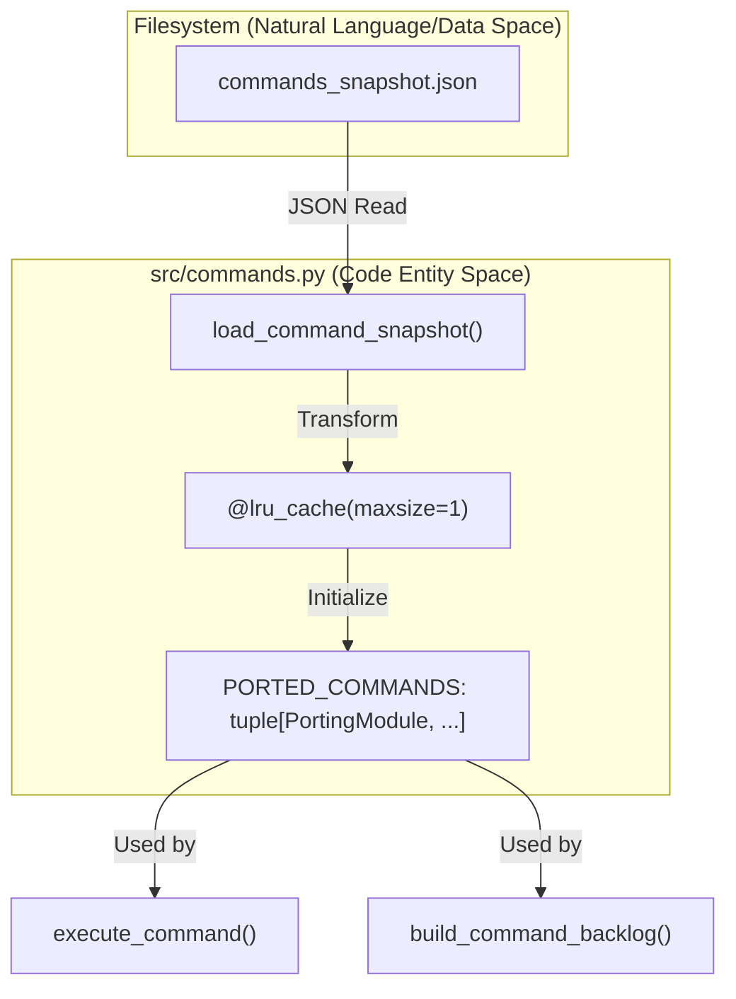
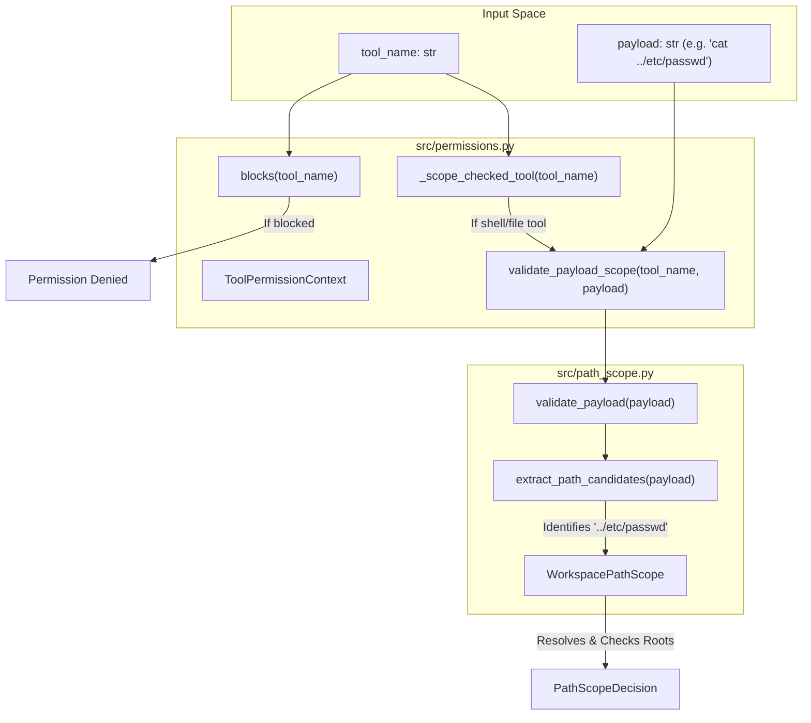

<!-- source: DeepWiki mcp.deepwiki.com · repo ultraworkers/claw-code · page 3.4 Python Commands and Tools Registries · fetched 2026-10-27 -->

# Python Commands and Tools Registries

Relevant source files

The following files were used as context for generating this wiki page:

- [src/commands.py](src/commands.py)
- [src/models.py](src/models.py)
- [src/path_scope.py](src/path_scope.py)
- [src/permissions.py](src/permissions.py)
- [src/query_engine.py](src/query_engine.py)
- [src/runtime.py](src/runtime.py)
- [src/tools.py](src/tools.py)
- [tests/test_porting_workspace.py](tests/test_porting_workspace.py)
- [tests/test_security_scope.py](tests/test_security_scope.py)

The Python porting workspace maintains a registry of commands and tools that mirror the surface area of the original TypeScript codebase. These registries, defined in `src/commands.py` and `src/tools.py`, serve as a reference for the parity-audit system and provide a shim for executing mirrored functionality within the Python environment.

## Data Loading and Snapshots

The Python registries do not dynamically discover commands from the Rust implementation; instead, they load data from static JSON snapshots located in `src/reference_data/`. This allows the Python workspace to act as a stable "clean-room" reference for what should be implemented.

The `PORTED_COMMANDS` registry is populated via `load_command_snapshot()` [src/commands.py:23-33](). This function reads from `commands_snapshot.json` [src/commands.py:10]() and transforms the raw JSON entries into a tuple of `PortingModule` dataclasses. Similarly, `PORTED_TOOLS` is loaded from `tools_snapshot.json` [src/tools.py:11]() via `load_tool_snapshot()` [src/tools.py:24-34]().

### The PortingModule Dataclass
The `PortingModule` [src/models.py:15-20]() is the primary unit of currency for these registries. It captures:
- **name**: The identifier of the command or tool.
- **responsibility**: A description of what the entity does.
- **source_hint**: A string indicating where the original implementation resides (e.g., a TypeScript file path or a plugin name).
- **status**: Defaults to `'planned'` but is hardcoded to `'mirrored'` for entries loaded from snapshots [src/commands.py:30-31]()[src/tools.py:31-32]().

### Registry Loading Flow
The following diagram illustrates how the `commands.py` module initializes its registry from the reference data.

**Command Registry Initialization**

Sources: [src/commands.py:10-36](), [src/tools.py:11-37](), [src/models.py:15-20]()

## Command Dispatch and Execution

The `commands.py` module provides a shim for "executing" commands. Since this is a porting workspace, execution typically results in a descriptive message rather than side effects.

### Key Functions
- `get_command(name: str)`: Performs a case-insensitive lookup in the `PORTED_COMMANDS` list, resolving aliases like `plugins` or `marketplace` to the base `plugin` command [src/commands.py:57-62]().
- `get_commands(...)`: Allows filtering the registry. It can exclude plugin-based or skill-based commands by inspecting the `source_hint` attribute [src/commands.py:65-71]().
- `execute_command(name: str, prompt: str)`: The primary entry point for command dispatch. It returns a `CommandExecution` object [src/commands.py:80-86]().

### CommandExecution Dataclass
The result of an execution is encapsulated in the `CommandExecution` dataclass [src/commands.py:13-20]():

| Field | Description |
| :--- | :--- |
| `name` | The name of the command executed. |
| `source_hint` | Where the mirrored command originated. |
| `prompt` | The input prompt provided to the command. |
| `handled` | Boolean indicating if the command was found in the registry. |
| `message` | A descriptive string of what the command *would* do [src/commands.py:85](). |

Sources: [src/commands.py:13-20](), [src/commands.py:38-41](), [src/commands.py:57-86]()

## Tool Registry and Permissions

Tools in the Python workspace are managed similarly to commands but include a mechanism for permission filtering and path scope validation.

### ToolPermissionContext and PathScope
The `ToolPermissionContext` class [src/permissions.py:10-15]() gates tool access. It allows blocking tools by specific names or prefixes [src/permissions.py:37-39](). For file-system or shell-related tools (e.g., `BashTool`, `FileReadTool`), it uses `WorkspacePathScope` to validate that path operands stay within allowed workspace roots [src/permissions.py:41-44]()[src/path_scope.py:26-34]().

The `WorkspacePathScope` implementation is intentionally conservative, denying any path that resolves outside the configured roots, including those reached via symlinks or glob expansion [src/path_scope.py:29-33]().

**Permission and Path Validation Logic**

Sources: [src/permissions.py:10-49](), [src/path_scope.py:25-58](), [src/tools.py:81-101]()

### Key Tool Functions
- `get_tools(...)`: Returns the tool registry, optionally filtering by `simple_mode` (only core file/shell tools), excluding MCP tools, or applying a `ToolPermissionContext` [src/tools.py:62-72]().
- `execute_tool(name, payload, permission_context)`: Dispatches a tool call. It first checks if the tool is blocked by name, then validates the payload's path scope if applicable [src/tools.py:81-101]().

Sources: [src/tools.py:62-101](), [src/permissions.py:10-44]()

## Runtime Integration

The `PortRuntime` class uses these registries to route user prompts to the most relevant commands or tools.

### Prompt Routing
The `PortRuntime.route_prompt()` [src/runtime.py:90-118]() method performs a token-based search across `PORTED_COMMANDS` and `PORTED_TOOLS`. It handles explicit command matches (e.g., prompts starting with `/`) with high priority [src/runtime.py:121-134]().

### Session Bootstrapping
When a session is bootstrapped via `bootstrap_session()` [src/runtime.py:136-179](), the runtime:
1. Builds a `PortContext` and runs workspace setup [src/runtime.py:137-138]().
2. Routes the prompt to find matches [src/runtime.py:144]().
3. Uses an `ExecutionRegistry` (built via `build_execution_registry()` [src/runtime.py:145]()) to dispatch the `execute()` shim for each match [src/runtime.py:146-147]().
4. Identifies `PermissionDenial` objects if the routing matched a tool that the context would block [src/runtime.py:148]().
5. Submits the results to the `QueryEnginePort` for turn processing [src/runtime.py:149-160]().

### Registry Utilities
- `find_commands`/`find_tools`: Provides searching by checking if the query exists within the name or source hint [src/commands.py:74-77]()[src/tools.py:75-78]().
- `render_command_index`/`render_tool_index`: Generates human-readable strings for CLI output [src/commands.py:88-95]()[src/tools.py:104-111]().

Sources: [src/runtime.py:90-179](), [src/commands.py:44-95](), [src/tools.py:40-111](), [src/query_engine.py:61-105]()

---

