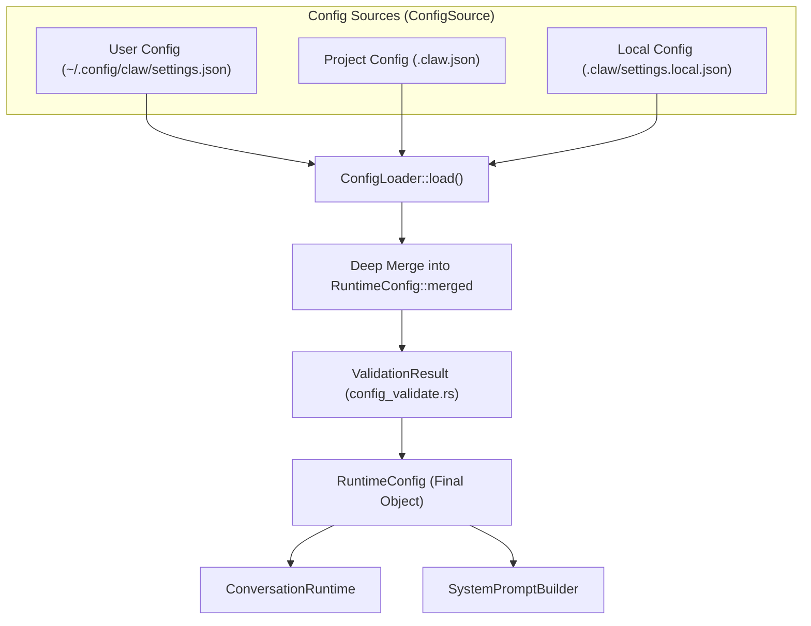
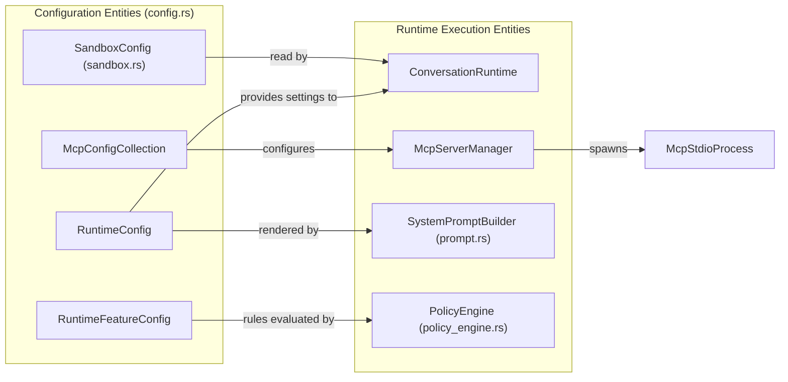

<!-- source: DeepWiki mcp.deepwiki.com · repo ultraworkers/claw-code · page 4.1 Runtime Configuration (Rust) · fetched 2026-10-27 -->

# Runtime Configuration (Rust)

Relevant source files

The following files were used as context for generating this wiki page:

- [.claude.json](.claude.json)
- [CLAUDE.md](CLAUDE.md)
- [rust/.claude/sessions/session-1775012674485.json](rust/.claude/sessions/session-1775012674485.json)
- [rust/.claude/sessions/session-1775012687059.json](rust/.claude/sessions/session-1775012687059.json)
- [rust/.claude/sessions/session-1775013221875.json](rust/.claude/sessions/session-1775013221875.json)
- [rust/.clawd-todos.json](rust/.clawd-todos.json)
- [rust/crates/runtime/src/config.rs](rust/crates/runtime/src/config.rs)
- [rust/crates/runtime/src/config_validate.rs](rust/crates/runtime/src/config_validate.rs)
- [rust/crates/runtime/src/lib.rs](rust/crates/runtime/src/lib.rs)
- [rust/crates/runtime/src/sandbox.rs](rust/crates/runtime/src/sandbox.rs)
- [rust/crates/rusty-claude-cli/src/setup_wizard.rs](rust/crates/rusty-claude-cli/src/setup_wizard.rs)
- [scripts/fmt.sh](scripts/fmt.sh)

The `runtime` crate provides a unified configuration system that aggregates settings from multiple sources to control the behavior of the AI assistant, its available tools, Model Context Protocol (MCP) integrations, and security sandboxing. This system is centered around the `RuntimeConfig` struct and the `ConfigLoader` utility, which manages the hierarchy of configuration files.

## Configuration Hierarchy and Loading

Claw uses a hierarchical configuration strategy where settings are merged from three distinct levels. This allows for global user preferences to be overridden by project-specific requirements or local environment overrides.

| Level | Source | Enum Variant | Purpose |
| :--- | :--- | :--- | :--- |
| **User** | Global user config | `ConfigSource::User` | Persistent preferences across all projects (e.g., default model). [rust/crates/runtime/src/config.rs:45-45]() |
| **Project** | Workspace config | `ConfigSource::Project` | Project-specific settings shared via version control (e.g., `.claw.json`). [rust/crates/runtime/src/config.rs:46-46]() |
| **Local** | Local override | `ConfigSource::Local` | Machine-specific overrides (e.g., `.claw/settings.local.json`). [rust/crates/runtime/src/config.rs:47-47]() |

The `ConfigLoader` handles the discovery and merging of these files [rust/crates/runtime/src/config.rs:70-70](). It also manages the `CLAW_SETTINGS_SCHEMA_NAME` constant, which is defined as `"SettingsSchema"` and is used for validation and IDE autocompletion [rust/crates/runtime/src/config.rs:40-40]().

### Data Flow: Config Resolution
The following diagram illustrates how the `ConfigLoader` assembles the final `RuntimeConfig` used by the `ConversationRuntime`.

**Diagram: Runtime Configuration Resolution Pipeline**

**Sources:** [rust/crates/runtime/src/config.rs:44-48](), [rust/crates/runtime/src/config.rs:60-71](), [rust/crates/runtime/src/config_validate.rs:69-72](), [rust/crates/runtime/src/config.rs:70-70]()

---

## RuntimeConfig Schema

The `RuntimeConfig` is the root data structure representing the application state. It is composed of several specialized sub-configs that govern different subsystems [rust/crates/runtime/src/config.rs:66-71]().

### Core Configuration Components

| Component | Type | Description |
| :--- | :--- | :--- |
| **Features** | `RuntimeFeatureConfig` | Toggles for experimental or optional capabilities (e.g., model aliases, trusted roots). [rust/crates/runtime/src/config.rs:151-166]() |
| **Hooks** | `RuntimeHookConfig` | Configures scripts or commands to run on specific events (Pre-tool/Post-tool). [rust/crates/runtime/src/config.rs:276-281]() |
| **Plugins** | `RuntimePluginConfig` | Manages external or bundled plugin activation, install roots, and registry paths. [rust/crates/runtime/src/config.rs:119-126]() |
| **MCP** | `McpConfigCollection` | Definitions for Model Context Protocol servers (Stdio, HTTP, SSE, WS). [rust/crates/runtime/src/config.rs:293-296]() |
| **Sandbox** | `SandboxConfig` | Defines execution constraints for the bash tool and filesystem isolation. [rust/crates/runtime/src/sandbox.rs:28-34]() |
| **Permissions** | `RuntimePermissionRuleConfig` | Lists of allow/deny/ask patterns for tool usage. [rust/crates/runtime/src/config.rs:284-290]() |
| **Fallbacks** | `ProviderFallbackConfig` | Ordered chain of model identifiers for retryable failures. [rust/crates/runtime/src/config.rs:269-273]() |
| **Provider** | `RuntimeProviderConfig` | Stored provider credentials (API key, base URL) from setup. [rust/crates/runtime/src/config.rs:199-204]() |

### MCP Configuration Collection
The `McpConfigCollection` allows Claw to connect to external tool providers. It is paired with the `ConfigSource` to track where each server was defined [rust/crates/runtime/src/config.rs:299-303](). It supports multiple transport types defined in `McpTransport` [rust/crates/runtime/src/config.rs:306-314]():
*   **Stdio**: Spawns a local process with environment variables and timeout controls [rust/crates/runtime/src/config.rs:328-334]().
*   **Remote (SSE/HTTP)**: Connects to remote servers with optional OAuth and header helpers [rust/crates/runtime/src/config.rs:336-343]().
*   **WebSocket**: Connects via `McpWebSocketServerConfig` [rust/crates/runtime/src/config.rs:345-351]().
*   **Managed Proxy**: Connects through a secure gateway using `McpManagedProxyServerConfig` [rust/crates/runtime/src/config.rs:359-364]().

**Sources:** [rust/crates/runtime/src/config.rs:293-314](), [rust/crates/runtime/src/config.rs:328-364]()

---

## Security and Sandboxing

The `SandboxConfig` governs the isolation level of the environment in which tools (especially shell tools) operate [rust/crates/runtime/src/sandbox.rs:28-34]().

### Filesystem Isolation
The `FilesystemIsolationMode` enum determines how much of the host filesystem is visible to the assistant [rust/crates/runtime/src/sandbox.rs:9-14]():
*   `Off`: No filesystem isolation.
*   `WorkspaceOnly`: Access restricted to the current project directory.
*   `AllowList`: Access restricted to paths explicitly listed in `allowed_mounts`.

The `resolve_sandbox_status` function evaluates the current platform and configuration to determine if features like Linux namespaces (`unshare`) are available for network or process isolation [rust/crates/runtime/src/sandbox.rs:156-159]().

### Validation and Diagnostics
Configuration files are validated against a schema in `config_validate.rs`. The `ValidationResult` produces `ConfigDiagnostic` entries for unknown keys, wrong types, or deprecated fields [rust/crates/runtime/src/config_validate.rs:8-14](). Known fields are defined in constants like `TOP_LEVEL_FIELDS`, `HOOKS_FIELDS`, and `PERMISSIONS_FIELDS` [rust/crates/runtime/src/config_validate.rs:154-261]().

**Sources:** [rust/crates/runtime/src/sandbox.rs:9-34](), [rust/crates/runtime/src/sandbox.rs:156-203](), [rust/crates/runtime/src/config_validate.rs:18-29](), [rust/crates/runtime/src/config_validate.rs:154-261]()

---

## Integration with System Prompt

The `RuntimeConfig` is integrated into the `SystemPromptBuilder` to inform the LLM of its current capabilities and constraints [rust/crates/runtime/src/lib.rs:148-150]().

When `SystemPromptBuilder::build()` is called, it checks if a config is present and renders it into the prompt sections. This ensures the model is aware of:
1.  Which MCP tools are currently active.
2.  The current `ResolvedPermissionMode` (e.g., ReadOnly vs WorkspaceWrite) [rust/crates/runtime/src/config.rs:52-56]().
3.  Any sandbox restrictions applied to the environment [rust/crates/runtime/src/sandbox.rs:28-34]().

**Diagram: Configuration to Code Entity Mapping**

**Sources:** [rust/crates/runtime/src/config.rs:66-71](), [rust/crates/runtime/src/config.rs:151-166](), [rust/crates/runtime/src/lib.rs:146-150](), [rust/crates/runtime/src/config.rs:52-56](), [rust/crates/runtime/src/sandbox.rs:28-34]()

---

## Setup and Discovery

### Setup Wizard
The `run_setup_wizard` function in `rusty-claude-cli` provides an interactive terminal interface to configure the `RuntimeProviderConfig` [rust/crates/rusty-claude-cli/src/setup_wizard.rs:39-42](). It allows users to select providers (Anthropic, OpenAI, etc.), set API keys, and define base URLs [rust/crates/rusty-claude-cli/src/setup_wizard.rs:51-54](). The resulting configuration is persisted to `~/.claw/settings.json` via `save_user_provider_settings` [rust/crates/rusty-claude-cli/src/setup_wizard.rs:57-57]().

### OAuth Configuration
For remote MCP servers or API providers requiring authentication, the `OAuthConfig` defines the client credentials and flow parameters [rust/crates/runtime/src/config.rs:376-385](). The `OAuthTokenSet` is used to persist the resulting access and refresh tokens [rust/crates/runtime/src/lib.rs:126-132](). The `PkceCodePair` helper supports secure PKCE-based authorization flows [rust/crates/runtime/src/lib.rs:131-131]().

**Sources:** [rust/crates/rusty-claude-cli/src/setup_wizard.rs:39-57](), [rust/crates/runtime/src/config.rs:376-385](), [rust/crates/runtime/src/lib.rs:126-132]()

---

