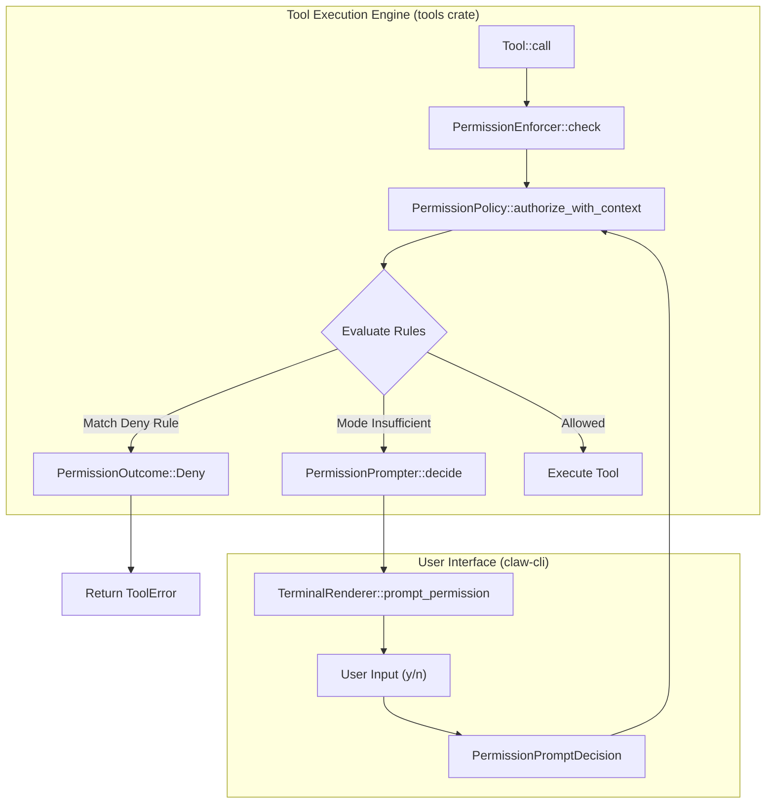
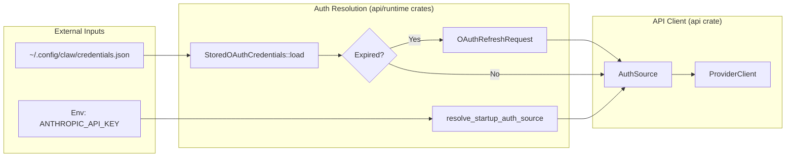

<!-- source: DeepWiki mcp.deepwiki.com · repo ultraworkers/claw-code · page 4.2 Permission Modes and OAuth · fetched 2026-10-27 -->

# Permission Modes and OAuth

Relevant source files

The following files were used as context for generating this wiki page:

- [rust/crates/runtime/src/approval_tokens.rs](rust/crates/runtime/src/approval_tokens.rs)
- [rust/crates/runtime/src/compact.rs](rust/crates/runtime/src/compact.rs)
- [rust/crates/runtime/src/conversation.rs](rust/crates/runtime/src/conversation.rs)
- [rust/crates/runtime/src/g004_conformance.rs](rust/crates/runtime/src/g004_conformance.rs)
- [rust/crates/runtime/src/hooks.rs](rust/crates/runtime/src/hooks.rs)
- [rust/crates/runtime/src/lsp_client.rs](rust/crates/runtime/src/lsp_client.rs)
- [rust/crates/runtime/src/mcp_tool_bridge.rs](rust/crates/runtime/src/mcp_tool_bridge.rs)
- [rust/crates/runtime/src/oauth.rs](rust/crates/runtime/src/oauth.rs)
- [rust/crates/runtime/src/permission_enforcer.rs](rust/crates/runtime/src/permission_enforcer.rs)
- [rust/crates/runtime/src/permissions.rs](rust/crates/runtime/src/permissions.rs)
- [rust/crates/runtime/src/plugin_lifecycle.rs](rust/crates/runtime/src/plugin_lifecycle.rs)
- [rust/crates/runtime/src/prompt.rs](rust/crates/runtime/src/prompt.rs)
- [rust/crates/runtime/src/session.rs](rust/crates/runtime/src/session.rs)
- [rust/crates/runtime/src/stale_branch.rs](rust/crates/runtime/src/stale_branch.rs)
- [rust/crates/runtime/src/team_cron_registry.rs](rust/crates/runtime/src/team_cron_registry.rs)
- [rust/crates/runtime/tests/fixtures/g004_contract_bundle.valid.json](rust/crates/runtime/tests/fixtures/g004_contract_bundle.valid.json)
- [rust/crates/runtime/tests/g004_conformance.rs](rust/crates/runtime/tests/g004_conformance.rs)
- [rust/crates/rusty-claude-cli/src/render.rs](rust/crates/rusty-claude-cli/src/render.rs)

This page details the security architecture of the `claw-code` environment, focusing on how user intent is gated through permission modes and how the system securely authenticates with providers using OAuth2 PKCE.

## Permission Modes

Claw implements a multi-tier permission system to protect the user's local environment from unintended model actions. This is governed by the `PermissionMode` enum and enforced via a `PermissionPolicy`.

### PermissionMode Enum
The `PermissionMode` defines the baseline level of trust granted to the model during a session.

| Mode | Description |
| :--- | :--- |
| `ReadOnly` | The model can read files and state but cannot modify the workspace or execute commands. |
| `WorkspaceWrite` | The model can modify files and perform git operations but requires confirmation for dangerous actions. |
| `DangerFullAccess` | The model has full permission to execute shell commands and modify the system without prompts. |
| `Prompt` | Explicitly forces a user prompt for the associated tool. |
| `Allow` | Explicitly allows the tool regardless of global mode. |

Sources: [rust/crates/runtime/src/permissions.rs:8-15]()

### Enforcement and Policy
The `PermissionPolicy` is the central engine for authorization. It evaluates the `active_mode` against `tool_requirements` and a set of `PermissionRule` objects (allow/deny/ask) parsed from the runtime configuration.

- **`PermissionPolicy::authorize`**: The primary entry point for checking if a tool can be executed with specific input [rust/crates/runtime/src/permissions.rs:175-182]().
- **`PermissionContext`**: Supports overrides provided by hooks or higher-level orchestration, allowing specific tool calls to be forced into `Allow`, `Deny`, or `Ask` states [rust/crates/runtime/src/permissions.rs:39-43]().
- **`PermissionEnforcer`**: A wrapper around the policy used by the tool execution engine to check permissions before dispatching. It includes specific logic for classifying file writes and bash commands [rust/crates/runtime/src/permission_enforcer.rs:27-29]().
- **`PermissionPrompter`**: A trait used when the policy requires interactive approval. It takes a `PermissionRequest` and returns a `PermissionPromptDecision` [rust/crates/runtime/src/permissions.rs:86-88]().

### Tool-Specific Validation
The `PermissionEnforcer` provides specialized checks for high-risk tools:

- **`check_file_write`**: Validates whether a path is within the `workspace_root` when in `WorkspaceWrite` mode. It denies writes in `ReadOnly` mode and allows them everywhere in `DangerFullAccess` [rust/crates/runtime/src/permission_enforcer.rs:108-142]().
- **`check_bash`**: Classifies shell commands. In `ReadOnly` mode, it only allows commands classified as read-only. It denies non-read-only commands unless the mode is elevated [rust/crates/runtime/src/permission_enforcer.rs:145-174]().

### Policy Exceptions and Approval Tokens
For scenarios where a global policy must be bypassed for a specific action, Claw implements an approval token system.
- **`ApprovalScope`**: Defines the specific policy, action, and optional repository/branch where an exception is granted [rust/crates/runtime/src/approval_tokens.rs:4-10]().
- **`ApprovalTokenGrant`**: Represents a machine-readable grant with a `status` (Pending, Granted, Consumed, Expired, Revoked) [rust/crates/runtime/src/approval_tokens.rs:118-129]().
- **`ApprovalTokenLedger`**: An in-memory ledger that manages token lifecycle and verification [rust/crates/runtime/src/approval_tokens.rs:207-210]().

### Entity Relationship: Permissions
The following diagram illustrates how permission requests flow from a tool execution to the user.

**Permission Request Flow**

Sources: [rust/crates/runtime/src/permissions.rs:99-105](), [rust/crates/runtime/src/permissions.rs:186-215](), [rust/crates/runtime/src/permission_enforcer.rs:39-46]()

---

## OAuth2 Authentication

Claw supports OAuth2 with Proof Key for Code Exchange (PKCE) for secure authentication, primarily targeting frontier model providers and remote MCP servers.

### PKCE Flow Implementation
The authentication flow is managed through several data structures in the `runtime` crate:

1.  **`PkceCodePair`**: Contains the `verifier` and the `challenge` (using `S256`) used to prove the client's identity without a client secret [rust/crates/runtime/src/oauth.rs:23-27]().
2.  **`OAuthAuthorizationRequest`**: Constructs the URL for browser-based login, including `client_id`, `redirect_uri`, `state`, and the `code_challenge` [rust/crates/runtime/src/oauth.rs:46-55]().
3.  **`OAuthTokenExchangeRequest`**: Used to exchange the temporary `code` received at the callback port for a long-lived `OAuthTokenSet` [rust/crates/runtime/src/oauth.rs:59-66]().
4.  **`OAuthRefreshRequest`**: Uses a `refresh_token` to obtain a new `access_token` when the current one expires [rust/crates/runtime/src/oauth.rs:70-75]().

### Credential Storage
Tokens are persisted as `OAuthTokenSet` which includes the `access_token`, `refresh_token`, and `expires_at` timestamp [rust/crates/runtime/src/oauth.rs:14-19](). Internally, these are handled by `StoredOAuthCredentials` for serialization compatibility [rust/crates/runtime/src/oauth.rs:88-96]().

---

## API Client AuthSource

The `api` crate abstracts authentication into the `AuthSource` enum, allowing the `ProviderClient` to function regardless of the credential type.

### AuthSource Variants
- `ApiKey(String)`: Standard API key.
- `BearerToken(String)`: OAuth access token.
- `None`: No authentication.

### Resolution and Refresh
The system resolves authentication at startup. If an OAuth token is used, the runtime checks the `expires_at` field. If expired, it initiates an `OAuthRefreshRequest` using the stored `refresh_token`.

**Authentication Resolution and Data Flow**

Sources: [rust/crates/runtime/src/oauth.rs:14-19](), [rust/crates/runtime/src/oauth.rs:120-138](), [rust/crates/runtime/src/oauth.rs:70-75]()

### Key Entities
| Entity | File | Description |
| :--- | :--- | :--- |
| `PermissionPolicy` | [rust/crates/runtime/src/permissions.rs:99-105]() | The engine that matches tool calls against `PermissionMode`. |
| `PermissionEnforcer` | [rust/crates/runtime/src/permission_enforcer.rs:27-29]() | High-level enforcement layer used during tool dispatch. |
| `OAuthTokenSet` | [rust/crates/runtime/src/oauth.rs:14-19]() | The data structure for persisted OAuth credentials. |
| `ApprovalTokenLedger` | [rust/crates/runtime/src/approval_tokens.rs:208-210]() | In-memory ledger for managing policy exceptions. |

Sources: [rust/crates/runtime/src/permissions.rs:1-150](), [rust/crates/runtime/src/permission_enforcer.rs:1-100](), [rust/crates/runtime/src/oauth.rs:1-80](), [rust/crates/runtime/src/approval_tokens.rs:1-210]()

---

