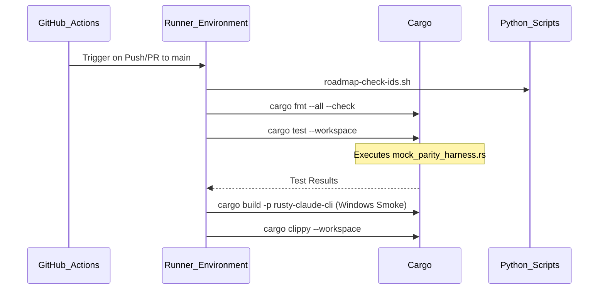

<!-- source: DeepWiki mcp.deepwiki.com · repo ultraworkers/claw-code · page 5 Testing and CI · fetched 2026-10-27 -->

# Testing and CI

<details>
<summary>Relevant source files</summary>

The following files were used as context for generating this wiki page:

- [.github/workflows/rust-ci.yml](.github/workflows/rust-ci.yml)
- [PARITY.md](PARITY.md)
- [docs/g007-plugin-mcp-verification-map.md](docs/g007-plugin-mcp-verification-map.md)
- [rust/MOCK_PARITY_HARNESS.md](rust/MOCK_PARITY_HARNESS.md)
- [rust/crates/mock-anthropic-service/src/lib.rs](rust/crates/mock-anthropic-service/src/lib.rs)
- [rust/crates/rusty-claude-cli/tests/mock_parity_harness.rs](rust/crates/rusty-claude-cli/tests/mock_parity_harness.rs)
- [rust/mock_parity_scenarios.json](rust/mock_parity_scenarios.json)
- [rust/scripts/run_mock_parity_diff.py](rust/scripts/run_mock_parity_diff.py)
- [scripts/dogfood-probe.py](scripts/dogfood-probe.py)
- [scripts/roadmap-check-ids.sh](scripts/roadmap-check-ids.sh)
- [scripts/roadmap-next-id.sh](scripts/roadmap-next-id.sh)
- [tests/__init__.py](tests/__init__.py)
- [tests/test_roadmap_helpers.py](tests/test_roadmap_helpers.py)

</details>


The `claw-code` repository employs a multi-layered testing strategy to ensure the reliability of the production Rust implementation while maintaining behavioral parity with the original system specifications. The testing infrastructure covers unit-level logic, complex integration scenarios involving deterministic mock services, and automated CI pipelines for cross-platform verification.

### Testing Architecture Overview

The testing surface is divided into two primary domains: the **Rust Workspace**, which contains the core production logic and high-performance components, and the **Python Workspace**, which serves as a clean-room verification and porting layer.

#### Component Testing Map
The following diagram illustrates how testing entities map to specific code modules and external boundaries.

**System Testing Map**
```mermaid
graph TD
    subgraph "Rust_Workspace_[rust/]"
        [cargo_test] --> [mock_parity_harness.rs]
        [mock_parity_harness.rs] --> [MockAnthropicService]
        [mock_parity_harness.rs] --> [HarnessWorkspace]
        [MockAnthropicService] --> [api_crate]
    end

    subgraph "Python_Workspace_[src/]"
        [unittest] --> [test_roadmap_helpers.py]
    end

    subgraph "External_Mock_Boundaries"
        [MockAnthropicService] -- "implements" --> [v1_messages_endpoint]
        [MockAnthropicService] -- "uses" --> [SCENARIO_PREFIX]
        [mock_parity_harness.rs] -- "validates" --> [mock_parity_scenarios.json]
    end
```
Sources: [rust/crates/mock-anthropic-service/src/lib.rs:13-24](), [rust/crates/rusty-claude-cli/tests/mock_parity_harness.rs:15-28](), [rust/mock_parity_scenarios.json:1-109](), [tests/test_roadmap_helpers.py:37-41]()

---

### Rust Test Suite

The Rust test suite focuses on the robustness of the core crates and the CLI binary. It utilizes asynchronous runtimes for integration and standard `#[test]` blocks for unit logic.

*   **Mock Parity Harness**: Located in `rust/crates/rusty-claude-cli/tests/mock_parity_harness.rs`, this is the primary behavioral verification suite [rust/crates/rusty-claude-cli/tests/mock_parity_harness.rs:15-17](). It uses a deterministic `MockAnthropicService` [rust/crates/mock-anthropic-service/src/lib.rs:26-31]() to simulate LLM responses across 12 scripted scenarios defined in `rust/mock_parity_scenarios.json` [rust/mock_parity_scenarios.json:1-109](). These include `streaming_text`, `read_file_roundtrip`, `bash_permission_prompt_approved`, and `plugin_tool_roundtrip` [rust/crates/rusty-claude-cli/tests/mock_parity_harness.rs:30-150]().
*   **MCP and Plugin Lifecycle**: The suite includes specific tests for degraded startup modes, such as `manager_discovery_report_keeps_healthy_servers_when_one_server_fails` [docs/g007-plugin-mcp-verification-map.md:25-26](), ensuring that a single failing MCP server does not crash the entire runtime.
*   **Parity Diffing**: The script `rust/scripts/run_mock_parity_diff.py` automates the comparison between harness results and the `PARITY.md` status document, ensuring that every implemented feature (like the 9-lane checkpoint) has a corresponding test scenario and documentation reference [PARITY.md:38-51]().
*   **Workspace Isolation**: Tests verify that `SessionStore` correctly namespaces on-disk session files by workspace fingerprint to prevent collisions [PARITY.md:131-133]().

For details, see [Rust Test Suite](#5.1).

Sources: [rust/crates/rusty-claude-cli/tests/mock_parity_harness.rs:15-193](), [PARITY.md:38-51](), [docs/g007-plugin-mcp-verification-map.md:25-39](), [rust/mock_parity_scenarios.json:1-109]()

---

### Python Test Suite

The Python workspace uses the `unittest` framework to ensure the porting layer and repository maintenance scripts remain synchronized with the original specifications.

*   **Roadmap ID Guard**: The `tests/test_roadmap_helpers.py` suite validates the `scripts/roadmap-check-ids.sh` and `scripts/roadmap-next-id.sh` scripts [tests/test_roadmap_helpers.py:37-41](). This prevents duplicate numeric IDs in `ROADMAP.md` during concurrent development [scripts/roadmap-check-ids.sh:1-12]().
*   **Dogfood Probes**: The `scripts/dogfood-probe.py` utility is tested to ensure it correctly labels timeouts and product errors during diagnostic runs [tests/test_roadmap_helpers.py:126-139]().

For details, see [Python Test Suite and CI Pipeline](#5.2).

Sources: [tests/test_roadmap_helpers.py:37-149](), [scripts/roadmap-check-ids.sh:1-12](), [scripts/dogfood-probe.py:1-41]()

---

### CI Pipeline Configuration

The project uses GitHub Actions to automate verification across Ubuntu and Windows environments.

| Stage | Tool | Purpose |
| :--- | :--- | :--- |
| **Doc Truth** | `check_doc_source_of_truth.py` | Validates documentation consistency and branding [.github/workflows/rust-ci.yml:75-76](). |
| **Roadmap Guard**| `roadmap-check-ids.sh` | Prevents ID collisions in the project roadmap [.github/workflows/rust-ci.yml:79-80](). |
| **Linting** | `cargo clippy` | Enforces workspace-wide lints [.github/workflows/rust-ci.yml:110-122](). |
| **Format** | `cargo fmt` | Enforces consistent coding style [.github/workflows/rust-ci.yml:84-96](). |
| **Test** | `cargo test` | Executes workspace-wide unit and integration tests [.github/workflows/rust-ci.yml:98-108](). |
| **Windows Smoke** | `pwsh` | Validates CLI basic commands on Windows runners [.github/workflows/rust-ci.yml:124-161]().

**CI Workflow Sequence**

Sources: [.github/workflows/rust-ci.yml:63-161](), [rust/MOCK_PARITY_HARNESS.md:30-42]()

For details, see [Python Test Suite and CI Pipeline](#5.2).

---

