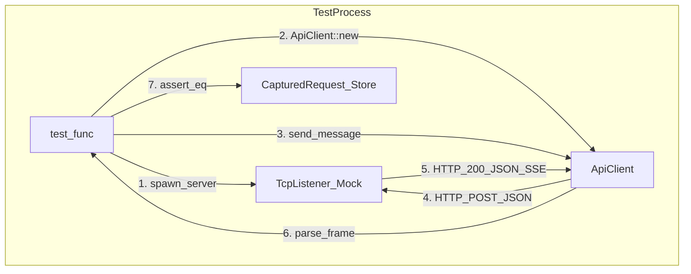
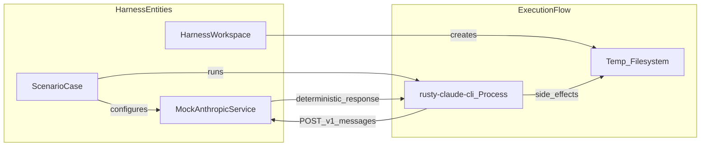

<!-- source: DeepWiki mcp.deepwiki.com · repo ultraworkers/claw-code · page 5.1 Rust Test Suite · fetched 2026-10-27 -->

# Rust Test Suite

Relevant source files

The following files were used as context for generating this wiki page:

- [PARITY.md](PARITY.md)
- [docs/g007-plugin-mcp-verification-map.md](docs/g007-plugin-mcp-verification-map.md)
- [rust/MOCK_PARITY_HARNESS.md](rust/MOCK_PARITY_HARNESS.md)
- [rust/crates/api/tests/provider_client_integration.rs](rust/crates/api/tests/provider_client_integration.rs)
- [rust/crates/mock-anthropic-service/Cargo.toml](rust/crates/mock-anthropic-service/Cargo.toml)
- [rust/crates/mock-anthropic-service/src/lib.rs](rust/crates/mock-anthropic-service/src/lib.rs)
- [rust/crates/mock-anthropic-service/src/main.rs](rust/crates/mock-anthropic-service/src/main.rs)
- [rust/crates/runtime/src/green_contract.rs](rust/crates/runtime/src/green_contract.rs)
- [rust/crates/runtime/src/policy_engine.rs](rust/crates/runtime/src/policy_engine.rs)
- [rust/crates/runtime/tests/integration_tests.rs](rust/crates/runtime/tests/integration_tests.rs)
- [rust/crates/rusty-claude-cli/tests/cli_flags_and_config_defaults.rs](rust/crates/rusty-claude-cli/tests/cli_flags_and_config_defaults.rs)
- [rust/crates/rusty-claude-cli/tests/compact_output.rs](rust/crates/rusty-claude-cli/tests/compact_output.rs)
- [rust/crates/rusty-claude-cli/tests/mock_parity_harness.rs](rust/crates/rusty-claude-cli/tests/mock_parity_harness.rs)
- [rust/crates/rusty-claude-cli/tests/resume_slash_commands.rs](rust/crates/rusty-claude-cli/tests/resume_slash_commands.rs)
- [rust/mock_parity_scenarios.json](rust/mock_parity_scenarios.json)
- [rust/scripts/run_mock_parity_diff.py](rust/scripts/run_mock_parity_diff.py)
- [rust/scripts/run_mock_parity_harness.sh](rust/scripts/run_mock_parity_harness.sh)

The Rust test suite provides a comprehensive verification layer for the production implementation of the Claw workspace. It spans low-level unit tests for runtime logic, integration tests for API client interactions with mocked providers, and end-to-end parity testing using a deterministic mock service.

## Overview of Testing Strategy

The test suite is organized into three primary layers:
1.  **Unit Tests**: Located within the `src/` directory of individual crates (e.g., `api`, `runtime`, `tools`), focusing on isolated logic like SSE parsing or session compaction.
2.  **Integration Tests**: Located in `tests/` directories, primarily used for verifying the `api` and `runtime` crates against simulated network conditions and cross-module wiring [rust/crates/runtime/tests/integration_tests.rs:1-5]().
3.  **Mocking Infrastructure**: The `mock-anthropic-service` crate provides a deterministic HTTP server that simulates LLM providers to verify request serialization and parity across complex tool-use scenarios [rust/crates/rusty-claude-cli/tests/mock_parity_harness.rs:10-12](), [rust/crates/mock-anthropic-service/src/lib.rs:26-31]().

### Data Flow in Integration Tests

The following diagram illustrates the data flow during an API integration test where a `TcpListener` mocks a remote provider.

**API Integration Test Flow**

Sources: [rust/crates/mock-anthropic-service/src/lib.rs:34-60](), [rust/crates/mock-anthropic-service/src/lib.rs:142-164]()

## API Client Integration Tests

The `api` crate contains integration tests to ensure compatibility with various LLM providers and correct handling of streaming responses.

### Key Test Files
*   **`provider_client_integration.rs`**: Validates `ProviderClient` logic for model alias resolution (e.g., `grok-mini` routing to `ProviderKind::Xai`) and credential validation [rust/crates/api/tests/provider_client_integration.rs:7-33](). It also tests `AuthSource` injection to ensure explicit keys bypass environment lookups [rust/crates/api/tests/provider_client_integration.rs:35-48]().

Sources: [rust/crates/api/tests/provider_client_integration.rs:1-88]()

## Mock Parity Harness

The `mock_parity_harness.rs` is a high-level integration suite that ensures the Rust implementation maintains behavioral parity with the original specification across development lanes [PARITY.md:13-17]().

### Scenario-Based Testing
The harness uses a manifest of scenarios (e.g., `streaming_text`, `read_file_roundtrip`) to drive end-to-end tests against the `MockAnthropicService` [rust/crates/rusty-claude-cli/tests/mock_parity_harness.rs:18-30](), [rust/mock_parity_scenarios.json:1-109]().

**Parity Harness Entity Mapping**

Sources: [rust/crates/rusty-claude-cli/tests/mock_parity_harness.rs:166-183](), [rust/crates/rusty-claude-cli/tests/mock_parity_harness.rs:31-151](), [rust/crates/mock-anthropic-service/src/lib.rs:142-164]()

### Validated Scenarios
*   **`read_file_roundtrip`**: Exercises `read_file` tool execution and final assistant synthesis [rust/crates/rusty-claude-cli/tests/mock_parity_harness.rs:42-50]().
*   **`bash_permission_prompt_approved`**: Exercises escalation from `workspace-write` to `bash` with user approval via `stdin` [rust/crates/rusty-claude-cli/tests/mock_parity_harness.rs:102-110]().
*   **`auto_compact_triggered`**: Verifies session compaction when cumulative input tokens exceed thresholds [rust/crates/rusty-claude-cli/tests/mock_parity_harness.rs:132-140]().
*   **`token_cost_reporting`**: Confirms usage token counts and `estimated_cost` appear in JSON output [rust/crates/rusty-claude-cli/tests/mock_parity_harness.rs:141-150]().

Sources: [rust/crates/rusty-claude-cli/tests/mock_parity_harness.rs:1-193](), [rust/mock_parity_scenarios.json:1-109]()

## Runtime Integration Tests

Tests in `integration_tests.rs` verify that lane signals correctly trigger policy actions via the `PolicyEngine` [rust/crates/runtime/tests/integration_tests.rs:19-44]().

### Policy and Lane Evaluation
*   **`StaleBranch`**: A branch behind the `STALE_BRANCH_THRESHOLD` (1 hour) generates a `MergeForward` or `Rebase` action [rust/crates/runtime/tests/integration_tests.rs:19-44](), [rust/crates/runtime/src/policy_engine.rs:7-8](), [rust/crates/runtime/src/policy_engine.rs:71]().
*   **`GreenContract`**: Verifies that a lane must meet a specific `GreenLevel` (e.g., `Workspace`) before being mergeable [rust/crates/runtime/tests/integration_tests.rs:72-83](), [rust/crates/runtime/src/green_contract.rs:5-10]().
*   **`ReconcileReason`**: Ensures that lanes already merged or superseded are handled by `PolicyCondition::LaneReconciled` [rust/crates/runtime/tests/integration_tests.rs:114-146](), [rust/crates/runtime/src/policy_engine.rs:107-116]().

Sources: [rust/crates/runtime/tests/integration_tests.rs:1-211](), [rust/crates/runtime/src/policy_engine.rs:1-236](), [rust/crates/runtime/src/green_contract.rs:1-219]()

## CLI and Resume Tests

Integration tests for the CLI verify that flags, settings, and session resumption work end-to-end.

*   **Slash Command Resumption**: The `resumed_binary_accepts_slash_commands_with_arguments` test verifies that the CLI can resume a session from a JSONL file and execute commands like `/export` and `/clear` [rust/crates/rusty-claude-cli/tests/resume_slash_commands.rs:15-81]().
*   **Config Loading**: Tests verify that settings are merged from global, project, and local sources (e.g., `settings.local.json`) [rust/crates/rusty-claude-cli/tests/resume_slash_commands.rs:116-176](), [rust/crates/rusty-claude-cli/tests/cli_flags_and_config_defaults.rs:133-186]().
*   **Status Flags**: Verifies that `--model` and `--permission-mode` CLI flags correctly override default configurations [rust/crates/rusty-claude-cli/tests/cli_flags_and_config_defaults.rs:12-38]().
*   **Resume Latest**: Ensures the CLI can automatically restore the most recent managed session in a workspace [rust/crates/rusty-claude-cli/tests/resume_slash_commands.rs:179-196]().

Sources: [rust/crates/rusty-claude-cli/tests/resume_slash_commands.rs:1-196](), [rust/crates/rusty-claude-cli/tests/cli_flags_and_config_defaults.rs:1-195]()

## Compact Output Tests

The `compact_output.rs` suite ensures that the `--compact` flag correctly filters terminal output to only show the final assistant response, suppressing tool call IDs and thinking spinners [rust/crates/rusty-claude-cli/tests/compact_output.rs:15-79]().

| Test Case | Verified Behavior |
| :--- | :--- |
| `compact_flag_prints_only_final_assistant_text` | Suppresses `toolu_` IDs and JSON envelopes [rust/crates/rusty-claude-cli/tests/compact_output.rs:65-72](). |
| `compact_flag_streaming_text_only` | Emits exactly the final message text followed by a newline [rust/crates/rusty-claude-cli/tests/compact_output.rs:124-127](). |

Sources: [rust/crates/rusty-claude-cli/tests/compact_output.rs:1-179]()

## Workflow: Cargo Test

The test suite is executed via standard `cargo` commands.

### Execution Commands
*   **Run all tests**: `cargo test`
*   **Run parity harness**: `cargo test -p rusty-claude-cli --test mock_parity_harness`
*   **Run runtime integration**: `cargo test -p runtime --test integration_tests` [rust/crates/runtime/tests/integration_tests.rs:1-5]()

### CI Integration
The `sandbox.rs` module probes for `unshare` capabilities to avoid failures in restricted CI environments like GitHub Actions [PARITY.md:72-75](). Parity status is tracked via `PARITY.md` and verified using `rust/scripts/run_mock_parity_diff.py` [PARITY.md:7-11]().

Sources: [PARITY.md:1-108](), [rust/MOCK_PARITY_HARNESS.md:1-51]()

---

