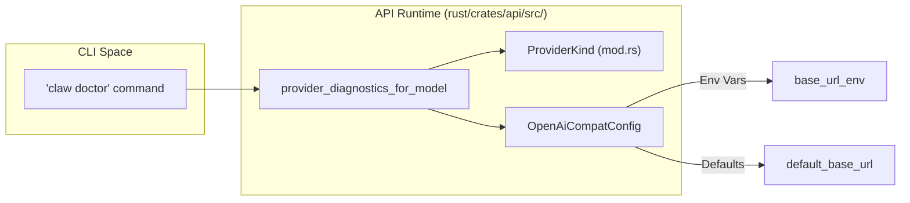

<!-- source: DeepWiki mcp.deepwiki.com · repo ultraworkers/claw-code · extra page Model Compatibility and Provider Routing · fetched 2026-10-27 -->

# Model Compatibility and Provider Routing

<details>
<summary>Relevant source files</summary>

The following files were used as context for generating this wiki page:

- [docs/MODEL_COMPATIBILITY.md](docs/MODEL_COMPATIBILITY.md)
- [prd.json](prd.json)
- [progress.txt](progress.txt)
- [rust/crates/api/benches/request_building.rs](rust/crates/api/benches/request_building.rs)
- [rust/crates/api/src/error.rs](rust/crates/api/src/error.rs)
- [rust/crates/api/src/providers/anthropic.rs](rust/crates/api/src/providers/anthropic.rs)
- [rust/crates/api/src/providers/mod.rs](rust/crates/api/src/providers/mod.rs)
- [rust/crates/api/src/providers/openai_compat.rs](rust/crates/api/src/providers/openai_compat.rs)
- [rust/crates/api/tests/openai_compat_integration.rs](rust/crates/api/tests/openai_compat_integration.rs)
- [rust/crates/api/tests/provider_client_integration.rs](rust/crates/api/tests/provider_client_integration.rs)

</details>


The `claw-code` API client provides a unified interface for multiple LLM providers. While the Anthropic provider is primary, the OpenAI-compatible provider (`openai_compat.rs`) implements extensive model-specific logic to normalize behavior across diverse backends like OpenAI, xAI, and Alibaba DashScope. This page details the routing logic, parameter stripping for reasoning models, and the specialized handling required for compatibility with various "OpenAI-compatible" endpoints, including local providers like Ollama.

## Overview

The `OpenAiCompatClient` translates internal `MessageRequest` objects into the OpenAI Chat Completions format. Because many providers claim OpenAI compatibility but vary in their strictness regarding specific fields (e.g., `is_error` in tool results or sampling parameters in reasoning models), the client applies a series of transformations based on the resolved model name.

**Core Responsibilities:**
*   **Model Alias Resolution:** Mapping short names like `grok` or `kimi` to canonical IDs [rust/crates/api/src/providers/mod.rs:206-232]().
*   **Parameter Stripping:** Removing incompatible sampling fields for reasoning models [docs/MODEL_COMPATIBILITY.md:60-75]().
*   **Field Normalization:** Swapping `max_tokens` for `max_completion_tokens` where required [docs/MODEL_COMPATIBILITY.md:98-111]().
*   **Provider Routing:** Directing requests to specific base URLs (e.g., DashScope for Qwen/Kimi) based on model prefixes [rust/crates/api/src/providers/openai_compat.rs:83-96]().
*   **Local Provider Support:** Specialized setup for Ollama, llama.cpp, and vLLM [rust/crates/api/src/providers/openai_compat.rs:52-58]().

### Request Flow and Entity Mapping

The following diagram illustrates how a generic request is routed and transformed into a provider-specific payload.

**Model Routing and Transformation Pipeline**

```mermaid
graph TD
    subgraph "Natural Language Space"
        User["User Prompt / CLI Flag"]
    end

    subgraph "Code Entity Space (rust/crates/api/src/)"
        MR["MessageRequest (types.rs)"]
        RAM["resolve_model_alias (providers/mod.rs)"]
        OACC["OpenAiCompatClient (providers/openai_compat.rs)"]
        BCCR["build_chat_completion_request"]
        
        subgraph "Compatibility Logic"
            IRM["is_reasoning_model"]
            MRIE["model_rejects_is_error_field"]
        end
    end

    User -->|"--model grok"| RAM
    RAM -->| "grok-3" | MR
    MR --> OACC
    OACC --> BCCR
    BCCR --> IRM
    BCCR --> MRIE
    
    IRM -->| "If true" | Strip["Strip temperature/top_p"]
    MRIE -->| "If true (Kimi)" | Exclude["Exclude is_error from ToolResults"]
    
    Exclude --> Final["Final JSON Payload"]
    Strip --> Final
```
Sources: [rust/crates/api/src/providers/mod.rs:206-232](), [rust/crates/api/src/providers/openai_compat.rs:172-200](), [docs/MODEL_COMPATIBILITY.md:158-174]()

---

## Model-Specific Handling

### Reasoning Models and Parameter Stripping
Reasoning models (Chain-of-Thought) often use fixed sampling strategies and will reject standard OpenAI parameters with a `400 Bad Request`. 

*   **Affected Models:** OpenAI `o1`/`o3`/`o4`, xAI `grok-3-mini`, and Alibaba `qwen-qwq` or `qwen3-*-thinking` [docs/MODEL_COMPATIBILITY.md:62-65]().
*   **Implementation:** The function `is_reasoning_model` detects these via prefix matching [docs/MODEL_COMPATIBILITY.md:79-92]().
*   **Stripped Fields:** `temperature`, `top_p`, `frequency_penalty`, and `presence_penalty` [docs/MODEL_COMPATIBILITY.md:67-71]().

### Kimi and DashScope Routing
Models from the Kimi family and Qwen family are routed through Alibaba's DashScope compatible-mode endpoint.

*   **Base URL:** `https://dashscope.aliyuncs.com/compatible-mode/v1` [rust/crates/api/src/providers/openai_compat.rs:23-23]().
*   **Authentication:** Uses `DASHSCOPE_API_KEY` [rust/crates/api/src/providers/openai_compat.rs:45-45]().
*   **Kimi `is_error` Exclusion:** Kimi models (e.g., `kimi-k2.5`) specifically reject the `is_error` field in tool result blocks, returning a `400 Bad Request` if present [docs/MODEL_COMPATIBILITY.md:37-45](). The client detects `kimi` in the model name via `model_rejects_is_error_field` and excludes this field during message translation [docs/MODEL_COMPATIBILITY.md:31-53]().

### GPT-5 Token Handling
Future-proofing for GPT-5 includes a transition from the `max_tokens` field to `max_completion_tokens`.
*   **Behavior:** If the model ID starts with `gpt-5`, the request payload uses `max_completion_tokens` [docs/MODEL_COMPATIBILITY.md:115-120]().

---

## Local Providers and Custom Gateways

### Local Provider Setup (Ollama, vLLM)
`claw-code` supports local inference engines that provide OpenAI-compatible endpoints.

*   **Ollama:** Configured via `OLLAMA_HOST` env var. It defaults to `http://127.0.0.1:11434/v1` and uses a placeholder `ollama` API key [rust/crates/api/src/providers/openai_compat.rs:52-58](), [rust/crates/api/src/providers/openai_compat.rs:162-175]().
*   **Local OpenAI Detection:** If `OPENAI_BASE_URL` points to a local address (e.g., `127.0.0.1`, `localhost`), the client defaults to a `local-dev-token` if no key is provided [rust/crates/api/src/providers/openai_compat.rs:146-150]().

### Custom Gateway Support
For users targeting OpenRouter or private gateways, the client supports custom base URLs while preserving complex model slugs.

*   **Slash Preservation:** While the standard OpenAI provider strips prefixes, non-local custom base URLs preserve slash-containing IDs like `openai/gpt-4.1-mini` to ensure gateways receive the exact ID expected [docs/MODEL_COMPATIBILITY.md:146-154]().
*   **Extra Body Parameters:** The `MessageRequest` includes an `extra_body` map allowing passthrough of provider-specific JSON (e.g., `web_search_options`) without overriding core fields like `model` or `messages` [docs/MODEL_COMPATIBILITY.md:153-156]().

---

## Provider Diagnostics and Routing

The `api` crate provides a diagnostic surface used by the `doctor` command to verify connectivity and configuration.

**Diagnostic Data Flow**


Sources: [rust/crates/api/src/providers/mod.rs:104-119](), [rust/crates/api/src/providers/openai_compat.rs:30-41](), [rust/crates/api/tests/provider_client_integration.rs:17-33]()

### Summary Table: Model Compatibility Logic

| Feature | Logic Location | Target Models |
| :--- | :--- | :--- |
| **Alias Resolution** | `resolve_model_alias` | `opus`, `sonnet`, `grok`, `kimi` |
| **Auth Env Var** | `OpenAiCompatConfig` | `XAI_API_KEY`, `DASHSCOPE_API_KEY`, etc. |
| **Reasoning Strip** | `is_reasoning_model` | `o1`, `o3`, `grok-3-mini`, `qwq` |
| **`is_error` Exclusion** | `model_rejects_is_error_field` | `kimi-*` |
| **Token Field Swap** | `build_chat_completion_request` | `gpt-5-*` |
| **Body Passthrough** | `extra_body` map | Custom Gateways (OpenRouter, etc.) |

Sources: [rust/crates/api/src/providers/mod.rs:206-232](), [rust/crates/api/src/providers/openai_compat.rs:52-96](), [docs/MODEL_COMPATIBILITY.md:168-174]()

---

