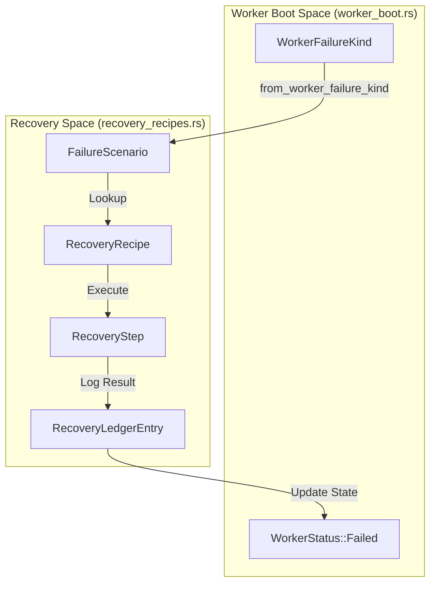
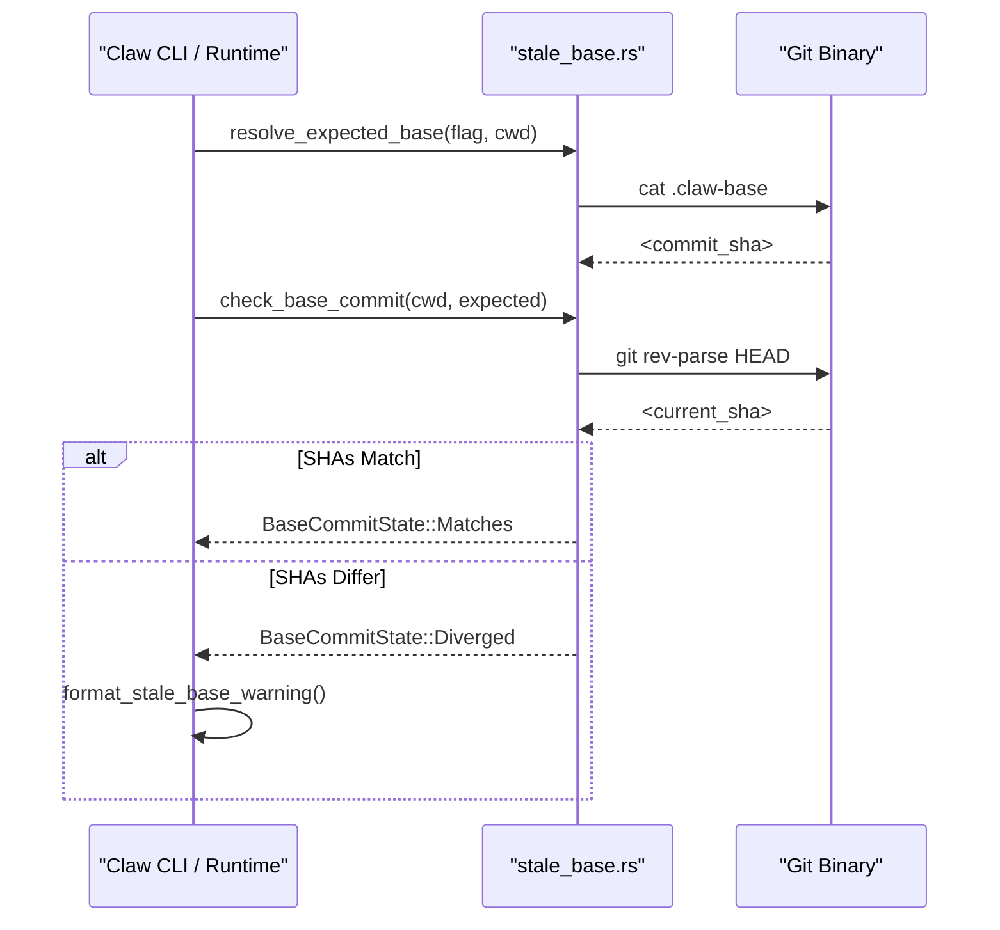

<!-- source: DeepWiki mcp.deepwiki.com · repo ultraworkers/claw-code · extra page Recovery Recipes and Branch Management · fetched 2026-10-27 -->

# Recovery Recipes and Branch Management

Relevant source files

The following files were used as context for generating this wiki page:

- [rust/crates/runtime/src/bash.rs](rust/crates/runtime/src/bash.rs)
- [rust/crates/runtime/src/bash_validation.rs](rust/crates/runtime/src/bash_validation.rs)
- [rust/crates/runtime/src/recovery_recipes.rs](rust/crates/runtime/src/recovery_recipes.rs)
- [rust/crates/runtime/src/session_control.rs](rust/crates/runtime/src/session_control.rs)
- [rust/crates/runtime/src/stale_base.rs](rust/crates/runtime/src/stale_base.rs)
- [rust/crates/runtime/src/trident.rs](rust/crates/runtime/src/trident.rs)
- [rust/crates/runtime/src/worker_boot.rs](rust/crates/runtime/src/worker_boot.rs)

This page details the automated recovery mechanisms for canonical failure scenarios and the logic governing branch health, freshness, and divergence prevention. The system implements a "one-attempt-before-escalation" policy to ensure high autonomy while preventing infinite retry loops.

## Recovery Recipes

The `recovery_recipes.rs` module defines a structured framework for identifying and resolving common failure scenarios during worker startup and operation [rust/crates/runtime/src/recovery_recipes.rs:2-7]().

### Canonical Failure Scenarios
The system recognizes seven specific `FailureScenario` variants [rust/crates/runtime/src/recovery_recipes.rs:18-26]():
1.  **TrustPromptUnresolved**: The environment requires a trust/permission confirmation that was not handled.
2.  **PromptMisdelivery**: The LLM prompt was sent to the wrong target (e.g., a raw shell instead of the agent).
3.  **StaleBranch**: The current worktree has diverged from the expected base commit.
4.  **CompileRedCrossCrate**: A crate in the workspace fails to compile (indicated by a "red cross" status).
5.  **McpHandshakeFailure**: Failure to establish a JSON-RPC handshake with an MCP server.
6.  **PartialPluginStartup**: One or more plugins failed to initialize correctly.
7.  **ProviderFailure**: Errors originating from the LLM provider or transport layer.

### Recovery Steps and Policy
Each scenario maps to a `RecoveryRecipe` containing a sequence of `RecoveryStep` actions [rust/crates/runtime/src/recovery_recipes.rs:101-106]().

| RecoveryStep | Description |
| :--- | :--- |
| `AcceptTrustPrompt` | Automatically attempts to resolve trust gates [rust/crates/runtime/src/recovery_recipes.rs:78](). |
| `RedirectPromptToAgent` | Re-routes misdelivered prompts back to the intended agent process [rust/crates/runtime/src/recovery_recipes.rs:79](). |
| `RebaseBranch` | Performs an automated rebase to resolve `StaleBranch` scenarios [rust/crates/runtime/src/recovery_recipes.rs:80](). |
| `CleanBuild` | Executes a clean build to resolve compilation errors [rust/crates/runtime/src/recovery_recipes.rs:81](). |
| `RetryMcpHandshake` | Retries the MCP connection with a specified timeout [rust/crates/runtime/src/recovery_recipes.rs:82](). |
| `RestartPlugin` | Targeted restart of a specific failed plugin [rust/crates/runtime/src/recovery_recipes.rs:83](). |
| `RestartWorker` | Full restart of the worker process [rust/crates/runtime/src/recovery_recipes.rs:84](). |
| `EscalateToHuman` | Hands off control to the user when automation is exhausted [rust/crates/runtime/src/recovery_recipes.rs:85](). |

The `RecoveryContext` tracks attempt counts per scenario, enforcing a policy where only one automatic attempt is made before escalating via the `EscalationPolicy` [rust/crates/runtime/src/recovery_recipes.rs:104-105, 201-205]().

### Data Flow: Failure to Recovery
The following diagram illustrates how a `WorkerFailureKind` from the boot state machine is bridged into the recovery system.

**Worker Failure Recovery Bridge**

Sources: [rust/crates/runtime/src/worker_boot.rs:57-64](), [rust/crates/runtime/src/recovery_recipes.rs:46-57](), [rust/crates/runtime/src/recovery_recipes.rs:155-169]()

---

## Branch Management and Freshness

Reliability depends on ensuring the agent operates on the correct codebase version. The `stale_base.rs` module provides the divergence guard.

### StaleBase Divergence Guard
The system checks the worktree `HEAD` against an expected base commit resolved from the `--base-commit` flag or a `.claw-base` file [rust/crates/runtime/src/stale_base.rs:38-48]().

*   **BaseCommitState**: Represents the result of the check, including `Matches`, `Diverged`, or `NotAGitRepo` [rust/crates/runtime/src/stale_base.rs:7-16]().
*   **Divergence Detection**: The `check_base_commit` function uses `git rev-parse` to compare SHAs [rust/crates/runtime/src/stale_base.rs:54-87]().
*   **Warning Mechanism**: If diverged, a `format_stale_base_warning` is generated to alert the user that the session may be running against a stale codebase [rust/crates/runtime/src/stale_base.rs:92-103]().

### Session Isolation and Workspace Root
The `SessionStore` ensures that sessions are namespaced by a workspace fingerprint derived from the canonical workspace root [rust/crates/runtime/src/session_control.rs:10-26](). This prevents collisions between parallel instances and ensures `resolve_reference` correctly identifies sessions relative to the `workspace_root` [rust/crates/runtime/src/session_control.rs:95-120]().

### Git Operation Monitoring and Ship Provenance
The `bash.rs` module monitors shell commands to detect high-impact git operations. Specifically, `detect_and_emit_ship_prepared` triggers a `lane.ship.prepared` event when it detects a `git push` to `main` or `master` [rust/crates/runtime/src/bash.rs:108-133](). This event captures `ShipProvenance`, including the `source_branch`, `base_commit`, and the `actor` responsible for the push [rust/crates/runtime/src/bash.rs:117-125]().

**Branch Freshness Verification Flow**

Sources: [rust/crates/runtime/src/stale_base.rs:38-87](), [rust/crates/runtime/src/stale_base.rs:92-103](), [rust/crates/runtime/src/bash.rs:108-133]()

---

## Safety and Validation

All recovery steps involving shell execution (e.g., `CleanBuild`, `RebaseBranch`) are subject to the bash validation pipeline defined in `bash_validation.rs`.

*   **CommandIntent**: Commands are classified into categories like `ReadOnly`, `Write`, `Destructive`, `Network`, `ProcessManagement`, `PackageManagement`, or `SystemAdmin` [rust/crates/runtime/src/bash_validation.rs:26-45]().
*   **Permission Enforcement**: The `validate_read_only` function blocks `WRITE_COMMANDS` (e.g., `rm`, `cp`, `mv`) and `STATE_MODIFYING_COMMANDS` (e.g., `apt`, `cargo`, `docker`) if the session is in `PermissionMode::ReadOnly` [rust/crates/runtime/src/bash_validation.rs:52-94, 103-160]().
*   **Destructive Patterns**: Patterns like `rm -rf /` or fork bombs are flagged as `ValidationResult::Warn` or `Block` [rust/crates/runtime/src/bash_validation.rs:206-232]().

Sources: [rust/crates/runtime/src/bash_validation.rs:26-45](), [rust/crates/runtime/src/bash_validation.rs:52-94](), [rust/crates/runtime/src/bash_validation.rs:103-160]()

---

