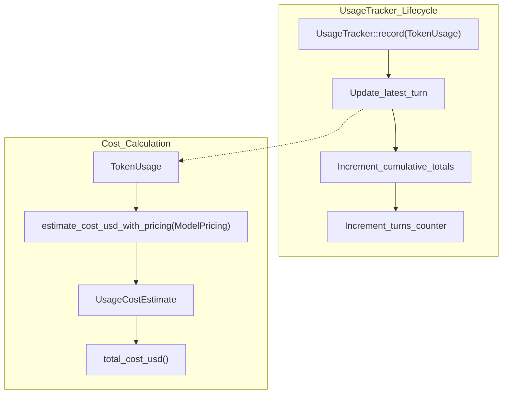
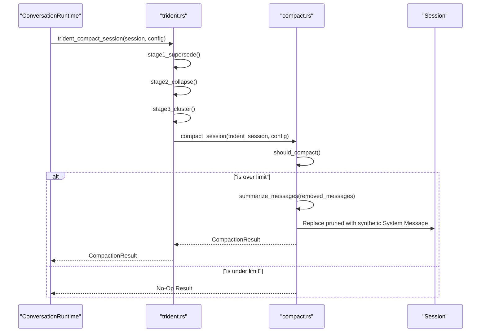

<!-- source: DeepWiki mcp.deepwiki.com · repo ultraworkers/claw-code · extra page Session Management and Compaction · fetched 2026-10-27 -->

# Session Management and Compaction

Relevant source files

The following files were used as context for generating this wiki page:

- [rust/crates/compat-harness/src/lib.rs](rust/crates/compat-harness/src/lib.rs)
- [rust/crates/runtime/src/bash.rs](rust/crates/runtime/src/bash.rs)
- [rust/crates/runtime/src/bash_validation.rs](rust/crates/runtime/src/bash_validation.rs)
- [rust/crates/runtime/src/compact.rs](rust/crates/runtime/src/compact.rs)
- [rust/crates/runtime/src/conversation.rs](rust/crates/runtime/src/conversation.rs)
- [rust/crates/runtime/src/file_ops.rs](rust/crates/runtime/src/file_ops.rs)
- [rust/crates/runtime/src/hooks.rs](rust/crates/runtime/src/hooks.rs)
- [rust/crates/runtime/src/oauth.rs](rust/crates/runtime/src/oauth.rs)
- [rust/crates/runtime/src/prompt.rs](rust/crates/runtime/src/prompt.rs)
- [rust/crates/runtime/src/recovery_recipes.rs](rust/crates/runtime/src/recovery_recipes.rs)
- [rust/crates/runtime/src/session.rs](rust/crates/runtime/src/session.rs)
- [rust/crates/runtime/src/session_control.rs](rust/crates/runtime/src/session_control.rs)
- [rust/crates/runtime/src/summary_compression.rs](rust/crates/runtime/src/summary_compression.rs)
- [rust/crates/runtime/src/trident.rs](rust/crates/runtime/src/trident.rs)
- [rust/crates/runtime/src/usage.rs](rust/crates/runtime/src/usage.rs)
- [rust/crates/runtime/src/worker_boot.rs](rust/crates/runtime/src/worker_boot.rs)
- [rust/crates/rusty-claude-cli/src/render.rs](rust/crates/rusty-claude-cli/src/render.rs)

This page details the technical implementation of conversation persistence and context management within the `claw-code` runtime. It covers how the system serializes interaction history to disk, tracks token usage and associated costs, and performs automated session compaction when token budgets are exceeded.

## Session Data Model

The core of the conversation engine is the `Session` struct, which serves as the container for all interaction history between the user and the assistant.

### Key Entities

*   **`Session`**: The top-level container holding a sequence of messages, prompt history, and metadata like `workspace_root` to prevent cross-project state leakage [rust/crates/runtime/src/session.rs:117-133]().
*   **`ConversationMessage`**: Represents a single turn in the conversation. It includes a `MessageRole`, a list of `ContentBlock`s, and optional `TokenUsage` metadata [rust/crates/runtime/src/session.rs:56-60]().
*   **`MessageRole`**: Enum defining the speaker: `System`, `User`, `Assistant`, or `Tool` [rust/crates/runtime/src/session.rs:24-29]().
*   **`ContentBlock`**: An enum representing different types of message content:
    *   `Text`: Standard prose [rust/crates/runtime/src/session.rs:34-36]().
    *   `Thinking`: Internal model reasoning and signature [rust/crates/runtime/src/session.rs:37-40]().
    *   `ToolUse`: A request from the assistant to execute a specific tool with JSON input [rust/crates/runtime/src/session.rs:41-45]().
    *   `ToolResult`: The output returned by a tool execution, including error status and the original `tool_use_id` [rust/crates/runtime/src/session.rs:46-51]().

### Serialization and Persistence

Sessions are serialized to and from JSON for disk persistence. The `Session` struct provides helper methods to interact with the filesystem:
*   `save_to_path`: Serializes the session and performs atomic writes to disk, including log rotation if the file exceeds `ROTATE_AFTER_BYTES` (256 KB) [rust/crates/runtime/src/session.rs:14-15]().
*   `load_from_path`: Reads a file from disk and parses the JSON content back into a `Session` object [rust/crates/runtime/src/session.rs:240-255]().

**Entity Mapping: Natural Language to Code**

| Concept | Code Entity | File |
| :--- | :--- | :--- |
| Interaction History | `Session` | [rust/crates/runtime/src/session.rs:117]() |
| Message Turn | `ConversationMessage` | [rust/crates/runtime/src/session.rs:56]() |
| Role (User/AI) | `MessageRole` | [rust/crates/runtime/src/session.rs:24]() |
| Tool Call | `ContentBlock::ToolUse` | [rust/crates/runtime/src/session.rs:41]() |
| Tool Output | `ContentBlock::ToolResult` | [rust/crates/runtime/src/session.rs:46]() |
| Session Version | `SESSION_VERSION` | [rust/crates/runtime/src/session.rs:13]() |

Sources: [rust/crates/runtime/src/session.rs:1-255]()

## Token Usage and Pricing

The `UsageTracker` monitors the resource consumption of a session, calculating both token counts and estimated financial costs based on model-specific pricing tiers.

### Token Tracking
The `TokenUsage` struct tracks four distinct categories of tokens [rust/crates/runtime/src/usage.rs:31-36]():
1.  `input_tokens`: Standard prompt tokens.
2.  `output_tokens`: Tokens generated by the model.
3.  `cache_creation_input_tokens`: Tokens written to the provider's context cache.
4.  `cache_read_input_tokens`: Tokens retrieved from the provider's context cache.

### Pricing Tiers
Pricing is determined by the `ModelPricing` struct [rust/crates/runtime/src/usage.rs:9-15](). The system includes hardcoded tiers for specific model families (Haiku, Opus, Sonnet) via the `pricing_for_model` function [rust/crates/runtime/src/usage.rs:59-81]().

### Cost Estimation
The `UsageTracker` aggregates usage across multiple turns [rust/crates/runtime/src/usage.rs:169-173](). It can be initialized from an existing `Session` by iterating through message metadata [rust/crates/runtime/src/usage.rs:182-190]().

**Usage Calculation Flow**

Sources: [rust/crates/runtime/src/usage.rs:1-215]()

## Session Compaction

Compaction is the process of summarizing old conversation history to stay within the model's context window (token budget).

### Compaction Logic
The runtime uses `CompactionConfig` to define thresholds for when compaction should trigger [rust/crates/runtime/src/compact.rs:10-13](). By default, it preserves 4 recent messages and triggers when estimated tokens exceed 10,000 [rust/crates/runtime/src/compact.rs:15-22]().

1.  **`should_compact`**: Determines if the current session exceeds the token limit defined in the configuration [rust/crates/runtime/src/compact.rs:41-51]().
2.  **`estimate_session_tokens`**: Provides a heuristic count of tokens currently in the session by summing `estimate_message_tokens` across all messages [rust/crates/runtime/src/compact.rs:35-37]().
3.  **`compact_session`**: The primary transformation function. It removes older messages, summarizes them, and replaces them with a synthetic system message [rust/crates/runtime/src/compact.rs:96-181]().
4.  **`get_compact_continuation_message`**: Builds the post-compaction system prompt, including the summary and instructions to resume without recap [rust/crates/runtime/src/compact.rs:71-92]().

### Trident Compaction Pipeline
For advanced context management, the `trident_compact_session` function implements a multi-stage pipeline [rust/crates/runtime/src/trident.rs:105-160]():
1.  **Stage 1: Supersede**: Removes obsolete file operations (e.g., intermediate reads of a file that was later overwritten) [rust/crates/runtime/src/trident.rs:179-217]().
2.  **Stage 2: Collapse**: Summarizes long chains of related tool interactions [rust/crates/runtime/src/trident.rs:126-132]().
3.  **Stage 3: Cluster**: Groups similar messages based on content similarity [rust/crates/runtime/src/trident.rs:134-143]().

### Boundary Protection
To prevent 400 errors from providers (like OpenAI), the compaction logic includes a "walk-back" mechanism. If the compaction boundary splits a `ToolUse` and its corresponding `ToolResult`, the logic moves the boundary to ensure the pair stays intact [rust/crates/runtime/src/compact.rs:121-158]().

**Compaction Implementation Architecture**

Sources: [rust/crates/runtime/src/compact.rs:1-181](), [rust/crates/runtime/src/trident.rs:1-160]()

## Workspace Isolation and Session Store

To prevent parallel `opencode serve` instances from colliding, sessions are managed by a `SessionStore` that namespaces files by a workspace fingerprint.

### SessionStore Architecture
*   **`SessionStore`**: Derives a unique hash from the workspace root path and stores sessions in `<data_dir>/sessions/<workspace_hash>/` [rust/crates/runtime/src/session_control.rs:20-26]().
*   **`SessionHandle`**: A reference to a specific session ID and its absolute path on disk [rust/crates/runtime/src/session_control.rs:87-92]().
*   **`SessionControlError`**: A taxonomy of errors including `Format`, `Io`, and `WorkspaceMismatch` [rust/crates/runtime/src/session_control.rs:241-255]().

### Key Operations
*   **`resolve_reference`**: Resolves session IDs or aliases (like `latest`) into a `SessionHandle` [rust/crates/runtime/src/session_control.rs:95-125]().
*   **`latest_session_excluding`**: Find the most recent session, skipping the current empty session to find actual conversation history for resume [rust/crates/runtime/src/session_control.rs:179-200]().
*   **`validate_loaded_session`**: Ensures that a loaded session matches the expected `workspace_root` of the store, preventing "phantom completions" across different projects [rust/crates/runtime/src/session_control.rs:222-239]().

**Workspace Mapping: Filesystem to Code**

| Path Component | Code Logic | File |
| :--- | :--- | :--- |
| `.claw/sessions/` | `SessionStore::from_cwd` | [rust/crates/runtime/src/session_control.rs:32]() |
| `<workspace_hash>` | `workspace_fingerprint()` | [rust/crates/runtime/src/session_control.rs:42]() |
| `<id>.jsonl` | `PRIMARY_SESSION_EXTENSION` | [rust/crates/runtime/src/session_control.rs:91]() |
| `latest` alias | `is_session_reference_alias()` | [rust/crates/runtime/src/session_control.rs:107]() |

Sources: [rust/crates/runtime/src/session_control.rs:1-266](), [rust/crates/runtime/src/session.rs:117-133]()

---

