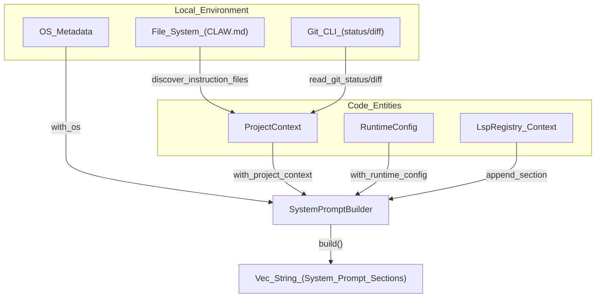
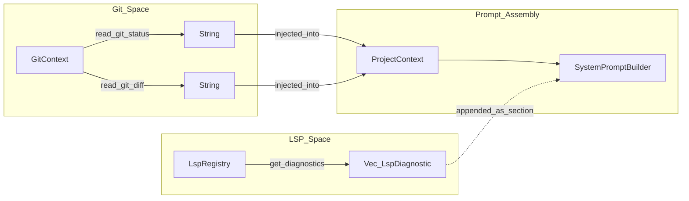

<!-- source: DeepWiki mcp.deepwiki.com · repo ultraworkers/claw-code · extra page System Prompt and Project Context · fetched 2026-10-27 -->

# System Prompt and Project Context

Relevant source files

The following files were used as context for generating this wiki page:

- [rust/crates/runtime/src/compact.rs](rust/crates/runtime/src/compact.rs)
- [rust/crates/runtime/src/conversation.rs](rust/crates/runtime/src/conversation.rs)
- [rust/crates/runtime/src/git_context.rs](rust/crates/runtime/src/git_context.rs)
- [rust/crates/runtime/src/hooks.rs](rust/crates/runtime/src/hooks.rs)
- [rust/crates/runtime/src/lsp_client.rs](rust/crates/runtime/src/lsp_client.rs)
- [rust/crates/runtime/src/mcp_tool_bridge.rs](rust/crates/runtime/src/mcp_tool_bridge.rs)
- [rust/crates/runtime/src/oauth.rs](rust/crates/runtime/src/oauth.rs)
- [rust/crates/runtime/src/permission_enforcer.rs](rust/crates/runtime/src/permission_enforcer.rs)
- [rust/crates/runtime/src/plugin_lifecycle.rs](rust/crates/runtime/src/plugin_lifecycle.rs)
- [rust/crates/runtime/src/prompt.rs](rust/crates/runtime/src/prompt.rs)
- [rust/crates/runtime/src/session.rs](rust/crates/runtime/src/session.rs)
- [rust/crates/runtime/src/stale_branch.rs](rust/crates/runtime/src/stale_branch.rs)
- [rust/crates/runtime/src/team_cron_registry.rs](rust/crates/runtime/src/team_cron_registry.rs)
- [rust/crates/rusty-claude-cli/src/render.rs](rust/crates/rusty-claude-cli/src/render.rs)

The system prompt in `claw-code` is a dynamically assembled multi-section document that defines the AI's identity, capabilities, and environmental awareness. It bridges the gap between static model instructions and the real-time state of the user's local development environment, including Git status, file-based instructions, and Language Server Protocol (LSP) diagnostics.

## SystemPromptBuilder Architecture

The `SystemPromptBuilder` struct in the `runtime` crate is the primary engine for composing the prompt. It follows a builder pattern to collect various context fragments before performing a final ordered join [rust/crates/runtime/src/prompt.rs:155-164]().

### Composition Order
The `build()` function defines a strict sequence for the prompt sections to ensure the model prioritizes identity and safety before processing project-specific data [rust/crates/runtime/src/prompt.rs:211-214]():

1.  **Intro & Style**: Basic identity and optional output formatting styles (e.g., Markdown preferences) [rust/crates/runtime/src/prompt.rs:213-214]().
2.  **System & Tasks**: Core behavioral instructions and task-handling logic.
3.  **Actions**: Definitions of available tools and interaction patterns.
4.  **Dynamic Boundary**: A marker (`__SYSTEM_PROMPT_DYNAMIC_BOUNDARY__`) used to separate static instructions from volatile context [rust/crates/runtime/src/prompt.rs:40-40]().
5.  **Environment**: OS version, current date, working directory, and model family identity [rust/crates/runtime/src/prompt.rs:180-190]().
6.  **Project Context**: Git status, diffs, and discovered instruction files (like `CLAW.md`) encapsulated in `ProjectContext` [rust/crates/runtime/src/prompt.rs:193-196]().
7.  **Runtime Config**: Active configuration settings, including model aliases and permission rules [rust/crates/runtime/src/prompt.rs:199-202]().
8.  **Appended Sections**: External injections such as LSP context, plugin-specific instructions, or custom user sections [rust/crates/runtime/src/prompt.rs:205-208]().

### Data Flow: Context to Prompt
The following diagram illustrates how disparate system entities are aggregated into the `SystemPromptBuilder`.

**Prompt Composition Data Flow**

Sources: [rust/crates/runtime/src/prompt.rs:96-139](), [rust/crates/runtime/src/prompt.rs:166-208](), [rust/crates/runtime/src/lsp_client.rs:110-124]()

## Project Context Discovery

The `ProjectContext` struct encapsulates the volatile state of the workspace. It is populated via discovery methods that scan the environment [rust/crates/runtime/src/prompt.rs:85-93]().

### Instruction File Discovery
The system searches for instruction files starting from the current working directory. The discovery logic is encapsulated in `discover_instruction_files` which is called during context initialization [rust/crates/runtime/src/prompt.rs:101-101]().

Discovery methods include:
*   `ProjectContext::discover`: Standard discovery of instruction files [rust/crates/runtime/src/prompt.rs:96-110]().
*   `ProjectContext::discover_with_git`: Discovery enriched with Git status and diff data [rust/crates/runtime/src/prompt.rs:129-138]().
*   `ProjectContext::discover_with_rules_import`: Discovery that respects specific `RulesImportConfig` settings [rust/crates/runtime/src/prompt.rs:112-127]().

### Budgeting and Deduplication
To prevent context window exhaustion, the builder enforces strict limits on instruction files:
*   **Per-file limit**: 4,000 characters (`MAX_INSTRUCTION_FILE_CHARS`) [rust/crates/runtime/src/prompt.rs:43-43]().
*   **Total limit**: 12,000 characters (`MAX_TOTAL_INSTRUCTION_CHARS`) [rust/crates/runtime/src/prompt.rs:44-44]().

Files are stored as `ContextFile` objects which include both the `PathBuf` and the file `content` [rust/crates/runtime/src/prompt.rs:66-70]().

## Git and LSP Enrichment

### Git Integration
The `GitContext` struct captures the repository state including the current branch, recent commit history, and staged files.
*   `GitContext::detect(cwd)`: Detects the repository state for a given directory [rust/crates/runtime/src/prompt.rs:136-136]().
*   The `ProjectContext` stores this as `git_status` and `git_diff` strings, as well as the structured `GitContext` [rust/crates/runtime/src/prompt.rs:89-91]().

### Context Limits for Large Diffs
To avoid overwhelming the model with large changes, the system limits the raw Git diff output to 50,000 characters (`MAX_GIT_DIFF_CHARS`) [rust/crates/runtime/src/prompt.rs:45-45]().

### LSP Context Injection
The `LspRegistry` manages language server states, including diagnostics [rust/crates/runtime/src/lsp_client.rs:109-117](). Diagnostics for specific files can be retrieved via `get_diagnostics` and appended to the prompt to give the model awareness of compilation errors or lints [rust/crates/runtime/src/lsp_client.rs:196-205]().

**Entity Mapping: Context to Code Entities**

Sources: [rust/crates/runtime/src/prompt.rs:85-93](), [rust/crates/runtime/src/prompt.rs:141-151](), [rust/crates/runtime/src/lsp_client.rs:196-205]()

## Key Implementation Details

| Component | Responsibility | Source |
| :--- | :--- | :--- |
| `ContextFile` | Holds the path and content of a discovered instruction file (e.g., `CLAW.md`). | [rust/crates/runtime/src/prompt.rs:66-70]() |
| `ProjectContext` | Aggregator for CWD, Date, Git status, and instruction files. | [rust/crates/runtime/src/prompt.rs:85-93]() |
| `SystemPromptBuilder` | Orchestrates the construction of the multi-section prompt string. | [rust/crates/runtime/src/prompt.rs:155-164]() |
| `ModelFamilyIdentity` | Controls the model family label (e.g., "Claude Opus 4.6" vs "an AI assistant"). | [rust/crates/runtime/src/prompt.rs:49-53]() |
| `SYSTEM_PROMPT_DYNAMIC_BOUNDARY` | Constant string used to separate static and dynamic prompt parts. | [rust/crates/runtime/src/prompt.rs:40-40]() |
| `FRONTIER_MODEL_NAME` | The default name used for the assistant identity ("Claude Opus 4.6"). | [rust/crates/runtime/src/prompt.rs:42-42]() |
| `LspRegistry` | Manages LSP server states and diagnostic information. | [rust/crates/runtime/src/lsp_client.rs:109-112]() |

Sources: [rust/crates/runtime/src/prompt.rs:1-214](), [rust/crates/runtime/src/lsp_client.rs:1-224]()

---

