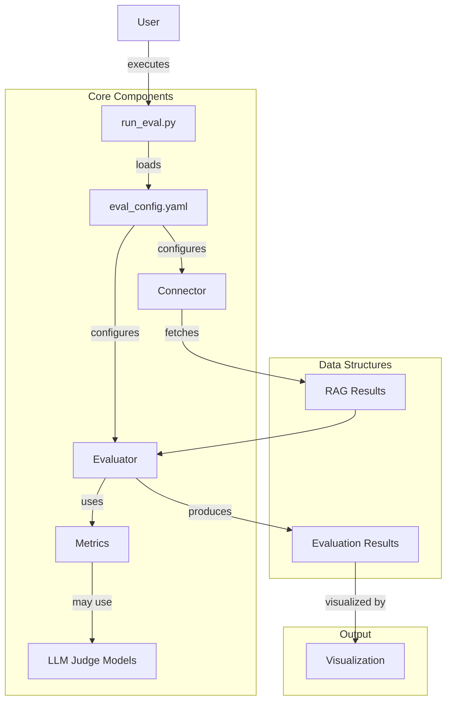
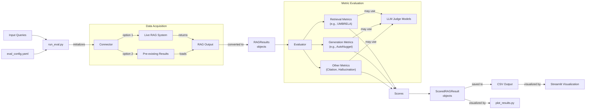
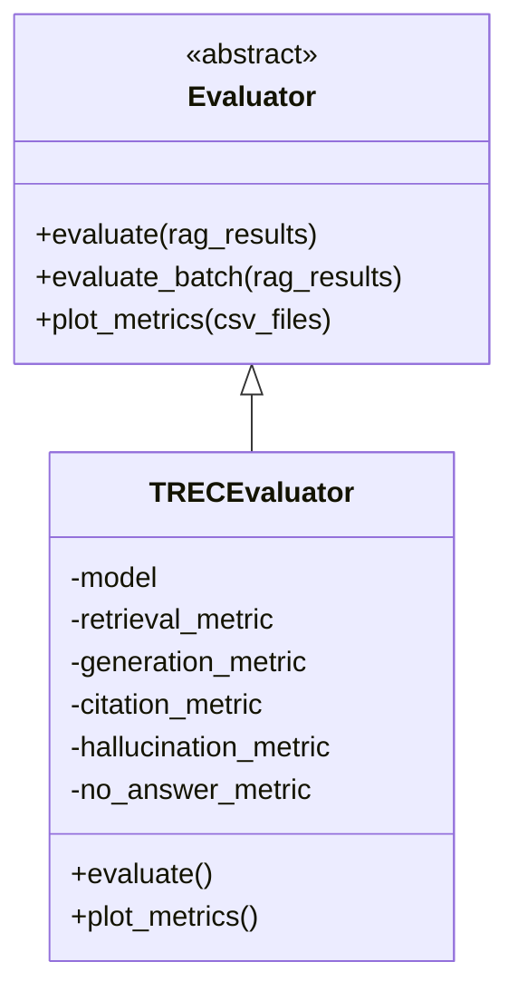
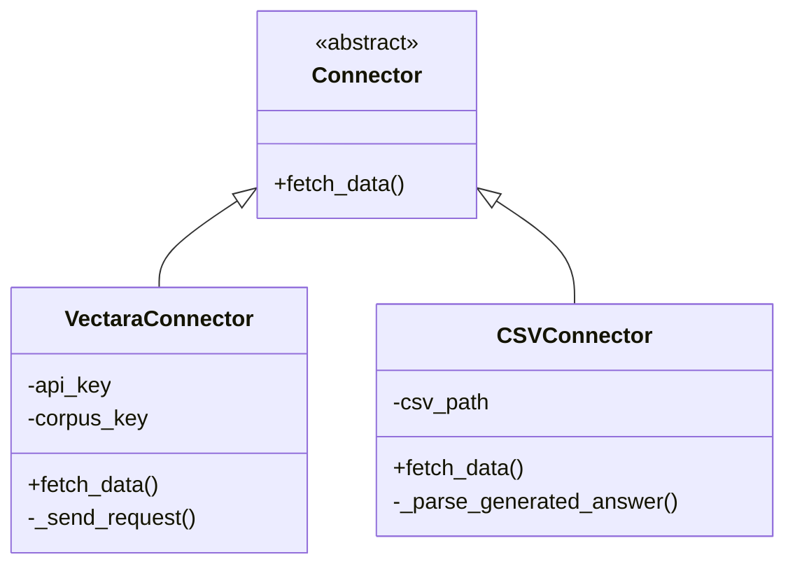
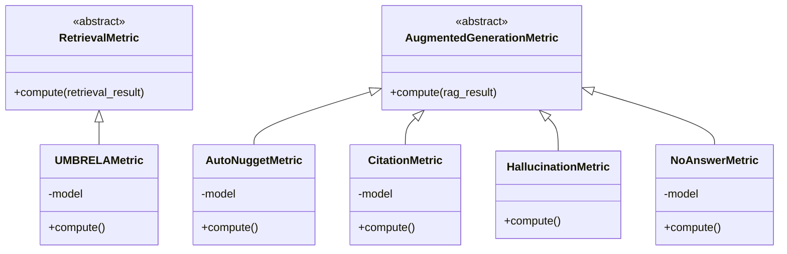
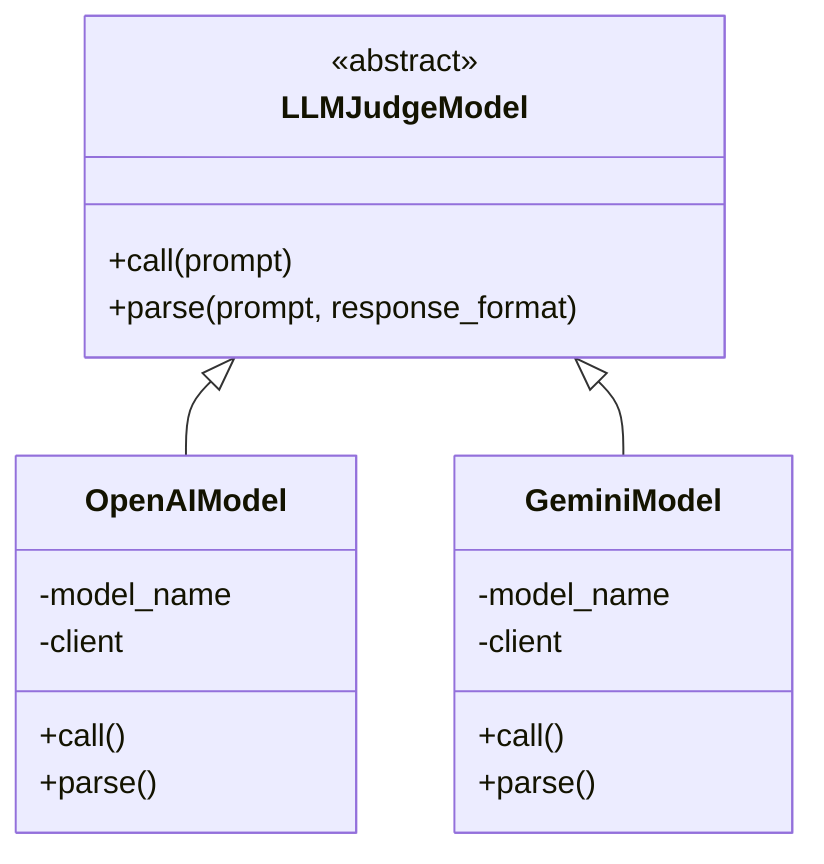

<!-- source: DeepWiki mcp.deepwiki.com · repo vectara/open-rag-eval · page 1 Overview · fetched 2026-10-27 -->

# Overview

<details>
<summary>Relevant source files</summary>

The following files were used as context for generating this wiki page:

- [README.md](README.md)
- [img/project-logo.png](img/project-logo.png)
- [sample_prompt.txt](sample_prompt.txt)

</details>


This document provides a comprehensive introduction to the Open-RAG-Eval repository, an open-source toolkit for evaluating Retrieval-Augmented Generation (RAG) pipelines. This framework enables users to measure and analyze the performance of RAG systems using standardized metrics and flexible evaluation approaches.

For detailed implementation guidance, see [Getting Started](#2). For technical details about specific components, refer to [Core Components](#3).

## Purpose and Scope

Open-RAG-Eval is designed to solve the complex challenge of evaluating RAG system quality through a modular and extensible Python framework. The toolkit provides:

- Standard evaluation metrics for RAG systems (particularly those used in the TREC-RAG benchmark)
- A flexible architecture that supports different RAG implementations
- Detailed reporting and visualization capabilities for performance analysis
- Integration options for both pre-existing RAG outputs and live RAG systems

Sources: [README.md:13-15]()

## System Architecture

The Open-RAG-Eval framework consists of several interconnected components that work together to evaluate RAG systems.

**System Architecture Diagram**


Sources: [README.md:174-181]()

## Evaluation Workflow

Open-RAG-Eval follows a structured workflow during the evaluation process:

**Evaluation Workflow Diagram**


Sources: [README.md:174-181]()

## Core Components

### Evaluators

Evaluators are responsible for assessing RAG output quality. The main evaluator is `TRECEvaluator`, which implements the evaluation metrics used in the TREC-RAG benchmark.

**Component Hierarchy for Evaluators**


Sources: [README.md:17-18](), [README.md:182-184]()

### Connectors

Connectors interface with RAG systems to fetch evaluation data. The toolkit provides two connector types:

1. **VectaraConnector**: Interfaces with the Vectara RAG platform API
2. **CSVConnector**: Loads pre-existing RAG results from CSV files

**Connector Class Hierarchy**


Sources: [README.md:19-20](), [README.md:182-184]()

### Metrics

The toolkit includes several metrics for evaluating different aspects of RAG quality:

| Metric Type | Implementation | Purpose |
|-------------|----------------|---------|
| Retrieval | UMBRELA | Evaluates the relevance of retrieved contexts |
| Generation | AutoNugget | Assesses the quality of generated answers |
| Augmentation | Citation | Evaluates the citation quality in generated answers |
| Quality | Hallucination | Detects hallucinations in generated answers |
| Completeness | NoAnswer | Determines if a query was properly answered |

**Metrics Architecture**


Sources: [README.md:17-18](), [README.md:182-184]()

### LLM Judge Models

Some metrics rely on LLM judge models to evaluate RAG output quality. The framework supports:

- OpenAI models (e.g., GPT-4)
- Gemini models

**Judge Models Architecture**


Sources: [README.md:182-184]()

## Data Structures

The framework uses two primary data structures:

1. **RAGResults**: Represents the output of a RAG pipeline for a single query, including:
   - Input query
   - Generated answer
   - Retrieved contexts/documents

2. **ScoredRAGResult**: Extends RAGResults with evaluation scores from metrics

Sources: [README.md:182-189]()

## Integration Options

Open-RAG-Eval can be integrated in different ways:

### Python Library

Install and use as a Python library in custom evaluation pipelines:

```bash
pip install open-rag-eval
```

### Command-line Tool

Run evaluations directly from the command line:

```bash
python open_rag_eval/run_eval.py --config eval_config.yaml
```

### Web API

For programmatic integration, the framework provides a Flask-based web server with endpoints for evaluation:

- `/api/v1/evaluate`: Evaluate a single RAG output
- `/api/v1/evaluate_batch`: Evaluate multiple RAG outputs in a batch

Start the server with:

```bash
python open_rag_eval/run_server.py
```

Sources: [README.md:193-204]()

## Visualization

The toolkit includes visualization capabilities for analyzing evaluation results:

1. **Plot Results**: Compare metrics across different runs
   ```bash
   python open_rag_eval/plot_results.py results_1.csv results_2.csv
   ```

2. **Streamlit Dashboard**: Detailed per-query analysis
   ```bash
   cd open_rag_eval/viz/
   streamlit run visualize.py
   ```

Sources: [README.md:112-125](), [README.md:158-170]()

---

