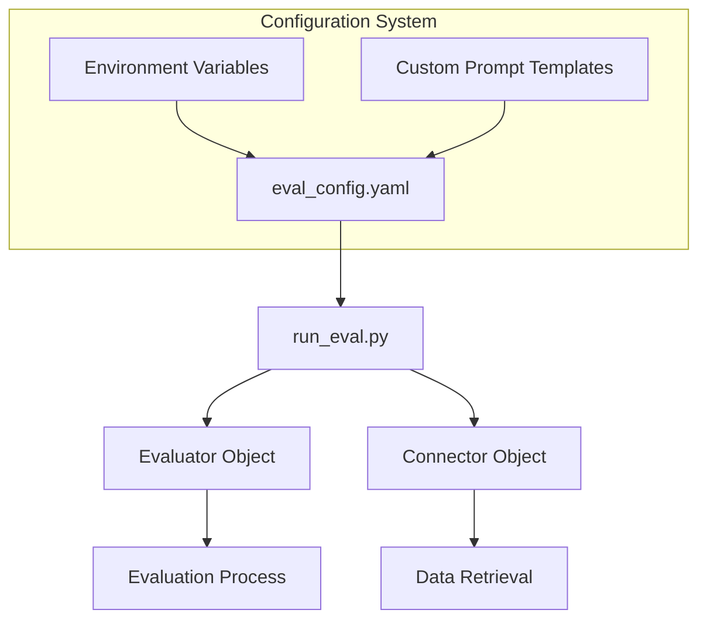
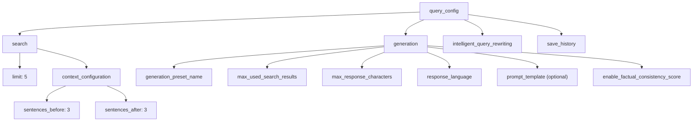
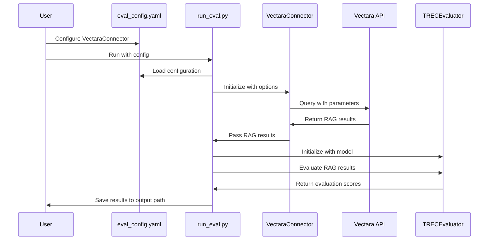
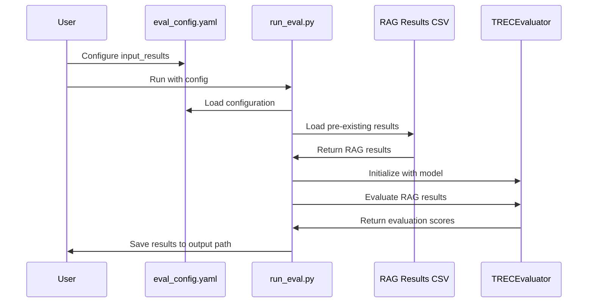

<!-- source: DeepWiki mcp.deepwiki.com · repo vectara/open-rag-eval · page 2.2 Configuration · fetched 2026-10-27 -->

# Configuration

<details>
<summary>Relevant source files</summary>

The following files were used as context for generating this wiki page:

- [README.md](README.md)
- [eval_config.yaml](eval_config.yaml)
- [img/project-logo.png](img/project-logo.png)
- [sample_prompt.txt](sample_prompt.txt)

</details>


This document explains how to configure the open-rag-eval toolkit through the `eval_config.yaml` file. Proper configuration is essential for specifying how RAG systems are evaluated, what metrics are used, and how results are processed. For information about installing the toolkit, see [Installation](#2.1).

## Overview

The configuration system in open-rag-eval uses a YAML file that defines all aspects of the evaluation process. The `eval_config.yaml` file serves as the control center for:

- Specifying input data sources or connectors
- Defining evaluation metrics and models
- Controlling output formats and locations
- Setting parameters for RAG system interactions



Sources: [eval_config.yaml:1-39](), [README.md:64-76]()

## Configuration File Structure

The `eval_config.yaml` file has four main sections:

1. **Input/Output Settings**: Specify input data sources and output locations
2. **Evaluator Configuration**: Define which evaluator to use and its parameters
3. **Model Configuration**: Specify the LLM judge model for evaluations
4. **Connector Configuration**: Set up how to retrieve RAG results

```mermaid
classDiagram
    class "eval_config.yaml" {
        input_results
        evaluation_results
        evaluator
        connector
    }

    class "evaluator" {
        type
        model
    }

    class "model" {
        type
        name
        api_key
    }

    class "connector" {
        type
        options
    }

    class "options" {
        api_key
        corpus_key
        input_queries
        generated_answers
        query_config
    }

    class "query_config" {
        search
        generation
        intelligent_query_rewriting
        save_history
    }

    "eval_config.yaml" --> "evaluator"
    "eval_config.yaml" --> "connector"
    "evaluator" --> "model"
    "connector" --> "options"
    "options" --> "query_config"
```

Sources: [eval_config.yaml:1-39]()

## Input and Output Configuration

These settings define where input data comes from and where evaluation results are stored.

| Parameter | Description | Example |
|-----------|-------------|---------|
| `input_results` | Path to pre-existing RAG results (CSV). Used when no connector is defined. | `"./results/my_rag_results.csv"` |
| `evaluation_results` | Directory where evaluation results will be saved | `"./open_eval_results/"` |

When using a connector (like VectaraConnector), you can leave `input_results` commented out or remove it, as the connector will generate the necessary RAG results.

Sources: [eval_config.yaml:1-7](), [README.md:133-136]()

## Evaluator Configuration

The evaluator section defines which evaluator to use and configures its underlying model.

```yaml
evaluator:
  type: "TRECEvaluator"  
  model:
    type: "OpenAIModel"
    name: "gpt-4o-mini"
    api_key: ${oc.env:OPENAI_API_KEY}
```

| Parameter | Description | Options |
|-----------|-------------|---------|
| `type` | Type of evaluator to use | `"TRECEvaluator"` |
| `model.type` | Type of LLM judge model | `"OpenAIModel"`, `"GeminiModel"` |
| `model.name` | Name/version of the LLM | `"gpt-4o-mini"`, `"gpt-4"`, etc. |
| `model.api_key` | API key for accessing the model | Environment variable reference |

The API key uses the syntax `${oc.env:VARIABLE_NAME}` to reference environment variables, enhancing security by keeping secrets out of configuration files.

Sources: [eval_config.yaml:9-14](), [README.md:79-80]()

## Connector Configuration

The connector section defines how to retrieve RAG results for evaluation. The toolkit supports different connectors, with VectaraConnector shown in the example.

```yaml
connector:
  type: "VectaraConnector"
  options:
    api_key: ${oc.env:VECTARA_API_KEY}
    corpus_key: "fiqa"
    input_queries: "queries.csv"
    generated_answers: "vectara_results.csv"
    query_config:
      # Configuration continues...
```

### Connector Types

| Connector Type | Description |
|----------------|-------------|
| `VectaraConnector` | Connects to Vectara's RAG platform to retrieve results |
| `CSVConnector` | Reads pre-existing RAG results from a CSV file |

### Connector Options

For `VectaraConnector`, the following options are available:

| Parameter | Description |
|-----------|-------------|
| `api_key` | API key for Vectara (referenced from environment variables) |
| `corpus_key` | Identifier for the corpus in Vectara |
| `input_queries` | CSV file containing queries to evaluate |
| `generated_answers` | CSV file where generated answers will be stored |

Sources: [eval_config.yaml:16-23](), [README.md:36-40](), [README.md:62-67]()

### Query Configuration

The `query_config` section controls how queries are processed by the connector:



#### Search Parameters

| Parameter | Description | Default |
|-----------|-------------|---------|
| `search.limit` | Maximum number of results to retrieve | `5` |
| `search.context_configuration.sentences_before` | Number of sentences to include before the matching text | `3` |
| `search.context_configuration.sentences_after` | Number of sentences to include after the matching text | `3` |

#### Generation Parameters

| Parameter | Description | Example |
|-----------|-------------|---------|
| `generation.generation_preset_name` | Name of the generation preset to use | `"mockingbird-2.0"` |
| `generation.max_used_search_results` | Maximum number of search results to use for generation | `5` |
| `generation.max_response_characters` | Maximum length of generated response | `1000` |
| `generation.response_language` | Language code for the response | `"eng"` |
| `generation.prompt_template` | Optional custom prompt template file | `"sample_prompt.txt"` |
| `generation.enable_factual_consistency_score` | Whether to calculate factual consistency score | `False` |

#### Other Query Settings

| Parameter | Description | Default |
|-----------|-------------|---------|
| `intelligent_query_rewriting` | Whether to enable query rewriting | `False` |
| `save_history` | Whether to save query history | `False` |

Sources: [eval_config.yaml:24-38](), [README.md:68-76]()

## Custom Prompt Templates

You can specify a custom prompt template to control how the RAG system generates answers. The template is referenced in the configuration using the `prompt_template` parameter under the `generation` section.

The prompt template is a text file with special variables that are replaced at runtime. For example:

```
[{"role": "system", "content": ""},
 {"role": "user", "content": "You are a search bot that forms a coherent answer to a user query based on search results that are provided to you.
 If the search results are irrelevant to the question, respond with - No result found (in $vectaraLangName). 
 ...
 Generate a coherent response to the query by summarizing the search results provided.
 Cite search results that you use in your response using [] notation. Please provide your answer in $vectaraLangName."}]
```

The template uses variables like `$vectaraQuery`, `$vectaraQueryResults`, and `$vectaraLangName` that will be replaced with actual values during execution.

Sources: [sample_prompt.txt:1-13](), [README.md:68-76](), [eval_config.yaml:34-36]()

## Example Configuration Workflows

### Using with Vectara Connector



Sources: [README.md:60-80](), [eval_config.yaml:16-38]()

### Using with Pre-existing Results



Sources: [README.md:130-146](), [eval_config.yaml:1-4]()

## Environment Variables

The configuration uses environment variables for sensitive information like API keys. The syntax `${oc.env:VARIABLE_NAME}` references these variables from the environment.

Key environment variables:

| Variable | Purpose | Used By |
|----------|---------|---------|
| `OPENAI_API_KEY` | Authentication for OpenAI API | OpenAIModel |
| `VECTARA_API_KEY` | Authentication for Vectara API | VectaraConnector |

Make sure to set these environment variables before running the evaluation:

```bash
export VECTARA_API_KEY='your-vectara-api-key'
export OPENAI_API_KEY='your-openai-api-key'
```

Sources: [README.md:79-80](), [eval_config.yaml:14](), [eval_config.yaml:19]()

---

