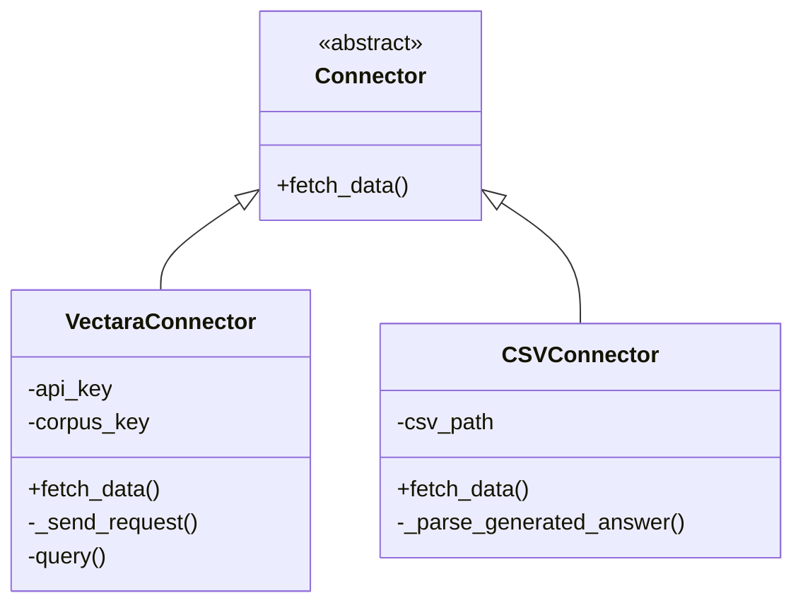
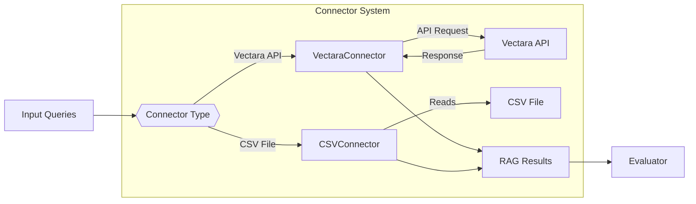
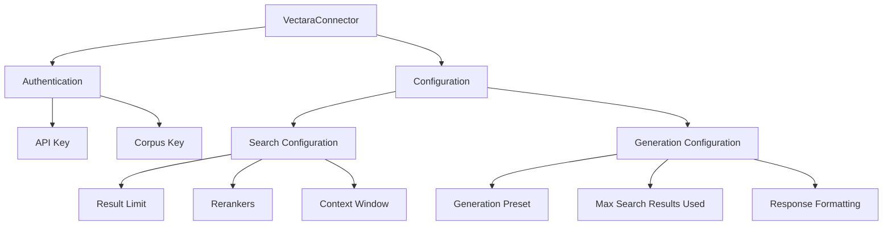
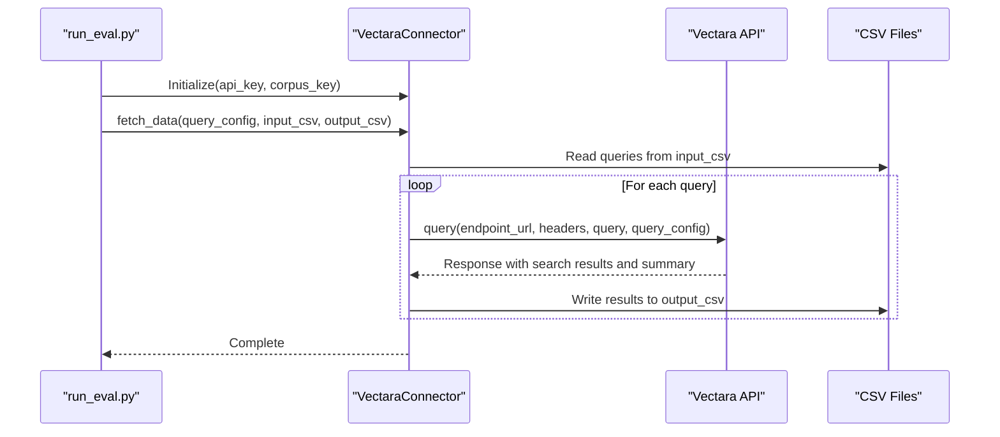
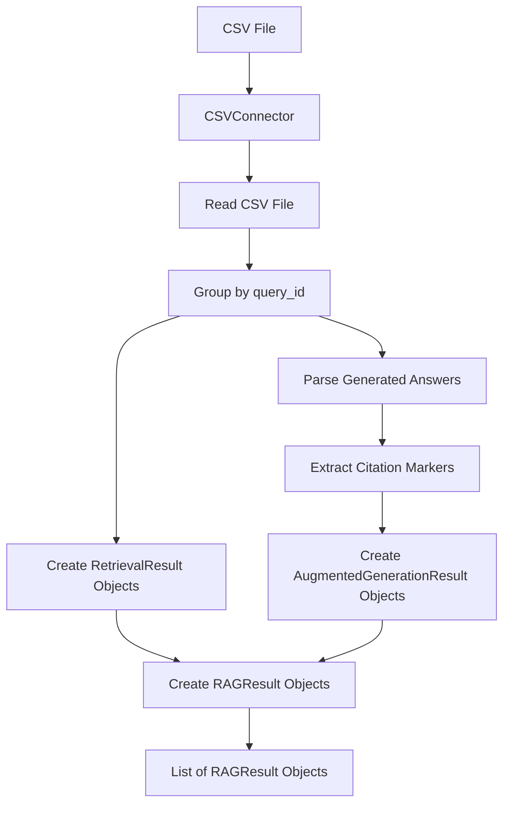
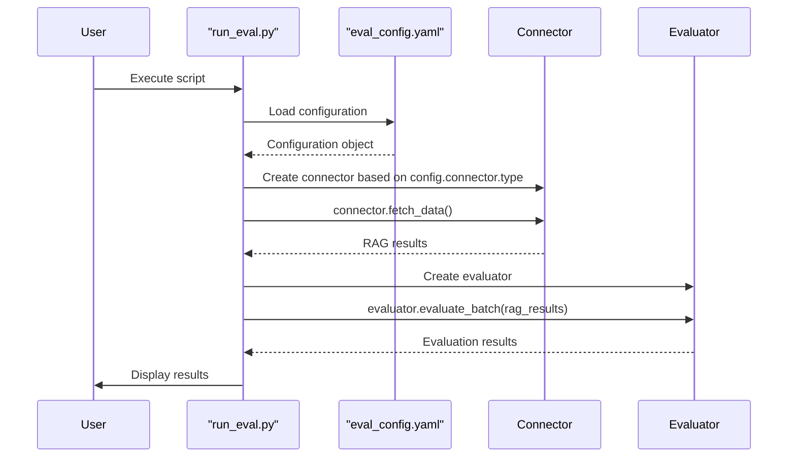

<!-- source: DeepWiki mcp.deepwiki.com · repo vectara/open-rag-eval · page 3.3 Connectors · fetched 2026-10-27 -->

# Connectors

<details>
<summary>Relevant source files</summary>

The following files were used as context for generating this wiki page:

- [CONTRIBUTING.md](CONTRIBUTING.md)
- [img/viz_1.png](img/viz_1.png)
- [img/viz_2.png](img/viz_2.png)
- [open_rag_eval/connectors/csv_connector.py](open_rag_eval/connectors/csv_connector.py)
- [open_rag_eval/connectors/vectara_connector.py](open_rag_eval/connectors/vectara_connector.py)

</details>


This page documents the Connector system within open-rag-eval, which is responsible for retrieving RAG results from various sources for evaluation. Connectors serve as the data input layer for the evaluation pipeline, providing a consistent interface for obtaining RAG results regardless of their original source.

For information about how these connectors are used within the evaluation pipeline, see [Evaluation Pipeline](#3.1). For details about specific connector implementations, see [Vectara Connector](#3.3.1) and [CSV Connector](#3.3.2).

## 1. Connector Architecture

The Connector system is built on a simple abstract base class that defines a common interface, with specialized implementations for different data sources.

### 1.1 Base Connector Interface

All connectors inherit from the abstract `Connector` base class, which requires implementing a `fetch_data()` method to retrieve RAG results.



Sources: [open_rag_eval/connectors/vectara_connector.py:40-102](). [open_rag_eval/connectors/csv_connector.py:15-66]().

### 1.2 Data Flow

Connectors retrieve data from external systems or files and convert it into standardized RAGResult objects that can be processed by the evaluation pipeline.



Sources: [open_rag_eval/connectors/vectara_connector.py:104-162](). [open_rag_eval/connectors/csv_connector.py:20-65]().

## 2. VectaraConnector

The `VectaraConnector` interfaces with the Vectara API to perform searches and generate answers for evaluation.

### 2.1 Configuration and Authentication

The VectaraConnector requires API credentials and has several configurable parameters:



Sources: [open_rag_eval/connectors/vectara_connector.py:40-80]().

### 2.2 Data Fetching Process

The VectaraConnector fetches data in a multi-step process:

1. Read queries from an input CSV file
2. For each query, send a request to the Vectara API
3. Process the response to extract generated answers and retrieved passages
4. Write the results to an output CSV file



Sources: [open_rag_eval/connectors/vectara_connector.py:104-162]().

### 2.3 Retry Logic

The VectaraConnector implements robust retry logic to handle API failures:

- Uses the `tenacity` library for automatic retries
- Implements exponential backoff
- Provides progress feedback via tqdm
- Handles network issues and API errors

Sources: [open_rag_eval/connectors/vectara_connector.py:164-199]().

## 3. CSVConnector

The `CSVConnector` reads pre-generated RAG results from a CSV file, parsing them into structured data for evaluation.

### 3.1 File Format

The CSVConnector expects a CSV file with specific columns:
- `query_id`: Unique identifier for each query
- `query`: The query text
- `passage_id`: Identifier for each retrieved passage
- `passage`: The text of the retrieved passage
- `generated_answer`: The generated answer (only present in the first row for each query)

### 3.2 Parsing Process



Sources: [open_rag_eval/connectors/csv_connector.py:20-65]().

### 3.3 Citation Handling

The CSVConnector includes specialized logic to parse citation markers in generated text, which are crucial for evaluation metrics:

- Identifies citation patterns like `[1]`, `[2]`, etc.
- Expands multi-number citations like `[1, 2, 3]` into individual citations
- Maps citation markers to the corresponding retrieved passages
- Segments the generated text based on citation boundaries

Sources: [open_rag_eval/connectors/csv_connector.py:67-115]().

## 4. Usage in Evaluation Pipeline

Connectors are typically configured through a YAML configuration file and instantiated by the evaluation runner:

```yaml
connector:
  type: VectaraConnector
  options:
    api_key: VECTARA_API_KEY
    corpus_key: fiqa
    input_queries: queries.csv
    generated_answers: vectara_results.csv
    query_config:
      search:
        limit: 5
        context_configuration:
          sentences_before: 3
          sentences_after: 3
      generation:
        generation_preset_name: mockingbird-2.0
        max_used_search_results: 5
```

The evaluation runner creates the appropriate connector based on the configuration and passes it to the evaluator:



Sources: [open_rag_eval/connectors/vectara_connector.py:104-162](). [open_rag_eval/connectors/csv_connector.py:20-65]().

## 5. Adding New Connectors

To create a new connector, implement the `Connector` abstract class with a `fetch_data()` method that returns a list of `RAGResult` objects. This allows for extending the system to support additional data sources while maintaining compatibility with the evaluation pipeline.

The key components to implement are:
1. A mechanism to retrieve data from your source
2. Logic to parse that data into `RetrievalResult` and `AugmentedGenerationResult` objects
3. Assembly of these components into `RAGResult` objects

Sources: [open_rag_eval/connectors/vectara_connector.py:40-102](). [open_rag_eval/connectors/csv_connector.py:15-66]().

---

