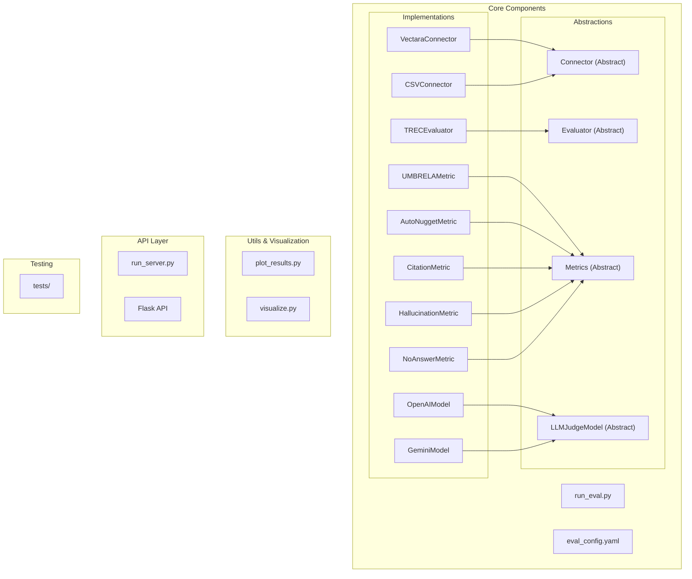
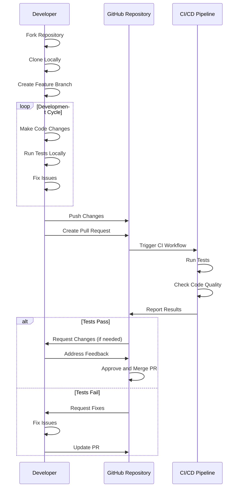
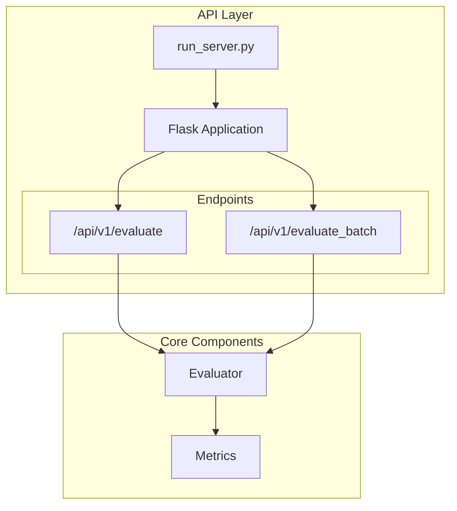

<!-- source: DeepWiki mcp.deepwiki.com · repo vectara/open-rag-eval · page 5 Development · fetched 2026-10-27 -->

# Development

<details>
<summary>Relevant source files</summary>

The following files were used as context for generating this wiki page:

- [.gitignore](.gitignore)
- [README.md](README.md)
- [img/project-logo.png](img/project-logo.png)
- [sample_prompt.txt](sample_prompt.txt)

</details>


This guide explains how to contribute to and extend the open-rag-eval toolkit. It covers the overall project structure, setting up a development environment, extending key components, and contributing guidelines. For specific information about testing your contributions, see [Testing](#5.1).

## Project Structure

The open-rag-eval project follows a modular architecture designed for extensibility. Understanding the codebase organization is essential for effective development.



Sources: [README.md:172-190]()

## Development Environment Setup

### Prerequisites

To set up your development environment for open-rag-eval:

1. **Fork and Clone the Repository**
   ```bash
   git clone https://github.com/YOUR-USERNAME/open-rag-eval.git
   cd open-rag-eval
   ```

2. **Install in Development Mode**
   ```bash
   pip install -e .
   ```

3. **API Keys for Testing**
   For full functionality during development, you'll need:
   - `OPENAI_API_KEY` environment variable for LLM judge models
   - `VECTARA_API_KEY` environment variable for the Vectara connector

### Development Container

The project supports development in VS Code's Dev Containers for a consistent environment:

```bash
code --install-extension ms-vscode-remote.remote-containers
# Then open the project in VS Code and click "Reopen in Container"
```

Sources: [README.md:10-11](), [README.md:42-58]()

## Extension Points

The toolkit is designed for extensibility via well-defined abstract classes. Here are the main extension points:

```mermaid
classDiagram
    class Connector {
        <<abstract>>
        +fetch_data()
    }
    
    class Evaluator {
        <<abstract>>
        +evaluate(rag_results)
        +evaluate_batch(rag_results)
        +plot_metrics(csv_files)
    }
    
    class LLMJudgeModel {
        <<abstract>>
        +call(prompt)
        +parse(prompt, response_format)
    }
    
    class Metric {
        <<abstract>>
        +compute(result)
    }
    
    class RetrievalMetric {
        <<abstract>>
        +compute(retrieval_result)
    }
    
    class AugmentedGenerationMetric {
        <<abstract>>
        +compute(rag_result)
    }
    
    VectaraConnector --|> Connector
    CSVConnector --|> Connector
    CustomConnector --|> Connector
    
    TRECEvaluator --|> Evaluator
    CustomEvaluator --|> Evaluator
    
    OpenAIModel --|> LLMJudgeModel
    GeminiModel --|> LLMJudgeModel
    CustomModel --|> LLMJudgeModel
    
    UMBRELAMetric --|> RetrievalMetric
    CustomRetrievalMetric --|> RetrievalMetric
    
    AutoNuggetMetric --|> AugmentedGenerationMetric
    CitationMetric --|> AugmentedGenerationMetric
    HallucinationMetric --|> AugmentedGenerationMetric
    NoAnswerMetric --|> AugmentedGenerationMetric
    CustomGenerationMetric --|> AugmentedGenerationMetric
```



### Creating Custom Connectors

To create a custom connector for a new RAG system:

1. Subclass the abstract `Connector` class
2. Implement the `fetch_data()` method to retrieve RAG results from your system
3. Convert your system's output to the standard `RAGResult` format

### Creating Custom Metrics

To implement a new evaluation metric:

1. Decide whether it's a retrieval or generation metric
2. Subclass the appropriate base class (`RetrievalMetric` or `AugmentedGenerationMetric`)
3. Implement the `compute()` method to calculate and return your metric score

### Creating Custom Judge Models

To use a different LLM or model for evaluation:

1. Subclass the abstract `LLMJudgeModel` class
2. Implement the `call()` method to send prompts to your model
3. Implement the `parse()` method to process the model's responses

Sources: System Architecture Diagrams

## Contribution Workflow



### Contributing Guidelines

1. **Code Style and Quality**
   - Follow PEP 8 guidelines for Python code
   - Add docstrings to all functions and classes
   - Maintain type hints where possible

2. **Testing**
   - Write unit tests for new functionality
   - Ensure existing tests pass with your changes

3. **Documentation**
   - Update relevant documentation
   - Add examples for new features
   - Include clear, descriptive commit messages

4. **Pull Request Process**
   - Reference issues your PR addresses
   - Provide a clear description of changes
   - Respond to reviewer feedback promptly

Sources: [README.md:216-220]()

## Extending the Visualization Components

The visualization system can also be extended to create custom views of evaluation results:

1. **Plot Results Extension**
   - Modify `plot_results.py` to add new visualization types
   - Add support for additional metrics in plots

2. **Streamlit UI Customization**
   - Extend the Streamlit visualization app in `viz/visualize.py`
   - Add new interactive elements for exploring results

Sources: [README.md:157-170]()

## API Extensions

The framework provides a REST API for programmatic evaluation:



To extend the API:

1. Add new endpoints in `run_server.py`
2. Implement request validation and processing
3. Connect to appropriate evaluator components

Sources: [README.md:191-204]()

## Development Resources

- **Issue Tracking**: Use the project's [GitHub issues page](https://github.com/vectara/open-rag-eval/issues) for bugs and feature requests
- **Contributing Guide**: See the detailed [contributing guide](https://github.com/vectara/open-rag-eval/blob/master/CONTRIBUTING.md)
- **Community Support**: Join the [Discord server](https://discord.gg/GFb8gMz6UH) for development discussions

Sources: [README.md:216-220](), [README.md:7-9]()

---

