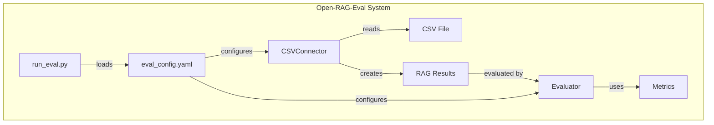
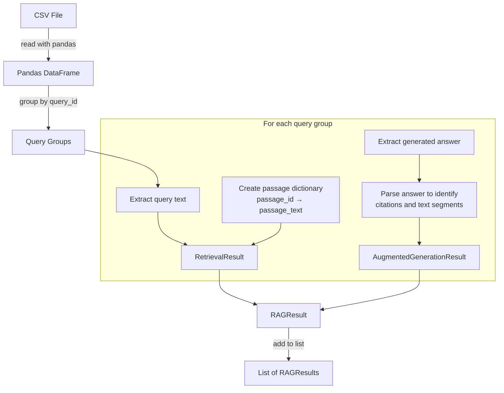
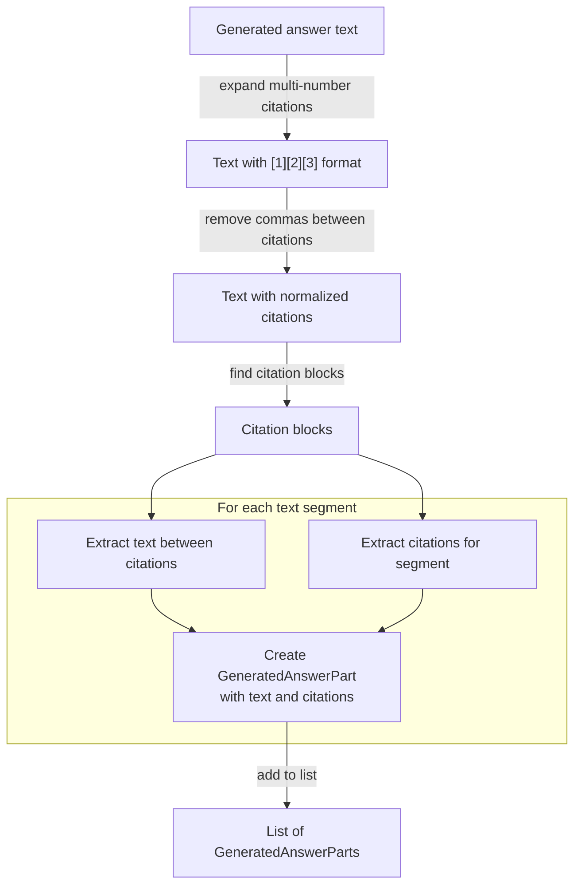
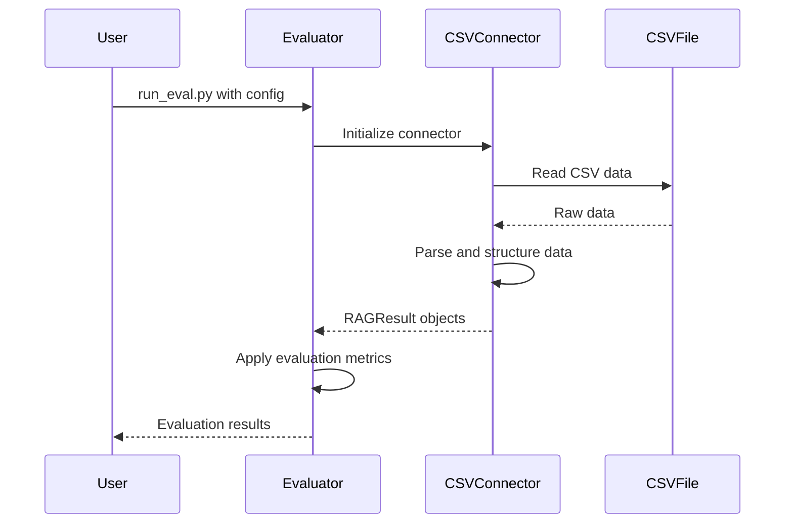

<!-- source: DeepWiki mcp.deepwiki.com · repo vectara/open-rag-eval · extra page CSV Connector · fetched 2026-10-27 -->

# CSV Connector

<details>
<summary>Relevant source files</summary>

The following files were used as context for generating this wiki page:

- [CONTRIBUTING.md](CONTRIBUTING.md)
- [img/viz_1.png](img/viz_1.png)
- [img/viz_2.png](img/viz_2.png)
- [open_rag_eval/connectors/csv_connector.py](open_rag_eval/connectors/csv_connector.py)
- [tests/data/test_csv_connector.csv](tests/data/test_csv_connector.csv)
- [tests/test_csv_connector.py](tests/test_csv_connector.py)

</details>


The CSV Connector provides a way to load pre-existing RAG (Retrieval-Augmented Generation) results from CSV files for evaluation. Unlike the [Vectara Connector](#3.3.1) which fetches results directly from a live RAG system, the CSV Connector allows you to evaluate results that have been previously generated and stored in a structured CSV format.

## Overview

The `CSVConnector` class implements the abstract `Connector` interface and provides functionality to read RAG results from properly formatted CSV files, parse citation references within generated answers, and convert all the data into the system's internal `RAGResult` data structures.



Sources: [open_rag_eval/connectors/csv_connector.py:15-65]()

## CSV Format Requirements

The CSV Connector expects input files to have a specific structure with the following columns:

| Column Name | Description |
|-------------|-------------|
| query_id    | Unique identifier for each query (will be generated if not provided) |
| query       | The text of the query |
| passage_id  | Identifier for each retrieved passage (typically in format [1], [2], etc.) |
| passage     | The text content of the retrieved passage |
| generated_answer | The generated answer text with citation references like [1], [2] |

Multiple rows with the same query_id represent multiple passages retrieved for that query.

Sources: [tests/data/test_csv_connector.csv:1-18]()

## Data Flow and Processing

The CSV Connector performs several transformations to convert the flat CSV data into structured `RAGResult` objects:



Sources: [open_rag_eval/connectors/csv_connector.py:20-65]()

## Citation Parsing

The CSV Connector includes a sophisticated citation parsing mechanism that handles different citation formats:

1. Single citations like `[1]`
2. Multiple citations like `[1][2][3]`
3. Comma-separated citations like `[1, 2, 3]`
4. Combined format citations like `[1, 2][3]`

Each text segment in the generated answer is associated with its corresponding citations, allowing for accurate evaluation of source attribution.



Sources: [open_rag_eval/connectors/csv_connector.py:67-115]()

## Implementation Details

The `CSVConnector` class has two main methods:

1. `__init__(csv_path)`: Initializes the connector with the path to the CSV file
2. `fetch_data()`: Reads the CSV file and converts the data to `RAGResult` objects
3. `_parse_generated_answer(text)`: Internal method to parse citation references in the generated answer

### Initialization

The constructor simply stores the path to the CSV file:

```python
def __init__(self, csv_path: str):
    """Initialize the CSV connector with path to CSV file."""
    self.csv_path = csv_path
```

Sources: [open_rag_eval/connectors/csv_connector.py:15-18]()

### Data Fetching

The `fetch_data()` method performs the following steps:

1. Reads the CSV file using pandas
2. Adds a query_id column if it doesn't exist
3. Groups the rows by query_id
4. For each query:
   - Extracts the query text
   - Creates a dictionary of retrieved passages
   - Extracts and parses the generated answer
   - Creates a `RetrievalResult` object
   - Creates an `AugmentedGenerationResult` object
   - Creates a `RAGResult` combining both
5. Returns a list of `RAGResult` objects

Sources: [open_rag_eval/connectors/csv_connector.py:20-65]()

### Citation Parsing

The `_parse_generated_answer()` method:

1. Expands multi-number citations like `[1, 2, 3]` to `[1][2][3]`
2. Normalizes citation format by removing commas between citations
3. Finds all citation blocks in the text
4. Extracts text segments between citation blocks
5. Associates each text segment with its corresponding citations
6. Returns a list of `GeneratedAnswerPart` objects

Sources: [open_rag_eval/connectors/csv_connector.py:67-115]()

## Usage Example

To use the CSV Connector in your evaluation pipeline, configure it in your `eval_config.yaml` file:

```yaml
connector:
  type: CSVConnector
  options:
    csv_path: /path/to/your/results.csv
```

The CSV Connector will then load the RAG results from the specified CSV file, parse them into `RAGResult` objects, and pass them to the evaluator for assessment.

## Handling Edge Cases

The connector includes several features for handling edge cases:

- If `query_id` isn't provided, it generates a random UUID for each query
- If multiple rows have the same generated answer, it uses the first non-empty one
- If no citation blocks are found in the generated answer, it treats the entire text as a single segment without citations
- It handles empty text segments and ensures they are not included in the results

Sources: [open_rag_eval/connectors/csv_connector.py:21-28](), [open_rag_eval/connectors/csv_connector.py:86-87](), [open_rag_eval/connectors/csv_connector.py:107-108]()

## Integration with the Evaluation Pipeline

The CSV Connector integrates seamlessly with the rest of the open-rag-eval system:



The evaluator doesn't need to know whether the RAG results came from a live system via the Vectara Connector or from a CSV file via the CSV Connector. This abstraction allows for a flexible evaluation pipeline that can work with different data sources.

Sources: [open_rag_eval/connectors/csv_connector.py:6-12]()

---

