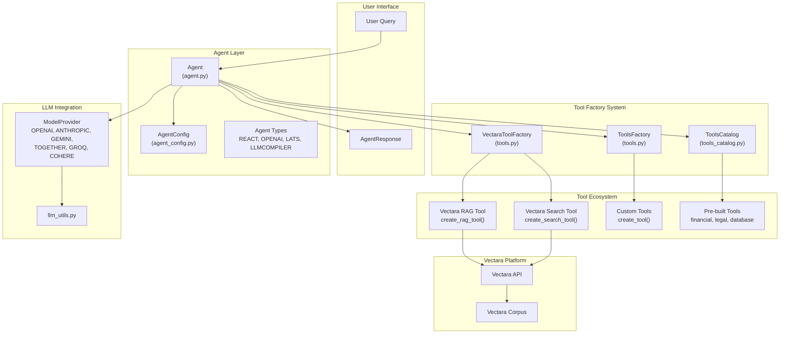
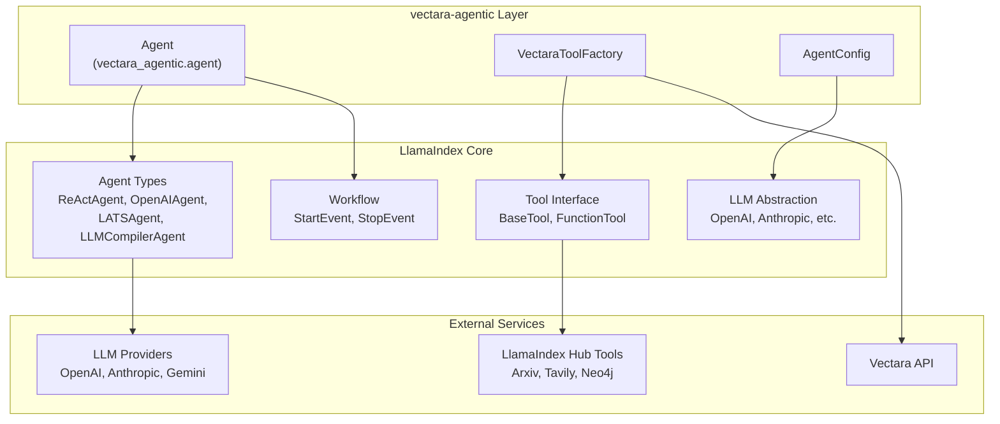

<!-- source: DeepWiki mcp.deepwiki.com · repo vectara/py-vectara-agentic · page 1 Overview · fetched 2026-10-27 -->

# Overview

<details>
<summary>Relevant source files</summary>

The following files were used as context for generating this wiki page:

- [README.md](README.md)
- [docs/index.md](docs/index.md)
- [requirements-dev.txt](requirements-dev.txt)
- [setup.py](setup.py)
- [tests/test_agent_planning.py](tests/test_agent_planning.py)
- [tests/test_agent_type.py](tests/test_agent_type.py)
- [vectara_agentic/__init__.py](vectara_agentic/__init__.py)

</details>


This document provides a high-level introduction to the `vectara-agentic` Python package, explaining its purpose as an AI agent framework for building retrieval-augmented generation (RAG) applications powered by Vectara. For detailed architecture information, see [Architecture](#1.1). For installation and setup instructions, see [Installation and Configuration](#3).

## Purpose and Scope

`vectara-agentic` is a Python library that enables developers to build sophisticated AI assistants and agents using Agentic RAG patterns. The package provides a simplified interface for creating agents that can reason about complex queries, use tools to gather information, and provide comprehensive responses grounded in data stored in Vectara corpora.

The library addresses the limitations of traditional RAG systems by introducing an agent-based approach where an LLM acts as a "manager" that can analyze user queries, break them down into sub-problems, select appropriate tools, and orchestrate multi-step workflows to produce accurate, comprehensive responses.

**Sources:** [README.md:39-59](), [docs/index.md:3-44](), [setup.py:21-22]()

## System Architecture Overview

The following diagram shows the high-level architecture of vectara-agentic, mapping conceptual components to their code entities:



**Sources:** [vectara_agentic/__init__.py:5-12](), [README.md:88-96](), [tests/test_agent_type.py:16-68]()

## Core Framework Components

The vectara-agentic framework is built around several key code entities that work together to provide agentic RAG capabilities:

### Agent System
The `Agent` class serves as the central orchestrator, managing the interaction between users, tools, and LLMs. It supports multiple agent types through the `AgentType` enumeration and is configured via the `AgentConfig` class.

### Tool Factory Pattern
Two main factory classes create different types of tools:
- `VectaraToolFactory`: Creates Vectara-specific tools like RAG and search tools
- `ToolsFactory`: Creates general-purpose tools from Python functions or integrates with external APIs

### Configuration Management
The `AgentConfig` class handles all configuration aspects including LLM provider selection, model names, agent types, and observability settings.

**Sources:** [vectara_agentic/__init__.py:1-19](), [README.md:154-168]()

## Integration with LlamaIndex

vectara-agentic is built on top of the LlamaIndex agent framework, leveraging its robust agent types and tool integration capabilities. The following diagram shows the relationship between vectara-agentic components and LlamaIndex:



**Sources:** [README.md:38-40](), [docs/index.md:73-77](), [requirements.txt:1]()

## Key Features and Capabilities

| Feature | Implementation | Purpose |
|---------|----------------|---------|
| Rapid Tool Creation | `VectaraToolFactory.create_rag_tool()` | Build Vectara RAG tools with single line of code |
| Agent Flexibility | `AgentType` enum with REACT, OPENAI, LATS, LLMCOMPILER | Support different reasoning patterns |
| Multi-LLM Support | `ModelProvider` enum | Integrate with 8+ LLM providers seamlessly |
| Pre-built Domain Tools | `ToolsCatalog` class | Ready-to-use tools for finance, legal, database |
| Observability | Arize Phoenix integration | Monitor agent performance and behavior |
| Workflow Support | `Workflow` base class and built-in workflows | Handle complex multi-step processes |
| API Endpoints | `create_app()`, `start_app()` functions | Deploy agents as web services |

**Sources:** [README.md:45-58](), [vectara_agentic/__init__.py:9-18]()

## Quick Start Example

The following example demonstrates the core workflow of creating and using an agent:

```python
# 1. Create tool factory
vec_factory = VectaraToolFactory(
    vectara_api_key=os.environ['VECTARA_API_KEY'],
    vectara_corpus_key=os.environ['VECTARA_CORPUS_KEY']
)

# 2. Create RAG tool
ask_finance = vec_factory.create_rag_tool(
    tool_name="query_financial_reports",
    tool_description="Query financial reports for a company and year",
    tool_args_schema=QueryFinancialReportsArgs,
)

# 3. Create agent
agent = Agent(
    tools=[ask_finance],
    topic="10-K annual financial reports",
    custom_instructions=financial_assistant_instructions,
)

# 4. Interact with agent
response = agent.chat("What was the revenue for Apple in 2021?")
```

This example shows the typical pattern: create a tool factory, define tools, configure an agent, and interact through the `chat()` method.

**Sources:** [README.md:86-177](), [docs/index.md:96-132]()

## Related Documentation

For specific implementation details and advanced usage:
- For detailed system architecture, see [Architecture](#1.1)
- For core concepts and terminology, see [Key Concepts](#1.2)  
- For comprehensive component documentation, see [Core Components](#2)
- For installation and environment setup, see [Installation and Configuration](#3)
- For practical examples and tutorials, see [Usage Guide](#4)
- For deployment as web services, see [API and Endpoints](#5)

**Sources:** Based on table of contents structure provided

---

