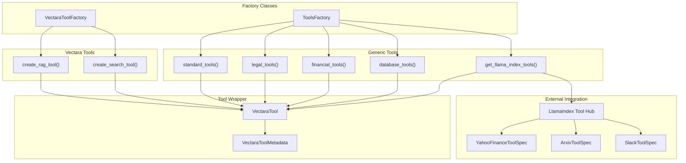
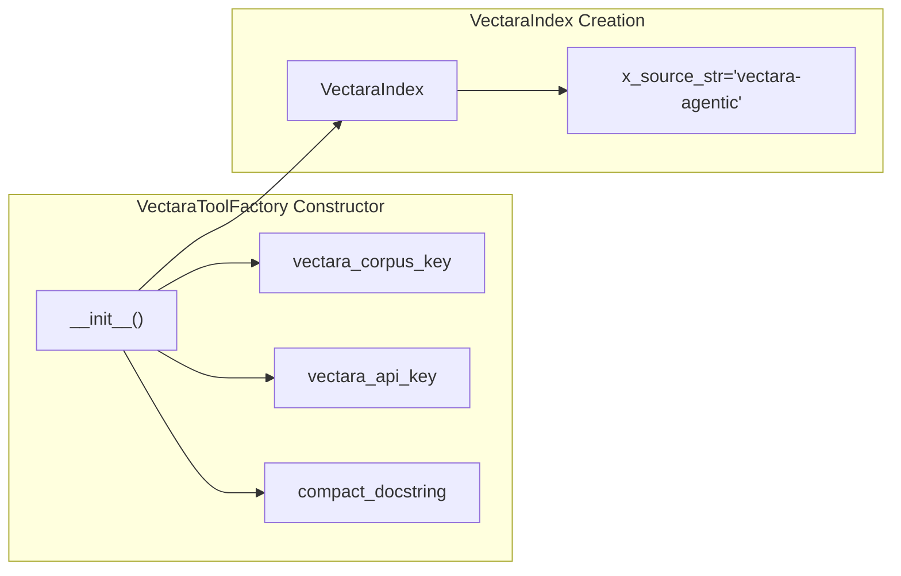
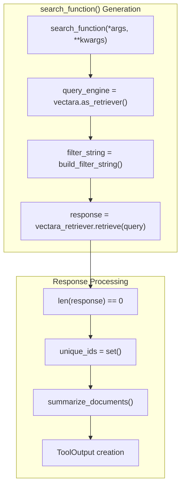
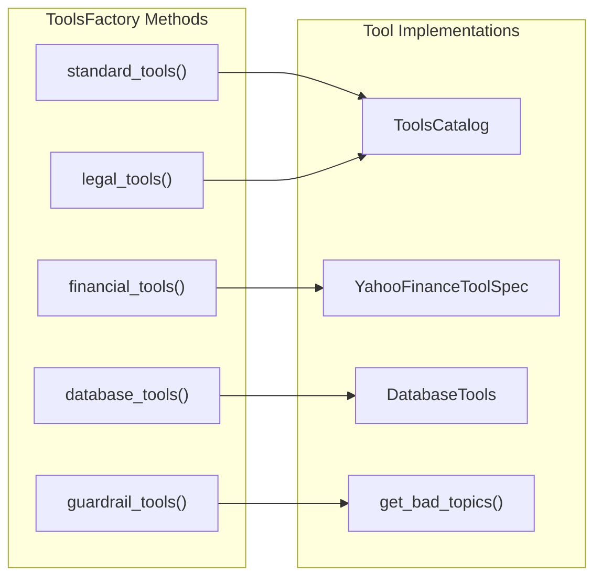
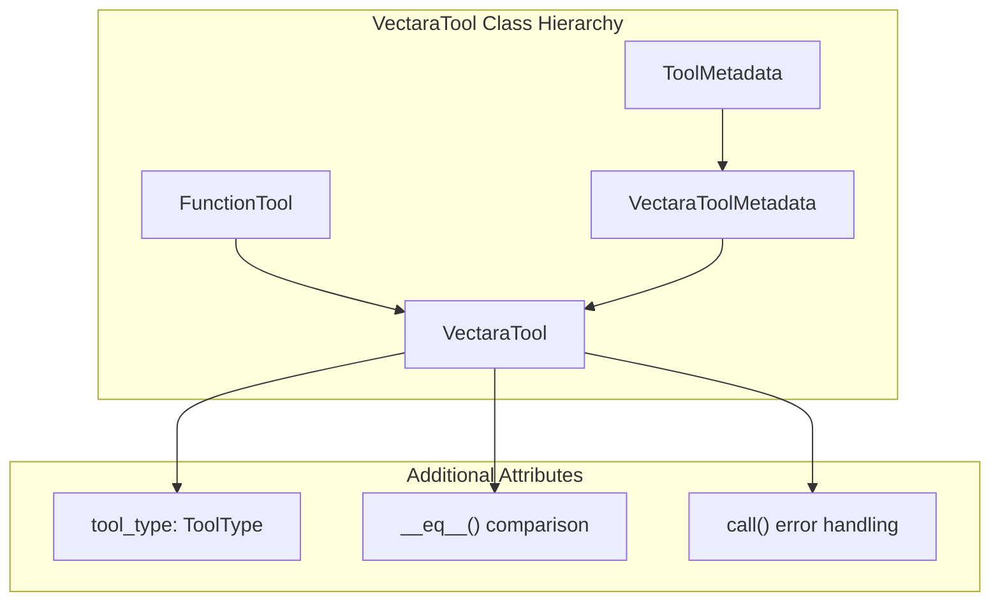
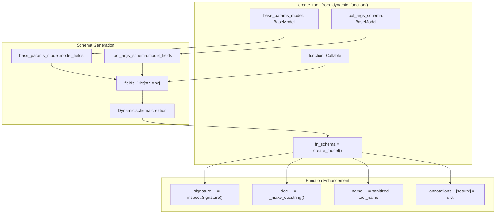
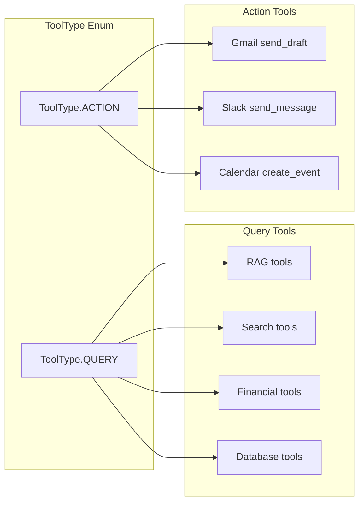

<!-- source: DeepWiki mcp.deepwiki.com · repo vectara/py-vectara-agentic · page 2.2 Tool Factory System · fetched 2026-10-27 -->

# Tool Factory System

Relevant source files

The following files were used as context for generating this wiki page:

- [tests/test_tools.py](tests/test_tools.py)
- [vectara_agentic/llm_utils.py](vectara_agentic/llm_utils.py)
- [vectara_agentic/tool_utils.py](vectara_agentic/tool_utils.py)
- [vectara_agentic/tools.py](vectara_agentic/tools.py)

## Purpose and Scope

The Tool Factory System is responsible for creating and managing tools that agents can use to perform various tasks. This system implements the factory pattern to generate different types of tools, from Vectara-specific RAG and search tools to generic tools integrated from external sources like LlamaIndex. The system handles tool creation, validation, metadata management, and dynamic function generation.

For information about how agents use these tools, see [Agent System](#2.1). For details about tool configuration parameters, see [Agent Configuration](#3.2).

## Factory Pattern Architecture

The tool factory system uses two primary factory classes that create different categories of tools:

Sources: [vectara_agentic/tools.py:68-780](), [vectara_agentic/tool_utils.py:43-95]()

## VectaraToolFactory

The `VectaraToolFactory` class specializes in creating tools that interact with the Vectara platform for retrieval-augmented generation and document search functionality.

### Initialization and Configuration

The factory initializes with Vectara credentials and configuration options:

The factory supports both single and multiple corpus configurations through comma-separated corpus keys. The `compact_docstring` parameter addresses OpenAI's 1024 token limit for tool descriptions.

Sources: [vectara_agentic/tools.py:73-90]()

### RAG Tool Creation

The `create_rag_tool()` method generates tools that perform retrieval-augmented generation using Vectara's query engine:

| Parameter | Type | Description |
|-----------|------|-------------|
| `tool_name` | str | Unique identifier for the tool |
| `tool_description` | str | Human-readable description |
| `tool_args_schema` | BaseModel | Pydantic schema for filtering arguments |
| `vectara_summarizer` | str | Summarization model name |
| `summary_num_results` | int | Number of documents to use for summary |
| `include_citations` | bool | Whether to include markdown citations |
| `fcs_threshold` | float | Factual consistency score threshold |

The RAG function dynamically generates responses using the Vectara query engine with configurable summarization and reranking parameters.

Sources: [vectara_agentic/tools.py:312-568]()

### Search Tool Creation

The `create_search_tool()` method generates tools for document retrieval without summarization:

The search tool supports optional document summarization through the `summarize_docs` parameter and configurable result limits.

Sources: [vectara_agentic/tools.py:92-311]()

## ToolsFactory

The `ToolsFactory` class creates generic tools and integrates with external tool specifications, particularly from the LlamaIndex ecosystem.

### Standard Tool Categories

The factory provides several predefined tool categories:

Each category returns a list of `VectaraTool` objects with appropriate tool types (`ToolType.QUERY` or `ToolType.ACTION`).

Sources: [vectara_agentic/tools.py:647-779]()

### LlamaIndex Integration

The `get_llama_index_tools()` method dynamically imports and instantiates tools from the LlamaIndex tool hub:

| Package | Tool Spec | Tool Type |
|---------|-----------|-----------|
| `yahoo_finance` | YahooFinanceToolSpec | QUERY |
| `arxiv` | ArxivToolSpec | QUERY |
| `tavily_research` | TavilyToolSpec | QUERY |
| `google.GmailToolSpec` | create_draft, send_draft | ACTION |
| `slack.SlackToolSpec` | send_message | ACTION |

The integration supports automatic tool prefix addition and proper tool type classification.

Sources: [vectara_agentic/tools.py:30-65](), [vectara_agentic/tools.py:594-645]()

## VectaraTool Implementation

The `VectaraTool` class extends LlamaIndex's `FunctionTool` with additional metadata and error handling capabilities.

### Tool Metadata Enhancement

The `VectaraToolMetadata` class adds the `tool_type` attribute to distinguish between query and action tools, enabling different agent behaviors based on tool capabilities.

Sources: [vectara_agentic/tool_utils.py:24-41](), [vectara_agentic/tool_utils.py:43-95]()

### Enhanced Error Handling

The `call()` and `acall()` methods provide comprehensive error handling:

- **TypeError**: Invalid argument names or types with suggested corrections
- **General Exceptions**: Malfunction reporting with full error context
- **Parameter Validation**: Signature introspection for valid argument lists

Sources: [vectara_agentic/tool_utils.py:118-175]()

## Dynamic Tool Creation Process

The system uses a sophisticated process for creating tools with dynamic schemas and function signatures:

The process combines base parameters (like `query`) with user-defined filtering parameters to create comprehensive tool schemas.

Sources: [vectara_agentic/tool_utils.py:296-377]()

### Filter String Construction

The `build_filter_string()` function converts tool arguments into Vectara filter syntax:

- **Numeric Values**: Direct equality or list membership
- **Boolean Values**: Conversion to "true"/"false" strings  
- **Range Operators**: `[1,10)` becomes `(field >= 1 AND field < 10)`
- **Comparison Operators**: `>5`, `<=10`, `!=value`
- **String Values**: Quoted equality or list membership

Sources: [vectara_agentic/tool_utils.py:438-522]()

## Tool Type Classification

The system uses the `ToolType` enum to classify tools for agent behavior optimization:

This classification enables agents to understand whether tools retrieve information or perform actions, influencing planning and execution strategies.

Sources: [vectara_agentic/types.py](), [vectara_agentic/tools.py:42-64]()

---

