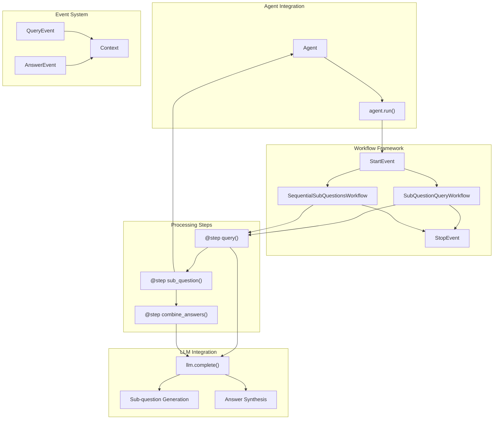
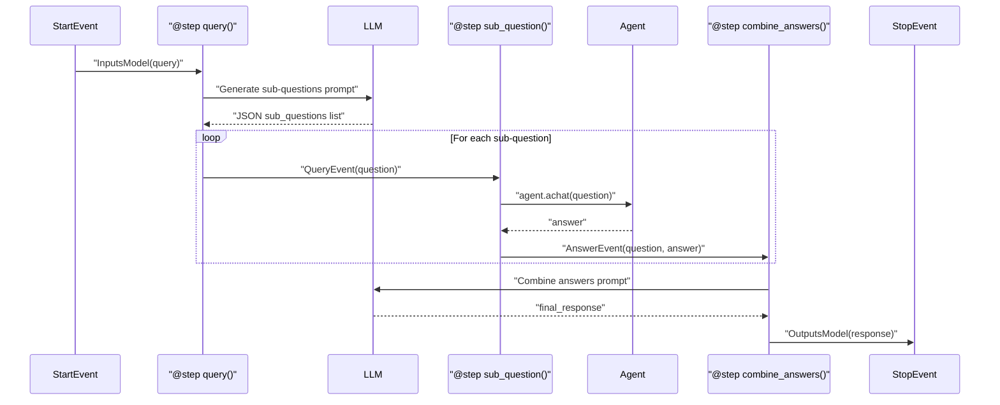
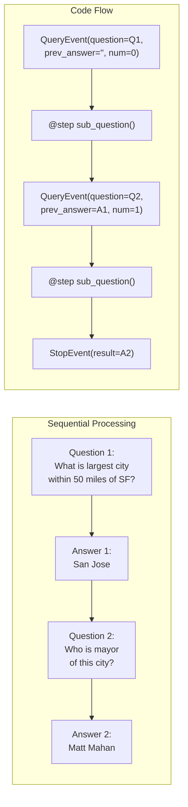

<!-- source: DeepWiki mcp.deepwiki.com · repo vectara/py-vectara-agentic · page 2.3 Workflow Engine · fetched 2026-10-27 -->

# Workflow Engine

<details>
<summary>Relevant source files</summary>

The following files were used as context for generating this wiki page:

- [tests/test_workflow.py](tests/test_workflow.py)
- [vectara_agentic/sub_query_workflow.py](vectara_agentic/sub_query_workflow.py)

</details>


The Workflow Engine provides sophisticated query decomposition capabilities that enable agents to break down complex user questions into manageable sub-tasks. This system leverages LlamaIndex's workflow framework to implement two primary decomposition strategies: parallel sub-question processing and sequential dependency-based processing.

For information about the broader agent orchestration system, see [Agent System](#2.1). For details on tool execution within workflows, see [Tool Factory System](#2.2).

## Architecture Overview

The Workflow Engine is built on LlamaIndex's event-driven workflow framework and integrates directly with the Agent system. Workflows operate as standalone processing units that can decompose queries, execute sub-tasks through agent tools, and combine results into coherent responses.

**Workflow Engine Architecture**



Sources: [vectara_agentic/sub_query_workflow.py:10-17](), [vectara_agentic/sub_query_workflow.py:20-23](), [vectara_agentic/sub_query_workflow.py:192-195]()

## Sub-Question Query Workflow

The `SubQuestionQueryWorkflow` decomposes complex queries into parallel sub-questions that can be processed independently. This approach is optimal when the user's question requires gathering information from multiple independent sources.

### Workflow Components

| Component | Type | Purpose |
|-----------|------|---------|
| `InputsModel` | Pydantic Model | Defines workflow input schema with `query` field |
| `OutputsModel` | Pydantic Model | Defines workflow output schema with `response` field |
| `QueryEvent` | Event | Carries individual sub-question for processing |
| `AnswerEvent` | Event | Carries question-answer pairs from completed sub-tasks |

### Processing Flow

**Sub-Question Workflow Processing**



The workflow implements parallel processing using `num_workers=4` for the sub-question step, allowing multiple sub-questions to be processed simultaneously by the agent.

Sources: [vectara_agentic/sub_query_workflow.py:52-142](), [vectara_agentic/sub_query_workflow.py:144-153](), [vectara_agentic/sub_query_workflow.py:155-189]()

### Sub-Question Generation

The LLM receives a structured prompt to generate sub-questions in JSON format:

```json
{
    "sub_questions": [
        "What is the population of San Francisco?",
        "What is the budget of San Francisco?",
        "What is the GDP of San Francisco?"
    ]
}
```

The system includes robust JSON parsing with fallback extraction using regex patterns to handle malformed LLM responses.

Sources: [vectara_agentic/sub_query_workflow.py:84-108](), [vectara_agentic/sub_query_workflow.py:118-137]()

## Sequential Sub-Questions Workflow

The `SequentialSubQuestionsWorkflow` processes queries that require dependencies between sub-questions, where each question's answer informs the next question.

### Sequential Processing Model

**Sequential Workflow Dependencies**



### Context Passing Mechanism

The sequential workflow maintains context between questions by:

1. Storing previous answers in `QueryEvent.prev_answer`
2. Constructing context-aware prompts for subsequent questions
3. Tracking question sequence with `QueryEvent.num`

Sources: [vectara_agentic/sub_query_workflow.py:314-345](), [vectara_agentic/sub_query_workflow.py:325-333]()

## Integration with Agent System

Workflows integrate with the Agent system through the `workflow_cls` parameter in Agent initialization. The Agent class provides the workflow runtime environment and handles workflow execution.

### Agent-Workflow Integration

```python
# Agent configuration with workflow
agent = Agent(
    tools=tools,
    topic="AI topic", 
    custom_instructions="You are a helpful AI assistant.",
    agent_config=AgentConfig(),
    workflow_cls=SubQuestionQueryWorkflow,
    workflow_timeout=60
)

# Workflow execution
inputs = SubQuestionQueryWorkflow.InputsModel(query="Complex question")
result = await agent.run(inputs=inputs)
```

### Required Workflow Attributes

The workflow receives these attributes from the Agent via the `StartEvent`:

| Attribute | Type | Purpose |
|-----------|------|---------|
| `agent` | Agent | Agent instance for tool execution |
| `llm` | LLM | Language model for text generation |
| `tools` | List[Tool] | Available tools for the agent |
| `verbose` | bool | Debug output control |

Sources: [vectara_agentic/sub_query_workflow.py:68-78](), [tests/test_workflow.py:30-36]()

## Error Handling and Timeouts

The Workflow Engine implements comprehensive error handling for production reliability.

### Timeout Management

Workflows support configurable timeouts to prevent indefinite execution:

```python
agent = Agent(
    workflow_cls=SubQuestionQueryWorkflow,
    workflow_timeout=30  # 30 second timeout
)
```

When timeouts occur, the system raises `WorkflowTimeoutError` from LlamaIndex.

### Failure Recovery

Workflows can define `OutputModelOnFail` classes to provide graceful degradation:

```python
class SubQuestionQueryWorkflowWithFailClass(SubQuestionQueryWorkflow):
    class OutputModelOnFail(BaseModel):
        original_query: str
```

This mechanism allows workflows to return meaningful responses even when primary processing fails.

### JSON Parsing Resilience

The workflow includes robust JSON parsing with regex fallback for handling malformed LLM responses:

1. Primary JSON parsing attempt
2. Regex extraction of JSON objects from response text  
3. Secondary parsing attempt on extracted content
4. Graceful fallback to original query for empty sub-question lists

Sources: [vectara_agentic/sub_query_workflow.py:118-137](), [tests/test_workflow.py:71-95](), [tests/test_workflow.py:102-130]()

---

