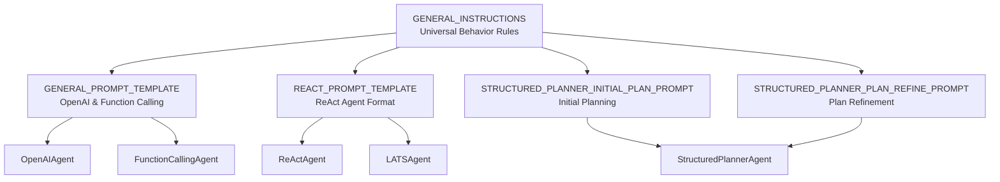
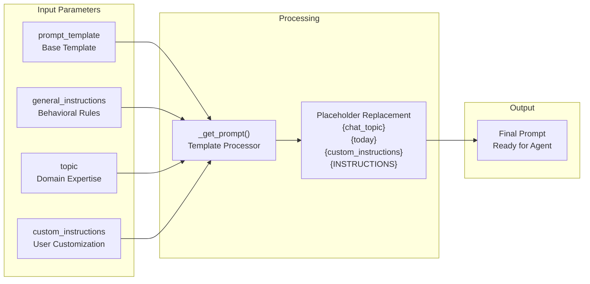
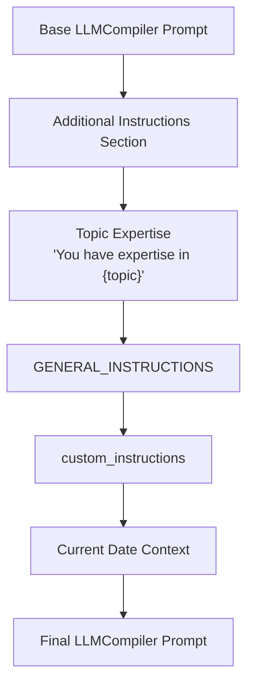
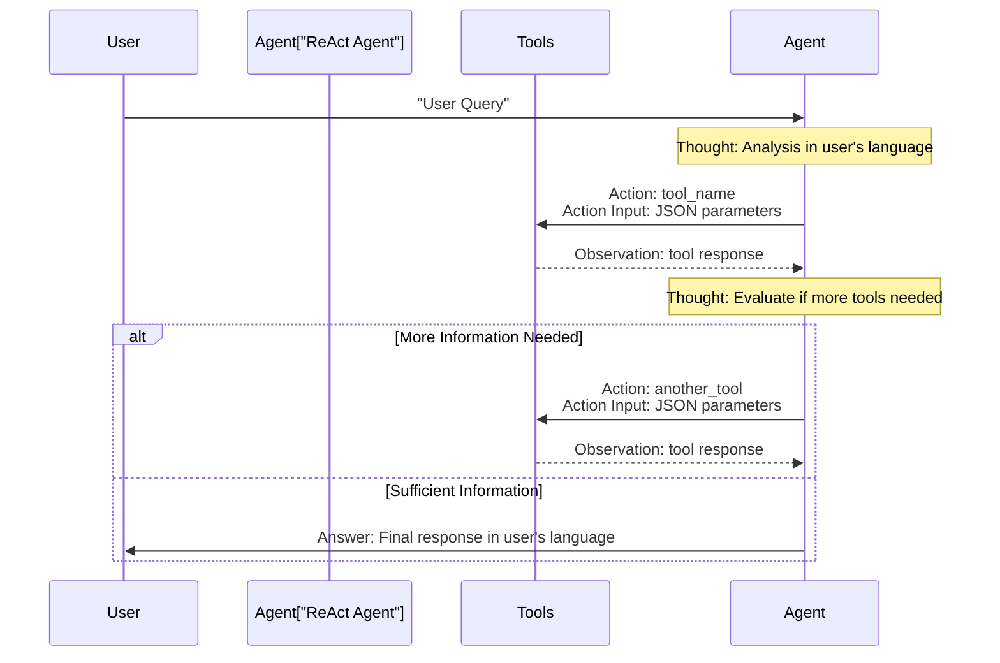
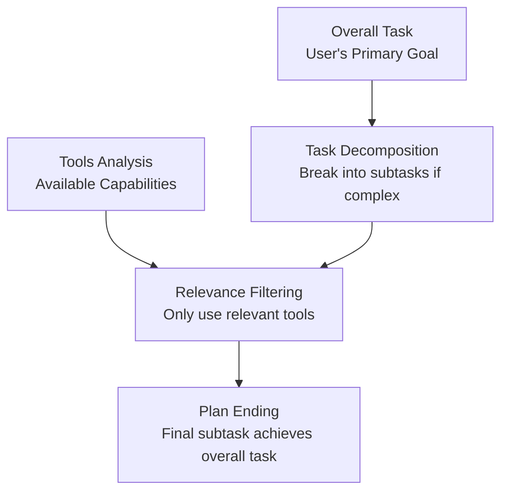
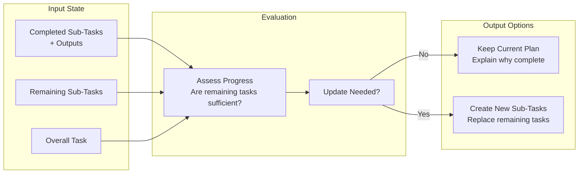
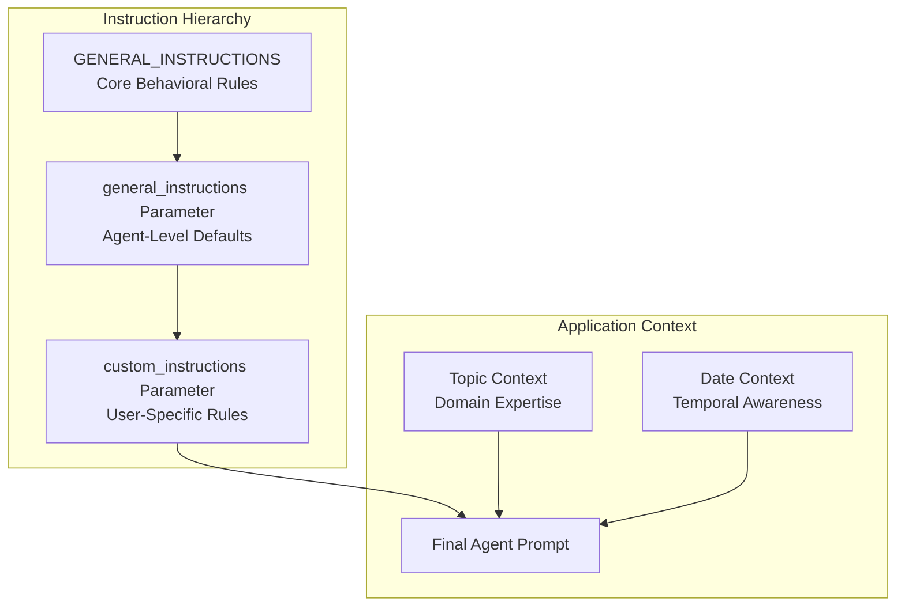

<!-- source: DeepWiki mcp.deepwiki.com · repo vectara/py-vectara-agentic · page 2.4 Prompt System · fetched 2026-10-27 -->

# Prompt System

Relevant source files

The following files were used as context for generating this wiki page:

- [vectara_agentic/_prompts.py](vectara_agentic/_prompts.py)
- [vectara_agentic/agent.py](vectara_agentic/agent.py)

The Prompt System is responsible for generating and managing the text instructions that guide agent behavior in vectara-agentic. It provides templated prompts that are customized based on agent type, user-specified topics, and configuration parameters, then injected into different LLM-based agents to control their reasoning and response patterns.

For information about agent types and their configuration, see [Agent System](#2.1). For details about how agents use these prompts during execution, see [Tool Factory System](#2.2).

## Core Prompt Templates

The prompt system is built around several foundational templates stored in `_prompts.py`, each designed for specific agent architectures and use cases.

### General Instructions Framework

The `GENERAL_INSTRUCTIONS` constant provides universal behavioral guidelines that apply across all agent types:

| Instruction Category | Purpose | Key Guidelines |
|---------------------|---------|----------------|
| Tool Usage | Enforce tool-first approach | Must use tools as primary information source |
| Date Handling | Ensure temporal accuracy | Call `get_current_date` before date-dependent queries |
| Query Optimization | Improve tool effectiveness | Simplify queries, rephrase on failure, break into sub-questions |
| Citation Management | Maintain source integrity | Include tool-provided references, format URLs with descriptive text |
| Error Handling | Graceful failure modes | Retry strategies, fallback to "I don't know" responses |
| Database Operations | Structured analytical queries | Required discovery steps before SQL execution |

**Sources:** [vectara_agentic/_prompts.py:6-54]()

### Agent-Specific Templates

**Sources:** [vectara_agentic/_prompts.py:59-70](), [vectara_agentic/_prompts.py:75-135](), [vectara_agentic/_prompts.py:140-170]()

## Prompt Processing and Injection

### Template Variable Substitution

The `_get_prompt()` function performs dynamic content injection into prompt templates:

| Placeholder | Source | Purpose |
|-------------|--------|---------|
| `{chat_topic}` | `topic` parameter | Inject domain expertise context |
| `{today}` | `date.today()` | Provide current date awareness |
| `{custom_instructions}` | User-provided string | Add specific behavioral customizations |
| `{INSTRUCTIONS}` | `GENERAL_INSTRUCTIONS` | Include universal behavioral guidelines |

**Sources:** [vectara_agentic/agent.py:87-111]()

### LLM Compiler Specialized Processing

The `_get_llm_compiler_prompt()` function handles unique formatting requirements for LLMCompiler agents:

**Sources:** [vectara_agentic/agent.py:113-131]()

## Agent Type Integration

### Prompt Assignment by Agent Type

The `_create_agent()` method assigns appropriate prompts based on agent configuration:

| Agent Type | Prompt Template | Processing Function | Special Handling |
|------------|----------------|--------------------|--------------------|
| `FUNCTION_CALLING` | `GENERAL_PROMPT_TEMPLATE` | `_get_prompt()` | Standard system prompt |
| `REACT` | `REACT_PROMPT_TEMPLATE` | `_get_prompt()` | ReActChatFormatter integration |
| `OPENAI` | `GENERAL_PROMPT_TEMPLATE` | `_get_prompt()` | Standard system prompt |
| `LLMCOMPILER` | Custom processing | `_get_llm_compiler_prompt()` | Dual prompt handling (system + replan) |
| `LATS` | `REACT_PROMPT_TEMPLATE` | `_get_prompt()` | ReActChatFormatter integration |

**Sources:** [vectara_agentic/agent.py:433-536]()

### ReAct Agent Format Specification

The `REACT_PROMPT_TEMPLATE` enforces a specific interaction pattern:

**Sources:** [vectara_agentic/_prompts.py:95-135]()

## Structured Planning Prompts

### Initial Planning Template

The `STRUCTURED_PLANNER_INITIAL_PLAN_PROMPT` guides task decomposition:

### Plan Refinement Template

The `STRUCTURED_PLANNER_PLAN_REFINE_PROMPT` handles dynamic plan updates:

**Sources:** [vectara_agentic/_prompts.py:140-170]()

## Prompt Customization Mechanisms

### Multi-Level Instruction Hierarchy

The prompt system supports layered customization through multiple instruction levels:

### Validation and Tool Integration

The prompt system includes validation mechanisms for tool consistency:

| Validation Type | Check | Error Handling |
|----------------|-------|----------------|
| Duplicate Tools | Tool name uniqueness | `ValueError` with duplicate list |
| Invalid Tool References | Instructions mention non-existent tools | `ValueError` with invalid tool names |
| Tool Name Format | Minimum 2 characters | Built into validation logic |

**Sources:** [vectara_agentic/agent.py:269-301]()

---

