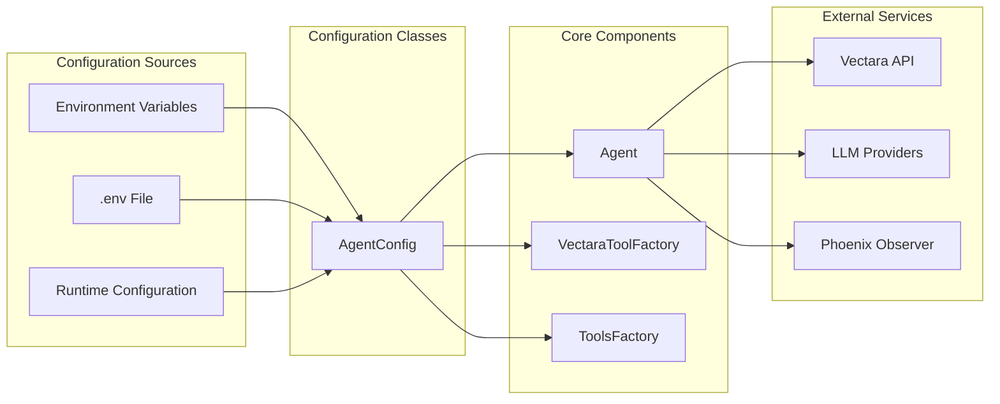

<!-- source: DeepWiki mcp.deepwiki.com · repo vectara/py-vectara-agentic · page 3 Installation and Configuration · fetched 2026-10-27 -->

# Installation and Configuration

<details>
<summary>Relevant source files</summary>

The following files were used as context for generating this wiki page:

- [docs/endpoint.md](docs/endpoint.md)
- [docs/installation.md](docs/installation.md)
- [requirements.txt](requirements.txt)
- [setup.py](setup.py)
- [vectara_agentic/__init__.py](vectara_agentic/__init__.py)

</details>


This document covers the installation of the vectara-agentic package and the initial configuration required to start building AI agents. It includes dependency management, environment variable setup, and basic configuration verification steps. For detailed agent configuration options, see [Agent Configuration](#3.2). For LLM provider-specific setup, see [LLM Provider Setup](#3.3).

## Package Installation

The vectara-agentic package can be installed directly from PyPI using pip:

```bash
pip install vectara-agentic
```

The package requires Python 3.10 or higher, as specified in [setup.py:39](). The installation will automatically handle all required dependencies through the setuptools configuration defined in [setup.py:26]().

**Sources:** [docs/installation.md:1-8](), [setup.py:39]()

## Dependencies Overview

The vectara-agentic package has an extensive dependency tree built around the LlamaIndex ecosystem. Understanding these dependencies helps with troubleshooting and environment management.

### Core Framework Dependencies

```mermaid
graph TB
    subgraph "Core Framework"
        llamaindex["llama-index==0.12.35"]
        vectara_managed["llama-index-indices-managed-vectara==0.4.5"]
    end
    
    subgraph "Agent Types"
        agent_openai["llama-index-agent-openai==0.4.8"]
        agent_compiler["llama-index-agent-llm-compiler==0.3.0"]
        agent_lats["llama-index-agent-lats==0.3.0"]
    end
    
    subgraph "LLM Providers"
        llm_openai["llama-index-llms-openai==0.3.42"]
        llm_anthropic["llama-index-llms-anthropic==0.6.10"]
        llm_google["llama-index-llms-google-genai==0.1.12"]
        llm_together["llama-index-llms-together==0.3.1"]
        llm_groq["llama-index-llms-groq==0.3.1"]
        llm_bedrock["llama-index-llms-bedrock==0.3.8"]
        llm_cohere["llama-index-llms-cohere==0.4.1"]
        llm_fireworks["llama-index-llms-fireworks==0.3.2"]
        llm_openai_like["llama-index-llms-openai-like>=0.3.5"]
    end
    
    llamaindex --> vectara_managed
    llamaindex --> agent_openai
    llamaindex --> agent_compiler
    llamaindex --> agent_lats
    llamaindex --> llm_openai
    llamaindex --> llm_anthropic
    llamaindex --> llm_google
    llamaindex --> llm_together
    llamaindex --> llm_groq
    llamaindex --> llm_bedrock
    llamaindex --> llm_cohere
    llamaindex --> llm_fireworks
    llamaindex --> llm_openai_like
```



### Tool Ecosystem Dependencies

```mermaid
graph TB
    subgraph "Research and Search Tools"
        yahoo_finance["llama-index-tools-yahoo-finance==0.3.0"]
        arxiv["llama-index-tools-arxiv==0.3.0"]
        tavily["llama-index-tools-tavily_research==0.3.0"]
        brave_search["llama_index.tools.brave_search==0.3.0"]
        exa["llama-index-tools-exa==0.3.0"]
        wikipedia["llama-index-tools-wikipedia==0.3.0"]
        bing_search["llama-index-tools-bing-search==0.3.0"]
    end
    
    subgraph "Database and Integration Tools"
        database["llama-index-tools-database==0.3.0"]
        neo4j["llama-index-tools-neo4j==0.3.0"]
        waii["llama-index-tools-waii==0.3.0"]
        kuzu_graph["llama-index-graph-stores-kuzu==0.7.0"]
        salesforce["llama-index-tools-salesforce==0.3.0"]
        slack["llama-index-tools-slack==0.3.0"]
    end
    
    subgraph "External APIs"
        google_tools["llama-index-tools-google==0.3.0"]
        tavily_python["tavily-python==0.7.2"]
        exa_py["exa-py==1.12.1"]
    end
    
    yahoo_finance --> database
    arxiv --> database
    tavily --> tavily_python
    exa --> exa_py
```



### Observability and Monitoring Dependencies

The package includes comprehensive observability tools for monitoring agent performance:

| Component | Version | Purpose |
|-----------|---------|---------|
| `arize-phoenix` | 8.26.1 | Main observability platform |
| `arize-phoenix-otel` | 0.9.2 | OpenTelemetry integration |
| `openinference-instrumentation-llama-index` | 4.2.1 | LlamaIndex instrumentation |
| `opentelemetry-proto` | >=1.31.0 | OpenTelemetry protocol definitions |

**Sources:** [requirements.txt:1-43]()

## Environment Configuration

### Required Environment Variables

The vectara-agentic package requires several environment variables for proper operation. These are referenced throughout the codebase via the `AgentConfig` class.

#### Vectara Configuration
```bash
# Required for Vectara platform access
export VECTARA_API_KEY="your_vectara_api_key"
export VECTARA_CUSTOMER_ID="your_customer_id"
```

#### LLM Provider Configuration
```bash
# OpenAI (most common)
export OPENAI_API_KEY="your_openai_api_key"

# Anthropic Claude
export ANTHROPIC_API_KEY="your_anthropic_api_key"

# Google Gemini
export GOOGLE_API_KEY="your_google_api_key"

# Other providers as needed
export TOGETHER_API_KEY="your_together_api_key"
export GROQ_API_KEY="your_groq_api_key"
```

#### API Endpoint Configuration
```bash
# For hosting agents behind API endpoints
export VECTARA_AGENTIC_API_KEY="your_endpoint_api_key"
```

### Configuration Loading

The package uses `python-dotenv` for environment variable management. You can create a `.env` file in your project root:

```
VECTARA_API_KEY=your_vectara_api_key
VECTARA_CUSTOMER_ID=your_customer_id
OPENAI_API_KEY=your_openai_api_key
```

**Sources:** [requirements.txt:39](), [docs/endpoint.md:9-14]()

## Configuration Architecture



## Verification Steps

### 1. Package Import Verification

Verify the installation by importing the main components:

```python
from vectara_agentic import Agent, AgentConfig, VectaraToolFactory
print("vectara-agentic imported successfully")
```

The main package exports are defined in [vectara_agentic/__init__.py:15-19]().

### 2. Dependency Verification

Check that core dependencies are available:

```python
import llama_index
from llama_index.indices.managed.vectara import VectaraIndex
from llama_index.agent.openai import OpenAIAgent
print("Core dependencies verified")
```

### 3. Environment Configuration Check

Verify that required environment variables are set:

```python
import os
required_vars = ['VECTARA_API_KEY', 'VECTARA_CUSTOMER_ID', 'OPENAI_API_KEY']
missing_vars = [var for var in required_vars if not os.getenv(var)]
if missing_vars:
    print(f"Missing environment variables: {missing_vars}")
else:
    print("Environment configuration verified")
```

### 4. Basic Agent Creation

Test basic agent creation to ensure everything is working:

```python
from vectara_agentic import Agent, AgentConfig

config = AgentConfig()
agent = Agent(config=config, tools=[], verbose=True)
print("Agent created successfully")
```

**Sources:** [vectara_agentic/__init__.py:5-19]()

---

