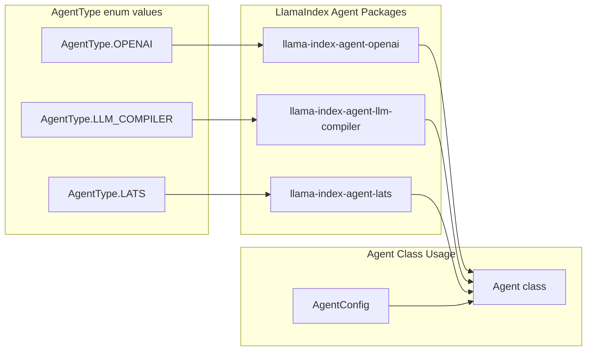
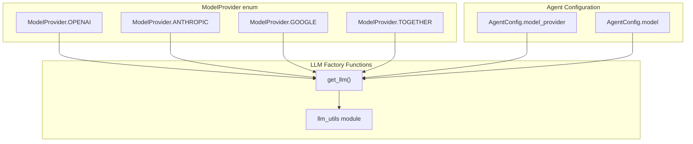
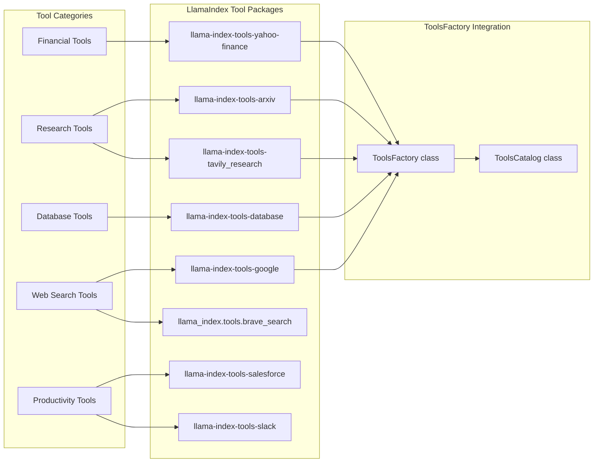
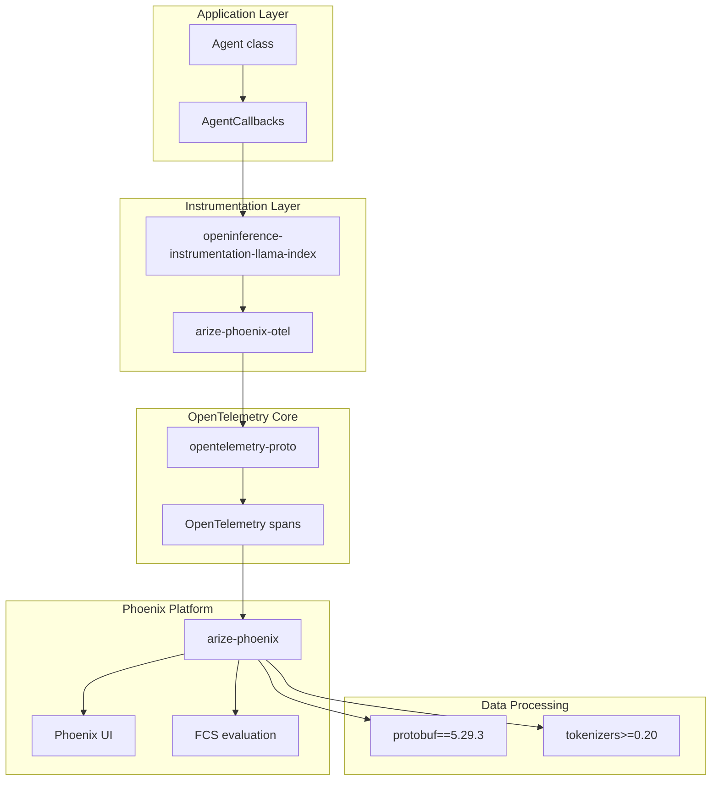
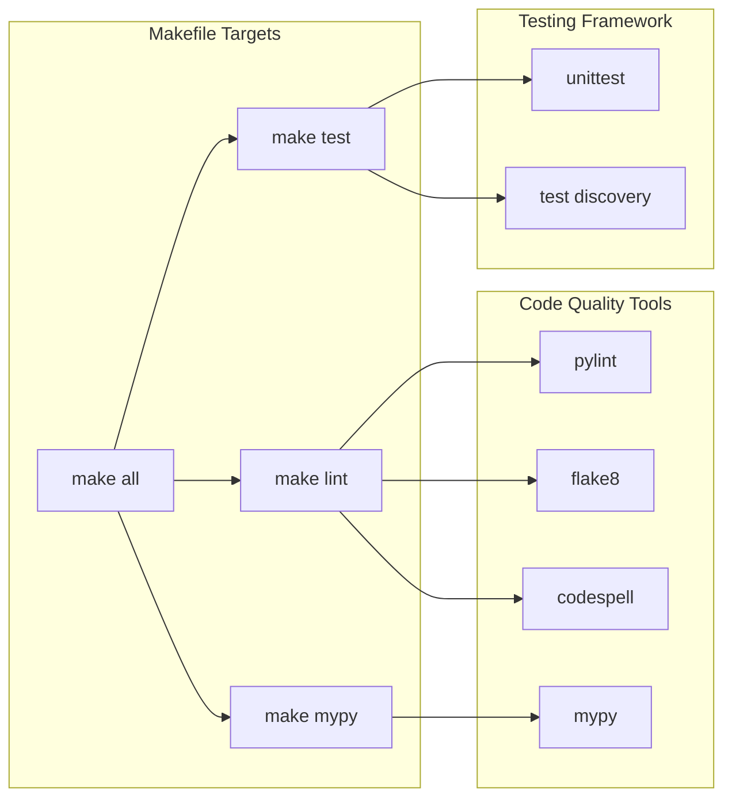

<!-- source: DeepWiki mcp.deepwiki.com · repo vectara/py-vectara-agentic · page 3.1 Dependencies and Setup · fetched 2026-10-27 -->

# Dependencies and Setup

<details>
<summary>Relevant source files</summary>

The following files were used as context for generating this wiki page:

- [Makefile](Makefile)
- [requirements.txt](requirements.txt)
- [setup.py](setup.py)
- [vectara_agentic/__init__.py](vectara_agentic/__init__.py)

</details>


This document covers the dependency architecture and installation process for the vectara-agentic package. It details the core LlamaIndex ecosystem integration, LLM provider requirements, tool ecosystem dependencies, and observability stack components necessary for running AI agents with Vectara integration.

For information about configuring agents after installation, see [Agent Configuration](#3.2). For LLM provider-specific configuration, see [LLM Provider Setup](#3.3).

## Core Dependency Architecture

The vectara-agentic package is built on top of the LlamaIndex ecosystem, requiring Python 3.10 or higher. The dependency structure follows a layered architecture where each layer provides specific capabilities to the AI agent framework.

### Dependency Layer Structure

```mermaid
graph TB
    subgraph "Application Layer"
        VA["vectara_agentic"]
    end
    
    subgraph "Core Framework Layer"
        LI["llama-index==0.12.35"]
        VMI["llama-index-indices-managed-vectara==0.4.5"]
    end
    
    subgraph "Agent Types Layer"
        REACT["llama-index-agent-openai==0.4.8"]
        COMPILER["llama-index-agent-llm-compiler==0.3.0"]
        LATS["llama-index-agent-lats==0.3.0"]
    end
    
    subgraph "LLM Provider Layer"
        OPENAI["llama-index-llms-openai==0.3.42"]
        ANTHROPIC["llama-index-llms-anthropic==0.6.10"]
        GOOGLE["llama-index-llms-google-genai==0.1.12"]
        TOGETHER["llama-index-llms-together==0.3.1"]
        GROQ["llama-index-llms-groq==0.3.1"]
        BEDROCK["llama-index-llms-bedrock==0.3.8"]
    end
    
    subgraph "Tool Ecosystem Layer"
        YAHOO["llama-index-tools-yahoo-finance==0.3.0"]
        ARXIV["llama-index-tools-arxiv==0.3.0"]
        DATABASE["llama-index-tools-database==0.3.0"]
        GOOGLE_TOOLS["llama-index-tools-google==0.3.0"]
        TAVILY["llama-index-tools-tavily_research==0.3.0"]
    end
    
    subgraph "Observability Layer"
        PHOENIX["arize-phoenix==8.26.1"]
        OTEL["opentelemetry-proto>=1.31.0"]
        INSTRUMENTATION["openinference-instrumentation-llama-index==4.2.1"]
    end
    
    VA --> LI
    VA --> VMI
    LI --> REACT
    LI --> COMPILER
    LI --> LATS
    LI --> OPENAI
    LI --> ANTHROPIC
    LI --> GOOGLE
    LI --> TOGETHER
    LI --> GROQ
    LI --> BEDROCK
    LI --> YAHOO
    LI --> ARXIV
    LI --> DATABASE
    LI --> GOOGLE_TOOLS
    LI --> TAVILY
    LI --> PHOENIX
    LI --> OTEL
    LI --> INSTRUMENTATION
```



Sources: [requirements.txt:1-42](), [setup.py:39]()

## LlamaIndex Ecosystem Integration

The package leverages the modular LlamaIndex architecture through specific component integrations. Each component is installed as a separate package to minimize dependency overhead and enable selective feature usage.

### Core LlamaIndex Components

| Component | Version | Purpose | Code Integration |
|-----------|---------|---------|------------------|
| `llama-index` | 0.12.35 | Core framework providing agent orchestration | [vectara_agentic/__init__.py:5-6]() |
| `llama-index-indices-managed-vectara` | 0.4.5 | Vectara index integration for RAG operations | [vectara_agentic/tools.py]() |

### Agent Type Dependencies



Sources: [requirements.txt:3-5](), [vectara_agentic/types.py]()

## LLM Provider Dependencies

The framework supports multiple LLM providers through dedicated LlamaIndex integration packages. Each provider requires specific authentication and configuration.

### Provider Package Mapping

| Provider | Package | Version | Environment Variables |
|----------|---------|---------|----------------------|
| OpenAI | `llama-index-llms-openai` | 0.3.42 | `OPENAI_API_KEY` |
| Anthropic | `llama-index-llms-anthropic` | 0.6.10 | `ANTHROPIC_API_KEY` |
| Google Gemini | `llama-index-llms-google-genai` | 0.1.12 | `GOOGLE_API_KEY` |
| Together AI | `llama-index-llms-together` | 0.3.1 | `TOGETHER_API_KEY` |
| Groq | `llama-index-llms-groq` | 0.3.1 | `GROQ_API_KEY` |
| Fireworks | `llama-index-llms-fireworks` | 0.3.2 | `FIREWORKS_API_KEY` |
| Cohere | `llama-index-llms-cohere` | 0.4.1 | `COHERE_API_KEY` |
| AWS Bedrock | `llama-index-llms-bedrock` | 0.3.8 | AWS credentials |

### LLM Provider Architecture



Sources: [requirements.txt:6-14](), [vectara_agentic/llm_utils.py](), [vectara_agentic/types.py]()

## Tool Ecosystem Dependencies

The tool ecosystem provides specialized capabilities through LlamaIndex tool integrations and external API libraries.

### Built-in Tool Dependencies



### External API Libraries

| Tool Integration | Package | Version | Purpose |
|-----------------|---------|---------|---------|
| Tavily Research | `tavily-python` | 0.7.2 | Web search and research |
| Exa Search | `exa-py` | 1.12.1 | Semantic search API |

Sources: [requirements.txt:15-30](), [vectara_agentic/tools_factory.py](), [vectara_agentic/tools_catalog.py]()

## Observability and Monitoring Stack

The observability infrastructure uses OpenTelemetry and Arize Phoenix for comprehensive agent monitoring and evaluation.

### Observability Component Architecture



### Observability Dependencies

| Component | Version | Purpose |
|-----------|---------|---------|
| `arize-phoenix` | 8.26.1 | Main observability platform |
| `arize-phoenix-otel` | 0.9.2 | OpenTelemetry integration |
| `openinference-instrumentation-llama-index` | 4.2.1 | LlamaIndex auto-instrumentation |
| `opentelemetry-proto` | >=1.31.0 | OpenTelemetry protocol definitions |

Sources: [requirements.txt:31-35](), [vectara_agentic/agent.py](), [vectara_agentic/callbacks.py]()

## Installation Process

### Package Installation

The package is distributed through PyPI and can be installed using standard Python package managers:

```bash
pip install vectara_agentic
```

### Development Installation

For development work, install from source with development dependencies:

```bash
git clone https://github.com/vectara/py-vectara-agentic
cd py-vectara-agentic
pip install -e .
```

### Package Configuration

The setup configuration defines key package metadata and requirements:

| Configuration | Value | Source |
|---------------|-------|---------|
| Package name | `vectara_agentic` | [setup.py:17]() |
| Python requirement | `>=3.10` | [setup.py:39]() |
| License | Apache Software License | [setup.py:29]() |
| Development Status | Beta | [setup.py:31]() |

Sources: [setup.py:16-40](), [vectara_agentic/__init__.py:22-26]()

## Development Setup

### Development Tools

The development environment includes linting, type checking, and testing tools configured through the Makefile:



### Core Dependencies

| Dependency | Version | Purpose |
|------------|---------|---------|
| `pydantic` | 2.11.3 | Data validation and settings management |
| `python-dotenv` | 1.0.1 | Environment variable loading |
| `httpx` | 0.28.1 | HTTP client for API interactions |
| `tiktoken` | 0.9.0 | Token counting for OpenAI models |
| `retrying` | 1.3.4 | Retry logic for API calls |
| `cloudpickle` | >=3.1.1 | Serialization support |

Sources: [Makefile:1-13](), [requirements.txt:37-42](), [setup.py:5-7]()

---

