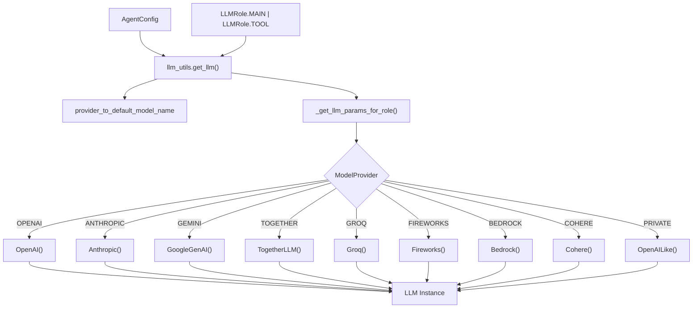
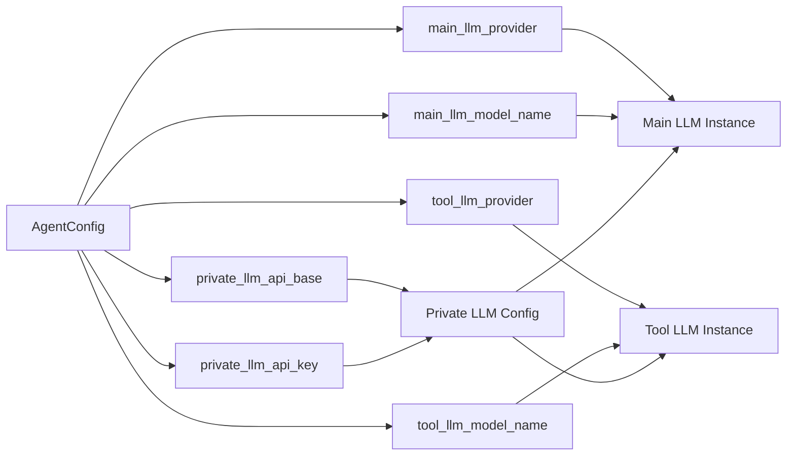
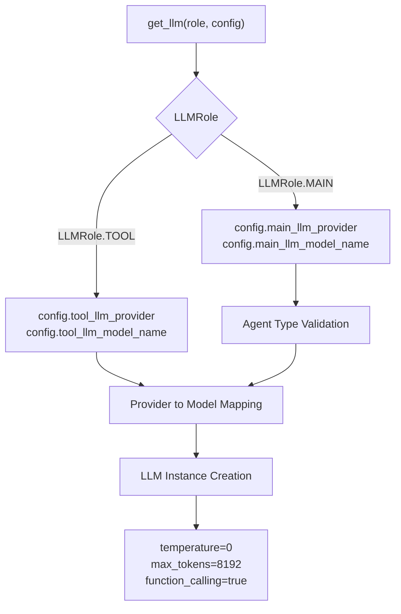
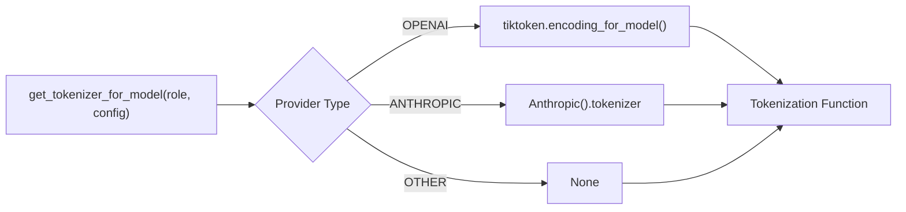

<!-- source: DeepWiki mcp.deepwiki.com · repo vectara/py-vectara-agentic · page 3.3 LLM Provider Setup · fetched 2026-10-27 -->

# LLM Provider Setup

<details>
<summary>Relevant source files</summary>

The following files were used as context for generating this wiki page:

- [tests/test_api_endpoint.py](tests/test_api_endpoint.py)
- [tests/test_fallback.py](tests/test_fallback.py)
- [tests/test_gemini.py](tests/test_gemini.py)
- [tests/test_groq.py](tests/test_groq.py)
- [tests/test_private_llm.py](tests/test_private_llm.py)
- [vectara_agentic/agent_endpoint.py](vectara_agentic/agent_endpoint.py)
- [vectara_agentic/llm_utils.py](vectara_agentic/llm_utils.py)
- [vectara_agentic/tool_utils.py](vectara_agentic/tool_utils.py)

</details>


This document covers how to configure and use different Large Language Model (LLM) providers within the vectara-agentic framework. The system supports multiple commercial and open-source LLM providers through a unified configuration interface.

For general agent configuration including environment variables and other settings, see [Agent Configuration](#3.2). For information about using agents in production deployments, see [Docker Deployment](#7.1).

## Overview

The vectara-agentic framework provides a flexible LLM provider system that allows you to use different models for different roles within your agent. The system distinguishes between two LLM roles:

- **Main LLM**: Used for primary agent reasoning and response generation
- **Tool LLM**: Used for processing tool outputs and generating summaries

## Provider Architecture



Sources: [vectara_agentic/llm_utils.py:84-161]()

## Supported Providers

The system supports the following LLM providers with their default models:

| Provider | Default Model | Class Used |
|----------|---------------|------------|
| OpenAI | `gpt-4o` | `llama_index.llms.openai.OpenAI` |
| Anthropic | `claude-3-7-sonnet-latest` | `llama_index.llms.anthropic.Anthropic` |
| Google Gemini | `models/gemini-2.0-flash` | `llama_index.llms.google_genai.GoogleGenAI` |
| Together AI | `Qwen/Qwen2.5-72B-Instruct-Turbo` | `llama_index.llms.together.TogetherLLM` |
| Groq | `meta-llama/llama-4-scout-17b-16e-instruct` | `llama_index.llms.groq.Groq` |
| Fireworks | `accounts/fireworks/models/firefunction-v2` | `llama_index.llms.fireworks.Fireworks` |
| AWS Bedrock | `anthropic.claude-3-7-sonnet-20250219-v1:0` | `llama_index.llms.bedrock.Bedrock` |
| Cohere | `command-a-03-2025` | `llama_index.llms.cohere.Cohere` |
| Private/Custom | Configurable | `llama_index.llms.openai_like.OpenAILike` |

Sources: [vectara_agentic/llm_utils.py:15-24](), [vectara_agentic/llm_utils.py:91-161]()

## Configuration Through AgentConfig

LLM providers are configured through the `AgentConfig` class using the following parameters:



Sources: [vectara_agentic/llm_utils.py:30-61]()

## Provider-Specific Setup

### OpenAI Configuration

```python
config = AgentConfig(
    main_llm_provider=ModelProvider.OPENAI,
    main_llm_model_name="gpt-4o",  # Optional, defaults to gpt-4o
    tool_llm_provider=ModelProvider.OPENAI
)
```

OpenAI models are configured with function calling enabled and strict mode for better tool use accuracy.

Sources: [vectara_agentic/llm_utils.py:91-99]()

### Anthropic Configuration

```python
config = AgentConfig(
    main_llm_provider=ModelProvider.ANTHROPIC,
    main_llm_model_name="claude-3-7-sonnet-latest"
)
```

Sources: [vectara_agentic/llm_utils.py:100-105]()

### Google Gemini Configuration

```python
config = AgentConfig(
    main_llm_provider=ModelProvider.GEMINI,
    main_llm_model_name="models/gemini-2.0-flash"
)
```

Gemini models are configured with function calling and parallel tool call support enabled.

Sources: [vectara_agentic/llm_utils.py:106-115](), [tests/test_gemini.py:57-61]()

### Groq Configuration

```python
config = AgentConfig(
    main_llm_provider=ModelProvider.GROQ,
    tool_llm_provider=ModelProvider.GROQ
)
```

Sources: [vectara_agentic/llm_utils.py:125-133](), [tests/test_groq.py:57-61]()

### Private/Custom LLM Configuration

For private or custom LLM endpoints that are OpenAI-compatible:

```python
config = AgentConfig(
    main_llm_provider=ModelProvider.PRIVATE,
    main_llm_model_name="gpt-4o",
    private_llm_api_base="http://127.0.0.1:5001/v1",
    private_llm_api_key="YOUR_API_KEY"
)
```

The private provider uses the `OpenAILike` class to connect to custom endpoints that implement the OpenAI API specification.

Sources: [vectara_agentic/llm_utils.py:146-158](), [tests/test_private_llm.py:50-56]()

## LLM Role Configuration



The system allows different providers for main and tool LLMs, enabling cost optimization by using more expensive models for main reasoning and cheaper models for tool processing.

Sources: [vectara_agentic/llm_utils.py:30-61](), [vectara_agentic/llm_utils.py:84-161]()

## Fallback Configuration

The agent system supports fallback configuration to automatically switch to a backup LLM provider if the primary provider fails:

```python
primary_config = AgentConfig(
    main_llm_provider=ModelProvider.PRIVATE,
    private_llm_api_base="http://127.0.0.1:5001/v1"
)

fallback_config = AgentConfig(
    main_llm_provider=ModelProvider.OPENAI
)

agent = Agent(
    agent_config=primary_config,
    fallback_agent_config=fallback_config,
    tools=tools
)
```

Sources: [tests/test_fallback.py:50-63]()

## Environment Variables

Most providers require API keys to be set as environment variables:

- `OPENAI_API_KEY` - OpenAI API key
- `ANTHROPIC_API_KEY` - Anthropic API key  
- `GOOGLE_API_KEY` - Google Gemini API key
- `TOGETHER_API_KEY` - Together AI API key
- `GROQ_API_KEY` - Groq API key
- `FIREWORKS_API_KEY` - Fireworks API key
- `COHERE_API_KEY` - Cohere API key

For AWS Bedrock, use standard AWS credentials configuration.

## Agent Type Compatibility

When using `AgentType.OPENAI`, the main LLM provider must be set to `ModelProvider.OPENAI`. The system validates this constraint and raises an error if there's a mismatch.

Sources: [vectara_agentic/llm_utils.py:54-59]()

## Tokenization Support

The system provides tokenization utilities for supported providers:



Sources: [vectara_agentic/llm_utils.py:63-81]()

---

