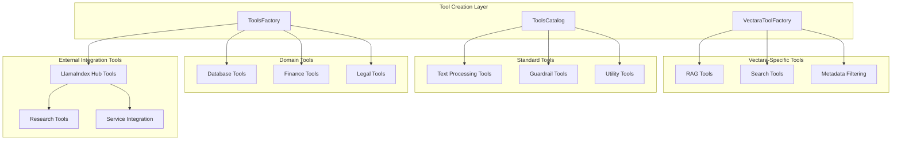
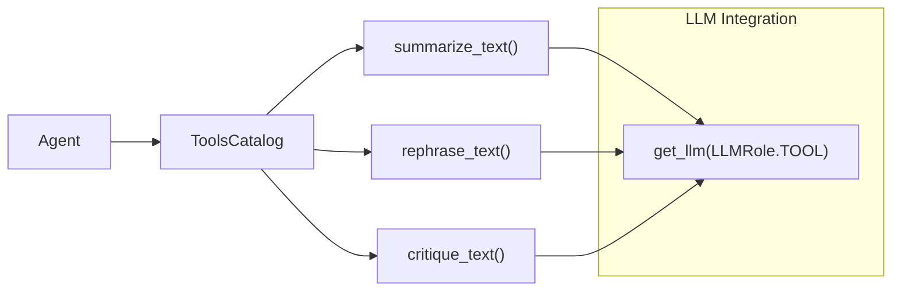
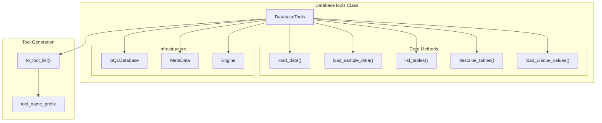
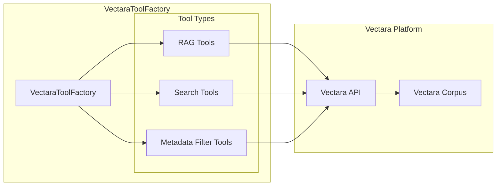
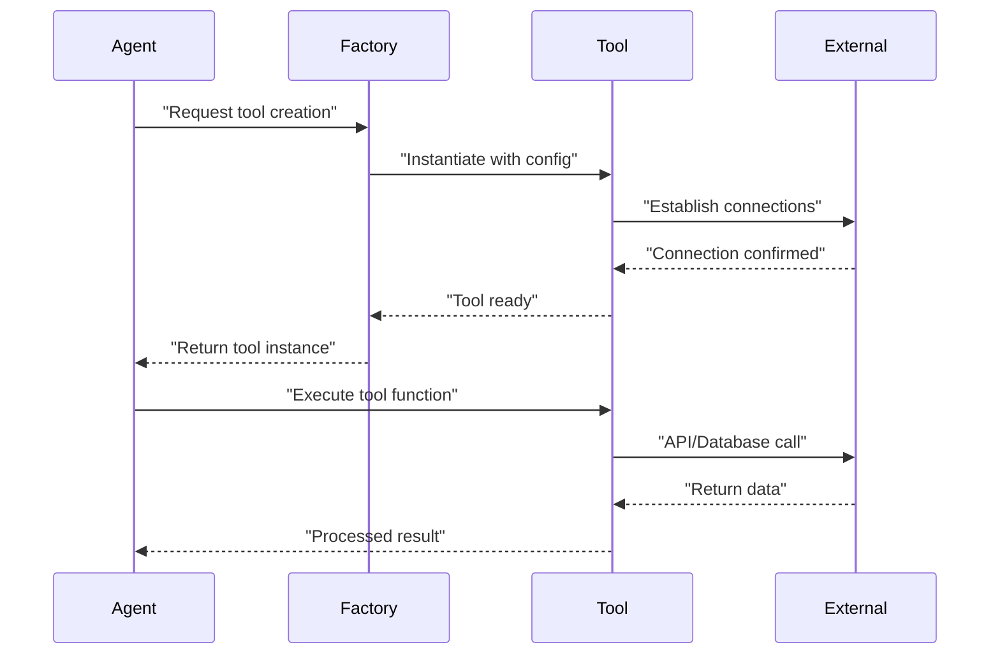
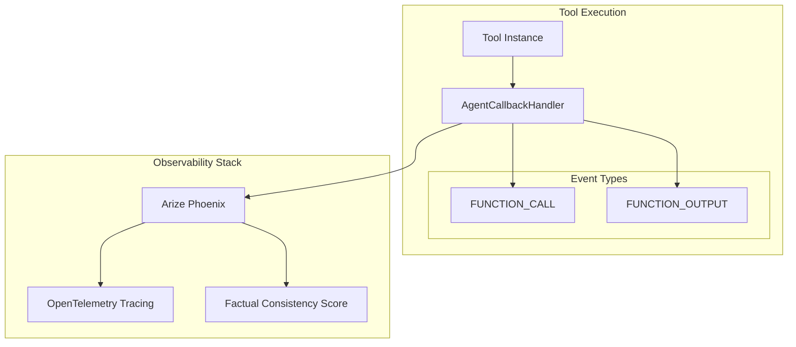

<!-- source: DeepWiki mcp.deepwiki.com · repo vectara/py-vectara-agentic · page 4.2 Available Tools · fetched 2026-10-27 -->

# Available Tools

Relevant source files

The following files were used as context for generating this wiki page:

- [.pylintrc](.pylintrc)
- [docs/tools.md](docs/tools.md)
- [vectara_agentic/_callback.py](vectara_agentic/_callback.py)
- [vectara_agentic/_observability.py](vectara_agentic/_observability.py)
- [vectara_agentic/db_tools.py](vectara_agentic/db_tools.py)
- [vectara_agentic/tools_catalog.py](vectara_agentic/tools_catalog.py)

This document provides a comprehensive catalog of built-in tools available in the vectara-agentic framework. Tools are functional components that agents can invoke to perform specific tasks, from retrieving information to processing data and interacting with external systems.

For information about creating custom tools or extending the tool system, see the Tool Factory System documentation in [Core Components](#2.2). For basic usage examples with tools, see [Basic Usage](#4.1).

## Tool Architecture Overview

The vectara-agentic framework organizes tools through a factory-based architecture that supports multiple tool categories and creation patterns.

Sources: High-level system architecture diagrams, [vectara_agentic/tools_catalog.py:34-146](), [vectara_agentic/db_tools.py:27-283]()

## Standard Text Processing Tools

The `ToolsCatalog` class provides fundamental text manipulation capabilities that agents commonly need.

### Text Manipulation Tools

| Tool Name | Function | Purpose |
|-----------|----------|---------|
| `summarize_text` | Text summarization with expertise | Condense content from specific domain perspective |
| `rephrase_text` | Text transformation | Rewrite content according to instructions |
| `critique_text` | Content evaluation | Analyze text from specified viewpoint |

**Implementation Details:**
- All text tools use `get_llm(LLMRole.TOOL, config=self.agent_config)` for processing
- Input validation ensures string parameters are provided
- Tools support markdown preservation in output

Sources: [vectara_agentic/tools_catalog.py:42-129]()

### Utility Tools

| Tool Name | Function | Return Type |
|-----------|----------|-------------|
| `get_current_date` | Current date retrieval | String in "Day, Month Day, Year" format |

Sources: [vectara_agentic/tools_catalog.py:26-31]()

## Guardrail Tools

Security and content safety tools help agents avoid inappropriate content generation.

### Content Safety

The `get_bad_topics()` function returns a predefined list of prohibited discussion topics:

- politics
- religion  
- violence
- hate speech
- adult content
- illegal activities

**Usage Pattern:** Agents automatically call this tool when available and use the returned topics to guide response generation away from prohibited content.

Sources: [vectara_agentic/tools_catalog.py:134-146]()

## Database Tools

The `DatabaseTools` class provides comprehensive database interaction capabilities for analytics and data retrieval.

### Database Tool Catalog

### Database Tool Functions

| Tool Function | Purpose | Return Type |
|---------------|---------|-------------|
| `load_data(sql_query)` | Execute SQL query with row limits | `List[str]` |
| `load_sample_data(table_name, num_rows)` | Fetch sample rows from table | `List[str]` |
| `list_tables()` | List all database tables | `List[str]` |  
| `describe_tables(tables)` | Get table schema information | `str` |
| `load_unique_values(table_name, columns, num_vals)` | Fetch unique column values | `Dict[str, List[str]]` |

**Configuration Parameters:**
- `max_rows`: Maximum rows returned (default: 1000)
- `tool_name_prefix`: Prefix for generated tool names
- Database connection via `SQLDatabase`, `Engine`, or connection URI

**Safety Features:**
- Query result counting before execution
- Row limit enforcement to prevent memory issues
- Table existence validation
- Exception handling with descriptive error messages

Sources: [vectara_agentic/db_tools.py:107-216](), [vectara_agentic/db_tools.py:218-248]()

## Vectara-Specific Tools  

Vectara tools provide retrieval-augmented generation capabilities through the Vectara platform integration.

### RAG and Search Tools

**Tool Categories:**
- **RAG Tools**: Query corpus with summarization
- **Search Tools**: Document retrieval without summarization  
- **Metadata Filter Tools**: Filtered search with metadata constraints

Sources: High-level system architecture diagrams, Tool Factory and Creation System diagram

## External Integration Tools

The framework supports extensive integration with external services through the LlamaIndex ecosystem.

### Research and Information Tools

| Tool Category | Tools Available | Purpose |
|---------------|-----------------|---------|
| Research | `arxiv`, `tavily_research` | Academic and web research |
| Search | `exa.ai`, `brave` | Web search capabilities |
| Graph Databases | `kuzu`, `neo4j` | Graph data querying |
| Services | `google`, `slack`, `salesforce` | Business system integration |

### Financial Analysis Tools

Based on LlamaIndex YahooFinanceToolSpec:

| Tool Name | Data Retrieved |
|-----------|----------------|
| `balance_sheet` | Company balance sheet |
| `income_statement` | Company income statement |
| `cash_flow` | Company cash flow statement |
| `stock_news` | Latest company news |
| `stock_basic_info` | Basic company and price information |
| `stock_analyst_recommendations` | Analyst recommendations |

### Legal Domain Tools

Specialized tools for legal document processing:

| Tool Name | Function |
|-----------|----------|
| `summarize_legal_text` | Legal document summarization |
| `critique_as_judge` | Expert legal analysis from judicial perspective |

Sources: [docs/tools.md:13-115]()

## Tool Management and Lifecycle

### Tool Creation Patterns

**Factory Responsibilities:**
- Tool instantiation with proper configuration
- Connection management for external services
- Error handling and validation
- Tool metadata generation

**Tool Lifecycle:**
1. Factory creates tool instance with configuration
2. Tool establishes external connections if needed  
3. Agent invokes tool methods during execution
4. Tool handles serialization for persistence

Sources: [vectara_agentic/db_tools.py:218-273](), Tool Factory and Creation System diagram

### Observability Integration

Tools integrate with the observability system for monitoring and evaluation:

**Monitoring Capabilities:**
- Function call tracking with arguments
- Output monitoring and validation
- Performance metrics collection
- Factual consistency scoring for RAG tools

Sources: [vectara_agentic/_callback.py:203-226](), [vectara_agentic/_observability.py:94-126]()

---

