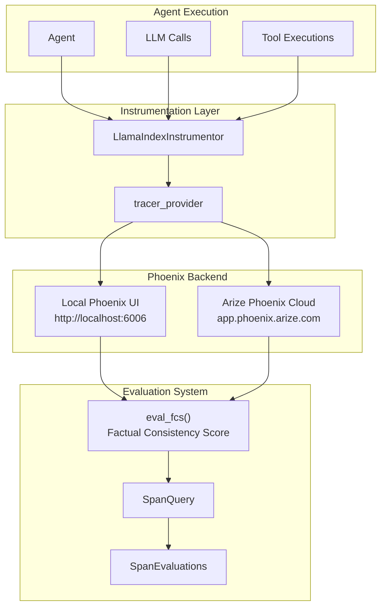
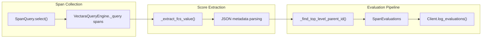
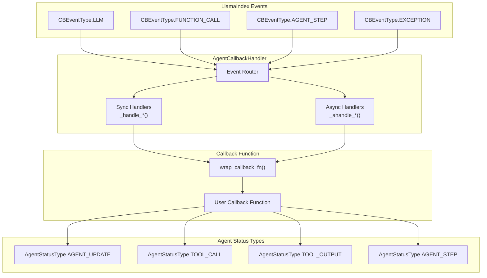
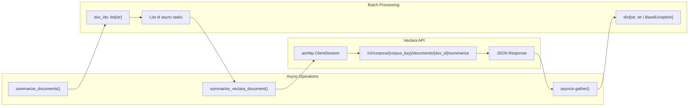
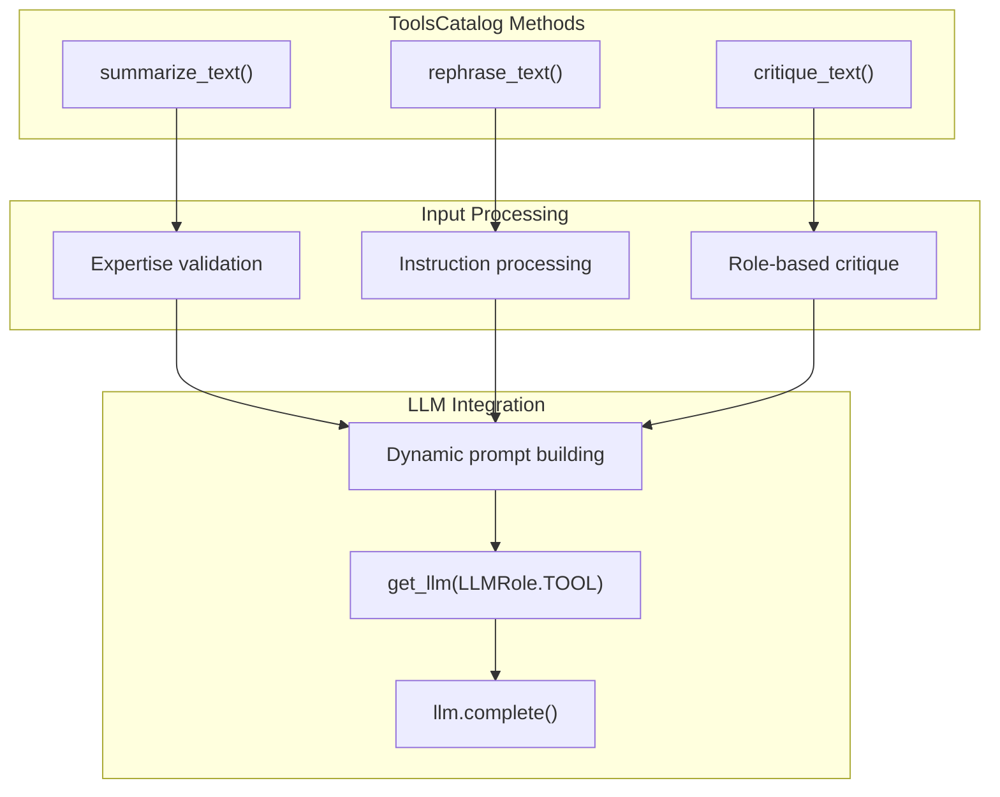
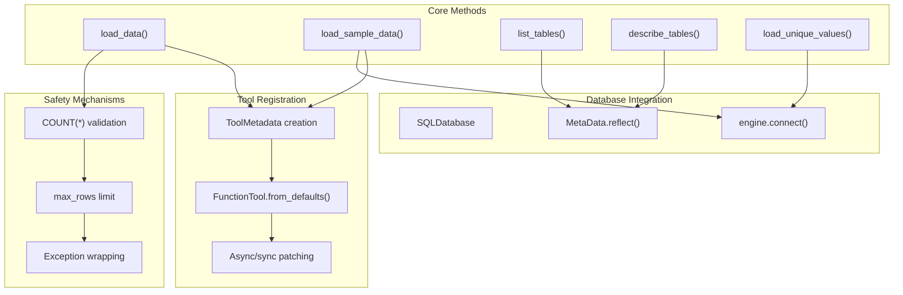

<!-- source: DeepWiki mcp.deepwiki.com · repo vectara/py-vectara-agentic · page 4.3 Advanced Features · fetched 2026-10-27 -->

# Advanced Features

<details>
<summary>Relevant source files</summary>

The following files were used as context for generating this wiki page:

- [.pylintrc](.pylintrc)
- [vectara_agentic/_callback.py](vectara_agentic/_callback.py)
- [vectara_agentic/_observability.py](vectara_agentic/_observability.py)
- [vectara_agentic/db_tools.py](vectara_agentic/db_tools.py)
- [vectara_agentic/tools_catalog.py](vectara_agentic/tools_catalog.py)
- [vectara_agentic/utils.py](vectara_agentic/utils.py)

</details>


This page covers advanced capabilities within the vectara-agentic framework that extend beyond basic agent usage and standard tool integration. These features include observability and monitoring, callback mechanisms for tracking agent progress, utility functions for specialized operations, and advanced tool capabilities.

For basic agent creation and interaction patterns, see [Basic Usage](#4.1). For information about standard tools and their configuration, see [Available Tools](#4.2).

## Observability and Monitoring

The vectara-agentic framework provides comprehensive observability through integration with Arize Phoenix, enabling detailed tracking of agent interactions, LLM calls, and tool executions.

### Phoenix Integration Architecture



### Observer Setup Process

The `setup_observer` function in [vectara_agentic/_observability.py:11-58]() handles the complete initialization of Phoenix observability:

| Configuration | Environment Variable | Purpose |
|---------------|---------------------|---------|
| Local Phoenix | None required | Launches local Phoenix UI at localhost:6006 |
| Arize Cloud | `PHOENIX_ENDPOINT`, `PHOENIX_API_KEY` | Connects to Arize Phoenix cloud service |
| Project Name | Hardcoded | All traces grouped under "vectara-agentic" |

The setup process follows this flow:
1. Check if `ObserverType.ARIZE_PHOENIX` is configured
2. Import required Phoenix libraries with fallback error handling
3. Configure endpoint (local vs. cloud)
4. Register tracer provider with LlamaIndex instrumentation
5. Enable tracing for all agent operations

### Factual Consistency Score Evaluation

The framework includes automated evaluation of Factual Consistency Scores (FCS) from Vectara query results through the `eval_fcs` function:



Sources: [vectara_agentic/_observability.py:11-126]()

## Callback System

The callback system provides real-time monitoring of agent execution through the `AgentCallbackHandler` class, supporting both synchronous and asynchronous callback functions.

### Callback Handler Architecture



### Callback Event Types

The `AgentCallbackHandler` processes different event types and translates them to agent-specific status updates:

| LlamaIndex Event | Handler Method | Agent Status Type | Data Extracted |
|------------------|----------------|-------------------|-----------------|
| `CBEventType.LLM` | `_handle_llm` | `AGENT_UPDATE` | Response text or prompt |
| `CBEventType.FUNCTION_CALL` | `_handle_function_call` | `TOOL_CALL`, `TOOL_OUTPUT` | Function arguments, output |
| `CBEventType.AGENT_STEP` | `_handle_agent_step` | `AGENT_STEP` | Messages or responses |

The `wrap_callback_fn` function ensures callback compatibility by filtering parameters to match the callback's signature, preventing runtime errors from unexpected parameters.

Sources: [vectara_agentic/_callback.py:1-351]()

## Utility Functions

The framework provides several utility functions for specialized operations, particularly for Vectara document processing and function introspection.

### Document Summarization Utilities



The `summarize_documents` function enables batch processing of multiple documents with error handling per document:

- Accepts `corpus_key`, `api_key`, `doc_ids`, and optional `llm_name` 
- Creates concurrent tasks using `asyncio.gather` with `return_exceptions=True`
- Returns a dictionary mapping document IDs to either summary strings or exceptions
- Includes timeout handling (60 seconds) and comprehensive error reporting

### Function Introspection Utilities

The `remove_self_from_signature` decorator modifies method signatures for tool creation:

```python
# Applied to tool methods in ToolsCatalog
@remove_self_from_signature
def summarize_text(self, text: str, expertise: str) -> str:
    # Method implementation
```

This decorator removes the `self` parameter from the function signature, enabling proper tool registration with LlamaIndex while maintaining object-oriented method structure.

### Type Checking Utilities

The `is_float` function provides safe string-to-float conversion checking, used throughout the codebase for parameter validation.

Sources: [vectara_agentic/utils.py:1-87]()

## Advanced Tool Features

### Text Processing Tools

The `ToolsCatalog` class provides sophisticated text processing capabilities that leverage LLM integration:



Each tool method includes parameter validation and structured prompt construction:

- `summarize_text`: Applies domain expertise to text summarization
- `rephrase_text`: Transforms text according to specific instructions
- `critique_text`: Provides structured critique from specified perspectives

### Database Tools Advanced Features

The `DatabaseTools` class provides comprehensive database interaction capabilities with safety mechanisms:



Key safety features include:
- Row count validation before query execution to prevent resource exhaustion
- Comprehensive error handling with user-friendly error messages
- Table existence validation for all table-specific operations
- Automatic serialization support through custom `__getstate__` and `__setstate__` methods

The `to_tool_list` method converts all database operations into LlamaIndex `FunctionTool` objects with proper metadata and async support through the `patch_sync` function.

### Guardrails Integration

The framework includes content safety mechanisms through the `get_bad_topics` function, which returns a list of topics to avoid:

- Politics, religion, violence
- Hate speech, adult content
- Illegal activities

This function integrates with agent safety systems to prevent generation of inappropriate content.

Sources: [vectara_agentic/tools_catalog.py:1-146](), [vectara_agentic/db_tools.py:1-283]()

---

