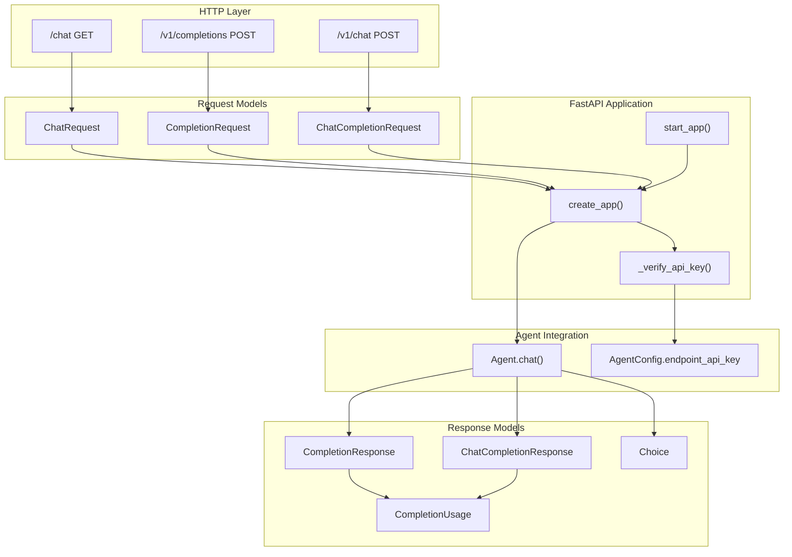
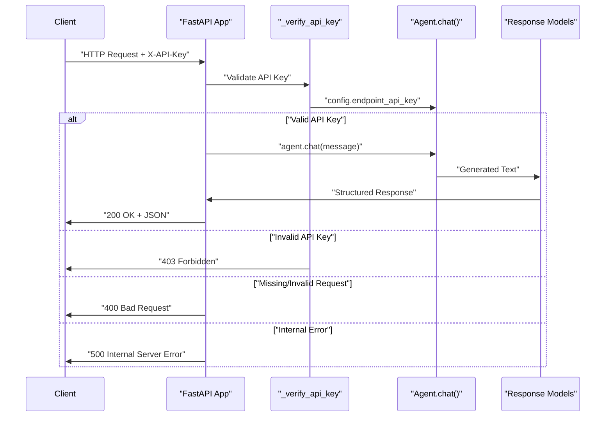
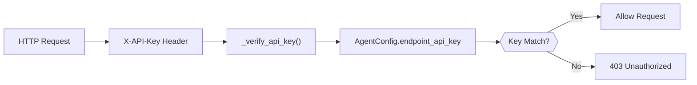
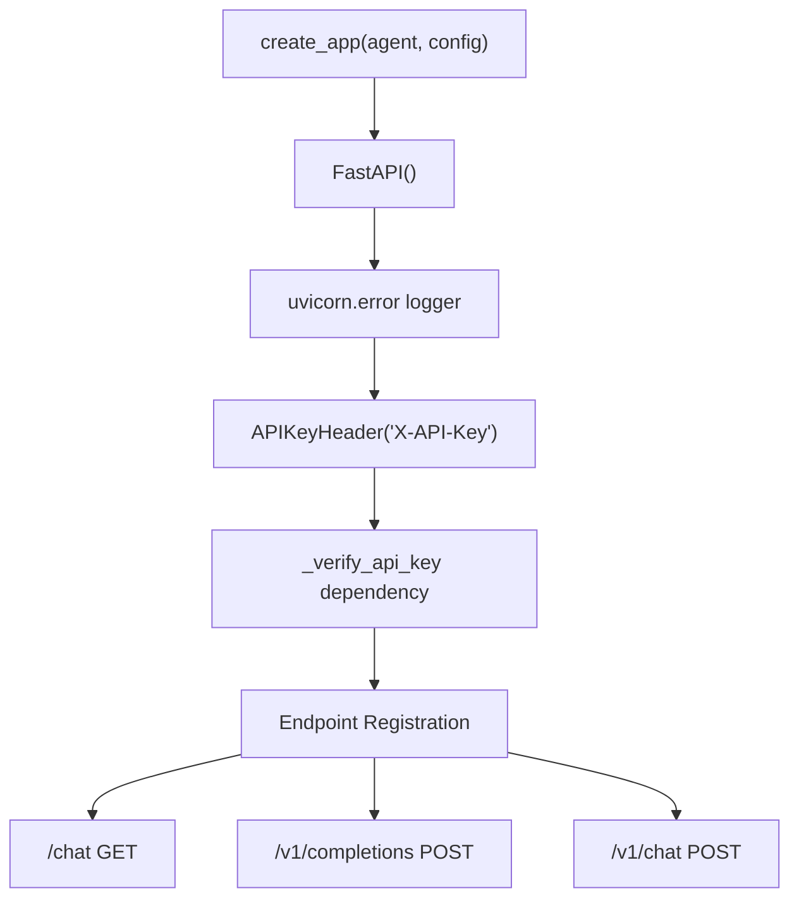

<!-- source: DeepWiki mcp.deepwiki.com · repo vectara/py-vectara-agentic · page 5.1 REST API · fetched 2026-10-27 -->

# REST API

<details>
<summary>Relevant source files</summary>

The following files were used as context for generating this wiki page:

- [docs/endpoint.md](docs/endpoint.md)
- [docs/installation.md](docs/installation.md)
- [tests/test_api_endpoint.py](tests/test_api_endpoint.py)
- [tests/test_gemini.py](tests/test_gemini.py)
- [tests/test_groq.py](tests/test_groq.py)
- [vectara_agentic/agent_endpoint.py](vectara_agentic/agent_endpoint.py)

</details>


This document covers the native REST API endpoints provided by vectara-agentic for exposing Agent functionality over HTTP. The system provides both simple chat endpoints and OpenAI-compatible completion endpoints.

For OpenAI-compatible chat completion endpoints specifically, see [OpenAI-Compatible Endpoints](#5.2).

## Overview

The REST API component transforms vectara-agentic `Agent` instances into HTTP web services using FastAPI. It provides multiple endpoint patterns to accommodate different integration needs, from simple chat interfaces to OpenAI-compatible completion APIs.

## API Endpoint Architecture



**Sources:** [vectara_agentic/agent_endpoint.py:1-253]()

## Request/Response Flow



**Sources:** [vectara_agentic/agent_endpoint.py:114-151](), [vectara_agentic/agent_endpoint.py:158-196](), [vectara_agentic/agent_endpoint.py:203-237]()

## Core Endpoint Types

### Chat Endpoint (`/chat`)

The `/chat` endpoint provides a simple GET-based interface for basic agent interactions.

| Parameter | Type | Required | Description |
|-----------|------|----------|-------------|
| `message` | `str` | Yes | User message to send to agent |

**Request Headers:**
- `X-API-Key`: Authentication token from `AgentConfig.endpoint_api_key`

**Response Schema:**
```json
{
  "response": "string"
}
```

**Sources:** [vectara_agentic/agent_endpoint.py:19-23](), [vectara_agentic/agent_endpoint.py:131-151]()

### Completion Endpoint (`/v1/completions`)

OpenAI-compatible completion endpoint supporting the `CompletionRequest` schema.

| Field | Type | Required | Default | Description |
|-------|------|----------|---------|-------------|
| `model` | `str` | Yes | - | Model identifier (passed through) |
| `prompt` | `str` or `List[str]` | Yes | - | Input prompt for completion |
| `max_tokens` | `int` | No | 16 | Maximum tokens (not enforced) |
| `temperature` | `float` | No | 1.0 | Temperature setting (not enforced) |
| `top_p` | `float` | No | 1.0 | Top-p setting (not enforced) |
| `n` | `int` | No | 1 | Number of completions (not enforced) |
| `stop` | `str` or `List[str]` | No | - | Stop sequences (not enforced) |

**Response:** `CompletionResponse` with `Choice` objects and `CompletionUsage` statistics.

**Sources:** [vectara_agentic/agent_endpoint.py:25-35](), [vectara_agentic/agent_endpoint.py:54-63](), [vectara_agentic/agent_endpoint.py:158-196]()

### Chat Completion Endpoint (`/v1/chat`)

OpenAI-compatible chat completion endpoint supporting the `ChatCompletionRequest` schema.

| Field | Type | Required | Default | Description |
|-------|------|----------|---------|-------------|
| `model` | `str` | Yes | - | Model identifier (passed through) |
| `messages` | `List[ChatMessage]` | Yes | - | Conversation messages |
| `temperature` | `float` | No | 1.0 | Temperature setting (not enforced) |
| `top_p` | `float` | No | 1.0 | Top-p setting (not enforced) |
| `n` | `int` | No | 1 | Number of completions (not enforced) |

**Message Processing:** Concatenates all `user` role messages, ignoring `system` and `assistant` messages.

**Response:** `ChatCompletionResponse` with `ChatCompletionChoice` objects and usage statistics.

**Sources:** [vectara_agentic/agent_endpoint.py:71-78](), [vectara_agentic/agent_endpoint.py:65-69](), [vectara_agentic/agent_endpoint.py:203-237]()

## Authentication System

### API Key Verification

Authentication uses the `APIKeyHeader` dependency with header name `X-API-Key`.



**Configuration:** Set `AgentConfig.endpoint_api_key` or environment variable `VECTARA_AGENTIC_API_KEY`.

**Sources:** [vectara_agentic/agent_endpoint.py:112-126]()

## Token Usage Calculation

The API provides basic token usage statistics using word-count approximation.

| Metric | Calculation Method |
|--------|-------------------|
| `prompt_tokens` | `len(input_text.split())` |
| `completion_tokens` | `len(response_text.split())` |
| `total_tokens` | `prompt_tokens + completion_tokens` |

**Note:** This is not actual tokenizer-based counting and serves as a rough approximation.

**Sources:** [vectara_agentic/agent_endpoint.py:182-184](), [vectara_agentic/agent_endpoint.py:217-218]()

## Application Lifecycle

### Application Creation

The `create_app()` function configures the FastAPI application with agent and configuration dependencies.



**Sources:** [vectara_agentic/agent_endpoint.py:97-239]()

### Application Startup

The `start_app()` function launches the configured FastAPI application using Uvicorn.

**Parameters:**
- `agent`: `Agent` instance for handling requests
- `host`: Network interface (default: `"0.0.0.0"`)
- `port`: Port number (default: `8000`)

**Sources:** [vectara_agentic/agent_endpoint.py:242-252]()

## Error Handling

### HTTP Status Codes

| Status Code | Condition | Endpoint |
|-------------|-----------|----------|
| 200 | Successful request | All |
| 400 | Missing required fields | All |
| 403 | Invalid API key | All |
| 500 | Internal server error | All |

### Error Response Format

All error responses follow FastAPI's standard `HTTPException` format:

```json
{
  "detail": "Error message"
}
```

**Sources:** [vectara_agentic/agent_endpoint.py:125](), [vectara_agentic/agent_endpoint.py:146](), [vectara_agentic/agent_endpoint.py:173]()

## Integration Testing

The test suite demonstrates endpoint functionality using `TestClient` from FastAPI.

### Test Coverage Areas

- Successful requests with proper authentication
- Authentication failure scenarios  
- Missing required parameters
- Multiple message handling in chat completions
- Response format validation
- UUID generation for request IDs

**Sources:** [tests/test_api_endpoint.py:1-127]()

---

