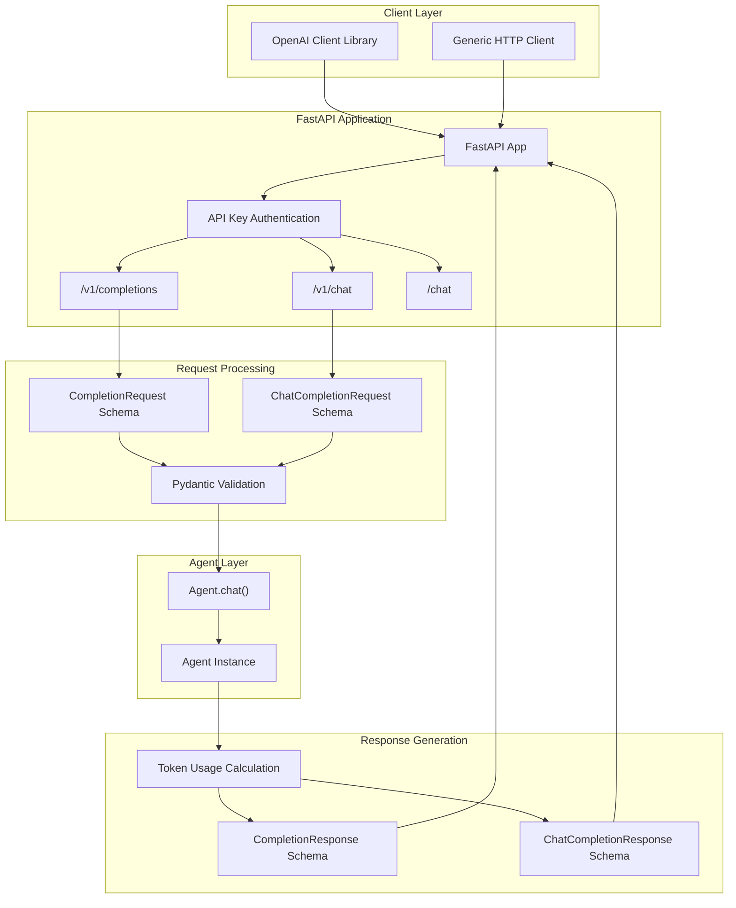
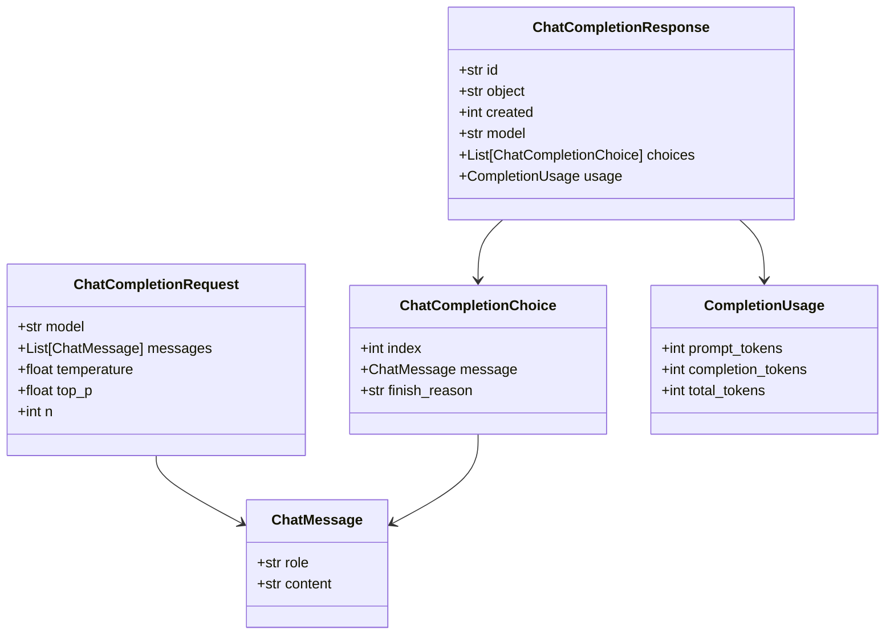
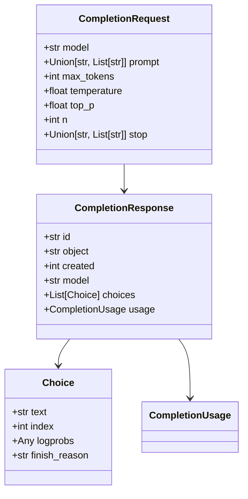
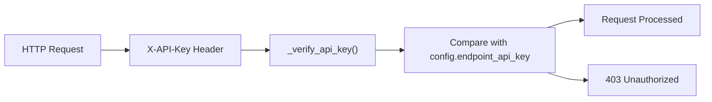

<!-- source: DeepWiki mcp.deepwiki.com · repo vectara/py-vectara-agentic · page 5.2 OpenAI-Compatible Endpoints · fetched 2026-10-27 -->

# OpenAI-Compatible Endpoints

<details>
<summary>Relevant source files</summary>

The following files were used as context for generating this wiki page:

- [docker/simple-agent.py](docker/simple-agent.py)
- [tests/endpoint.py](tests/endpoint.py)
- [tests/test_api_endpoint.py](tests/test_api_endpoint.py)
- [tests/test_gemini.py](tests/test_gemini.py)
- [tests/test_groq.py](tests/test_groq.py)
- [vectara_agentic/agent_endpoint.py](vectara_agentic/agent_endpoint.py)

</details>


This document covers the OpenAI-compatible HTTP endpoints provided by vectara-agentic, which allow agents to be accessed using standard OpenAI API client libraries and tools. These endpoints wrap the core Agent functionality in familiar REST API patterns.

For information about the native vectara-agentic REST API, see [REST API](#5.1). For details about the underlying Agent system that powers these endpoints, see [Agent System](#2.1).

## Overview

The vectara-agentic framework provides OpenAI-compatible endpoints that expose Agent functionality through familiar API patterns. This compatibility allows existing OpenAI client applications to integrate with vectara-agentic agents with minimal code changes.

The implementation centers around the `create_app()` function in [vectara_agentic/agent_endpoint.py:97-239](), which creates a FastAPI application with OpenAI-style endpoints. These endpoints translate incoming OpenAI API requests into calls to the underlying `Agent.chat()` method.

## Request Flow Architecture



Sources: [vectara_agentic/agent_endpoint.py:97-239](), [tests/test_api_endpoint.py:1-127]()

## Available Endpoints

### Chat Completions Endpoint

The `/v1/chat` endpoint provides OpenAI ChatGPT-compatible chat completion functionality:

| Property | Value |
|----------|--------|
| Method | POST |
| Path | `/v1/chat` |
| Request Schema | `ChatCompletionRequest` |
| Response Schema | `ChatCompletionResponse` |
| Handler Function | `chat_completion()` |

The endpoint processes a list of chat messages and returns the agent's response in OpenAI's chat completion format. User messages are concatenated and passed to `Agent.chat()`.

### Text Completions Endpoint  

The `/v1/completions` endpoint provides OpenAI text completion functionality:

| Property | Value |
|----------|--------|
| Method | POST |
| Path | `/v1/completions` |
| Request Schema | `CompletionRequest` |
| Response Schema | `CompletionResponse` |
| Handler Function | `completions()` |

This endpoint accepts a text prompt and returns a completion response with usage statistics.

### Legacy Chat Endpoint

A simplified GET-based chat endpoint is also available:

| Property | Value |
|----------|--------|
| Method | GET |
| Path | `/chat` |
| Parameters | `message` (query string) |
| Response | Simple JSON with `response` field |
| Handler Function | `chat()` |

Sources: [vectara_agentic/agent_endpoint.py:128-151](), [vectara_agentic/agent_endpoint.py:154-196](), [vectara_agentic/agent_endpoint.py:198-237]()

## Request and Response Schemas

### Chat Completion Schemas

The chat completion endpoint uses these Pydantic models:



Sources: [vectara_agentic/agent_endpoint.py:65-95]()

### Text Completion Schemas

The text completion endpoint uses these models:



Sources: [vectara_agentic/agent_endpoint.py:25-63]()

## Authentication

All endpoints require API key authentication via the `X-API-Key` header. The authentication is implemented using FastAPI's dependency injection system:



The API key is configured through the `AgentConfig.endpoint_api_key` property. If the provided key doesn't match, the endpoint returns a 403 Unauthorized response.

Sources: [vectara_agentic/agent_endpoint.py:112-126]()

## Usage Examples

### Using OpenAI Python Client

```python
from openai import OpenAI

# Configure client to point to vectara-agentic endpoint
client = OpenAI(
    base_url="http://localhost:8000/v1",
    api_key="your-endpoint-api-key"
)

# Chat completion
response = client.chat.completions.create(
    model="any-model-name",
    messages=[
        {"role": "user", "content": "What is Vectara?"}
    ]
)

# Text completion  
response = client.completions.create(
    model="any-model-name",
    prompt="Explain vector databases"
)
```

### Direct HTTP Requests

```python
import requests

headers = {"X-API-Key": "your-endpoint-api-key"}

# Chat completion
chat_request = {
    "model": "agent-model",
    "messages": [{"role": "user", "content": "Hello"}]
}
response = requests.post(
    "http://localhost:8000/v1/chat", 
    json=chat_request, 
    headers=headers
)

# Simple chat
response = requests.get(
    "http://localhost:8000/chat",
    params={"message": "Hello"},
    headers=headers
)
```

Sources: [tests/test_api_endpoint.py:71-89](), [tests/test_api_endpoint.py:44-58]()

## Deployment

### Basic Deployment

The simplest way to deploy an agent with OpenAI-compatible endpoints is using the `start_app()` function:

```python
from vectara_agentic.agent import Agent
from vectara_agentic.agent_endpoint import start_app

agent = Agent.from_corpus(
    tool_name='query_tool',
    vectara_corpus_id='corpus_id',
    vectara_api_key='api_key',
    data_description='Your data',
    assistant_specialty='domain expert'
)

start_app(agent, host="0.0.0.0", port=8000)
```

### Custom FastAPI Integration

For more control, create the FastAPI app directly:

```python
from vectara_agentic.agent_endpoint import create_app
from vectara_agentic.agent_config import AgentConfig

config = AgentConfig(endpoint_api_key="secure-key")
app = create_app(agent, config)

# Add custom middleware, routes, etc.
# Deploy with uvicorn, gunicorn, etc.
```

Sources: [docker/simple-agent.py:1-19](), [vectara_agentic/agent_endpoint.py:242-252]()

## Implementation Details

### Token Counting

The endpoints implement basic token counting by splitting text on whitespace:

- `prompt_tokens`: Word count of input text
- `completion_tokens`: Word count of agent response  
- `total_tokens`: Sum of prompt and completion tokens

This provides approximate usage statistics compatible with OpenAI's response format, though not as precise as actual tokenization.

### Response ID Generation

Each response includes a unique ID generated using `uuid.uuid4()`:
- Chat completions: `chatcmpl-{uuid}`
- Text completions: `cmpl-{uuid}`

### Message Processing

For chat completions, only messages with `role: "user"` are processed. All user messages are concatenated with spaces and passed to the agent as a single prompt.

Sources: [vectara_agentic/agent_endpoint.py:176-196](), [vectara_agentic/agent_endpoint.py:207-237]()

---

