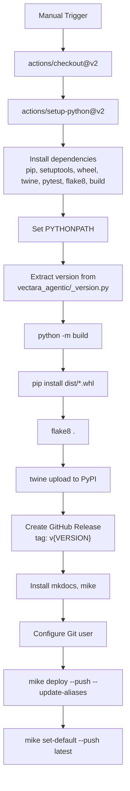
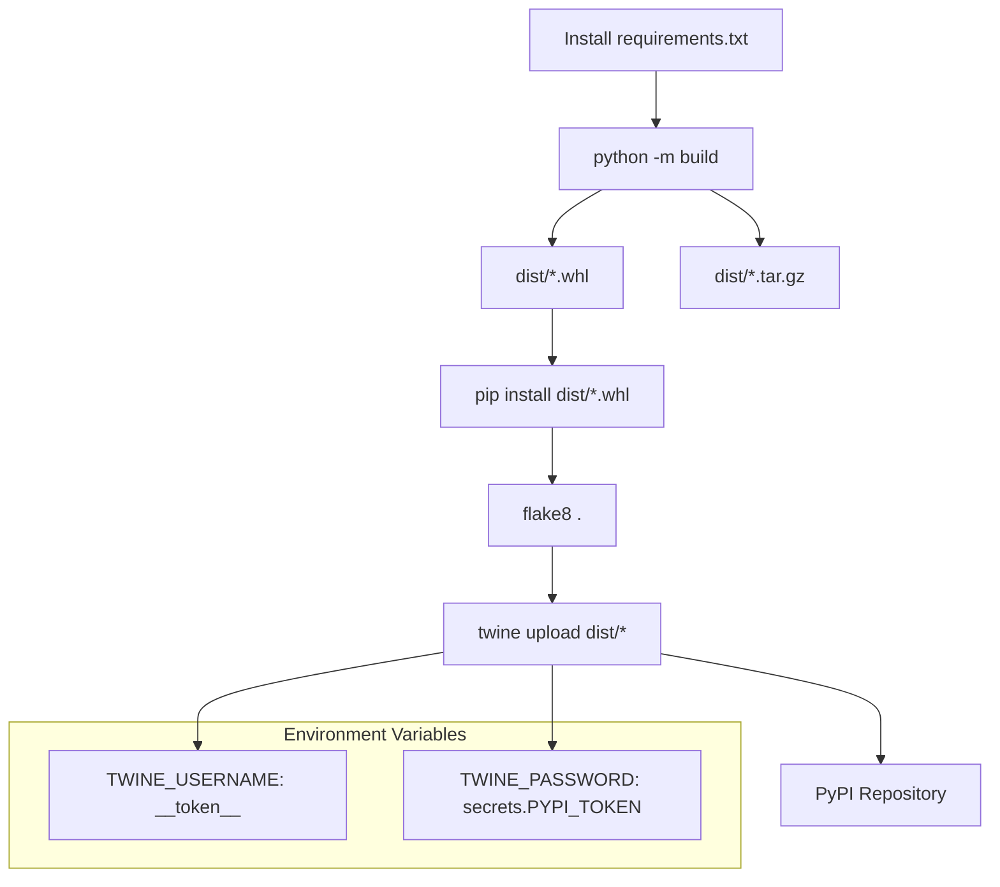
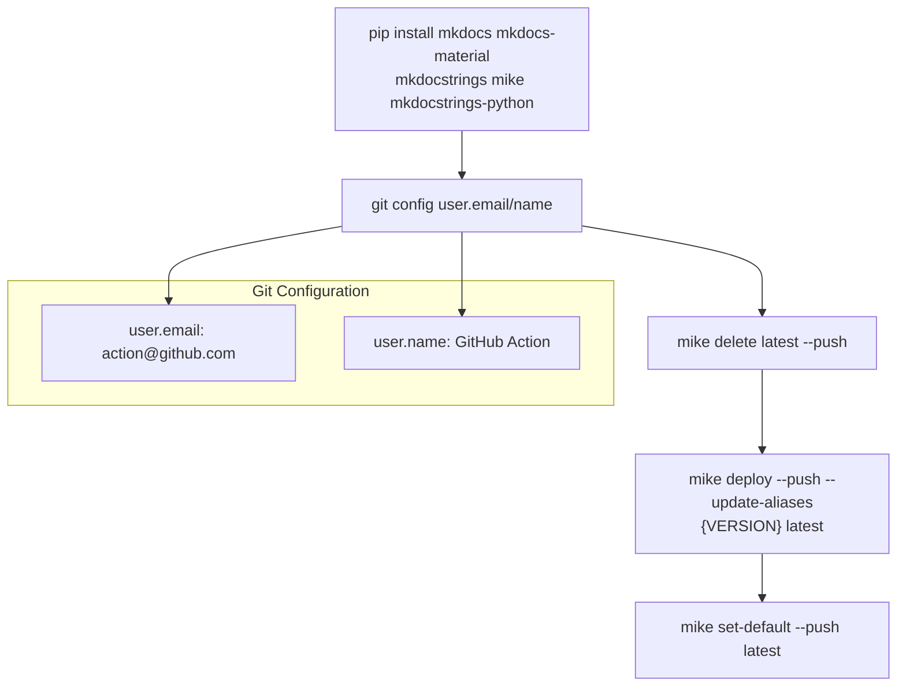
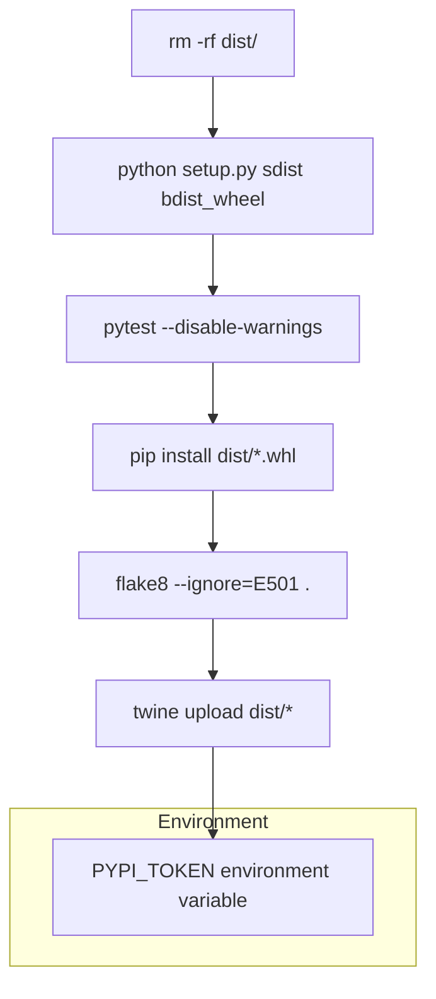

<!-- source: DeepWiki mcp.deepwiki.com · repo vectara/py-vectara-agentic · page 6.3 Release Process · fetched 2026-10-27 -->

# Release Process

<details>
<summary>Relevant source files</summary>

The following files were used as context for generating this wiki page:

- [.github/assets/Vectara-logo.png](.github/assets/Vectara-logo.png)
- [.github/workflows/publish_release.yml](.github/workflows/publish_release.yml)
- [publish.sh](publish.sh)
- [vectara_agentic/_version.py](vectara_agentic/_version.py)

</details>


This document describes the automated release and publishing workflow for the vectara-agentic package. It covers version management, package building, PyPI publishing, GitHub releases, and documentation deployment.

For information about setting up the development environment, see [Development Environment](#6.2). For testing procedures before release, see [Testing Framework](#6.1).

## Release Workflow Overview

The vectara-agentic package uses an automated GitHub Actions workflow for releases. The process is triggered manually and handles the complete release lifecycle from version extraction to documentation deployment.

### GitHub Actions Release Workflow



**GitHub Actions Release Process**

Sources: [.github/workflows/publish_release.yml:1-89]()

## Version Management

The package version is centrally managed in a single file and extracted during the release process using shell commands.

### Version Definition and Extraction

```mermaid
graph LR
    VersionFile["vectara_agentic/_version.py<br/>__version__ = '0.2.18'"] --> GrepCmd["grep -o '__version__ = \"[^\"]*\"'"]
    GrepCmd --> SedCmd["sed 's/__version__ = \"//;s/\"//g'"]
    SedCmd --> EnvVar["VERSION environment variable"]
    EnvVar --> GitTag["Git tag: v{VERSION}"]
    EnvVar --> PyPIRelease["PyPI package version"]
    EnvVar --> DocsVersion["Documentation version"]
```

**Version Extraction Pipeline**

The version extraction process uses shell commands to parse the version string:

| Step | Command | Purpose |
|------|---------|---------|
| Extract | `grep -o '__version__ = "[^"]*"'` | Find version line |
| Clean | `sed 's/__version__ = "//;s/"//g'` | Remove quotes and assignment |
| Store | `echo "VERSION=$VERSION" >> $GITHUB_ENV` | Set environment variable |

Sources: [vectara_agentic/_version.py:1-5](), [.github/workflows/publish_release.yml:32-39]()

## Build and Publish Process

The workflow uses modern Python packaging tools to build and distribute the package.

### Package Build Steps



**Package Build and Distribution Process**

### Dependencies and Tools

The build process installs the following tools:

| Tool | Purpose |
|------|---------|
| `setuptools` | Package setup utilities |
| `wheel` | Wheel format building |
| `twine` | PyPI upload tool |
| `pytest` | Testing framework |
| `flake8` | Code linting |
| `build` | Modern build backend |

Sources: [.github/workflows/publish_release.yml:24-27](), [.github/workflows/publish_release.yml:40-57]()

## Documentation Deployment

Documentation is automatically updated as part of the release process using `mike` for versioned documentation management.

### Documentation Workflow



**Documentation Deployment Pipeline**

The documentation deployment process:

1. **Tool Installation**: Installs MkDocs ecosystem tools
2. **Git Configuration**: Sets up GitHub Action as committer
3. **Version Management**: Removes existing `latest` alias
4. **Deployment**: Deploys new version with `latest` alias
5. **Default Setting**: Sets `latest` as the default documentation version

Sources: [.github/workflows/publish_release.yml:72-89]()

## Manual Release Alternative

A shell script provides an alternative manual release process for development use.

### Manual Release Script



**Manual Release Process via publish.sh**

The manual script performs similar steps but uses older build tools:

| Script Step | Command | Difference from GitHub Actions |
|-------------|---------|--------------------------------|
| Build | `python setup.py sdist bdist_wheel` | Uses setuptools directly vs `python -m build` |
| Lint | `flake8 --ignore=E501 .` | Ignores line length vs strict linting |
| Upload | Direct twine command | Uses environment variable vs GitHub secret |

Sources: [publish.sh:1-21]()

## Release Triggers and Permissions

The release workflow is configured with specific triggers and repository restrictions.

### Workflow Configuration

| Setting | Value | Purpose |
|---------|-------|---------|
| Trigger | `workflow_dispatch` | Manual trigger only |
| Repository Check | `github.repository == 'vectara/py-vectara-agentic'` | Prevents unauthorized releases |
| Runner | `ubuntu-latest` | Consistent Linux environment |
| Python Version | `3.x` | Latest stable Python 3 |

### Required Secrets

The workflow requires the following GitHub repository secrets:

| Secret | Usage |
|--------|--------|
| `PYPI_TOKEN` | PyPI API token for package upload |
| `GITHUB_TOKEN` | Automatic token for GitHub release creation |

Sources: [.github/workflows/publish_release.yml:3-11](), [.github/workflows/publish_release.yml:54-55](), [.github/workflows/publish_release.yml:63]()

---

