# Page: Overview

# Overview

<details>
<summary>Relevant source files</summary>

The following files were used as context for generating this wiki page:

- [README.md](README.md)
- [docs/index.md](docs/index.md)
- [requirements-dev.txt](requirements-dev.txt)
- [setup.py](setup.py)
- [tests/test_agent_planning.py](tests/test_agent_planning.py)
- [tests/test_agent_type.py](tests/test_agent_type.py)
- [vectara_agentic/__init__.py](vectara_agentic/__init__.py)

</details>


This document provides a high-level introduction to the `vectara-agentic` Python package, explaining its purpose as an AI agent framework for building retrieval-augmented generation (RAG) applications powered by Vectara. For detailed architecture information, see [Architecture](#1.1). For installation and setup instructions, see [Installation and Configuration](#3).

## Purpose and Scope

`vectara-agentic` is a Python library that enables developers to build sophisticated AI assistants and agents using Agentic RAG patterns. The package provides a simplified interface for creating agents that can reason about complex queries, use tools to gather information, and provide comprehensive responses grounded in data stored in Vectara corpora.

The library addresses the limitations of traditional RAG systems by introducing an agent-based approach where an LLM acts as a "manager" that can analyze user queries, break them down into sub-problems, select appropriate tools, and orchestrate multi-step workflows to produce accurate, comprehensive responses.

**Sources:** [README.md:39-59](), [docs/index.md:3-44](), [setup.py:21-22]()

## System Architecture Overview

The following diagram shows the high-level architecture of vectara-agentic, mapping conceptual components to their code entities:

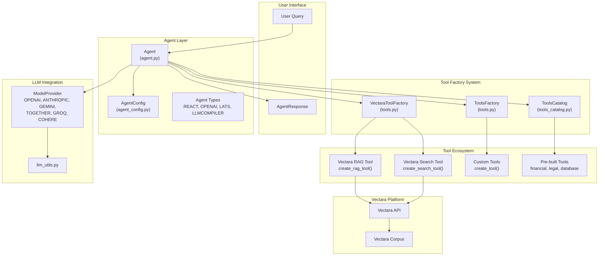

**Sources:** [vectara_agentic/__init__.py:5-12](), [README.md:88-96](), [tests/test_agent_type.py:16-68]()

## Core Framework Components

The vectara-agentic framework is built around several key code entities that work together to provide agentic RAG capabilities:

### Agent System
The `Agent` class serves as the central orchestrator, managing the interaction between users, tools, and LLMs. It supports multiple agent types through the `AgentType` enumeration and is configured via the `AgentConfig` class.

### Tool Factory Pattern
Two main factory classes create different types of tools:
- `VectaraToolFactory`: Creates Vectara-specific tools like RAG and search tools
- `ToolsFactory`: Creates general-purpose tools from Python functions or integrates with external APIs

### Configuration Management
The `AgentConfig` class handles all configuration aspects including LLM provider selection, model names, agent types, and observability settings.

**Sources:** [vectara_agentic/__init__.py:1-19](), [README.md:154-168]()

## Integration with LlamaIndex

vectara-agentic is built on top of the LlamaIndex agent framework, leveraging its robust agent types and tool integration capabilities. The following diagram shows the relationship between vectara-agentic components and LlamaIndex:

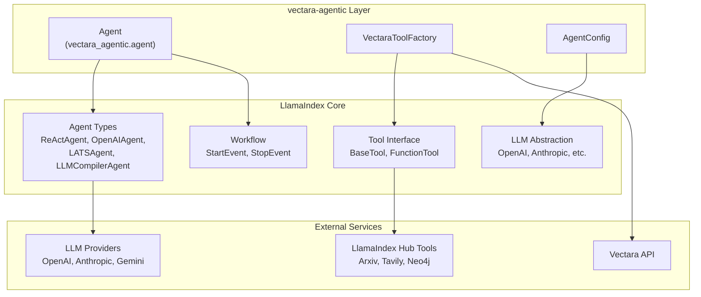

**Sources:** [README.md:38-40](), [docs/index.md:73-77](), [requirements.txt:1]()

## Key Features and Capabilities

| Feature | Implementation | Purpose |
|---------|----------------|---------|
| Rapid Tool Creation | `VectaraToolFactory.create_rag_tool()` | Build Vectara RAG tools with single line of code |
| Agent Flexibility | `AgentType` enum with REACT, OPENAI, LATS, LLMCOMPILER | Support different reasoning patterns |
| Multi-LLM Support | `ModelProvider` enum | Integrate with 8+ LLM providers seamlessly |
| Pre-built Domain Tools | `ToolsCatalog` class | Ready-to-use tools for finance, legal, database |
| Observability | Arize Phoenix integration | Monitor agent performance and behavior |
| Workflow Support | `Workflow` base class and built-in workflows | Handle complex multi-step processes |
| API Endpoints | `create_app()`, `start_app()` functions | Deploy agents as web services |

**Sources:** [README.md:45-58](), [vectara_agentic/__init__.py:9-18]()

## Quick Start Example

The following example demonstrates the core workflow of creating and using an agent:

```python
# 1. Create tool factory
vec_factory = VectaraToolFactory(
    vectara_api_key=os.environ['VECTARA_API_KEY'],
    vectara_corpus_key=os.environ['VECTARA_CORPUS_KEY']
)

# 2. Create RAG tool
ask_finance = vec_factory.create_rag_tool(
    tool_name="query_financial_reports",
    tool_description="Query financial reports for a company and year",
    tool_args_schema=QueryFinancialReportsArgs,
)

# 3. Create agent
agent = Agent(
    tools=[ask_finance],
    topic="10-K annual financial reports",
    custom_instructions=financial_assistant_instructions,
)

# 4. Interact with agent
response = agent.chat("What was the revenue for Apple in 2021?")
```

This example shows the typical pattern: create a tool factory, define tools, configure an agent, and interact through the `chat()` method.

**Sources:** [README.md:86-177](), [docs/index.md:96-132]()

## Related Documentation

For specific implementation details and advanced usage:
- For detailed system architecture, see [Architecture](#1.1)
- For core concepts and terminology, see [Key Concepts](#1.2)  
- For comprehensive component documentation, see [Core Components](#2)
- For installation and environment setup, see [Installation and Configuration](#3)
- For practical examples and tutorials, see [Usage Guide](#4)
- For deployment as web services, see [API and Endpoints](#5)

**Sources:** Based on table of contents structure provided

---

# Page: Architecture

# Architecture

<details>
<summary>Relevant source files</summary>

The following files were used as context for generating this wiki page:

- [requirements.txt](requirements.txt)
- [vectara_agentic/agent.py](vectara_agentic/agent.py)
- [vectara_agentic/tools.py](vectara_agentic/tools.py)

</details>


This document describes the high-level system architecture of the vectara-agentic framework. It covers the core components, their relationships, and how they work together to provide an AI agent system built around Vectara's RAG capabilities.

For specific implementation details of individual components, see [Core Components](#2). For configuration and setup information, see [Installation and Configuration](#3). For API endpoint documentation, see [API and Endpoints](#5).

## System Overview

The vectara-agentic framework is an agent-centric AI system that orchestrates multiple components to enable intelligent retrieval-augmented generation (RAG) applications. The system is built on the LlamaIndex framework and provides a factory-based approach to creating tools and agents.

### High-Level Component Mapping

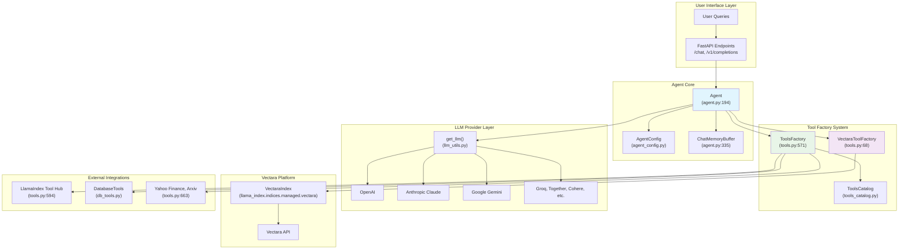

Sources: [vectara_agentic/agent.py:194-218](), [vectara_agentic/tools.py:68-91](), [vectara_agentic/tools.py:571-577](), [requirements.txt:1-42]()

## Core Agent Architecture

The `Agent` class serves as the central orchestrator, supporting multiple agent types with different reasoning strategies. The system implements a factory pattern for both agents and tools, enabling flexible composition of capabilities.

### Agent Types and Execution Flow

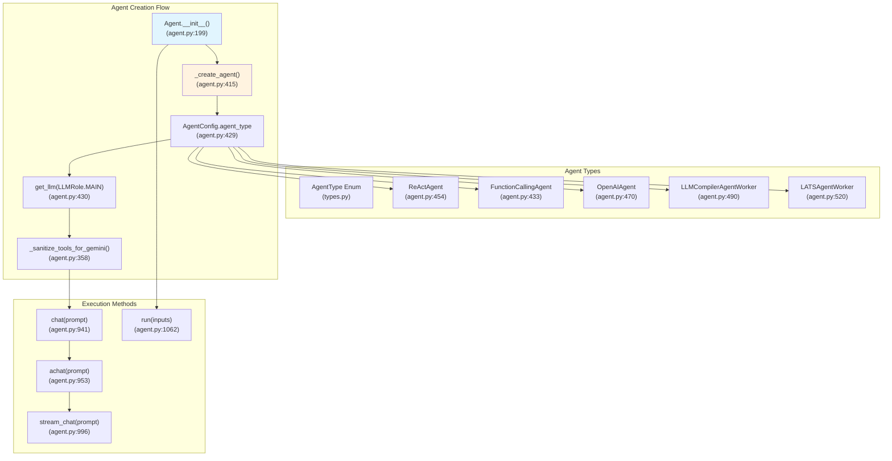

Sources: [vectara_agentic/agent.py:194-218](), [vectara_agentic/agent.py:415-556](), [vectara_agentic/agent.py:941-995](), [vectara_agentic/types.py]()

## Tool Factory System

The tool factory system provides a modular approach to creating agent tools. Two main factories handle different categories of tools: `VectaraToolFactory` for Vectara-specific RAG tools and `ToolsFactory` for general-purpose tools.

### VectaraToolFactory Architecture

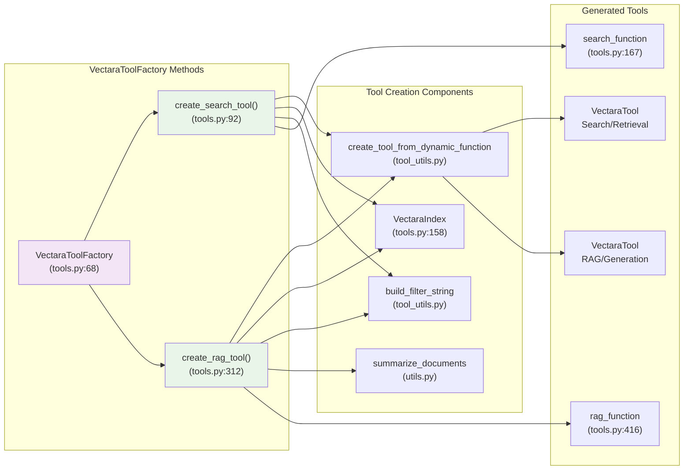

Sources: [vectara_agentic/tools.py:68-91](), [vectara_agentic/tools.py:92-310](), [vectara_agentic/tools.py:312-568]()

### ToolsFactory and External Integrations

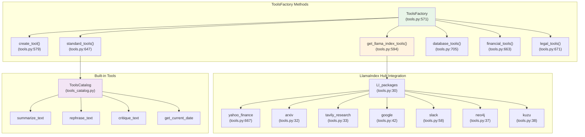

Sources: [vectara_agentic/tools.py:571-779](), [vectara_agentic/tools.py:30-65](), [vectara_agentic/tools_catalog.py]()

## LLM Provider Layer

The system abstracts LLM interactions through a unified interface that supports multiple providers. This enables seamless switching between different language models based on configuration.

### LLM Provider Integration

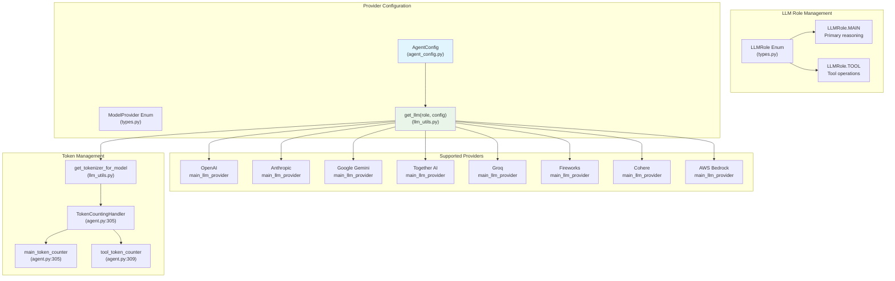

Sources: [vectara_agentic/llm_utils.py](), [vectara_agentic/agent_config.py](), [vectara_agentic/agent.py:304-311](), [vectara_agentic/types.py](), [requirements.txt:6-14]()

## Data Flow and Processing Pipeline

The system processes user queries through a structured pipeline that involves agent reasoning, tool execution, and response generation. The flow varies based on agent type but follows consistent patterns.

### Query Processing Flow

```mermaid
sequenceDiagram
    participant User
    participant Agent["Agent.achat()<br/>(agent.py:953)"]
    participant CurrentAgent["_get_current_agent()<br/>(agent.py:914)"]
    participant ToolFactory["VectaraToolFactory<br/>create_rag_tool()"]
    participant VectaraIndex["VectaraIndex<br/>(tools.py:158)"]
    participant VectaraAPI["Vectara API"]
    participant LLM["LLM Provider"]
    participant Observer["Phoenix Observer<br/>(_observability.py)"]
    
    User->>Agent: "query string"
    Agent->>CurrentAgent: "Get active agent instance"
    CurrentAgent->>ToolFactory: "Execute tool with query"
    ToolFactory->>VectaraIndex: "as_query_engine()"
    VectaraIndex->>VectaraAPI: "Query with filters"
    VectaraAPI-->>VectaraIndex: "Retrieved documents"
    VectaraIndex->>LLM: "Summarize results"
    LLM-->>VectaraIndex: "Generated response"
    VectaraIndex-->>ToolFactory: "ToolOutput"
    ToolFactory-->>CurrentAgent: "Tool results"
    CurrentAgent->>LLM: "Generate final response"
    LLM-->>CurrentAgent: "AgentResponse"
    CurrentAgent->>Observer: "Log metrics & FCS"
    CurrentAgent-->>Agent: "AgentResponse"
    Agent-->>User: "Final response"
```

Sources: [vectara_agentic/agent.py:953-994](), [vectara_agentic/tools.py:416-549](), [vectara_agentic/tools.py:158-164](), [vectara_agentic/_observability.py]()

## Technology Stack and Dependencies

The framework is built on a comprehensive technology stack that integrates multiple AI and data processing libraries.

### Core Dependencies

| Component | Version | Purpose |
|-----------|---------|---------|
| `llama-index` | 0.12.35 | Core framework foundation |
| `llama-index-indices-managed-vectara` | 0.4.5 | Vectara integration |
| `llama-index-agent-llm-compiler` | 0.3.0 | LLMCompiler agent type |
| `llama-index-agent-lats` | 0.3.0 | LATS agent type |
| `llama-index-agent-openai` | 0.4.8 | OpenAI agent type |
| `arize-phoenix` | 8.26.1 | Observability platform |
| `pydantic` | 2.11.3 | Data validation |
| `tiktoken` | 0.9.0 | Tokenization |

### LLM Provider Dependencies

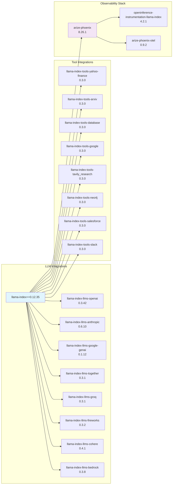

Sources: [requirements.txt:1-42]()

## Configuration and Observability

The system includes comprehensive configuration management and observability features to support production deployments.

### Configuration Architecture

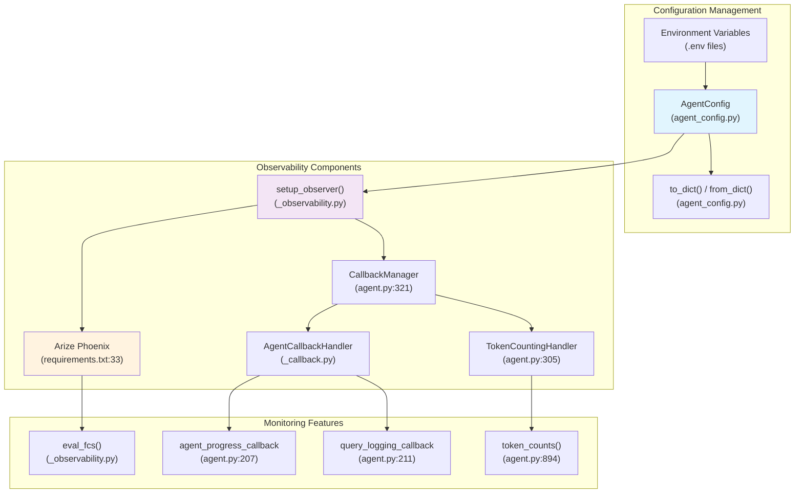

Sources: [vectara_agentic/agent_config.py](), [vectara_agentic/_observability.py](), [vectara_agentic/_callback.py](), [vectara_agentic/agent.py:304-321](), [vectara_agentic/agent.py:894-912]()

The architecture demonstrates a well-structured, modular system that separates concerns while maintaining flexibility for different use cases and deployment scenarios. The factory patterns enable easy extension, while the LLM abstraction layer provides provider independence.

---

# Page: Key Concepts

# Key Concepts

<details>
<summary>Relevant source files</summary>

The following files were used as context for generating this wiki page:

- [README.md](README.md)
- [docs/index.md](docs/index.md)
- [requirements-dev.txt](requirements-dev.txt)
- [tests/test_agent_planning.py](tests/test_agent_planning.py)
- [tests/test_agent_type.py](tests/test_agent_type.py)
- [vectara_agentic/_prompts.py](vectara_agentic/_prompts.py)

</details>


This document defines the fundamental concepts and terminology used throughout the vectara-agentic system. It covers the core abstractions that developers need to understand when building AI agents with Vectara's RAG capabilities.

For implementation details about the agent system, see [Agent System](#2.1). For information about deploying agents as web services, see [REST API](#5.1).

## Core Concepts

### Agents

An **Agent** is the central orchestrator that manages the entire interaction flow between users and tools. The agent interprets user queries, creates execution plans, calls appropriate tools, and synthesizes final responses.

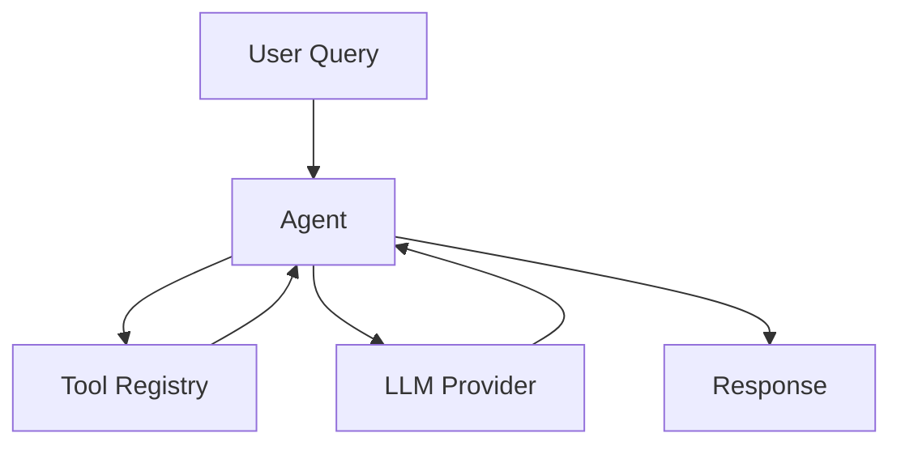

**Agent Types**

The system supports multiple agent architectures, each with different reasoning patterns:

| Agent Type | Description | Implementation |
|------------|-------------|----------------|
| `OPENAI` | Function-calling agent using OpenAI's native tool calling | Default agent type |
| `REACT` | Reasoning and acting agent that thinks step-by-step | Uses custom prompt template |
| `FUNCTION_CALLING` | Generic function calling agent for non-OpenAI providers | Works with multiple LLM providers |
| `LATS` | Language Agent Tree Search for complex reasoning | Advanced planning capabilities |
| `LLMCOMPILER` | Parallel tool execution agent | Optimized for performance |

Sources: [README.md:608-610](), [vectara_agentic/_prompts.py:1-171](), [tests/test_agent_type.py:16-68]()

### Tools

**Tools** are discrete functions that agents can invoke to perform specific tasks. They extend the agent's capabilities beyond pure language generation.

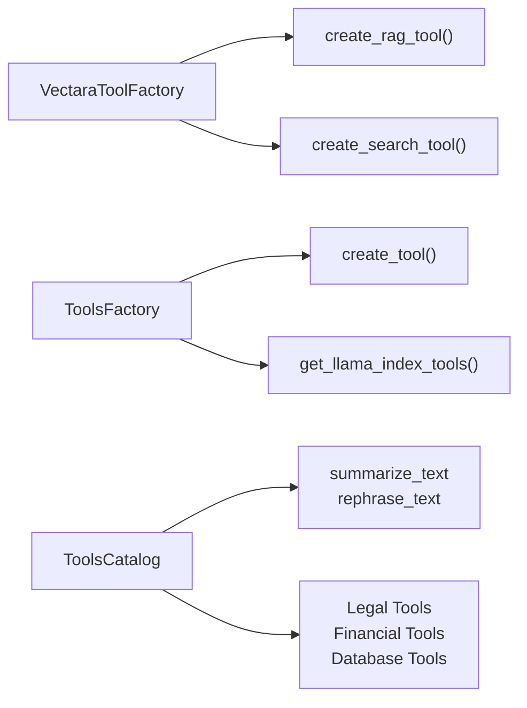

**Tool Categories**

- **Vectara Tools**: RAG and search tools for querying Vectara corpora
- **Standard Tools**: Text processing utilities like summarization and rephrasing  
- **Domain Tools**: Specialized tools for verticals (legal, finance, database)
- **External Tools**: Integration with third-party APIs and services

Sources: [README.md:204-386](), [README.md:255-292]()

### RAG vs Agentic RAG

**RAG (Retrieval-Augmented Generation)** is a technique where relevant information is retrieved from a knowledge base and used to generate more accurate responses.

**Agentic RAG** extends traditional RAG by using an LLM-powered agent to intelligently manage the retrieval and generation process through reasoning, planning, and tool usage.

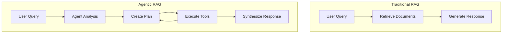

**Key Differences**

| Aspect | Traditional RAG | Agentic RAG |
|--------|----------------|-------------|
| Query Processing | Direct retrieval | Intelligent analysis and planning |
| Tool Usage | Single retrieval call | Multiple tool interactions |
| Complex Queries | Limited capability | Breaks down into sub-questions |
| Filtering | Basic keyword matching | Dynamic metadata filtering |
| Response Quality | Good for simple queries | Excels at complex, multi-step queries |

Sources: [docs/index.md:5-70](), [README.md:37-59]()

### Workflows

**Workflows** provide structured, multi-step interactions for complex query processing. They define input/output models and execution sequences using the LlamaIndex workflow framework.

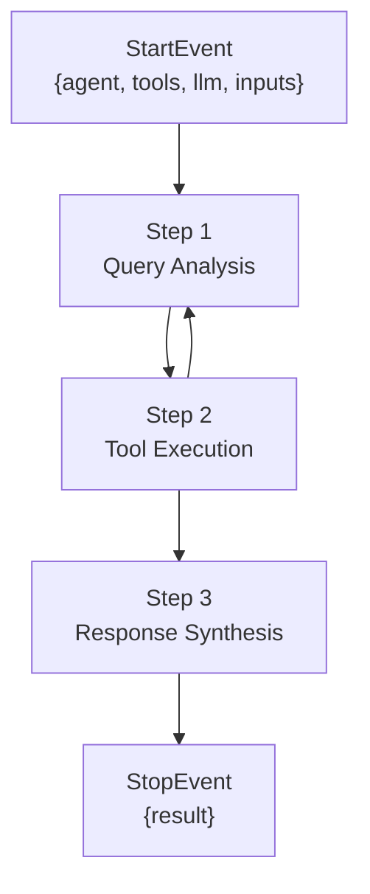

**Built-in Workflows**

- `SubQuestionQueryWorkflow`: Breaks complex queries into parallel sub-questions
- `SequentialSubQuestionsWorkflow`: Executes sub-questions sequentially with dependencies

Sources: [README.md:418-580]()

### Agent Configuration

**AgentConfig** controls agent behavior through structured configuration parameters rather than hardcoded values.

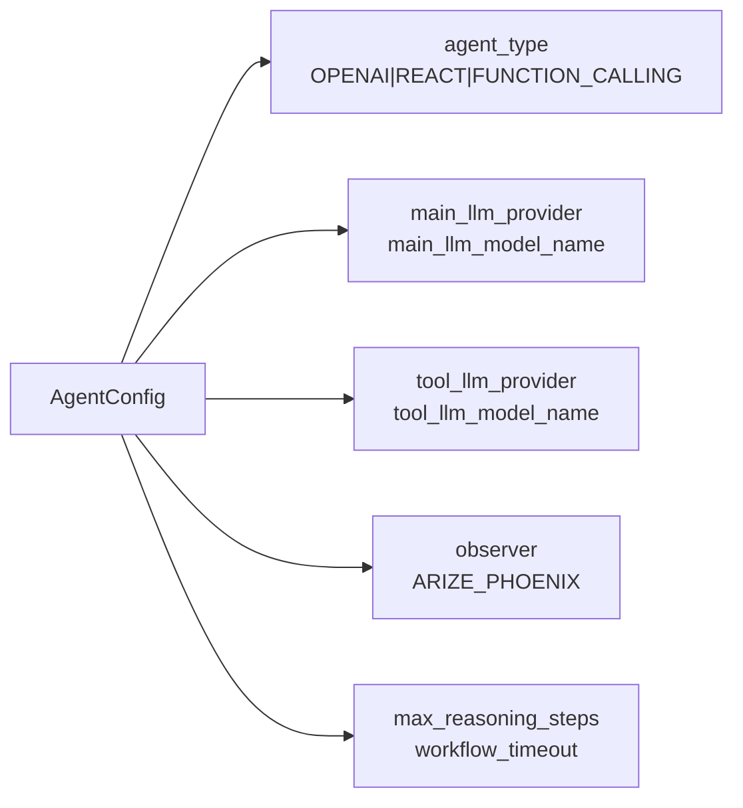

**Configuration Sources** (in priority order):
1. Direct parameters to `AgentConfig` constructor
2. Environment variables (e.g., `VECTARA_AGENTIC_AGENT_TYPE`)
3. Default values

Sources: [README.md:583-615]()

### LLM Provider Abstraction

The system abstracts different language model providers through a unified interface, allowing agents to work with multiple LLM services.

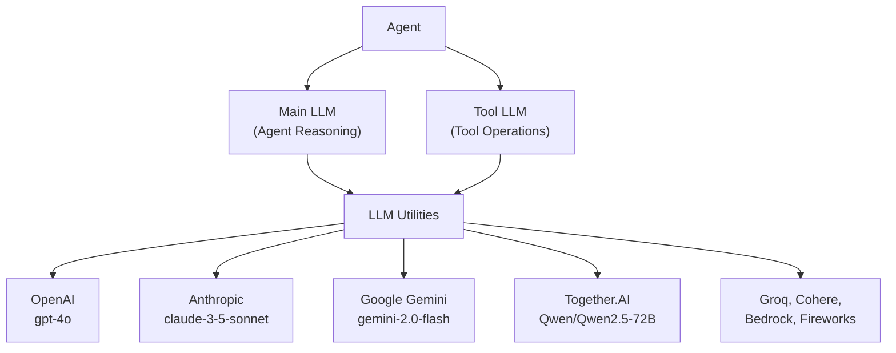

Sources: [README.md:609-610](), [docs/index.md:186-219]()

### Tool Factory Pattern

The **Factory Pattern** is used extensively for creating tools with consistent interfaces while hiding implementation complexity.

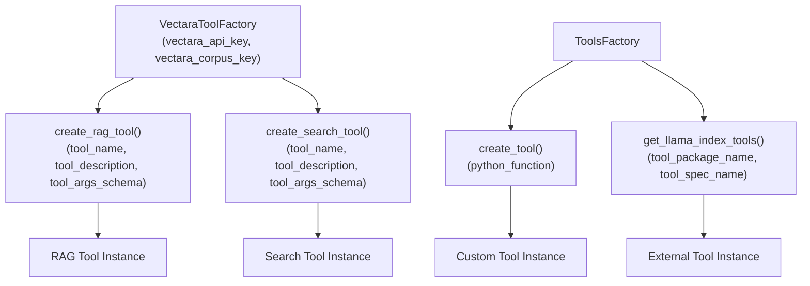

Sources: [README.md:86-125](), [README.md:389-401]()

### Observability and Monitoring

**Observability** provides insight into agent behavior through logging, metrics, and evaluation frameworks.

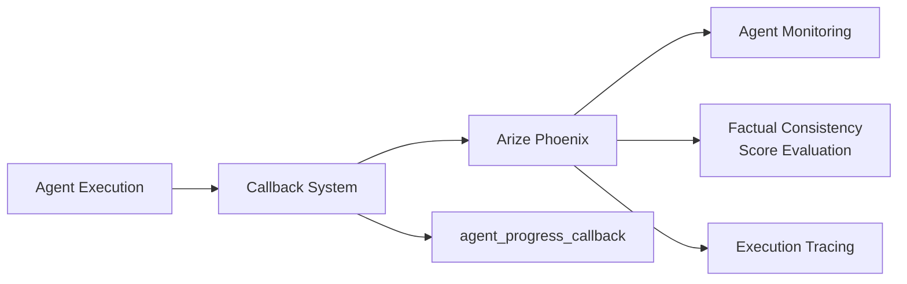

**Key Features**
- Progress callbacks for real-time monitoring
- Integration with Arize Phoenix for comprehensive observability
- Factual consistency scoring for response quality assessment
- Execution tracing for debugging and optimization

Sources: [README.md:55-56](), [README.md:170-171](), [vectara_agentic/_prompts.py:37]()

### Prompt System

The **Prompt System** provides structured instructions that guide agent behavior through carefully crafted templates and instructions.

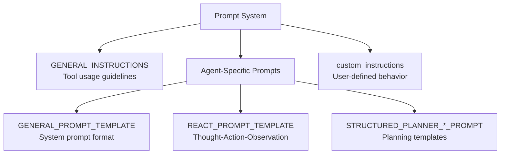

**Instruction Hierarchy**
1. **General Instructions**: Universal guidelines for tool usage and response formatting
2. **Agent-Specific Templates**: Prompt templates tailored to each agent type  
3. **Custom Instructions**: User-defined behavioral guidelines for specific use cases

Sources: [vectara_agentic/_prompts.py:6-171](), [README.md:185-201]()

---

# Page: Core Components

# Core Components

<details>
<summary>Relevant source files</summary>

The following files were used as context for generating this wiki page:

- [vectara_agentic/agent.py](vectara_agentic/agent.py)
- [vectara_agentic/tools.py](vectara_agentic/tools.py)

</details>


This document covers the fundamental building blocks of the vectara-agentic system, explaining how the main classes and interfaces work together to create a flexible AI agent framework. For detailed information about agent types and lifecycle management, see [Agent System](#2.1). For comprehensive tool creation patterns, see [Tool Factory System](#2.2). For workflow orchestration capabilities, see [Workflow Engine](#2.3).

The core components form a modular architecture where agents coordinate tool execution through factory patterns, with extensive configuration management and LLM provider abstraction.

## Architecture Overview

The vectara-agentic system is built around several key components that work together to provide a complete agentic framework:

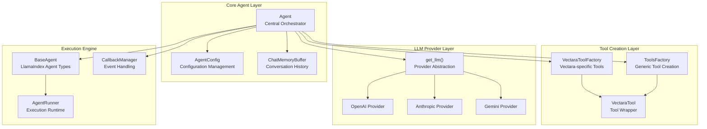

**Sources:** [vectara_agentic/agent.py:194-298](), [vectara_agentic/tools.py:68-780]()

## Agent as Central Orchestrator

The `Agent` class serves as the primary interface and orchestrator for the entire system. It manages tool execution, LLM interactions, memory, and configuration switching.

```mermaid
graph LR
    subgraph "Agent Initialization"
        AgentInit["Agent.__init__()"]
        ConfigValidation["Tool Validation"]
        MemorySetup["ChatMemoryBuffer Setup"]
        AgentCreation["_create_agent()"]
    end
    
    subgraph "Agent Types"
        ReActAgent["ReActAgent"]
        OpenAIAgent["OpenAIAgent"] 
        FunctionCallingAgent["FunctionCallingAgent"]
        LLMCompilerAgent["LLMCompilerAgentWorker"]
        LATSAgent["LATSAgentWorker"]
    end
    
    subgraph "Execution Methods"
        Chat["chat() / achat()"]
        StreamChat["stream_chat() / astream_chat()"]
        Run["run() for workflows"]
    end
    
    AgentInit --> ConfigValidation
    ConfigValidation --> MemorySetup
    MemorySetup --> AgentCreation
    
    AgentCreation --> ReActAgent
    AgentCreation --> OpenAIAgent
    AgentCreation --> FunctionCallingAgent
    AgentCreation --> LLMCompilerAgent
    AgentCreation --> LATSAgent
    
    Chat --> ReActAgent
    StreamChat --> OpenAIAgent
    Run --> FunctionCallingAgent
```

The `Agent` class provides several creation patterns:

| Method | Purpose | Key Parameters |
|--------|---------|----------------|
| `Agent.from_tools()` | Create agent from tool list | `tools`, `agent_config`, `topic` |
| `Agent.from_corpus()` | Create agent from Vectara corpus | `vectara_corpus_key`, `data_description` |
| `Agent.__init__()` | Direct instantiation | Full parameter control |

**Sources:** [vectara_agentic/agent.py:199-298](), [vectara_agentic/agent.py:630-686](), [vectara_agentic/agent.py:688-853]()

## Tool Factory Pattern

The system uses a factory pattern to create and manage tools. Two main factories handle different tool categories:

```mermaid
graph TB
    subgraph "VectaraToolFactory Methods"
        CreateRAG["create_rag_tool()<br/>RAG with Summarization"]
        CreateSearch["create_search_tool()<br/>Document Retrieval"]
    end
    
    subgraph "ToolsFactory Methods"  
        StandardTools["standard_tools()<br/>Text Processing"]
        GuardrailTools["guardrail_tools()<br/>Content Safety"]
        FinancialTools["financial_tools()<br/>Yahoo Finance"]
        LegalTools["legal_tools()<br/>Legal Analysis"]
        DatabaseTools["database_tools()<br/>SQL Interface"]
        LlamaIndexTools["get_llama_index_tools()<br/>External Integrations"]
    end
    
    subgraph "Tool Outputs"
        VectaraTool1["VectaraTool<br/>RAG Tool"]
        VectaraTool2["VectaraTool<br/>Search Tool"] 
        VectaraTool3["VectaraTool<br/>Standard Tool"]
        VectaraTool4["VectaraTool<br/>External Tool"]
    end
    
    CreateRAG --> VectaraTool1
    CreateSearch --> VectaraTool2
    StandardTools --> VectaraTool3
    LlamaIndexTools --> VectaraTool4
```

### VectaraToolFactory

The `VectaraToolFactory` specializes in creating tools that interact with the Vectara platform:

- **RAG Tools**: Created via `create_rag_tool()` for retrieval-augmented generation
- **Search Tools**: Created via `create_search_tool()` for document retrieval
- **Dynamic Function Generation**: Tools are created with dynamically generated functions that handle Vectara API calls

### ToolsFactory  

The `ToolsFactory` handles general-purpose tool creation:

- **Standard Tools**: Text processing tools like `summarize_text`, `rephrase_text`, `critique_text`
- **Domain-Specific Tools**: Financial, legal, and database tools
- **External Integrations**: LlamaIndex hub tools for various APIs

**Sources:** [vectara_agentic/tools.py:68-569](), [vectara_agentic/tools.py:571-780]()

## Configuration Management

The system uses `AgentConfig` to manage all configuration aspects, with support for fallback configurations and environment variable integration.

```mermaid
graph LR
    subgraph "Configuration Sources"
        EnvVars["Environment Variables"]
        ConfigParams["Constructor Parameters"] 
        Defaults["Default Values"]
    end
    
    subgraph "AgentConfig Properties"
        AgentType["agent_type: AgentType"]
        MainLLM["main_llm_provider: ModelProvider"]
        ToolLLM["tool_llm_provider: ModelProvider"]
        MaxSteps["max_reasoning_steps: int"]
        Observability["observability_config: dict"]
    end
    
    subgraph "Runtime Behavior"
        PrimaryConfig["Primary Configuration"]
        FallbackConfig["Fallback Configuration"]
        ConfigSwitching["Automatic Switching"]
    end
    
    EnvVars --> AgentType
    ConfigParams --> MainLLM
    Defaults --> ToolLLM
    
    AgentType --> PrimaryConfig
    MainLLM --> FallbackConfig
    PrimaryConfig --> ConfigSwitching
    FallbackConfig --> ConfigSwitching
```

**Sources:** [vectara_agentic/agent.py:246-247](), [vectara_agentic/agent.py:343-349]()

## LLM Provider Integration

The system abstracts LLM provider differences through a unified interface:

```mermaid
graph TB
    subgraph "LLM Role System"
        MainRole["LLMRole.MAIN<br/>Primary Agent LLM"]
        ToolRole["LLMRole.TOOL<br/>Tool Execution LLM"]
    end
    
    subgraph "Provider Support"
        OpenAIProvider["ModelProvider.OPENAI"]
        AnthropicProvider["ModelProvider.ANTHROPIC"] 
        GeminiProvider["ModelProvider.GEMINI"]
        OtherProviders["Together, Groq, Cohere, etc."]
    end
    
    subgraph "Special Handling"
        GeminiSanitization["_sanitize_tools_for_gemini()<br/>Remove Default Parameters"]
        TokenCounting["TokenCountingHandler<br/>Usage Tracking"]
        CallbackIntegration["Callback Manager Integration"]
    end
    
    MainRole --> OpenAIProvider
    ToolRole --> AnthropicProvider
    MainRole --> GeminiProvider
    
    GeminiProvider --> GeminiSanitization
    OpenAIProvider --> TokenCounting
    AnthropicProvider --> CallbackIntegration
```

The system includes special handling for provider-specific requirements, such as Gemini's tool parameter restrictions handled by `_sanitize_tools_for_gemini()`.

**Sources:** [vectara_agentic/agent.py:358-413](), [vectara_agentic/agent.py:253](), [vectara_agentic/agent.py:304-311]()

## Data Flow and Tool Execution

The following diagram shows how user queries flow through the system:

```mermaid
sequenceDiagram
    participant User
    participant Agent
    participant ToolFactory
    participant VectaraTool
    participant VectaraAPI
    participant LLM
    
    User->>Agent: "chat() or achat()"
    Agent->>Agent: "_get_current_agent()"
    Agent->>LLM: "Generate reasoning plan"
    LLM-->>Agent: "Tool calls needed"
    
    loop For each tool call
        Agent->>VectaraTool: "Execute tool function"
        VectaraTool->>VectaraAPI: "Query with filters"
        VectaraAPI-->>VectaraTool: "Search results"
        VectaraTool->>LLM: "Summarize results (if RAG)"
        LLM-->>VectaraTool: "Processed output"
        VectaraTool-->>Agent: "ToolOutput object"
    end
    
    Agent->>LLM: "Generate final response"
    LLM-->>Agent: "AgentResponse"
    Agent-->>User: "Final answer"
```

**Sources:** [vectara_agentic/agent.py:953-994](), [vectara_agentic/tools.py:167-263](), [vectara_agentic/tools.py:416-549]()

## Error Handling and Fallbacks

The system includes robust error handling with automatic configuration switching:

```mermaid
graph LR
    subgraph "Error Detection"
        LLMFailure["LLM Call Failure"]
        ToolFailure["Tool Execution Failure"]
        ValidationFailure["Input Validation Failure"]
    end
    
    subgraph "Recovery Mechanisms"
        ConfigSwitch["_switch_agent_config()"]
        RetryLogic["Retry with Backoff"]
        FallbackAgent["Fallback Agent Config"]
    end
    
    subgraph "Error Reporting"
        AgentResponse["AgentResponse with Error"]
        CallbackNotification["Callback Notifications"]
        VerboseLogging["Verbose Error Messages"]
    end
    
    LLMFailure --> ConfigSwitch
    ToolFailure --> RetryLogic
    ValidationFailure --> AgentResponse
    
    ConfigSwitch --> FallbackAgent
    RetryLogic --> CallbackNotification
    FallbackAgent --> VerboseLogging
```

The system attempts up to 4 retries (2 with primary config, 2 with fallback) before returning an error response.

**Sources:** [vectara_agentic/agent.py:963-994](), [vectara_agentic/agent.py:855-863]()

## Serialization and Persistence

The `Agent` class supports serialization for persistence and deployment:

| Method | Purpose | Format |
|--------|---------|--------|
| `dumps()` | Serialize to JSON string | JSON with pickled functions |
| `loads()` | Deserialize from JSON | Reconstructs full agent |
| `to_dict()` | Convert to dictionary | Includes tool schemas |
| `from_dict()` | Create from dictionary | Handles schema reconstruction |

The serialization system handles complex cases like Pydantic model schemas and function pickling for complete state preservation.

**Sources:** [vectara_agentic/agent.py:1124-1297]()

---

# Page: Agent System

# Agent System

<details>
<summary>Relevant source files</summary>

The following files were used as context for generating this wiki page:

- [tests/test_agent.py](tests/test_agent.py)
- [vectara_agentic/agent.py](vectara_agentic/agent.py)
- [vectara_agentic/agent_config.py](vectara_agentic/agent_config.py)
- [vectara_agentic/types.py](vectara_agentic/types.py)

</details>


This document covers the core `Agent` class that serves as the central orchestrator for AI agent interactions in the vectara-agentic framework. The Agent System handles agent lifecycle management, multi-turn conversations, tool coordination, and integration with various LLM providers through different agent implementation strategies.

For information about tool creation and management, see [Tool Factory System](#2.2). For workflow orchestration capabilities, see [Workflow Engine](#2.3). For prompt templates and instructions, see [Prompt System](#2.4).

## Purpose and Architecture

The Agent System provides a unified interface for creating and managing AI agents that can interact with tools, maintain conversation memory, and execute complex reasoning workflows. The system supports multiple agent types, each optimized for different LLM providers and reasoning strategies.

### Core Agent Architecture

```mermaid
graph TB
    subgraph "Agent Class Structure"
        Agent["Agent"]
        AgentConfig["AgentConfig"]
        Memory["ChatMemoryBuffer"]
        
        Agent --> AgentConfig
        Agent --> Memory
    end
    
    subgraph "Agent Types"
        REACT["ReActAgent"]
        OPENAI["OpenAIAgent"] 
        FUNCTION_CALLING["FunctionCallingAgent"]
        LLMCOMPILER["LLMCompilerAgentWorker"]
        LATS["LATSAgentWorker"]
    end
    
    subgraph "LLM Integration"
        LLMUtils["get_llm()"]
        MainLLM["Main LLM"]
        ToolLLM["Tool LLM"]
        
        LLMUtils --> MainLLM
        LLMUtils --> ToolLLM
    end
    
    subgraph "Support Systems"
        CallbackManager["CallbackManager"]
        TokenCounters["TokenCountingHandler"]
        ObservabilitySetup["setup_observer()"]
        
        CallbackManager --> TokenCounters
    end
    
    Agent --> REACT
    Agent --> OPENAI
    Agent --> FUNCTION_CALLING
    Agent --> LLMCOMPILER
    Agent --> LATS
    
    Agent --> LLMUtils
    Agent --> CallbackManager
    Agent --> ObservabilitySetup
```

Sources: [vectara_agentic/agent.py:194-557](), [vectara_agentic/types.py:10-18](), [vectara_agentic/agent_config.py:9-115]()

## Agent Class Overview

The `Agent` class located at [vectara_agentic/agent.py:194-1187]() serves as the primary interface for all agent operations. It provides both synchronous and asynchronous methods for chat interactions, memory management, and tool coordination.

### Agent Initialization

```mermaid
graph TD
    subgraph "Agent.__init__ Flow"
        Init["Agent.__init__()"]
        ValidateTools["Validate Tools"]
        CreateTokenCounters["Create Token Counters"] 
        SetupCallbacks["Setup Callback Manager"]
        CreateMemory["Initialize ChatMemoryBuffer"]
        CreateAgent["_create_agent()"]
        SetupObserver["setup_observer()"]
        
        Init --> ValidateTools
        ValidateTools --> CreateTokenCounters
        CreateTokenCounters --> SetupCallbacks
        SetupCallbacks --> CreateMemory
        CreateMemory --> CreateAgent
        CreateAgent --> SetupObserver
    end
    
    subgraph "Tool Validation"
        CheckDuplicates["Check Duplicate Tools"]
        SanitizeGemini["_sanitize_tools_for_gemini()"]
        ValidateInstructions["Validate Tool Instructions"]
        
        ValidateTools --> CheckDuplicates
        CheckDuplicates --> SanitizeGemini
        SanitizeGemini --> ValidateInstructions
    end
    
    subgraph "Memory Setup"
        ChatHistory["chat_history parameter"]
        ConvertHistory["Convert to ChatMessage"]
        BufferInit["ChatMemoryBuffer.from_defaults()"]
        
        CreateMemory --> ChatHistory
        ChatHistory --> ConvertHistory
        ConvertHistory --> BufferInit
    end
```

Sources: [vectara_agentic/agent.py:199-357](), [vectara_agentic/agent.py:358-413](), [vectara_agentic/agent.py:324-340]()

### Key Initialization Parameters

| Parameter | Type | Purpose | Default |
|-----------|------|---------|---------|
| `tools` | `List[FunctionTool]` | Tools available to the agent | Required |
| `topic` | `str` | Agent specialization topic | `"general"` |
| `custom_instructions` | `str` | Custom behavior instructions | `""` |
| `agent_config` | `AgentConfig` | LLM and agent configuration | `AgentConfig()` |
| `fallback_agent_config` | `AgentConfig` | Backup configuration for failures | `None` |
| `chat_history` | `list[Tuple[str, str]]` | Pre-populate conversation memory | `None` |
| `workflow_cls` | `Workflow` | Workflow class for `run()` method | `None` |
| `validate_tools` | `bool` | Validate tool-instruction consistency | `False` |

Sources: [vectara_agentic/agent.py:199-245]()

## Agent Types and Implementation

The system supports five distinct agent types, each implementing different reasoning strategies and optimized for specific LLM providers.

### Agent Type Implementation Matrix

```mermaid
graph LR
    subgraph "Agent Types"
        REACT["AgentType.REACT"]
        OPENAI["AgentType.OPENAI"]
        FUNCTION_CALLING["AgentType.FUNCTION_CALLING"]
        LLMCOMPILER["AgentType.LLMCOMPILER"]
        LATS["AgentType.LATS"]
    end
    
    subgraph "LlamaIndex Implementations"
        ReActAgent["ReActAgent.from_tools()"]
        OpenAIAgent["OpenAIAgent.from_tools()"]
        FunctionCallingAgent["FunctionCallingAgent.from_tools()"]
        LLMCompilerWorker["LLMCompilerAgentWorker.from_tools()"]
        LATSWorker["LATSAgentWorker.from_tools()"]
    end
    
    subgraph "LLM Provider Constraints"
        OpenAIRequired["Requires OpenAI LLM"]
        NoOpenAITool["Cannot use OpenAI for tools"]
        AnyProvider["Any LLM Provider"]
    end
    
    REACT --> ReActAgent
    OPENAI --> OpenAIAgent
    FUNCTION_CALLING --> FunctionCallingAgent
    LLMCOMPILER --> LLMCompilerWorker
    LATS --> LATSWorker
    
    OPENAI --> OpenAIRequired
    FUNCTION_CALLING --> NoOpenAITool
    REACT --> AnyProvider
    LLMCOMPILER --> AnyProvider
    LATS --> AnyProvider
```

Sources: [vectara_agentic/agent.py:415-557](), [vectara_agentic/types.py:10-18]()

### Agent Creation Logic

The `_create_agent()` method at [vectara_agentic/agent.py:415-557]() implements the factory pattern for creating specific agent types:

```mermaid
flowchart TD
    CreateAgent["_create_agent()"]
    CheckType["Check agent_type"]
    
    REACT_Path["AgentType.REACT"]
    OPENAI_Path["AgentType.OPENAI"] 
    FUNCTION_Path["AgentType.FUNCTION_CALLING"]
    COMPILER_Path["AgentType.LLMCOMPILER"]
    LATS_Path["AgentType.LATS"]
    
    REACT_Create["ReActAgent.from_tools()"]
    OPENAI_Create["OpenAIAgent.from_tools()"]
    FUNCTION_Create["FunctionCallingAgent.from_tools()"]
    COMPILER_Create["LLMCompilerAgentWorker.from_tools()"]
    LATS_Create["LATSAgentWorker.from_tools()"]
    
    StructuredPlanner["use_structured_planning?"]
    WrapPlanner["StructuredPlannerAgent()"]
    
    CreateAgent --> CheckType
    CheckType --> REACT_Path
    CheckType --> OPENAI_Path
    CheckType --> FUNCTION_Path
    CheckType --> COMPILER_Path
    CheckType --> LATS_Path
    
    REACT_Path --> REACT_Create
    OPENAI_Path --> OPENAI_Create
    FUNCTION_Path --> FUNCTION_Create
    COMPILER_Path --> COMPILER_Create
    LATS_Path --> LATS_Create
    
    REACT_Create --> StructuredPlanner
    OPENAI_Create --> StructuredPlanner
    FUNCTION_Create --> StructuredPlanner
    COMPILER_Create --> StructuredPlanner
    LATS_Create --> StructuredPlanner
    
    StructuredPlanner -->|Yes| WrapPlanner
```

Sources: [vectara_agentic/agent.py:415-557]()

## Configuration System

The `AgentConfig` class at [vectara_agentic/agent_config.py:9-115]() provides centralized configuration management with environment variable support.

### Configuration Structure

```mermaid
graph TB
    subgraph "AgentConfig Fields"
        AgentType["agent_type: AgentType"]
        MainLLM["main_llm_provider: ModelProvider"]
        MainModel["main_llm_model_name: str"]
        ToolLLM["tool_llm_provider: ModelProvider"]
        ToolModel["tool_llm_model_name: str"]
        Observer["observer: ObserverType"]
        MaxSteps["max_reasoning_steps: int"]
        APIKey["endpoint_api_key: str"]
        PrivateAPI["private_llm_api_base: str"]
    end
    
    subgraph "Environment Variables"
        ENV_AGENT["VECTARA_AGENTIC_AGENT_TYPE"]
        ENV_MAIN_LLM["VECTARA_AGENTIC_MAIN_LLM_PROVIDER"]
        ENV_MAIN_MODEL["VECTARA_AGENTIC_MAIN_MODEL_NAME"]
        ENV_TOOL_LLM["VECTARA_AGENTIC_TOOL_LLM_PROVIDER"]
        ENV_TOOL_MODEL["VECTARA_AGENTIC_TOOL_MODEL_NAME"]
        ENV_OBSERVER["VECTARA_AGENTIC_OBSERVER_TYPE"]
        ENV_MAX_STEPS["VECTARA_AGENTIC_MAX_REASONING_STEPS"]
        ENV_API_KEY["VECTARA_AGENTIC_API_KEY"]
    end
    
    AgentType --> ENV_AGENT
    MainLLM --> ENV_MAIN_LLM
    MainModel --> ENV_MAIN_MODEL
    ToolLLM --> ENV_TOOL_LLM
    ToolModel --> ENV_TOOL_MODEL
    Observer --> ENV_OBSERVER
    MaxSteps --> ENV_MAX_STEPS
    APIKey --> ENV_API_KEY
```

Sources: [vectara_agentic/agent_config.py:18-73]()

### Fallback Configuration System

The Agent supports a fallback configuration mechanism for handling LLM failures:

| Configuration Type | Usage | Switching Logic |
|-------------------|-------|-----------------|
| `agent_config` | Primary configuration | Used for first 2 attempts |
| `fallback_agent_config` | Backup configuration | Used after primary fails |
| `agent_config_type` | Current active config | Tracked via `AgentConfigType` enum |

Sources: [vectara_agentic/agent.py:342-350](), [vectara_agentic/agent.py:855-863]()

## Chat Interface and Lifecycle

The Agent provides both synchronous and asynchronous chat interfaces with comprehensive error handling and retry logic.

### Chat Method Flow

```mermaid
sequenceDiagram
    participant User
    participant Agent
    participant CurrentAgent as "_get_current_agent()"
    participant LLM
    participant Fallback as "fallback_agent"
    participant Observer as "eval_fcs()"
    
    User->>Agent: "chat(prompt)"
    Agent->>Agent: "asyncio.run(achat(prompt))"
    
    loop "Max 4 attempts"
        Agent->>CurrentAgent: "Get active agent"
        CurrentAgent->>LLM: "achat(prompt)"
        
        alt "Success"
            LLM-->>Agent: "AgentResponse"
            Agent->>Agent: "_aformat_for_lats()"
            Agent->>Observer: "eval_fcs()"
            Agent->>Agent: "query_logging_callback()"
            Agent-->>User: "AgentResponse"
        else "Exception after 2 attempts"
            Agent->>Agent: "_switch_agent_config()"
            Agent->>Fallback: "Switch to fallback config"
            Agent->>Agent: "time.sleep(1)"
        end
    end
    
    alt "All attempts failed"
        Agent-->>User: "Failure response with error details"
    end
```

Sources: [vectara_agentic/agent.py:941-995](), [vectara_agentic/agent.py:953-995]()

### Streaming Chat Interface

The agent also supports streaming responses through `stream_chat()` and `astream_chat()` methods at [vectara_agentic/agent.py:996-1055](). The streaming implementation preserves the same retry logic while wrapping the response generator to execute post-streaming callbacks.

Sources: [vectara_agentic/agent.py:996-1055]()

## Memory Management

The Agent uses LlamaIndex's `ChatMemoryBuffer` for conversation state management with a default token limit of 128,000 tokens.

### Memory Initialization and Operations

```mermaid
graph TD
    subgraph "Memory Initialization"
        CheckHistory["chat_history provided?"]
        ConvertPairs["Convert string pairs to ChatMessage"]
        CreateBuffer["ChatMemoryBuffer.from_defaults()"]
        SetLimit["token_limit=128000"]
        
        CheckHistory -->|Yes| ConvertPairs
        CheckHistory -->|No| CreateBuffer
        ConvertPairs --> CreateBuffer
        CreateBuffer --> SetLimit
    end
    
    subgraph "Memory Operations"
        ClearMemory["clear_memory()"]
        GetAgent["_get_current_agent()"]
        ResetMemory["agent.memory.reset()"]
        
        ClearMemory --> GetAgent
        GetAgent --> ResetMemory
    end
    
    subgraph "Message Types"
        UserMsg["MessageRole.USER"]
        AssistantMsg["MessageRole.ASSISTANT"]
        
        ConvertPairs --> UserMsg
        ConvertPairs --> AssistantMsg
    end
```

Sources: [vectara_agentic/agent.py:324-340](), [vectara_agentic/agent.py:558-571]()

## Tool Integration and Validation

The Agent System includes comprehensive tool management with validation, sanitization, and automatic tool injection.

### Tool Processing Pipeline

```mermaid
flowchart TD
    Tools["Input tools"]
    AddDate["Add get_current_date tool"]
    CheckDuplicates["Check for duplicate tools"]
    Gemini["Gemini provider?"]
    Sanitize["_sanitize_tools_for_gemini()"]
    Validate["validate_tools flag?"]
    ValidateInstructions["Validate tool instructions"]
    Complete["Tools ready"]
    
    Tools --> AddDate
    AddDate --> CheckDuplicates
    CheckDuplicates -->|Duplicates found| Error["Raise ValueError"]
    CheckDuplicates -->|No duplicates| Gemini
    Gemini -->|Yes| Sanitize
    Gemini -->|No| Validate
    Sanitize --> Validate
    Validate -->|Yes| ValidateInstructions
    Validate -->|No| Complete
    ValidateInstructions --> Complete
```

Sources: [vectara_agentic/agent.py:248-302](), [vectara_agentic/agent.py:358-413]()

### Gemini Tool Sanitization

For Gemini LLM provider compatibility, the system removes default parameter values from tool schemas at [vectara_agentic/agent.py:358-413]():

| Sanitization Step | Purpose | Implementation |
|------------------|---------|----------------|
| Strip function defaults | Remove `default=` from `tool.fn` signature | `Parameter.replace(default=Parameter.empty)` |
| Rebuild Pydantic schema | Make all fields required | `create_model()` with `Field(...)` |
| Update signatures | Clean `__signature__` attribute | `Signature(params)` with no defaults |

Sources: [vectara_agentic/agent.py:358-413]()

## Factory Methods

The Agent class provides convenient factory methods for common use cases.

### Factory Method Comparison

| Method | Purpose | Key Parameters |
|--------|---------|----------------|
| `from_tools()` | Create agent from tool list | `tools`, `agent_config`, `topic` |
| `from_corpus()` | Create single-corpus RAG agent | `vectara_corpus_key`, `data_description`, `assistant_specialty` |

### from_corpus Implementation

```mermaid
graph TD
    FromCorpus["Agent.from_corpus()"]
    CreateFactory["VectaraToolFactory()"]
    BuildSchema["create_model('QueryArgs')"]
    CreateRAGTool["vec_factory.create_rag_tool()"]
    BuildInstructions["Build assistant_instructions"]
    CallInit["Agent.__init__()"]
    
    FromCorpus --> CreateFactory
    CreateFactory --> BuildSchema
    BuildSchema --> CreateRAGTool
    CreateRAGTool --> BuildInstructions
    BuildInstructions --> CallInit
    
    subgraph "Dynamic Schema Building"
        QueryField["'query': (str, Field())"]
        FilterFields["vectara_filter_fields"]
        CombineFields["Combine into QueryArgs model"]
        
        BuildSchema --> QueryField
        BuildSchema --> FilterFields
        QueryField --> CombineFields
        FilterFields --> CombineFields
    end
```

Sources: [vectara_agentic/agent.py:688-853]()

## Workflow Integration

The Agent supports workflow execution through the `run()` method, which integrates with LlamaIndex's Workflow system.

### Workflow Execution Flow

```mermaid
sequenceDiagram
    participant User
    participant Agent
    participant Workflow
    participant Context as "Context"
    participant WorkflowInputs as "workflow.InputsModel"
    participant WorkflowOutputs as "workflow.OutputsModel"
    
    User->>Agent: "run(inputs)"
    Agent->>Agent: "Validate workflow_cls exists"
    Agent->>Workflow: "workflow_cls(timeout, verbose)"
    Agent->>WorkflowInputs: "Validate inputs type"
    Agent->>Context: "Context(workflow=workflow)"
    Agent->>Workflow: "workflow.run(ctx, agent, tools, llm, inputs)"
    Workflow-->>Agent: "result"
    Agent->>WorkflowOutputs: "OutputsModel.model_validate(result)"
    Agent-->>User: "Validated output"
    
    alt "Workflow fails"
        Agent->>Agent: "Check OutputModelOnFail"
        Agent->>Agent: "Extract context values"
        Agent-->>User: "Failure model with context"
    end
```

Sources: [vectara_agentic/agent.py:1062-1119]()

## Error Handling and Observability

The Agent System includes comprehensive error handling with automatic fallback configuration switching and observability integration.

### Token Counting and Callbacks

```mermaid
graph TB
    subgraph "Token Counting"
        MainTokenizer["get_tokenizer_for_model(MAIN)"]
        ToolTokenizer["get_tokenizer_for_model(TOOL)"]
        MainCounter["TokenCountingHandler(main_tok)"]
        ToolCounter["TokenCountingHandler(tool_tok)"]
        
        MainTokenizer --> MainCounter
        ToolTokenizer --> ToolCounter
    end
    
    subgraph "Callback System"
        AgentCallback["AgentCallbackHandler()"]
        CallbackManager["CallbackManager()"]
        
        AgentCallback --> CallbackManager
        MainCounter --> CallbackManager
        ToolCounter --> CallbackManager
    end
    
    subgraph "Observability"
        SetupObserver["setup_observer()"]
        EvalFCS["eval_fcs()"]
        Phoenix["Arize Phoenix integration"]
        
        SetupObserver --> Phoenix
        EvalFCS --> Phoenix
    end
```

Sources: [vectara_agentic/agent.py:304-321](), [vectara_agentic/agent.py:352-356]()

The Agent System provides a robust foundation for AI agent interactions with comprehensive configuration management, multiple reasoning strategies, and seamless integration with the broader vectara-agentic ecosystem.

---

# Page: Tool Factory System

# Tool Factory System

<details>
<summary>Relevant source files</summary>

The following files were used as context for generating this wiki page:

- [tests/test_tools.py](tests/test_tools.py)
- [vectara_agentic/llm_utils.py](vectara_agentic/llm_utils.py)
- [vectara_agentic/tool_utils.py](vectara_agentic/tool_utils.py)
- [vectara_agentic/tools.py](vectara_agentic/tools.py)

</details>


## Purpose and Scope

The Tool Factory System is responsible for creating and managing tools that agents can use to perform various tasks. This system implements the factory pattern to generate different types of tools, from Vectara-specific RAG and search tools to generic tools integrated from external sources like LlamaIndex. The system handles tool creation, validation, metadata management, and dynamic function generation.

For information about how agents use these tools, see [Agent System](#2.1). For details about tool configuration parameters, see [Agent Configuration](#3.2).

## Factory Pattern Architecture

The tool factory system uses two primary factory classes that create different categories of tools:

```mermaid
graph TB
    subgraph "Factory Classes"
        VTF["VectaraToolFactory"] 
        TF["ToolsFactory"]
    end
    
    subgraph "Vectara Tools"
        RAG["create_rag_tool()"]
        Search["create_search_tool()"]
    end
    
    subgraph "Generic Tools"
        Standard["standard_tools()"]
        Legal["legal_tools()"]
        Financial["financial_tools()"]
        Database["database_tools()"]
        LlamaIndex["get_llama_index_tools()"]
    end
    
    subgraph "Tool Wrapper"
        VT["VectaraTool"]
        VTM["VectaraToolMetadata"]
    end
    
    subgraph "External Integration"
        LI_Hub["LlamaIndex Tool Hub"]
        Yahoo["YahooFinanceToolSpec"]
        Arxiv["ArxivToolSpec"]
        Slack["SlackToolSpec"]
    end
    
    VTF --> RAG
    VTF --> Search
    TF --> Standard
    TF --> Legal
    TF --> Financial
    TF --> Database
    TF --> LlamaIndex
    
    RAG --> VT
    Search --> VT
    Standard --> VT
    Legal --> VT
    Financial --> VT
    Database --> VT
    LlamaIndex --> VT
    
    VT --> VTM
    LlamaIndex --> LI_Hub
    LI_Hub --> Yahoo
    LI_Hub --> Arxiv
    LI_Hub --> Slack
```

Sources: [vectara_agentic/tools.py:68-780](), [vectara_agentic/tool_utils.py:43-95]()

## VectaraToolFactory

The `VectaraToolFactory` class specializes in creating tools that interact with the Vectara platform for retrieval-augmented generation and document search functionality.

### Initialization and Configuration

The factory initializes with Vectara credentials and configuration options:

```mermaid
graph LR
    subgraph "VectaraToolFactory Constructor"
        VTF_Init["__init__()"]
        Corpus["vectara_corpus_key"]
        API["vectara_api_key"] 
        Compact["compact_docstring"]
    end
    
    subgraph "VectaraIndex Creation"
        VI["VectaraIndex"]
        Config["x_source_str='vectara-agentic'"]
    end
    
    VTF_Init --> Corpus
    VTF_Init --> API
    VTF_Init --> Compact
    VTF_Init --> VI
    VI --> Config
```

The factory supports both single and multiple corpus configurations through comma-separated corpus keys. The `compact_docstring` parameter addresses OpenAI's 1024 token limit for tool descriptions.

Sources: [vectara_agentic/tools.py:73-90]()

### RAG Tool Creation

The `create_rag_tool()` method generates tools that perform retrieval-augmented generation using Vectara's query engine:

| Parameter | Type | Description |
|-----------|------|-------------|
| `tool_name` | str | Unique identifier for the tool |
| `tool_description` | str | Human-readable description |
| `tool_args_schema` | BaseModel | Pydantic schema for filtering arguments |
| `vectara_summarizer` | str | Summarization model name |
| `summary_num_results` | int | Number of documents to use for summary |
| `include_citations` | bool | Whether to include markdown citations |
| `fcs_threshold` | float | Factual consistency score threshold |

The RAG function dynamically generates responses using the Vectara query engine with configurable summarization and reranking parameters.

Sources: [vectara_agentic/tools.py:312-568]()

### Search Tool Creation

The `create_search_tool()` method generates tools for document retrieval without summarization:

```mermaid
graph TB
    subgraph "search_function() Generation"
        SF["search_function(*args, **kwargs)"]
        QE["query_engine = vectara.as_retriever()"]
        Retrieve["response = vectara_retriever.retrieve(query)"]
        Filter["filter_string = build_filter_string()"]
    end
    
    subgraph "Response Processing"
        DocCheck["len(response) == 0"]
        UniqueIds["unique_ids = set()"]
        Summarize["summarize_documents()"]
        Output["ToolOutput creation"]
    end
    
    SF --> QE
    QE --> Filter
    Filter --> Retrieve
    Retrieve --> DocCheck
    DocCheck --> UniqueIds
    UniqueIds --> Summarize
    Summarize --> Output
```

The search tool supports optional document summarization through the `summarize_docs` parameter and configurable result limits.

Sources: [vectara_agentic/tools.py:92-311]()

## ToolsFactory

The `ToolsFactory` class creates generic tools and integrates with external tool specifications, particularly from the LlamaIndex ecosystem.

### Standard Tool Categories

The factory provides several predefined tool categories:

```mermaid
graph LR
    subgraph "ToolsFactory Methods"
        STD["standard_tools()"]
        GR["guardrail_tools()"]
        FIN["financial_tools()"]
        LEG["legal_tools()"]
        DB["database_tools()"]
    end
    
    subgraph "Tool Implementations"
        TC["ToolsCatalog"]
        Yahoo["YahooFinanceToolSpec"]
        DBT["DatabaseTools"]
        BadTopics["get_bad_topics()"]
    end
    
    STD --> TC
    GR --> BadTopics
    FIN --> Yahoo
    LEG --> TC
    DB --> DBT
```

Each category returns a list of `VectaraTool` objects with appropriate tool types (`ToolType.QUERY` or `ToolType.ACTION`).

Sources: [vectara_agentic/tools.py:647-779]()

### LlamaIndex Integration

The `get_llama_index_tools()` method dynamically imports and instantiates tools from the LlamaIndex tool hub:

| Package | Tool Spec | Tool Type |
|---------|-----------|-----------|
| `yahoo_finance` | YahooFinanceToolSpec | QUERY |
| `arxiv` | ArxivToolSpec | QUERY |
| `tavily_research` | TavilyToolSpec | QUERY |
| `google.GmailToolSpec` | create_draft, send_draft | ACTION |
| `slack.SlackToolSpec` | send_message | ACTION |

The integration supports automatic tool prefix addition and proper tool type classification.

Sources: [vectara_agentic/tools.py:30-65](), [vectara_agentic/tools.py:594-645]()

## VectaraTool Implementation

The `VectaraTool` class extends LlamaIndex's `FunctionTool` with additional metadata and error handling capabilities.

### Tool Metadata Enhancement

```mermaid
graph TB
    subgraph "VectaraTool Class Hierarchy"
        FT["FunctionTool"]
        VT["VectaraTool"]
        VTM["VectaraToolMetadata"]
        TM["ToolMetadata"]
    end
    
    subgraph "Additional Attributes"
        TT["tool_type: ToolType"]
        Eq["__eq__() comparison"]
        Call["call() error handling"]
    end
    
    FT --> VT
    TM --> VTM
    VTM --> VT
    VT --> TT
    VT --> Eq
    VT --> Call
```

The `VectaraToolMetadata` class adds the `tool_type` attribute to distinguish between query and action tools, enabling different agent behaviors based on tool capabilities.

Sources: [vectara_agentic/tool_utils.py:24-41](), [vectara_agentic/tool_utils.py:43-95]()

### Enhanced Error Handling

The `call()` and `acall()` methods provide comprehensive error handling:

- **TypeError**: Invalid argument names or types with suggested corrections
- **General Exceptions**: Malfunction reporting with full error context
- **Parameter Validation**: Signature introspection for valid argument lists

Sources: [vectara_agentic/tool_utils.py:118-175]()

## Dynamic Tool Creation Process

The system uses a sophisticated process for creating tools with dynamic schemas and function signatures:

```mermaid
graph TB
    subgraph "create_tool_from_dynamic_function()"
        Func["function: Callable"]
        Base["base_params_model: BaseModel"]
        Args["tool_args_schema: BaseModel"]
        Schema["fn_schema = create_model()"]
    end
    
    subgraph "Schema Generation"
        Fields["fields: Dict[str, Any]"]
        BaseFields["base_params_model.model_fields"]
        ArgsFields["tool_args_schema.model_fields"]
        DynSchema["Dynamic schema creation"]
    end
    
    subgraph "Function Enhancement"
        Sig["__signature__ = inspect.Signature()"]
        Doc["__doc__ = _make_docstring()"]
        Name["__name__ = sanitized tool_name"]
        Annot["__annotations__['return'] = dict"]
    end
    
    Func --> Fields
    Base --> BaseFields
    Args --> ArgsFields
    BaseFields --> Fields
    ArgsFields --> Fields
    Fields --> DynSchema
    DynSchema --> Schema
    
    Schema --> Sig
    Schema --> Doc
    Schema --> Name
    Schema --> Annot
```

The process combines base parameters (like `query`) with user-defined filtering parameters to create comprehensive tool schemas.

Sources: [vectara_agentic/tool_utils.py:296-377]()

### Filter String Construction

The `build_filter_string()` function converts tool arguments into Vectara filter syntax:

- **Numeric Values**: Direct equality or list membership
- **Boolean Values**: Conversion to "true"/"false" strings  
- **Range Operators**: `[1,10)` becomes `(field >= 1 AND field < 10)`
- **Comparison Operators**: `>5`, `<=10`, `!=value`
- **String Values**: Quoted equality or list membership

Sources: [vectara_agentic/tool_utils.py:438-522]()

## Tool Type Classification

The system uses the `ToolType` enum to classify tools for agent behavior optimization:

```mermaid
graph LR
    subgraph "ToolType Enum"
        Query["ToolType.QUERY"]
        Action["ToolType.ACTION"]
    end
    
    subgraph "Query Tools"
        RAGTool["RAG tools"]
        SearchTool["Search tools"] 
        FinTool["Financial tools"]
        DBTool["Database tools"]
    end
    
    subgraph "Action Tools"
        EmailSend["Gmail send_draft"]
        SlackMsg["Slack send_message"]
        CalEvent["Calendar create_event"]
    end
    
    Query --> RAGTool
    Query --> SearchTool
    Query --> FinTool
    Query --> DBTool
    
    Action --> EmailSend
    Action --> SlackMsg
    Action --> CalEvent
```

This classification enables agents to understand whether tools retrieve information or perform actions, influencing planning and execution strategies.

Sources: [vectara_agentic/types.py](), [vectara_agentic/tools.py:42-64]()

---

# Page: Workflow Engine

# Workflow Engine

<details>
<summary>Relevant source files</summary>

The following files were used as context for generating this wiki page:

- [tests/test_workflow.py](tests/test_workflow.py)
- [vectara_agentic/sub_query_workflow.py](vectara_agentic/sub_query_workflow.py)

</details>


The Workflow Engine provides sophisticated query decomposition capabilities that enable agents to break down complex user questions into manageable sub-tasks. This system leverages LlamaIndex's workflow framework to implement two primary decomposition strategies: parallel sub-question processing and sequential dependency-based processing.

For information about the broader agent orchestration system, see [Agent System](#2.1). For details on tool execution within workflows, see [Tool Factory System](#2.2).

## Architecture Overview

The Workflow Engine is built on LlamaIndex's event-driven workflow framework and integrates directly with the Agent system. Workflows operate as standalone processing units that can decompose queries, execute sub-tasks through agent tools, and combine results into coherent responses.

**Workflow Engine Architecture**

```mermaid
graph TB
    subgraph "Agent Integration"
        Agent["Agent"]
        AgentRun["agent.run()"]
        Agent --> AgentRun
    end
    
    subgraph "Workflow Framework"
        StartEvent["StartEvent"]
        SubQuestionQueryWorkflow["SubQuestionQueryWorkflow"]
        SequentialSubQuestionsWorkflow["SequentialSubQuestionsWorkflow"]
        StopEvent["StopEvent"]
        
        StartEvent --> SubQuestionQueryWorkflow
        StartEvent --> SequentialSubQuestionsWorkflow
        SubQuestionQueryWorkflow --> StopEvent
        SequentialSubQuestionsWorkflow --> StopEvent
    end
    
    subgraph "Event System"
        QueryEvent["QueryEvent"]
        AnswerEvent["AnswerEvent"]
        Context["Context"]
        
        QueryEvent --> Context
        AnswerEvent --> Context
    end
    
    subgraph "Processing Steps"
        QueryStep["@step query()"]
        SubQuestionStep["@step sub_question()"]
        CombineStep["@step combine_answers()"]
        
        QueryStep --> SubQuestionStep
        SubQuestionStep --> CombineStep
    end
    
    subgraph "LLM Integration"
        LLM["llm.complete()"]
        SubQuestionGeneration["Sub-question Generation"]
        AnswerSynthesis["Answer Synthesis"]
        
        LLM --> SubQuestionGeneration
        LLM --> AnswerSynthesis
    end
    
    AgentRun --> StartEvent
    SubQuestionQueryWorkflow --> QueryStep
    SequentialSubQuestionsWorkflow --> QueryStep
    QueryStep --> LLM
    SubQuestionStep --> Agent
    CombineStep --> LLM
```

Sources: [vectara_agentic/sub_query_workflow.py:10-17](), [vectara_agentic/sub_query_workflow.py:20-23](), [vectara_agentic/sub_query_workflow.py:192-195]()

## Sub-Question Query Workflow

The `SubQuestionQueryWorkflow` decomposes complex queries into parallel sub-questions that can be processed independently. This approach is optimal when the user's question requires gathering information from multiple independent sources.

### Workflow Components

| Component | Type | Purpose |
|-----------|------|---------|
| `InputsModel` | Pydantic Model | Defines workflow input schema with `query` field |
| `OutputsModel` | Pydantic Model | Defines workflow output schema with `response` field |
| `QueryEvent` | Event | Carries individual sub-question for processing |
| `AnswerEvent` | Event | Carries question-answer pairs from completed sub-tasks |

### Processing Flow

**Sub-Question Workflow Processing**

```mermaid
sequenceDiagram
    participant StartEvent
    participant query_step as "@step query()"
    participant LLM
    participant sub_question_step as "@step sub_question()"
    participant Agent
    participant combine_step as "@step combine_answers()"
    participant StopEvent
    
    StartEvent->>query_step: "InputsModel(query)"
    query_step->>LLM: "Generate sub-questions prompt"
    LLM-->>query_step: "JSON sub_questions list"
    
    loop For each sub-question
        query_step->>sub_question_step: "QueryEvent(question)"
        sub_question_step->>Agent: "agent.achat(question)"
        Agent-->>sub_question_step: "answer"
        sub_question_step->>combine_step: "AnswerEvent(question, answer)"
    end
    
    combine_step->>LLM: "Combine answers prompt"
    LLM-->>combine_step: "final_response"
    combine_step->>StopEvent: "OutputsModel(response)"
```

The workflow implements parallel processing using `num_workers=4` for the sub-question step, allowing multiple sub-questions to be processed simultaneously by the agent.

Sources: [vectara_agentic/sub_query_workflow.py:52-142](), [vectara_agentic/sub_query_workflow.py:144-153](), [vectara_agentic/sub_query_workflow.py:155-189]()

### Sub-Question Generation

The LLM receives a structured prompt to generate sub-questions in JSON format:

```json
{
    "sub_questions": [
        "What is the population of San Francisco?",
        "What is the budget of San Francisco?",
        "What is the GDP of San Francisco?"
    ]
}
```

The system includes robust JSON parsing with fallback extraction using regex patterns to handle malformed LLM responses.

Sources: [vectara_agentic/sub_query_workflow.py:84-108](), [vectara_agentic/sub_query_workflow.py:118-137]()

## Sequential Sub-Questions Workflow

The `SequentialSubQuestionsWorkflow` processes queries that require dependencies between sub-questions, where each question's answer informs the next question.

### Sequential Processing Model

**Sequential Workflow Dependencies**

```mermaid
graph LR
    subgraph "Sequential Processing"
        Q1["Question 1:<br/>What is largest city<br/>within 50 miles of SF?"]
        A1["Answer 1:<br/>San Jose"]
        Q2["Question 2:<br/>Who is mayor<br/>of this city?"]
        A2["Answer 2:<br/>Matt Mahan"]
        
        Q1 --> A1
        A1 --> Q2
        Q2 --> A2
    end
    
    subgraph "Code Flow"
        QueryEvent1["QueryEvent(question=Q1,<br/>prev_answer='', num=0)"]
        SubQuestionStep1["@step sub_question()"]
        QueryEvent2["QueryEvent(question=Q2,<br/>prev_answer=A1, num=1)"]
        SubQuestionStep2["@step sub_question()"]
        StopEvent["StopEvent(result=A2)"]
        
        QueryEvent1 --> SubQuestionStep1
        SubQuestionStep1 --> QueryEvent2
        QueryEvent2 --> SubQuestionStep2
        SubQuestionStep2 --> StopEvent
    end
```

### Context Passing Mechanism

The sequential workflow maintains context between questions by:

1. Storing previous answers in `QueryEvent.prev_answer`
2. Constructing context-aware prompts for subsequent questions
3. Tracking question sequence with `QueryEvent.num`

Sources: [vectara_agentic/sub_query_workflow.py:314-345](), [vectara_agentic/sub_query_workflow.py:325-333]()

## Integration with Agent System

Workflows integrate with the Agent system through the `workflow_cls` parameter in Agent initialization. The Agent class provides the workflow runtime environment and handles workflow execution.

### Agent-Workflow Integration

```python
# Agent configuration with workflow
agent = Agent(
    tools=tools,
    topic="AI topic", 
    custom_instructions="You are a helpful AI assistant.",
    agent_config=AgentConfig(),
    workflow_cls=SubQuestionQueryWorkflow,
    workflow_timeout=60
)

# Workflow execution
inputs = SubQuestionQueryWorkflow.InputsModel(query="Complex question")
result = await agent.run(inputs=inputs)
```

### Required Workflow Attributes

The workflow receives these attributes from the Agent via the `StartEvent`:

| Attribute | Type | Purpose |
|-----------|------|---------|
| `agent` | Agent | Agent instance for tool execution |
| `llm` | LLM | Language model for text generation |
| `tools` | List[Tool] | Available tools for the agent |
| `verbose` | bool | Debug output control |

Sources: [vectara_agentic/sub_query_workflow.py:68-78](), [tests/test_workflow.py:30-36]()

## Error Handling and Timeouts

The Workflow Engine implements comprehensive error handling for production reliability.

### Timeout Management

Workflows support configurable timeouts to prevent indefinite execution:

```python
agent = Agent(
    workflow_cls=SubQuestionQueryWorkflow,
    workflow_timeout=30  # 30 second timeout
)
```

When timeouts occur, the system raises `WorkflowTimeoutError` from LlamaIndex.

### Failure Recovery

Workflows can define `OutputModelOnFail` classes to provide graceful degradation:

```python
class SubQuestionQueryWorkflowWithFailClass(SubQuestionQueryWorkflow):
    class OutputModelOnFail(BaseModel):
        original_query: str
```

This mechanism allows workflows to return meaningful responses even when primary processing fails.

### JSON Parsing Resilience

The workflow includes robust JSON parsing with regex fallback for handling malformed LLM responses:

1. Primary JSON parsing attempt
2. Regex extraction of JSON objects from response text  
3. Secondary parsing attempt on extracted content
4. Graceful fallback to original query for empty sub-question lists

Sources: [vectara_agentic/sub_query_workflow.py:118-137](), [tests/test_workflow.py:71-95](), [tests/test_workflow.py:102-130]()

---

# Page: Prompt System

# Prompt System

<details>
<summary>Relevant source files</summary>

The following files were used as context for generating this wiki page:

- [vectara_agentic/_prompts.py](vectara_agentic/_prompts.py)
- [vectara_agentic/agent.py](vectara_agentic/agent.py)

</details>


The Prompt System is responsible for generating and managing the text instructions that guide agent behavior in vectara-agentic. It provides templated prompts that are customized based on agent type, user-specified topics, and configuration parameters, then injected into different LLM-based agents to control their reasoning and response patterns.

For information about agent types and their configuration, see [Agent System](#2.1). For details about how agents use these prompts during execution, see [Tool Factory System](#2.2).

## Core Prompt Templates

The prompt system is built around several foundational templates stored in `_prompts.py`, each designed for specific agent architectures and use cases.

### General Instructions Framework

The `GENERAL_INSTRUCTIONS` constant provides universal behavioral guidelines that apply across all agent types:

| Instruction Category | Purpose | Key Guidelines |
|---------------------|---------|----------------|
| Tool Usage | Enforce tool-first approach | Must use tools as primary information source |
| Date Handling | Ensure temporal accuracy | Call `get_current_date` before date-dependent queries |
| Query Optimization | Improve tool effectiveness | Simplify queries, rephrase on failure, break into sub-questions |
| Citation Management | Maintain source integrity | Include tool-provided references, format URLs with descriptive text |
| Error Handling | Graceful failure modes | Retry strategies, fallback to "I don't know" responses |
| Database Operations | Structured analytical queries | Required discovery steps before SQL execution |

**Sources:** [vectara_agentic/_prompts.py:6-54]()

### Agent-Specific Templates

```mermaid
graph TD
    GENERAL_INSTRUCTIONS["GENERAL_INSTRUCTIONS<br/>Universal Behavior Rules"]
    
    GENERAL_PROMPT_TEMPLATE["GENERAL_PROMPT_TEMPLATE<br/>OpenAI & Function Calling"]
    REACT_PROMPT_TEMPLATE["REACT_PROMPT_TEMPLATE<br/>ReAct Agent Format"]
    STRUCTURED_PLANNER_INITIAL["STRUCTURED_PLANNER_INITIAL_PLAN_PROMPT<br/>Initial Planning"]
    STRUCTURED_PLANNER_REFINE["STRUCTURED_PLANNER_PLAN_REFINE_PROMPT<br/>Plan Refinement"]
    
    GENERAL_INSTRUCTIONS --> GENERAL_PROMPT_TEMPLATE
    GENERAL_INSTRUCTIONS --> REACT_PROMPT_TEMPLATE
    GENERAL_INSTRUCTIONS --> STRUCTURED_PLANNER_INITIAL
    GENERAL_INSTRUCTIONS --> STRUCTURED_PLANNER_REFINE
    
    GENERAL_PROMPT_TEMPLATE --> OpenAIAgent["OpenAIAgent"]
    GENERAL_PROMPT_TEMPLATE --> FunctionCallingAgent["FunctionCallingAgent"]
    
    REACT_PROMPT_TEMPLATE --> ReActAgent["ReActAgent"]
    REACT_PROMPT_TEMPLATE --> LATSAgent["LATSAgent"]
    
    STRUCTURED_PLANNER_INITIAL --> StructuredPlannerAgent["StructuredPlannerAgent"]
    STRUCTURED_PLANNER_REFINE --> StructuredPlannerAgent
```

**Sources:** [vectara_agentic/_prompts.py:59-70](), [vectara_agentic/_prompts.py:75-135](), [vectara_agentic/_prompts.py:140-170]()

## Prompt Processing and Injection

### Template Variable Substitution

The `_get_prompt()` function performs dynamic content injection into prompt templates:

```mermaid
graph LR
    subgraph "Input Parameters"
        prompt_template["prompt_template<br/>Base Template"]
        general_instructions["general_instructions<br/>Behavioral Rules"]
        topic["topic<br/>Domain Expertise"]
        custom_instructions["custom_instructions<br/>User Customization"]
    end
    
    subgraph "Processing"
        _get_prompt["_get_prompt()<br/>Template Processor"]
        placeholders["Placeholder Replacement<br/>{chat_topic}<br/>{today}<br/>{custom_instructions}<br/>{INSTRUCTIONS}"]
    end
    
    subgraph "Output"
        final_prompt["Final Prompt<br/>Ready for Agent"]
    end
    
    prompt_template --> _get_prompt
    general_instructions --> _get_prompt
    topic --> _get_prompt
    custom_instructions --> _get_prompt
    
    _get_prompt --> placeholders
    placeholders --> final_prompt
```

| Placeholder | Source | Purpose |
|-------------|--------|---------|
| `{chat_topic}` | `topic` parameter | Inject domain expertise context |
| `{today}` | `date.today()` | Provide current date awareness |
| `{custom_instructions}` | User-provided string | Add specific behavioral customizations |
| `{INSTRUCTIONS}` | `GENERAL_INSTRUCTIONS` | Include universal behavioral guidelines |

**Sources:** [vectara_agentic/agent.py:87-111]()

### LLM Compiler Specialized Processing

The `_get_llm_compiler_prompt()` function handles unique formatting requirements for LLMCompiler agents:

```mermaid
graph TD
    base_prompt["Base LLMCompiler Prompt"]
    additional_instructions["Additional Instructions Section"]
    topic_expertise["Topic Expertise<br/>'You have expertise in {topic}'"]
    general_rules["GENERAL_INSTRUCTIONS"]
    custom_rules["custom_instructions"]
    date_context["Current Date Context"]
    
    base_prompt --> additional_instructions
    additional_instructions --> topic_expertise
    topic_expertise --> general_rules
    general_rules --> custom_rules
    custom_rules --> date_context
    
    date_context --> final_llmcompiler_prompt["Final LLMCompiler Prompt"]
```

**Sources:** [vectara_agentic/agent.py:113-131]()

## Agent Type Integration

### Prompt Assignment by Agent Type

The `_create_agent()` method assigns appropriate prompts based on agent configuration:

| Agent Type | Prompt Template | Processing Function | Special Handling |
|------------|----------------|--------------------|--------------------|
| `FUNCTION_CALLING` | `GENERAL_PROMPT_TEMPLATE` | `_get_prompt()` | Standard system prompt |
| `REACT` | `REACT_PROMPT_TEMPLATE` | `_get_prompt()` | ReActChatFormatter integration |
| `OPENAI` | `GENERAL_PROMPT_TEMPLATE` | `_get_prompt()` | Standard system prompt |
| `LLMCOMPILER` | Custom processing | `_get_llm_compiler_prompt()` | Dual prompt handling (system + replan) |
| `LATS` | `REACT_PROMPT_TEMPLATE` | `_get_prompt()` | ReActChatFormatter integration |

**Sources:** [vectara_agentic/agent.py:433-536]()

### ReAct Agent Format Specification

The `REACT_PROMPT_TEMPLATE` enforces a specific interaction pattern:

```mermaid
sequenceDiagram
    participant User
    participant Agent["ReAct Agent"]
    participant Tools
    
    User->>Agent: "User Query"
    
    Note over Agent: Thought: Analysis in user's language
    Agent->>Tools: Action: tool_name<br/>Action Input: JSON parameters
    Tools-->>Agent: Observation: tool response
    
    Note over Agent: Thought: Evaluate if more tools needed
    
    alt More Information Needed
        Agent->>Tools: Action: another_tool<br/>Action Input: JSON parameters
        Tools-->>Agent: Observation: tool response
    else Sufficient Information
        Agent->>User: Answer: Final response in user's language
    end
```

**Sources:** [vectara_agentic/_prompts.py:95-135]()

## Structured Planning Prompts

### Initial Planning Template

The `STRUCTURED_PLANNER_INITIAL_PLAN_PROMPT` guides task decomposition:

```mermaid
graph TD
    task["Overall Task<br/>User's Primary Goal"]
    tools_analysis["Tools Analysis<br/>Available Capabilities"]
    
    decomposition["Task Decomposition<br/>Break into subtasks if complex"]
    relevance_filter["Relevance Filtering<br/>Only use relevant tools"]
    
    end_state["Plan Ending<br/>Final subtask achieves overall task"]
    
    task --> decomposition
    tools_analysis --> relevance_filter
    decomposition --> relevance_filter
    relevance_filter --> end_state
```

### Plan Refinement Template

The `STRUCTURED_PLANNER_PLAN_REFINE_PROMPT` handles dynamic plan updates:

```mermaid
graph LR
    subgraph "Input State"
        completed["Completed Sub-Tasks<br/>+ Outputs"]
        remaining["Remaining Sub-Tasks"]
        overall_task["Overall Task"]
    end
    
    subgraph "Evaluation"
        assess["Assess Progress<br/>Are remaining tasks sufficient?"]
        update_needed["Update Needed?"]
    end
    
    subgraph "Output Options"
        keep_plan["Keep Current Plan<br/>Explain why complete"]
        create_new["Create New Sub-Tasks<br/>Replace remaining tasks"]
    end
    
    completed --> assess
    remaining --> assess
    overall_task --> assess
    
    assess --> update_needed
    update_needed -->|No| keep_plan
    update_needed -->|Yes| create_new
```

**Sources:** [vectara_agentic/_prompts.py:140-170]()

## Prompt Customization Mechanisms

### Multi-Level Instruction Hierarchy

The prompt system supports layered customization through multiple instruction levels:

```mermaid
graph TB
    subgraph "Instruction Hierarchy"
        base["GENERAL_INSTRUCTIONS<br/>Core Behavioral Rules"]
        general["general_instructions Parameter<br/>Agent-Level Defaults"]
        custom["custom_instructions Parameter<br/>User-Specific Rules"]
        
        base --> general
        general --> custom
    end
    
    subgraph "Application Context"
        topic["Topic Context<br/>Domain Expertise"]
        date["Date Context<br/>Temporal Awareness"]
        
        custom --> final_prompt["Final Agent Prompt"]
        topic --> final_prompt
        date --> final_prompt
    end
```

### Validation and Tool Integration

The prompt system includes validation mechanisms for tool consistency:

| Validation Type | Check | Error Handling |
|----------------|-------|----------------|
| Duplicate Tools | Tool name uniqueness | `ValueError` with duplicate list |
| Invalid Tool References | Instructions mention non-existent tools | `ValueError` with invalid tool names |
| Tool Name Format | Minimum 2 characters | Built into validation logic |

**Sources:** [vectara_agentic/agent.py:269-301]()

---

# Page: Installation and Configuration

# Installation and Configuration

<details>
<summary>Relevant source files</summary>

The following files were used as context for generating this wiki page:

- [docs/endpoint.md](docs/endpoint.md)
- [docs/installation.md](docs/installation.md)
- [requirements.txt](requirements.txt)
- [setup.py](setup.py)
- [vectara_agentic/__init__.py](vectara_agentic/__init__.py)

</details>


This document covers the installation of the vectara-agentic package and the initial configuration required to start building AI agents. It includes dependency management, environment variable setup, and basic configuration verification steps. For detailed agent configuration options, see [Agent Configuration](#3.2). For LLM provider-specific setup, see [LLM Provider Setup](#3.3).

## Package Installation

The vectara-agentic package can be installed directly from PyPI using pip:

```bash
pip install vectara-agentic
```

The package requires Python 3.10 or higher, as specified in [setup.py:39](). The installation will automatically handle all required dependencies through the setuptools configuration defined in [setup.py:26]().

**Sources:** [docs/installation.md:1-8](), [setup.py:39]()

## Dependencies Overview

The vectara-agentic package has an extensive dependency tree built around the LlamaIndex ecosystem. Understanding these dependencies helps with troubleshooting and environment management.

### Core Framework Dependencies

```mermaid
graph TB
    subgraph "Core Framework"
        llamaindex["llama-index==0.12.35"]
        vectara_managed["llama-index-indices-managed-vectara==0.4.5"]
    end
    
    subgraph "Agent Types"
        agent_openai["llama-index-agent-openai==0.4.8"]
        agent_compiler["llama-index-agent-llm-compiler==0.3.0"]
        agent_lats["llama-index-agent-lats==0.3.0"]
    end
    
    subgraph "LLM Providers"
        llm_openai["llama-index-llms-openai==0.3.42"]
        llm_anthropic["llama-index-llms-anthropic==0.6.10"]
        llm_google["llama-index-llms-google-genai==0.1.12"]
        llm_together["llama-index-llms-together==0.3.1"]
        llm_groq["llama-index-llms-groq==0.3.1"]
        llm_bedrock["llama-index-llms-bedrock==0.3.8"]
        llm_cohere["llama-index-llms-cohere==0.4.1"]
        llm_fireworks["llama-index-llms-fireworks==0.3.2"]
        llm_openai_like["llama-index-llms-openai-like>=0.3.5"]
    end
    
    llamaindex --> vectara_managed
    llamaindex --> agent_openai
    llamaindex --> agent_compiler
    llamaindex --> agent_lats
    llamaindex --> llm_openai
    llamaindex --> llm_anthropic
    llamaindex --> llm_google
    llamaindex --> llm_together
    llamaindex --> llm_groq
    llamaindex --> llm_bedrock
    llamaindex --> llm_cohere
    llamaindex --> llm_fireworks
    llamaindex --> llm_openai_like
```

### Tool Ecosystem Dependencies

```mermaid
graph TB
    subgraph "Research and Search Tools"
        yahoo_finance["llama-index-tools-yahoo-finance==0.3.0"]
        arxiv["llama-index-tools-arxiv==0.3.0"]
        tavily["llama-index-tools-tavily_research==0.3.0"]
        brave_search["llama_index.tools.brave_search==0.3.0"]
        exa["llama-index-tools-exa==0.3.0"]
        wikipedia["llama-index-tools-wikipedia==0.3.0"]
        bing_search["llama-index-tools-bing-search==0.3.0"]
    end
    
    subgraph "Database and Integration Tools"
        database["llama-index-tools-database==0.3.0"]
        neo4j["llama-index-tools-neo4j==0.3.0"]
        waii["llama-index-tools-waii==0.3.0"]
        kuzu_graph["llama-index-graph-stores-kuzu==0.7.0"]
        salesforce["llama-index-tools-salesforce==0.3.0"]
        slack["llama-index-tools-slack==0.3.0"]
    end
    
    subgraph "External APIs"
        google_tools["llama-index-tools-google==0.3.0"]
        tavily_python["tavily-python==0.7.2"]
        exa_py["exa-py==1.12.1"]
    end
    
    yahoo_finance --> database
    arxiv --> database
    tavily --> tavily_python
    exa --> exa_py
```

### Observability and Monitoring Dependencies

The package includes comprehensive observability tools for monitoring agent performance:

| Component | Version | Purpose |
|-----------|---------|---------|
| `arize-phoenix` | 8.26.1 | Main observability platform |
| `arize-phoenix-otel` | 0.9.2 | OpenTelemetry integration |
| `openinference-instrumentation-llama-index` | 4.2.1 | LlamaIndex instrumentation |
| `opentelemetry-proto` | >=1.31.0 | OpenTelemetry protocol definitions |

**Sources:** [requirements.txt:1-43]()

## Environment Configuration

### Required Environment Variables

The vectara-agentic package requires several environment variables for proper operation. These are referenced throughout the codebase via the `AgentConfig` class.

#### Vectara Configuration
```bash
# Required for Vectara platform access
export VECTARA_API_KEY="your_vectara_api_key"
export VECTARA_CUSTOMER_ID="your_customer_id"
```

#### LLM Provider Configuration
```bash
# OpenAI (most common)
export OPENAI_API_KEY="your_openai_api_key"

# Anthropic Claude
export ANTHROPIC_API_KEY="your_anthropic_api_key"

# Google Gemini
export GOOGLE_API_KEY="your_google_api_key"

# Other providers as needed
export TOGETHER_API_KEY="your_together_api_key"
export GROQ_API_KEY="your_groq_api_key"
```

#### API Endpoint Configuration
```bash
# For hosting agents behind API endpoints
export VECTARA_AGENTIC_API_KEY="your_endpoint_api_key"
```

### Configuration Loading

The package uses `python-dotenv` for environment variable management. You can create a `.env` file in your project root:

```
VECTARA_API_KEY=your_vectara_api_key
VECTARA_CUSTOMER_ID=your_customer_id
OPENAI_API_KEY=your_openai_api_key
```

**Sources:** [requirements.txt:39](), [docs/endpoint.md:9-14]()

## Configuration Architecture

```mermaid
graph LR
    subgraph "Configuration Sources"
        env_vars["Environment Variables"]
        dotenv_file[".env File"]
        runtime_config["Runtime Configuration"]
    end
    
    subgraph "Configuration Classes"
        AgentConfig["AgentConfig"]
    end
    
    subgraph "Core Components"
        Agent["Agent"]
        VectaraToolFactory["VectaraToolFactory"]
        ToolsFactory["ToolsFactory"]
    end
    
    subgraph "External Services"
        vectara_api["Vectara API"]
        llm_providers["LLM Providers"]
        observability["Phoenix Observer"]
    end
    
    env_vars --> AgentConfig
    dotenv_file --> AgentConfig
    runtime_config --> AgentConfig
    
    AgentConfig --> Agent
    AgentConfig --> VectaraToolFactory
    AgentConfig --> ToolsFactory
    
    Agent --> vectara_api
    Agent --> llm_providers
    Agent --> observability
```

## Verification Steps

### 1. Package Import Verification

Verify the installation by importing the main components:

```python
from vectara_agentic import Agent, AgentConfig, VectaraToolFactory
print("vectara-agentic imported successfully")
```

The main package exports are defined in [vectara_agentic/__init__.py:15-19]().

### 2. Dependency Verification

Check that core dependencies are available:

```python
import llama_index
from llama_index.indices.managed.vectara import VectaraIndex
from llama_index.agent.openai import OpenAIAgent
print("Core dependencies verified")
```

### 3. Environment Configuration Check

Verify that required environment variables are set:

```python
import os
required_vars = ['VECTARA_API_KEY', 'VECTARA_CUSTOMER_ID', 'OPENAI_API_KEY']
missing_vars = [var for var in required_vars if not os.getenv(var)]
if missing_vars:
    print(f"Missing environment variables: {missing_vars}")
else:
    print("Environment configuration verified")
```

### 4. Basic Agent Creation

Test basic agent creation to ensure everything is working:

```python
from vectara_agentic import Agent, AgentConfig

config = AgentConfig()
agent = Agent(config=config, tools=[], verbose=True)
print("Agent created successfully")
```

**Sources:** [vectara_agentic/__init__.py:5-19]()

---

# Page: Dependencies and Setup

# Dependencies and Setup

<details>
<summary>Relevant source files</summary>

The following files were used as context for generating this wiki page:

- [Makefile](Makefile)
- [requirements.txt](requirements.txt)
- [setup.py](setup.py)
- [vectara_agentic/__init__.py](vectara_agentic/__init__.py)

</details>


This document covers the dependency architecture and installation process for the vectara-agentic package. It details the core LlamaIndex ecosystem integration, LLM provider requirements, tool ecosystem dependencies, and observability stack components necessary for running AI agents with Vectara integration.

For information about configuring agents after installation, see [Agent Configuration](#3.2). For LLM provider-specific configuration, see [LLM Provider Setup](#3.3).

## Core Dependency Architecture

The vectara-agentic package is built on top of the LlamaIndex ecosystem, requiring Python 3.10 or higher. The dependency structure follows a layered architecture where each layer provides specific capabilities to the AI agent framework.

### Dependency Layer Structure

```mermaid
graph TB
    subgraph "Application Layer"
        VA["vectara_agentic"]
    end
    
    subgraph "Core Framework Layer"
        LI["llama-index==0.12.35"]
        VMI["llama-index-indices-managed-vectara==0.4.5"]
    end
    
    subgraph "Agent Types Layer"
        REACT["llama-index-agent-openai==0.4.8"]
        COMPILER["llama-index-agent-llm-compiler==0.3.0"]
        LATS["llama-index-agent-lats==0.3.0"]
    end
    
    subgraph "LLM Provider Layer"
        OPENAI["llama-index-llms-openai==0.3.42"]
        ANTHROPIC["llama-index-llms-anthropic==0.6.10"]
        GOOGLE["llama-index-llms-google-genai==0.1.12"]
        TOGETHER["llama-index-llms-together==0.3.1"]
        GROQ["llama-index-llms-groq==0.3.1"]
        BEDROCK["llama-index-llms-bedrock==0.3.8"]
    end
    
    subgraph "Tool Ecosystem Layer"
        YAHOO["llama-index-tools-yahoo-finance==0.3.0"]
        ARXIV["llama-index-tools-arxiv==0.3.0"]
        DATABASE["llama-index-tools-database==0.3.0"]
        GOOGLE_TOOLS["llama-index-tools-google==0.3.0"]
        TAVILY["llama-index-tools-tavily_research==0.3.0"]
    end
    
    subgraph "Observability Layer"
        PHOENIX["arize-phoenix==8.26.1"]
        OTEL["opentelemetry-proto>=1.31.0"]
        INSTRUMENTATION["openinference-instrumentation-llama-index==4.2.1"]
    end
    
    VA --> LI
    VA --> VMI
    LI --> REACT
    LI --> COMPILER
    LI --> LATS
    LI --> OPENAI
    LI --> ANTHROPIC
    LI --> GOOGLE
    LI --> TOGETHER
    LI --> GROQ
    LI --> BEDROCK
    LI --> YAHOO
    LI --> ARXIV
    LI --> DATABASE
    LI --> GOOGLE_TOOLS
    LI --> TAVILY
    LI --> PHOENIX
    LI --> OTEL
    LI --> INSTRUMENTATION
```

Sources: [requirements.txt:1-42](), [setup.py:39]()

## LlamaIndex Ecosystem Integration

The package leverages the modular LlamaIndex architecture through specific component integrations. Each component is installed as a separate package to minimize dependency overhead and enable selective feature usage.

### Core LlamaIndex Components

| Component | Version | Purpose | Code Integration |
|-----------|---------|---------|------------------|
| `llama-index` | 0.12.35 | Core framework providing agent orchestration | [vectara_agentic/__init__.py:5-6]() |
| `llama-index-indices-managed-vectara` | 0.4.5 | Vectara index integration for RAG operations | [vectara_agentic/tools.py]() |

### Agent Type Dependencies

```mermaid
graph LR
    subgraph "AgentType enum values"
        OPENAI_AGENT["AgentType.OPENAI"]
        LLM_COMPILER["AgentType.LLM_COMPILER"] 
        LATS_AGENT["AgentType.LATS"]
    end
    
    subgraph "LlamaIndex Agent Packages"
        OPENAI_PKG["llama-index-agent-openai"]
        COMPILER_PKG["llama-index-agent-llm-compiler"]
        LATS_PKG["llama-index-agent-lats"]
    end
    
    subgraph "Agent Class Usage"
        AGENT_CLASS["Agent class"]
        AGENT_CONFIG["AgentConfig"]
    end
    
    OPENAI_AGENT --> OPENAI_PKG
    LLM_COMPILER --> COMPILER_PKG
    LATS_AGENT --> LATS_PKG
    
    OPENAI_PKG --> AGENT_CLASS
    COMPILER_PKG --> AGENT_CLASS
    LATS_PKG --> AGENT_CLASS
    
    AGENT_CONFIG --> AGENT_CLASS
```

Sources: [requirements.txt:3-5](), [vectara_agentic/types.py]()

## LLM Provider Dependencies

The framework supports multiple LLM providers through dedicated LlamaIndex integration packages. Each provider requires specific authentication and configuration.

### Provider Package Mapping

| Provider | Package | Version | Environment Variables |
|----------|---------|---------|----------------------|
| OpenAI | `llama-index-llms-openai` | 0.3.42 | `OPENAI_API_KEY` |
| Anthropic | `llama-index-llms-anthropic` | 0.6.10 | `ANTHROPIC_API_KEY` |
| Google Gemini | `llama-index-llms-google-genai` | 0.1.12 | `GOOGLE_API_KEY` |
| Together AI | `llama-index-llms-together` | 0.3.1 | `TOGETHER_API_KEY` |
| Groq | `llama-index-llms-groq` | 0.3.1 | `GROQ_API_KEY` |
| Fireworks | `llama-index-llms-fireworks` | 0.3.2 | `FIREWORKS_API_KEY` |
| Cohere | `llama-index-llms-cohere` | 0.4.1 | `COHERE_API_KEY` |
| AWS Bedrock | `llama-index-llms-bedrock` | 0.3.8 | AWS credentials |

### LLM Provider Architecture

```mermaid
graph TB
    subgraph "ModelProvider enum"
        OPENAI_ENUM["ModelProvider.OPENAI"]
        ANTHROPIC_ENUM["ModelProvider.ANTHROPIC"]
        GOOGLE_ENUM["ModelProvider.GOOGLE"]
        TOGETHER_ENUM["ModelProvider.TOGETHER"]
    end
    
    subgraph "LLM Factory Functions"
        GET_LLM["get_llm()"]
        LLM_UTILS["llm_utils module"]
    end
    
    subgraph "Agent Configuration"
        AGENT_CONFIG_MODEL["AgentConfig.model"]
        AGENT_CONFIG_PROVIDER["AgentConfig.model_provider"]
    end
    
    OPENAI_ENUM --> GET_LLM
    ANTHROPIC_ENUM --> GET_LLM  
    GOOGLE_ENUM --> GET_LLM
    TOGETHER_ENUM --> GET_LLM
    
    GET_LLM --> LLM_UTILS
    AGENT_CONFIG_PROVIDER --> GET_LLM
    AGENT_CONFIG_MODEL --> GET_LLM
```

Sources: [requirements.txt:6-14](), [vectara_agentic/llm_utils.py](), [vectara_agentic/types.py]()

## Tool Ecosystem Dependencies

The tool ecosystem provides specialized capabilities through LlamaIndex tool integrations and external API libraries.

### Built-in Tool Dependencies

```mermaid
graph LR
    subgraph "Tool Categories"
        FINANCIAL["Financial Tools"]
        RESEARCH["Research Tools"] 
        DATABASE["Database Tools"]
        WEB["Web Search Tools"]
        PRODUCTIVITY["Productivity Tools"]
    end
    
    subgraph "LlamaIndex Tool Packages"
        YAHOO["llama-index-tools-yahoo-finance"]
        ARXIV["llama-index-tools-arxiv"]
        DB_TOOLS["llama-index-tools-database"]
        GOOGLE_TOOLS["llama-index-tools-google"]
        TAVILY["llama-index-tools-tavily_research"]
        BRAVE["llama_index.tools.brave_search"]
        SALESFORCE["llama-index-tools-salesforce"]
        SLACK["llama-index-tools-slack"]
    end
    
    subgraph "ToolsFactory Integration"
        TOOLS_FACTORY["ToolsFactory class"]
        TOOLS_CATALOG["ToolsCatalog class"]
    end
    
    FINANCIAL --> YAHOO
    RESEARCH --> ARXIV
    RESEARCH --> TAVILY
    DATABASE --> DB_TOOLS
    WEB --> GOOGLE_TOOLS
    WEB --> BRAVE
    PRODUCTIVITY --> SALESFORCE
    PRODUCTIVITY --> SLACK
    
    YAHOO --> TOOLS_FACTORY
    ARXIV --> TOOLS_FACTORY
    DB_TOOLS --> TOOLS_FACTORY
    GOOGLE_TOOLS --> TOOLS_FACTORY
    TAVILY --> TOOLS_FACTORY
    
    TOOLS_FACTORY --> TOOLS_CATALOG
```

### External API Libraries

| Tool Integration | Package | Version | Purpose |
|-----------------|---------|---------|---------|
| Tavily Research | `tavily-python` | 0.7.2 | Web search and research |
| Exa Search | `exa-py` | 1.12.1 | Semantic search API |

Sources: [requirements.txt:15-30](), [vectara_agentic/tools_factory.py](), [vectara_agentic/tools_catalog.py]()

## Observability and Monitoring Stack

The observability infrastructure uses OpenTelemetry and Arize Phoenix for comprehensive agent monitoring and evaluation.

### Observability Component Architecture

```mermaid
graph TB
    subgraph "Application Layer"
        AGENT["Agent class"]
        CALLBACKS["AgentCallbacks"]
    end
    
    subgraph "Instrumentation Layer"
        LLAMA_INSTRUMENTATION["openinference-instrumentation-llama-index"]
        PHOENIX_OTEL["arize-phoenix-otel"]
    end
    
    subgraph "OpenTelemetry Core"
        OTEL_PROTO["opentelemetry-proto"]
        OTEL_SPANS["OpenTelemetry spans"]
    end
    
    subgraph "Phoenix Platform"
        PHOENIX_CORE["arize-phoenix"]
        PHOENIX_UI["Phoenix UI"]
        FCS_EVAL["FCS evaluation"]
    end
    
    subgraph "Data Processing"
        PROTOBUF["protobuf==5.29.3"]
        TOKENIZERS["tokenizers>=0.20"]
    end
    
    AGENT --> CALLBACKS
    CALLBACKS --> LLAMA_INSTRUMENTATION
    LLAMA_INSTRUMENTATION --> PHOENIX_OTEL
    PHOENIX_OTEL --> OTEL_PROTO
    OTEL_PROTO --> OTEL_SPANS
    OTEL_SPANS --> PHOENIX_CORE
    PHOENIX_CORE --> PHOENIX_UI
    PHOENIX_CORE --> FCS_EVAL
    PHOENIX_CORE --> PROTOBUF
    PHOENIX_CORE --> TOKENIZERS
```

### Observability Dependencies

| Component | Version | Purpose |
|-----------|---------|---------|
| `arize-phoenix` | 8.26.1 | Main observability platform |
| `arize-phoenix-otel` | 0.9.2 | OpenTelemetry integration |
| `openinference-instrumentation-llama-index` | 4.2.1 | LlamaIndex auto-instrumentation |
| `opentelemetry-proto` | >=1.31.0 | OpenTelemetry protocol definitions |

Sources: [requirements.txt:31-35](), [vectara_agentic/agent.py](), [vectara_agentic/callbacks.py]()

## Installation Process

### Package Installation

The package is distributed through PyPI and can be installed using standard Python package managers:

```bash
pip install vectara_agentic
```

### Development Installation

For development work, install from source with development dependencies:

```bash
git clone https://github.com/vectara/py-vectara-agentic
cd py-vectara-agentic
pip install -e .
```

### Package Configuration

The setup configuration defines key package metadata and requirements:

| Configuration | Value | Source |
|---------------|-------|---------|
| Package name | `vectara_agentic` | [setup.py:17]() |
| Python requirement | `>=3.10` | [setup.py:39]() |
| License | Apache Software License | [setup.py:29]() |
| Development Status | Beta | [setup.py:31]() |

Sources: [setup.py:16-40](), [vectara_agentic/__init__.py:22-26]()

## Development Setup

### Development Tools

The development environment includes linting, type checking, and testing tools configured through the Makefile:

```mermaid
graph LR
    subgraph "Code Quality Tools"
        PYLINT["pylint"]
        FLAKE8["flake8"]
        CODESPELL["codespell"]
        MYPY["mypy"]
    end
    
    subgraph "Testing Framework"
        UNITTEST["unittest"]
        TEST_DISCOVERY["test discovery"]
    end
    
    subgraph "Makefile Targets"
        LINT_TARGET["make lint"]
        MYPY_TARGET["make mypy"]
        TEST_TARGET["make test"]
        ALL_TARGET["make all"]
    end
    
    LINT_TARGET --> PYLINT
    LINT_TARGET --> FLAKE8
    LINT_TARGET --> CODESPELL
    MYPY_TARGET --> MYPY
    TEST_TARGET --> UNITTEST
    TEST_TARGET --> TEST_DISCOVERY
    ALL_TARGET --> LINT_TARGET
    ALL_TARGET --> MYPY_TARGET
    ALL_TARGET --> TEST_TARGET
```

### Core Dependencies

| Dependency | Version | Purpose |
|------------|---------|---------|
| `pydantic` | 2.11.3 | Data validation and settings management |
| `python-dotenv` | 1.0.1 | Environment variable loading |
| `httpx` | 0.28.1 | HTTP client for API interactions |
| `tiktoken` | 0.9.0 | Token counting for OpenAI models |
| `retrying` | 1.3.4 | Retry logic for API calls |
| `cloudpickle` | >=3.1.1 | Serialization support |

Sources: [Makefile:1-13](), [requirements.txt:37-42](), [setup.py:5-7]()

---

# Page: Agent Configuration

# Agent Configuration

<details>
<summary>Relevant source files</summary>

The following files were used as context for generating this wiki page:

- [docs/usage.md](docs/usage.md)
- [vectara_agentic/agent_config.py](vectara_agentic/agent_config.py)

</details>


This document provides a complete reference for the `AgentConfig` class and environment variable configuration in vectara-agentic. The `AgentConfig` class serves as the centralized configuration system for all agent behavior, LLM providers, observability settings, and runtime parameters.

For information about setting up specific LLM providers, see [LLM Provider Setup](#3.3). For basic agent usage examples, see [Basic Usage](#4.1).

## Configuration Architecture

The `AgentConfig` class implements a configuration-as-code pattern with environment variable fallbacks, allowing flexible deployment across different environments while maintaining type safety and validation.

### AgentConfig Class Structure

```mermaid
graph TB
    subgraph "AgentConfig Fields"
        AT["agent_type: AgentType"]
        MLP["main_llm_provider: ModelProvider"]
        MLN["main_llm_model_name: str"]
        TLP["tool_llm_provider: ModelProvider"] 
        TLN["tool_llm_model_name: str"]
        PAB["private_llm_api_base: str"]
        PAK["private_llm_api_key: str"]
        OBS["observer: ObserverType"]
        EAK["endpoint_api_key: str"]
        MRS["max_reasoning_steps: int"]
    end
    
    subgraph "Environment Variables"
        ENV1["VECTARA_AGENTIC_AGENT_TYPE"]
        ENV2["VECTARA_AGENTIC_MAIN_LLM_PROVIDER"]
        ENV3["VECTARA_AGENTIC_MAIN_MODEL_NAME"]
        ENV4["VECTARA_AGENTIC_TOOL_LLM_PROVIDER"]
        ENV5["VECTARA_AGENTIC_TOOL_MODEL_NAME"]
        ENV6["VECTARA_AGENTIC_PRIVATE_LLM_API_BASE"]
        ENV7["VECTARA_AGENTIC_PRIVATE_LLM_API_KEY"]
        ENV8["VECTARA_AGENTIC_OBSERVER_TYPE"]
        ENV9["VECTARA_AGENTIC_API_KEY"]
        ENV10["VECTARA_AGENTIC_MAX_REASONING_STEPS"]
    end
    
    ENV1 --> AT
    ENV2 --> MLP
    ENV3 --> MLN
    ENV4 --> TLP
    ENV5 --> TLN
    ENV6 --> PAB
    ENV7 --> PAK
    ENV8 --> OBS
    ENV9 --> EAK
    ENV10 --> MRS
```

Sources: [vectara_agentic/agent_config.py:9-73]()

### Configuration Data Flow

```mermaid
sequenceDiagram
    participant User
    participant AgentConfig
    participant EnvVars
    participant Agent
    participant LLMProviders
    
    User->>AgentConfig: "Create config (explicit or defaults)"
    AgentConfig->>EnvVars: "Read environment variables"
    EnvVars-->>AgentConfig: "Return values or defaults"
    AgentConfig->>AgentConfig: "__post_init__ type conversion"
    User->>Agent: "Pass AgentConfig to Agent constructor"
    Agent->>LLMProviders: "Configure LLMs using config values"
    Agent->>Agent: "Set max_reasoning_steps, observer, etc."
```

Sources: [vectara_agentic/agent_config.py:74-83](), [docs/usage.md:466-492]()

## Configuration Fields

The `AgentConfig` dataclass contains the following configuration categories:

### Agent Type Configuration

| Field | Type | Environment Variable | Default | Description |
|-------|------|---------------------|---------|-------------|
| `agent_type` | `AgentType` | `VECTARA_AGENTIC_AGENT_TYPE` | `OPENAI` | The agent reasoning strategy |

Valid `AgentType` values: `REACT`, `LLMCOMPILER`, `LATS`, `FUNCTION_CALLING`, `OPENAI`

### LLM Provider Configuration

| Field | Type | Environment Variable | Default | Description |
|-------|------|---------------------|---------|-------------|
| `main_llm_provider` | `ModelProvider` | `VECTARA_AGENTIC_MAIN_LLM_PROVIDER` | `OPENAI` | LLM provider for main agent reasoning |
| `main_llm_model_name` | `str` | `VECTARA_AGENTIC_MAIN_MODEL_NAME` | `""` | Specific model name for main LLM |
| `tool_llm_provider` | `ModelProvider` | `VECTARA_AGENTIC_TOOL_LLM_PROVIDER` | `OPENAI` | LLM provider for tool execution |
| `tool_llm_model_name` | `str` | `VECTARA_AGENTIC_TOOL_MODEL_NAME` | `""` | Specific model name for tool LLM |

Valid `ModelProvider` values: `OPENAI`, `ANTHROPIC`, `TOGETHER`, `GROQ`, `COHERE`, `BEDROCK`, `GEMINI`, `FIREWORKS`, `PRIVATE`

### Private LLM Configuration

| Field | Type | Environment Variable | Default | Description |
|-------|------|---------------------|---------|-------------|
| `private_llm_api_base` | `str` | `VECTARA_AGENTIC_PRIVATE_LLM_API_BASE` | `"http://private-endpoint.company.com:5000/v1"` | API endpoint for private LLM |
| `private_llm_api_key` | `str` | `VECTARA_AGENTIC_PRIVATE_LLM_API_KEY` | `"<private-api-key>"` | API key for private LLM |

### Observability and Runtime Configuration

| Field | Type | Environment Variable | Default | Description |
|-------|------|---------------------|---------|-------------|
| `observer` | `ObserverType` | `VECTARA_AGENTIC_OBSERVER_TYPE` | `NO_OBSERVER` | Observability framework |
| `endpoint_api_key` | `str` | `VECTARA_AGENTIC_API_KEY` | `"dev-api-key"` | API key for agent endpoints |
| `max_reasoning_steps` | `int` | `VECTARA_AGENTIC_MAX_REASONING_STEPS` | `50` | Maximum agent reasoning iterations |

Valid `ObserverType` values: `ARIZE_PHOENIX`, `NO_OBSERVER`

Sources: [vectara_agentic/agent_config.py:19-72]()

## Environment Variable Configuration

### Setting Environment Variables

Environment variables provide the default configuration when `AgentConfig` is instantiated without explicit parameters:

```bash
# Agent behavior
export VECTARA_AGENTIC_AGENT_TYPE="REACT"
export VECTARA_AGENTIC_MAX_REASONING_STEPS="30"

# Main agent LLM
export VECTARA_AGENTIC_MAIN_LLM_PROVIDER="ANTHROPIC"
export VECTARA_AGENTIC_MAIN_MODEL_NAME="claude-3-sonnet-20240229"

# Tool LLM (can be different from main LLM)
export VECTARA_AGENTIC_TOOL_LLM_PROVIDER="OPENAI"
export VECTARA_AGENTIC_TOOL_MODEL_NAME="gpt-4"

# Observability
export VECTARA_AGENTIC_OBSERVER_TYPE="ARIZE_PHOENIX"

# API endpoint security
export VECTARA_AGENTIC_API_KEY="your-secure-api-key"
```

### Private LLM Configuration

For organizations using private LLM deployments:

```bash
export VECTARA_AGENTIC_MAIN_LLM_PROVIDER="PRIVATE"
export VECTARA_AGENTIC_PRIVATE_LLM_API_BASE="https://internal-llm.company.com/v1"
export VECTARA_AGENTIC_PRIVATE_LLM_API_KEY="internal-api-key"
```

Sources: [vectara_agentic/agent_config.py:47-54](), [docs/usage.md:734-749]()

## Creating AgentConfig Objects

### Using Environment Variable Defaults

When no parameters are provided, `AgentConfig` reads from environment variables:

```python
from vectara_agentic.agent_config import AgentConfig

# Uses environment variables for all settings
config = AgentConfig()
```

### Explicit Configuration

Override specific settings while keeping environment variable defaults for others:

```python
from vectara_agentic.agent_config import AgentConfig

config = AgentConfig(
    agent_type="REACT",
    main_llm_provider="OPENAI", 
    tool_llm_provider="COHERE",
    max_reasoning_steps=25
)
```

### Mixed Configuration Example

```python
config = AgentConfig(
    agent_type="FUNCTION_CALLING",
    main_llm_provider="ANTHROPIC",
    main_llm_model_name="claude-3-haiku-20240307",
    observer="ARIZE_PHOENIX"
)
```

Sources: [docs/usage.md:484-492]()

## Serialization and Persistence

### Dictionary Conversion

The `AgentConfig` class supports serialization to and from dictionaries for persistence and API transport:

```python
# Convert to dictionary
config_dict = config.to_dict()

# Restore from dictionary  
restored_config = AgentConfig.from_dict(config_dict)
```

### Dictionary Structure

```mermaid
graph LR
    subgraph "AgentConfig.to_dict() Output"
        D1["agent_type: str"]
        D2["main_llm_provider: str"] 
        D3["main_llm_model_name: str"]
        D4["tool_llm_provider: str"]
        D5["tool_llm_model_name: str"]
        D6["observer: str"]
        D7["endpoint_api_key: str"]
        D8["max_reasoning_steps: int"]
    end
    
    subgraph "Enum Conversion"
        E1["AgentType.value"]
        E2["ModelProvider.value"]
        E3["ObserverType.value"]
    end
    
    E1 --> D1
    E2 --> D2
    E2 --> D4
    E3 --> D6
```

Sources: [vectara_agentic/agent_config.py:85-114]()

## Integration with Agent System

### Agent Constructor Usage

The `AgentConfig` object is passed to the `Agent` constructor to configure all agent behavior:

```python
from vectara_agentic import Agent
from vectara_agentic.agent_config import AgentConfig

config = AgentConfig(
    agent_type="REACT",
    main_llm_provider="ANTHROPIC",
    observer="ARIZE_PHOENIX"
)

agent = Agent(
    tools=[...],
    topic="financial analysis",
    custom_instructions="...",
    agent_config=config
)
```

### Fallback Agent Configuration

A separate `AgentConfig` can be provided for fallback scenarios when the primary LLM provider is unavailable:

```python
primary_config = AgentConfig(
    main_llm_provider="OPENAI",
    main_llm_model_name="gpt-4"
)

fallback_config = AgentConfig(
    main_llm_provider="ANTHROPIC", 
    main_llm_model_name="claude-3-haiku-20240307"
)

agent = Agent(
    tools=[...],
    agent_config=primary_config,
    fallback_agent_config=fallback_config
)
```

Sources: [docs/usage.md:396-401]()

## Type Safety and Validation

### Frozen Dataclass

The `AgentConfig` class is defined as a frozen dataclass, ensuring immutability after creation:

```python
@dataclass(eq=True, frozen=True)
class AgentConfig:
    # Configuration is immutable after instantiation
```

### Automatic Type Conversion

The `__post_init__` method handles automatic conversion of string values to appropriate enum types:

```mermaid
graph TD
    subgraph "Type Conversion Process"
        INPUT["String inputs (from env vars or user)"]
        VALIDATION["__post_init__ validation"]
        ENUM_CONVERSION["Convert to AgentType/ModelProvider/ObserverType"]
        FROZEN["Frozen dataclass instance"]
    end
    
    INPUT --> VALIDATION
    VALIDATION --> ENUM_CONVERSION
    ENUM_CONVERSION --> FROZEN
```

Sources: [vectara_agentic/agent_config.py:9](), [vectara_agentic/agent_config.py:74-83]()

---

# Page: LLM Provider Setup

# LLM Provider Setup

<details>
<summary>Relevant source files</summary>

The following files were used as context for generating this wiki page:

- [tests/test_api_endpoint.py](tests/test_api_endpoint.py)
- [tests/test_fallback.py](tests/test_fallback.py)
- [tests/test_gemini.py](tests/test_gemini.py)
- [tests/test_groq.py](tests/test_groq.py)
- [tests/test_private_llm.py](tests/test_private_llm.py)
- [vectara_agentic/agent_endpoint.py](vectara_agentic/agent_endpoint.py)
- [vectara_agentic/llm_utils.py](vectara_agentic/llm_utils.py)
- [vectara_agentic/tool_utils.py](vectara_agentic/tool_utils.py)

</details>


This document covers how to configure and use different Large Language Model (LLM) providers within the vectara-agentic framework. The system supports multiple commercial and open-source LLM providers through a unified configuration interface.

For general agent configuration including environment variables and other settings, see [Agent Configuration](#3.2). For information about using agents in production deployments, see [Docker Deployment](#7.1).

## Overview

The vectara-agentic framework provides a flexible LLM provider system that allows you to use different models for different roles within your agent. The system distinguishes between two LLM roles:

- **Main LLM**: Used for primary agent reasoning and response generation
- **Tool LLM**: Used for processing tool outputs and generating summaries

## Provider Architecture

```mermaid
graph TD
    AgentConfig["AgentConfig"] --> LLMUtils["llm_utils.get_llm()"]
    LLMRole["LLMRole.MAIN | LLMRole.TOOL"] --> LLMUtils
    
    LLMUtils --> ProviderMapping["provider_to_default_model_name"]
    LLMUtils --> ModelSelection["_get_llm_params_for_role()"]
    
    ModelSelection --> ProviderCheck{"ModelProvider"}
    
    ProviderCheck -->|"OPENAI"| OpenAILLM["OpenAI()"]
    ProviderCheck -->|"ANTHROPIC"| AnthropicLLM["Anthropic()"]
    ProviderCheck -->|"GEMINI"| GeminiLLM["GoogleGenAI()"]
    ProviderCheck -->|"TOGETHER"| TogetherLLM["TogetherLLM()"]
    ProviderCheck -->|"GROQ"| GroqLLM["Groq()"]
    ProviderCheck -->|"FIREWORKS"| FireworksLLM["Fireworks()"]
    ProviderCheck -->|"BEDROCK"| BedrockLLM["Bedrock()"]
    ProviderCheck -->|"COHERE"| CohereLLM["Cohere()"]
    ProviderCheck -->|"PRIVATE"| PrivateLLM["OpenAILike()"]
    
    OpenAILLM --> LLMInstance["LLM Instance"]
    AnthropicLLM --> LLMInstance
    GeminiLLM --> LLMInstance
    TogetherLLM --> LLMInstance
    GroqLLM --> LLMInstance
    FireworksLLM --> LLMInstance
    BedrockLLM --> LLMInstance
    CohereLLM --> LLMInstance
    PrivateLLM --> LLMInstance
```

Sources: [vectara_agentic/llm_utils.py:84-161]()

## Supported Providers

The system supports the following LLM providers with their default models:

| Provider | Default Model | Class Used |
|----------|---------------|------------|
| OpenAI | `gpt-4o` | `llama_index.llms.openai.OpenAI` |
| Anthropic | `claude-3-7-sonnet-latest` | `llama_index.llms.anthropic.Anthropic` |
| Google Gemini | `models/gemini-2.0-flash` | `llama_index.llms.google_genai.GoogleGenAI` |
| Together AI | `Qwen/Qwen2.5-72B-Instruct-Turbo` | `llama_index.llms.together.TogetherLLM` |
| Groq | `meta-llama/llama-4-scout-17b-16e-instruct` | `llama_index.llms.groq.Groq` |
| Fireworks | `accounts/fireworks/models/firefunction-v2` | `llama_index.llms.fireworks.Fireworks` |
| AWS Bedrock | `anthropic.claude-3-7-sonnet-20250219-v1:0` | `llama_index.llms.bedrock.Bedrock` |
| Cohere | `command-a-03-2025` | `llama_index.llms.cohere.Cohere` |
| Private/Custom | Configurable | `llama_index.llms.openai_like.OpenAILike` |

Sources: [vectara_agentic/llm_utils.py:15-24](), [vectara_agentic/llm_utils.py:91-161]()

## Configuration Through AgentConfig

LLM providers are configured through the `AgentConfig` class using the following parameters:

```mermaid
graph LR
    AgentConfig --> MainProvider["main_llm_provider"]
    AgentConfig --> MainModel["main_llm_model_name"]
    AgentConfig --> ToolProvider["tool_llm_provider"]
    AgentConfig --> ToolModel["tool_llm_model_name"]
    AgentConfig --> PrivateBase["private_llm_api_base"]
    AgentConfig --> PrivateKey["private_llm_api_key"]
    
    MainProvider --> MainLLM["Main LLM Instance"]
    MainModel --> MainLLM
    ToolProvider --> ToolLLM["Tool LLM Instance"]
    ToolModel --> ToolLLM
    
    PrivateBase --> PrivateConfig["Private LLM Config"]
    PrivateKey --> PrivateConfig
    PrivateConfig --> MainLLM
    PrivateConfig --> ToolLLM
```

Sources: [vectara_agentic/llm_utils.py:30-61]()

## Provider-Specific Setup

### OpenAI Configuration

```python
config = AgentConfig(
    main_llm_provider=ModelProvider.OPENAI,
    main_llm_model_name="gpt-4o",  # Optional, defaults to gpt-4o
    tool_llm_provider=ModelProvider.OPENAI
)
```

OpenAI models are configured with function calling enabled and strict mode for better tool use accuracy.

Sources: [vectara_agentic/llm_utils.py:91-99]()

### Anthropic Configuration

```python
config = AgentConfig(
    main_llm_provider=ModelProvider.ANTHROPIC,
    main_llm_model_name="claude-3-7-sonnet-latest"
)
```

Sources: [vectara_agentic/llm_utils.py:100-105]()

### Google Gemini Configuration

```python
config = AgentConfig(
    main_llm_provider=ModelProvider.GEMINI,
    main_llm_model_name="models/gemini-2.0-flash"
)
```

Gemini models are configured with function calling and parallel tool call support enabled.

Sources: [vectara_agentic/llm_utils.py:106-115](), [tests/test_gemini.py:57-61]()

### Groq Configuration

```python
config = AgentConfig(
    main_llm_provider=ModelProvider.GROQ,
    tool_llm_provider=ModelProvider.GROQ
)
```

Sources: [vectara_agentic/llm_utils.py:125-133](), [tests/test_groq.py:57-61]()

### Private/Custom LLM Configuration

For private or custom LLM endpoints that are OpenAI-compatible:

```python
config = AgentConfig(
    main_llm_provider=ModelProvider.PRIVATE,
    main_llm_model_name="gpt-4o",
    private_llm_api_base="http://127.0.0.1:5001/v1",
    private_llm_api_key="YOUR_API_KEY"
)
```

The private provider uses the `OpenAILike` class to connect to custom endpoints that implement the OpenAI API specification.

Sources: [vectara_agentic/llm_utils.py:146-158](), [tests/test_private_llm.py:50-56]()

## LLM Role Configuration

```mermaid
graph TD
    ConfigRequest["get_llm(role, config)"] --> RoleCheck{"LLMRole"}
    
    RoleCheck -->|"LLMRole.MAIN"| MainConfig["config.main_llm_provider<br/>config.main_llm_model_name"]
    RoleCheck -->|"LLMRole.TOOL"| ToolConfig["config.tool_llm_provider<br/>config.tool_llm_model_name"]
    
    MainConfig --> Validation["Agent Type Validation"]
    ToolConfig --> ProviderLookup["Provider to Model Mapping"]
    
    Validation --> ProviderLookup
    ProviderLookup --> LLMCreation["LLM Instance Creation"]
    
    LLMCreation --> CommonSettings["temperature=0<br/>max_tokens=8192<br/>function_calling=true"]
```

The system allows different providers for main and tool LLMs, enabling cost optimization by using more expensive models for main reasoning and cheaper models for tool processing.

Sources: [vectara_agentic/llm_utils.py:30-61](), [vectara_agentic/llm_utils.py:84-161]()

## Fallback Configuration

The agent system supports fallback configuration to automatically switch to a backup LLM provider if the primary provider fails:

```python
primary_config = AgentConfig(
    main_llm_provider=ModelProvider.PRIVATE,
    private_llm_api_base="http://127.0.0.1:5001/v1"
)

fallback_config = AgentConfig(
    main_llm_provider=ModelProvider.OPENAI
)

agent = Agent(
    agent_config=primary_config,
    fallback_agent_config=fallback_config,
    tools=tools
)
```

Sources: [tests/test_fallback.py:50-63]()

## Environment Variables

Most providers require API keys to be set as environment variables:

- `OPENAI_API_KEY` - OpenAI API key
- `ANTHROPIC_API_KEY` - Anthropic API key  
- `GOOGLE_API_KEY` - Google Gemini API key
- `TOGETHER_API_KEY` - Together AI API key
- `GROQ_API_KEY` - Groq API key
- `FIREWORKS_API_KEY` - Fireworks API key
- `COHERE_API_KEY` - Cohere API key

For AWS Bedrock, use standard AWS credentials configuration.

## Agent Type Compatibility

When using `AgentType.OPENAI`, the main LLM provider must be set to `ModelProvider.OPENAI`. The system validates this constraint and raises an error if there's a mismatch.

Sources: [vectara_agentic/llm_utils.py:54-59]()

## Tokenization Support

The system provides tokenization utilities for supported providers:

```mermaid
graph LR
    TokenizerRequest["get_tokenizer_for_model(role, config)"] --> ProviderCheck{"Provider Type"}
    
    ProviderCheck -->|"OPENAI"| TikToken["tiktoken.encoding_for_model()"]
    ProviderCheck -->|"ANTHROPIC"| AnthropicTokenizer["Anthropic().tokenizer"]
    ProviderCheck -->|"OTHER"| NoTokenizer["None"]
    
    TikToken --> TokenFunction["Tokenization Function"]
    AnthropicTokenizer --> TokenFunction
    NoTokenizer --> TokenFunction
```

Sources: [vectara_agentic/llm_utils.py:63-81]()

---

# Page: Usage Guide

# Usage Guide

<details>
<summary>Relevant source files</summary>

The following files were used as context for generating this wiki page:

- [README.md](README.md)
- [docs/usage.md](docs/usage.md)

</details>


This page provides comprehensive guidance on how to use vectara-agentic in real applications, covering the essential patterns for creating AI agents with Vectara's RAG capabilities. It demonstrates the core workflow from tool creation through agent configuration and interaction.

For installation and environment setup, see [Installation and Configuration](#3). For specific tool details, see [Available Tools](#4.2). For advanced capabilities like observability and callbacks, see [Advanced Features](#4.3).

## Core Usage Patterns

The vectara-agentic framework follows a consistent pattern: create tools, configure an agent, and interact through chat or workflow methods. The framework supports multiple agent types and provides extensive customization options for both tools and agent behavior.

```mermaid
graph TB
    subgraph "Tool Creation Phase"
        VTF["VectaraToolFactory"] --> CreateRAG["create_rag_tool()"]
        VTF --> CreateSearch["create_search_tool()"]
        TF["ToolsFactory"] --> CreateCustom["create_tool()"]
        TF --> GetCatalog["get catalog tools"]
    end
    
    subgraph "Agent Configuration"
        AgentConfig["AgentConfig"] --> AgentType["agent_type: REACT/OPENAI/LATS"]
        AgentConfig --> LLMConfig["LLM providers & models"]
        AgentConfig --> Observer["observer: ARIZE_PHOENIX"]
    end
    
    subgraph "Agent Instance"
        Agent["Agent(tools, topic, instructions)"] --> Chat["chat(query)"]
        Agent --> StreamChat["stream_chat(query)"]
        Agent --> RunWorkflow["run(workflow_inputs)"]
    end
    
    CreateRAG --> Agent
    CreateSearch --> Agent
    CreateCustom --> Agent
    GetCatalog --> Agent
    AgentConfig --> Agent
    
    Chat --> AgentResponse["AgentResponse"]
    StreamChat --> StreamResponse["AgentStreamingResponse"]
    RunWorkflow --> WorkflowOutput["WorkflowOutput"]
```

Sources: [README.md:82-177](), [docs/usage.md:8-38](), [vectara_agentic/agent.py]()

## Tool Creation Workflow

Tools are the primary interface between agents and external systems. The framework provides three main approaches for tool creation, each optimized for different use cases.

```mermaid
graph LR
    subgraph "VectaraToolFactory Methods"
        VRAG["create_rag_tool(tool_name, tool_description, tool_args_schema)"] 
        VSearch["create_search_tool(tool_name, tool_description, tool_args_schema)"]
    end
    
    subgraph "ToolsFactory Methods"
        Custom["create_tool(python_function)"]
        Standard["standard_tools()"]
        Financial["finance_tools()"]
        Legal["legal_tools()"]
        Database["database_tools()"]
        LlamaIndex["get_llama_index_tools(package_name, spec_name)"]
    end
    
    subgraph "Tool Arguments"
        Schema["BaseModel with Field descriptions"] --> FilterArgs["Metadata filtering arguments"]
        Schema --> QueryArg["query argument (auto-added for RAG)"]
    end
    
    subgraph "Tool Output"
        FunctionTool["FunctionTool instances"] --> AgentTools["List of tools for Agent"]
    end
    
    VRAG --> FunctionTool
    VSearch --> FunctionTool
    Custom --> FunctionTool
    Standard --> FunctionTool
    Financial --> FunctionTool
    Legal --> FunctionTool
    Database --> FunctionTool
    LlamaIndex --> FunctionTool
    
    Schema --> VRAG
    Schema --> VSearch
```

Sources: [README.md:86-125](), [docs/usage.md:39-204](), [vectara_agentic/tools/vectara_tool_factory.py](), [vectara_agentic/tools/tools_factory.py]()

### Vectara RAG Tool Creation

The most common tool type connects to Vectara corpora for retrieval-augmented generation. These tools automatically include query functionality and support metadata filtering.

**Key Components:**
- `VectaraToolFactory` class for tool creation [vectara_agentic/tools/vectara_tool_factory.py]()
- `create_rag_tool()` method for full RAG pipeline [vectara_agentic/tools/vectara_tool_factory.py]()
- `create_search_tool()` method for document retrieval [vectara_agentic/tools/vectara_tool_factory.py]()
- Pydantic `BaseModel` schemas for argument validation [docs/usage.md:49-86]()

**Configuration Parameters:**
- `reranker` and `rerank_k` for result reranking [docs/usage.md:110-124]()
- `lambda_val` for lexical vs semantic search balance [README.md:121]()
- `fcs_threshold` for factual consistency scoring [docs/usage.md:157-166]()
- `fixed_filter` for persistent metadata filtering [docs/usage.md:224-231]()

Sources: [README.md:97-129](), [docs/usage.md:88-204]()

### Custom Tool Creation

The `ToolsFactory.create_tool()` method converts Python functions into agent tools with automatic type conversion and validation.

**Requirements:**
- Functions must be defined at module level (not nested) [README.md:399-401]()
- Clear docstrings for tool description [docs/usage.md:282-290]()
- Pydantic `Field` annotations for parameter descriptions [docs/usage.md:268-280]()
- Graceful exception handling with string error returns [docs/usage.md:369-373]()

Sources: [README.md:390-401](), [docs/usage.md:263-378]()

## Agent Configuration and Lifecycle

The `Agent` class serves as the central orchestrator, managing tools, LLM interactions, and conversation state. Agent behavior is controlled through configuration objects and instruction sets.

```mermaid
graph TB
    subgraph "Agent Constructor Parameters"
        Tools["tools: List[FunctionTool]"]
        Topic["topic: str"]
        Instructions["custom_instructions: str"]
        Config["agent_config: AgentConfig"]
        Callbacks["Callback functions"]
        Validation["validate_tools: bool"]
    end
    
    subgraph "AgentConfig Components"
        AgentType["agent_type: REACT/OPENAI/LATS/LLMCOMPILER"]
        MainLLM["main_llm_provider: OPENAI/ANTHROPIC/etc"]
        ToolLLM["tool_llm_provider: OPENAI/ANTHROPIC/etc"]
        Models["model names for main/tool LLMs"]
        Observer["observer: ARIZE_PHOENIX"]
        MaxSteps["max_reasoning_steps: int"]
    end
    
    subgraph "Agent Methods"
        Chat["chat(query) -> AgentResponse"]
        AsyncChat["achat(query) -> AgentResponse"]
        Stream["stream_chat(query) -> AgentStreamingResponse"]
        AsyncStream["astream_chat(query) -> AgentStreamingResponse"]
        Workflow["run(inputs) -> WorkflowOutput"]
        Report["report() -> agent info"]
        Tokens["token_counts() -> usage stats"]
    end
    
    Tools --> Agent["Agent Instance"]
    Topic --> Agent
    Instructions --> Agent
    Config --> Agent
    Callbacks --> Agent
    Validation --> Agent
    
    AgentType --> Config
    MainLLM --> Config
    ToolLLM --> Config
    Models --> Config
    Observer --> Config
    MaxSteps --> Config
    
    Agent --> Chat
    Agent --> AsyncChat
    Agent --> Stream
    Agent --> AsyncStream
    Agent --> Workflow
    Agent --> Report
    Agent --> Tokens
```

Sources: [docs/usage.md:379-516](), [README.md:154-177](), [vectara_agentic/agent.py]()

### Agent Instructions

The agent combines general base instructions with custom instructions to determine behavior. Instructions should focus on presentation and edge cases rather than tool usage, which is handled by tool descriptions.

**Instruction Guidelines:**
- Focus on behavior and presentation patterns [README.md:192-196]()
- Consider edge cases and unusual scenarios [docs/usage.md:420-423]()
- Avoid over-specifying based on primary use cases [docs/usage.md:421-423]()
- Reference specific tools only when necessary [docs/usage.md:441-444]()

Sources: [README.md:185-200](), [docs/usage.md:412-444]()

### Configuration Options

The `AgentConfig` class provides fine-grained control over agent behavior, LLM selection, and observability features.

**Core Configuration:**
- Agent types: `REACT`, `OPENAI`, `LATS`, `LLMCOMPILER` [docs/usage.md:470]()
- LLM providers: `OPENAI`, `ANTHROPIC`, `TOGETHER`, `GROQ`, `COHERE`, `BEDROCK`, `GEMINI`, `FIREWORKS` [docs/usage.md:471]()
- Model specification for main agent and tool operations [docs/usage.md:472]()
- Maximum reasoning steps for iterative processes [docs/usage.md:475]()

Sources: [README.md:581-646](), [docs/usage.md:467-492]()

## Interaction Methods

### Chat Interface

The primary interaction method provides synchronous and asynchronous chat capabilities with streaming support.

**Response Types:**
- `AgentResponse` with `response` text and `sources` metadata [README.md:182-183]()
- `AgentStreamingResponse` for chunked delivery [docs/usage.md:567-575]()
- Tool output tracking through `ToolOutput` objects [docs/usage.md:551-553]()

**Callback Integration:**
- `agent_progress_callback` for step-by-step monitoring [README.md:170](), [docs/usage.md:447-464]()
- `query_logging_callback` for query/response pair logging [docs/usage.md:717-725]()

Sources: [README.md:174-183](), [docs/usage.md:523-575]()

### Workflow Execution

The `run()` method enables structured multi-step interactions with validated inputs and outputs using the LlamaIndex workflow system.

**Workflow Components:**
- `InputsModel` and `OutputsModel` Pydantic schemas [docs/usage.md:583-597]()
- `StartEvent` with agent, tools, llm, and inputs [docs/usage.md:605-611]()
- Context management for state persistence [docs/usage.md:613-626]()
- Workflow class specification in agent constructor [docs/usage.md:630-640]()

**Built-in Workflows:**
- `SubQuestionQueryWorkflow` for parallel sub-question processing [README.md:511-536]()
- `SequentialSubQuestionsWorkflow` for sequential reasoning [README.md:538-563]()

Sources: [README.md:418-580](), [docs/usage.md:576-665]()

## Common Usage Patterns

### Financial Analysis Agent

A typical financial agent combines Vectara RAG tools with external data sources and custom calculation functions.

**Tool Composition:**
- Vectara corpus tools for financial document queries [docs/usage.md:97-129]()
- Yahoo Finance integration through `finance_tools()` [README.md:277-281]()
- Custom calculation functions [docs/usage.md:326-350]()
- Validation tools for company and year verification [docs/usage.md:311-324]()

Sources: [README.md:82-177](), [docs/usage.md:295-516]()

### Multi-Corpus RAG System

For applications requiring multiple data sources, the framework supports comma-separated corpus keys and unified querying.

**Configuration:**
- Multiple corpus keys in environment variables [docs/usage.md:144-146]()
- Query API keys with multi-corpus access [docs/usage.md:141-146]()
- Unified tool interface across corpora [docs/usage.md:134-146]()

Sources: [docs/usage.md:134-146](), [README.md:619-623]()

### Observability Integration

Phoenix integration provides comprehensive monitoring of agent interactions, tool calls, and factual consistency scores.

**Setup Requirements:**
- Environment variable or config specification [docs/usage.md:695-696]()
- Local or hosted Phoenix server connection [docs/usage.md:697-711]()
- Automatic FCS score recording for Vectara tools [docs/usage.md:713-715]()

Sources: [docs/usage.md:686-715](), [README.md:610-612]()

---

# Page: Basic Usage

# Basic Usage

<details>
<summary>Relevant source files</summary>

The following files were used as context for generating this wiki page:

- [docker/simple-agent.py](docker/simple-agent.py)
- [docs/usage.md](docs/usage.md)
- [tests/endpoint.py](tests/endpoint.py)
- [tests/test_agent.py](tests/test_agent.py)
- [vectara_agentic/types.py](vectara_agentic/types.py)

</details>


This page covers the fundamental concepts and patterns for creating and using agents with the vectara-agentic framework. It demonstrates how to create your first agent, perform basic interactions, and understand the core components involved.

For information about the complete catalog of available tools, see [Available Tools](#4.2). For advanced features like observability, workflows, and callbacks, see [Advanced Features](#4.3). For installation and environment setup, see [Installation and Configuration](#3).

## Core System Overview

The basic usage of vectara-agentic centers around three main components: the `Agent` class, tools created through factory classes, and configuration managed by `AgentConfig`.

```mermaid
graph TB
    subgraph "User Interface"
        Query["User Query"]
        Response["Agent Response"]
    end
    
    subgraph "Core Agent System"
        Agent["Agent"]
        AgentConfig["AgentConfig"]
        
        Agent --> AgentConfig
    end
    
    subgraph "Tool Creation"
        VTF["VectaraToolFactory"]
        TF["ToolsFactory"]
        
        VTF --> RAGTool["create_rag_tool()"]
        VTF --> SearchTool["create_search_tool()"]
        TF --> CustomTool["create_tool()"]
        TF --> StandardTools["standard_tools()"]
    end
    
    subgraph "LLM Providers"
        OpenAI["OpenAI"]
        Anthropic["Anthropic"]
        Others["Gemini, Together, Groq, etc."]
    end
    
    Query --> Agent
    Agent --> Response
    
    RAGTool --> Agent
    SearchTool --> Agent
    CustomTool --> Agent
    StandardTools --> Agent
    
    Agent --> OpenAI
    Agent --> Anthropic
    Agent --> Others
```

Sources: [vectara_agentic/agent.py](), [vectara_agentic/agent_config.py](), [vectara_agentic/tools.py]()

## Quick Start Example

The simplest way to create an agent is using the `Agent.from_corpus()` class method, which creates an agent with a single RAG tool connected to a Vectara corpus:

```mermaid
sequenceDiagram
    participant User
    participant Agent
    participant VectaraAPI["Vectara API"]
    participant LLM
    
    User->>Agent: "Agent.from_corpus()"
    Agent->>Agent: "Create RAG tool internally"
    User->>Agent: "chat('What is...')"
    Agent->>VectaraAPI: "Query corpus"
    VectaraAPI-->>Agent: "Retrieved documents"
    Agent->>LLM: "Generate summary"
    LLM-->>Agent: "Generated response"
    Agent-->>User: "AgentResponse"
```

The basic pattern involves calling `Agent.from_corpus()` with corpus credentials and then using the `chat()` method for interactions. This creates an agent with a single Vectara RAG tool automatically configured.

Sources: [tests/test_agent.py:100-111](), [docker/simple-agent.py:10-16]()

## Agent Creation Patterns

### From Corpus (Simplest)

The `from_corpus` class method creates an agent with a pre-configured Vectara RAG tool:

| Parameter | Purpose | Example |
|-----------|---------|---------|
| `tool_name` | Name for the RAG tool | `"query_vectara_website"` |
| `vectara_corpus_key` | Corpus identifier | `"corpus_key"` |
| `vectara_api_key` | API key for access | `"api_key"` |
| `data_description` | Description of corpus data | `"Data from vectara.com website"` |
| `assistant_specialty` | Agent's area of expertise | `"vectara"` |

Sources: [tests/test_agent.py:100-111](), [docker/simple-agent.py:10-16]()

### Manual Construction

For more control, create agents by explicitly providing tools and configuration:

```mermaid
graph LR
    subgraph "Tool Creation"
        ToolsFactory["ToolsFactory()"]
        VectaraToolFactory["VectaraToolFactory()"]
        CustomFunc["Custom Functions"]
    end
    
    subgraph "Tool Types"
        RAGTool["create_rag_tool()"]
        StandardTools["standard_tools()"]
        CustomTool["create_tool(func)"]
    end
    
    subgraph "Agent Constructor"
        Agent["Agent(tools, topic, custom_instructions)"]
    end
    
    ToolsFactory --> StandardTools
    VectaraToolFactory --> RAGTool
    ToolsFactory --> CustomTool
    CustomFunc --> CustomTool
    
    RAGTool --> Agent
    StandardTools --> Agent
    CustomTool --> Agent
```

The `Agent` constructor accepts a list of tools, a topic string, and custom instructions. Tools must be created through the factory pattern before being passed to the agent.

Sources: [tests/test_agent.py:33-41](), [tests/test_agent.py:85-98]()

## Essential Agent Parameters

| Parameter | Type | Purpose | Default |
|-----------|------|---------|---------|
| `tools` | `list[FunctionTool]` | List of available tools | Required |
| `topic` | `str` | Agent's specialty area | `"general"` |
| `custom_instructions` | `str` | Behavioral instructions | `""` |
| `agent_config` | `AgentConfig` | LLM and behavior config | Default config |
| `chat_history` | `list[tuple[str, str]]` | Previous conversations | `None` |

Sources: [tests/test_agent.py:33-41](), [tests/test_agent.py:112-124]()

## Basic Chat Interactions

### Synchronous Chat

The `chat()` method provides synchronous interaction and returns an `AgentResponse` object:

```mermaid
graph LR
    UserQuery["User Query String"]
    ChatMethod["agent.chat(query)"]
    AgentResponse["AgentResponse"]
    ResponseText["response.response"]
    ToolOutputs["response.sources"]
    
    UserQuery --> ChatMethod
    ChatMethod --> AgentResponse
    AgentResponse --> ResponseText
    AgentResponse --> ToolOutputs
```

The response contains both the generated text and information about which tools were called during processing.

Sources: [tests/test_agent.py:42-48](), [tests/test_agent.py:77-83]()

### Multi-turn Conversations

Agents maintain conversation context automatically. Each call to `chat()` builds on previous interactions:

```mermaid
sequenceDiagram
    participant User
    participant Agent
    participant Memory["Chat Memory"]
    
    User->>Agent: "What is 5 times 10?"
    Agent->>Memory: "Store: Q1 + A1"
    Agent-->>User: "50"
    
    User->>Agent: "What is 3 times 7?"
    Agent->>Memory: "Store: Q2 + A2"
    Agent-->>User: "21"
    
    User->>Agent: "Multiply the last two results"
    Agent->>Memory: "Retrieve context"
    Agent-->>User: "1050"
```

The agent automatically maintains conversation history and can reference previous interactions without explicit session management.

Sources: [tests/test_agent.py:85-98](), [tests/test_agent.py:112-124]()

## Configuration Basics

### Agent Types

The framework supports multiple agent architectures through the `AgentType` enum:

| Agent Type | Behavior | Use Case |
|------------|----------|----------|
| `OPENAI` | Function calling pattern | Default, good general purpose |
| `REACT` | Reasoning and acting loop | Complex multi-step tasks |
| `FUNCTION_CALLING` | Direct function invocation | Simple tool usage |
| `LLMCOMPILER` | Parallel execution | Performance optimization |
| `LATS` | Language agent tree search | Complex reasoning |

Sources: [vectara_agentic/types.py:10-17](), [tests/test_agent.py:50-76]()

### LLM Provider Configuration

Configure different LLM providers for the main agent and tool calling:

```mermaid
graph TB
    subgraph "AgentConfig"
        MainLLM["main_llm_provider"]
        ToolLLM["tool_llm_provider"]
        MainModel["main_llm_model_name"]
        ToolModel["tool_llm_model_name"]
    end
    
    subgraph "Providers"
        OpenAI["OPENAI"]
        Anthropic["ANTHROPIC"]
        Together["TOGETHER"]
        Others["GROQ, GEMINI, COHERE, etc."]
    end
    
    MainLLM --> OpenAI
    MainLLM --> Anthropic
    ToolLLM --> Together
    ToolLLM --> Others
```

Different providers can be used for the main reasoning and tool execution, allowing optimization for cost and performance.

Sources: [tests/test_agent.py:50-76](), [vectara_agentic/types.py:26-37]()

### Basic Configuration Example

```mermaid
graph LR
    subgraph "Configuration Creation"
        AgentConfig["AgentConfig()"]
        AgentType["agent_type=REACT"]
        MainProvider["main_llm_provider=ANTHROPIC"]
        ToolProvider["tool_llm_provider=TOGETHER"]
    end
    
    subgraph "Agent Creation"
        Agent["Agent(tools, config=config)"]
    end
    
    AgentConfig --> Agent
    AgentType --> AgentConfig
    MainProvider --> AgentConfig
    ToolProvider --> AgentConfig
```

The `AgentConfig` class provides explicit control over agent behavior, LLM selection, and observability settings.

Sources: [tests/test_agent.py:50-76](), [vectara_agentic/agent_config.py]()

---

# Page: Available Tools

# Available Tools

<details>
<summary>Relevant source files</summary>

The following files were used as context for generating this wiki page:

- [.pylintrc](.pylintrc)
- [docs/tools.md](docs/tools.md)
- [vectara_agentic/_callback.py](vectara_agentic/_callback.py)
- [vectara_agentic/_observability.py](vectara_agentic/_observability.py)
- [vectara_agentic/db_tools.py](vectara_agentic/db_tools.py)
- [vectara_agentic/tools_catalog.py](vectara_agentic/tools_catalog.py)

</details>


This document provides a comprehensive catalog of built-in tools available in the vectara-agentic framework. Tools are functional components that agents can invoke to perform specific tasks, from retrieving information to processing data and interacting with external systems.

For information about creating custom tools or extending the tool system, see the Tool Factory System documentation in [Core Components](#2.2). For basic usage examples with tools, see [Basic Usage](#4.1).

## Tool Architecture Overview

The vectara-agentic framework organizes tools through a factory-based architecture that supports multiple tool categories and creation patterns.

```mermaid
graph TB
    subgraph "Tool Creation Layer"
        VTF["VectaraToolFactory"] 
        TF["ToolsFactory"]
        TC["ToolsCatalog"]
    end
    
    subgraph "Vectara-Specific Tools"
        RAG["RAG Tools"]
        Search["Search Tools"] 
        Metadata["Metadata Filtering"]
    end
    
    subgraph "Standard Tools"
        Text["Text Processing Tools"]
        Guard["Guardrail Tools"]
        Date["Utility Tools"]
    end
    
    subgraph "Domain Tools"
        DB["Database Tools"]
        Finance["Finance Tools"]
        Legal["Legal Tools"]
    end
    
    subgraph "External Integration Tools"
        LlamaHub["LlamaIndex Hub Tools"]
        Research["Research Tools"]
        Services["Service Integration"]
    end
    
    VTF --> RAG
    VTF --> Search
    VTF --> Metadata
    
    TC --> Text
    TC --> Guard
    TC --> Date
    
    TF --> DB
    TF --> Finance
    TF --> Legal
    TF --> LlamaHub
    
    LlamaHub --> Research
    LlamaHub --> Services
```

Sources: High-level system architecture diagrams, [vectara_agentic/tools_catalog.py:34-146](), [vectara_agentic/db_tools.py:27-283]()

## Standard Text Processing Tools

The `ToolsCatalog` class provides fundamental text manipulation capabilities that agents commonly need.

### Text Manipulation Tools

| Tool Name | Function | Purpose |
|-----------|----------|---------|
| `summarize_text` | Text summarization with expertise | Condense content from specific domain perspective |
| `rephrase_text` | Text transformation | Rewrite content according to instructions |
| `critique_text` | Content evaluation | Analyze text from specified viewpoint |

```mermaid
graph LR
    Agent["Agent"] --> TC["ToolsCatalog"]
    TC --> summarize["summarize_text()"]
    TC --> rephrase["rephrase_text()"] 
    TC --> critique["critique_text()"]
    
    subgraph "LLM Integration"
        LLM["get_llm(LLMRole.TOOL)"]
    end
    
    summarize --> LLM
    rephrase --> LLM
    critique --> LLM
```

**Implementation Details:**
- All text tools use `get_llm(LLMRole.TOOL, config=self.agent_config)` for processing
- Input validation ensures string parameters are provided
- Tools support markdown preservation in output

Sources: [vectara_agentic/tools_catalog.py:42-129]()

### Utility Tools

| Tool Name | Function | Return Type |
|-----------|----------|-------------|
| `get_current_date` | Current date retrieval | String in "Day, Month Day, Year" format |

Sources: [vectara_agentic/tools_catalog.py:26-31]()

## Guardrail Tools

Security and content safety tools help agents avoid inappropriate content generation.

### Content Safety

The `get_bad_topics()` function returns a predefined list of prohibited discussion topics:

- politics
- religion  
- violence
- hate speech
- adult content
- illegal activities

**Usage Pattern:** Agents automatically call this tool when available and use the returned topics to guide response generation away from prohibited content.

Sources: [vectara_agentic/tools_catalog.py:134-146]()

## Database Tools

The `DatabaseTools` class provides comprehensive database interaction capabilities for analytics and data retrieval.

### Database Tool Catalog

```mermaid
graph TB
    subgraph "DatabaseTools Class"
        DB["DatabaseTools"]
        
        subgraph "Core Methods"
            load["load_data()"]
            sample["load_sample_data()"]
            list["list_tables()"]
            describe["describe_tables()"]
            unique["load_unique_values()"]
        end
        
        subgraph "Infrastructure"
            sql["SQLDatabase"]
            meta["MetaData"]
            engine["Engine"]
        end
    end
    
    subgraph "Tool Generation"
        tools["to_tool_list()"]
        prefix["tool_name_prefix"]
    end
    
    DB --> load
    DB --> sample  
    DB --> list
    DB --> describe
    DB --> unique
    
    DB --> sql
    DB --> meta
    DB --> engine
    
    DB --> tools
    tools --> prefix
```

### Database Tool Functions

| Tool Function | Purpose | Return Type |
|---------------|---------|-------------|
| `load_data(sql_query)` | Execute SQL query with row limits | `List[str]` |
| `load_sample_data(table_name, num_rows)` | Fetch sample rows from table | `List[str]` |
| `list_tables()` | List all database tables | `List[str]` |  
| `describe_tables(tables)` | Get table schema information | `str` |
| `load_unique_values(table_name, columns, num_vals)` | Fetch unique column values | `Dict[str, List[str]]` |

**Configuration Parameters:**
- `max_rows`: Maximum rows returned (default: 1000)
- `tool_name_prefix`: Prefix for generated tool names
- Database connection via `SQLDatabase`, `Engine`, or connection URI

**Safety Features:**
- Query result counting before execution
- Row limit enforcement to prevent memory issues
- Table existence validation
- Exception handling with descriptive error messages

Sources: [vectara_agentic/db_tools.py:107-216](), [vectara_agentic/db_tools.py:218-248]()

## Vectara-Specific Tools  

Vectara tools provide retrieval-augmented generation capabilities through the Vectara platform integration.

### RAG and Search Tools

```mermaid
graph LR
    subgraph "VectaraToolFactory"
        VTF["VectaraToolFactory"]
        
        subgraph "Tool Types" 
            rag["RAG Tools"]
            search["Search Tools"]
            filter["Metadata Filter Tools"]
        end
    end
    
    subgraph "Vectara Platform"
        api["Vectara API"]
        corpus["Vectara Corpus"]
    end
    
    VTF --> rag
    VTF --> search  
    VTF --> filter
    
    rag --> api
    search --> api
    filter --> api
    
    api --> corpus
```

**Tool Categories:**
- **RAG Tools**: Query corpus with summarization
- **Search Tools**: Document retrieval without summarization  
- **Metadata Filter Tools**: Filtered search with metadata constraints

Sources: High-level system architecture diagrams, Tool Factory and Creation System diagram

## External Integration Tools

The framework supports extensive integration with external services through the LlamaIndex ecosystem.

### Research and Information Tools

| Tool Category | Tools Available | Purpose |
|---------------|-----------------|---------|
| Research | `arxiv`, `tavily_research` | Academic and web research |
| Search | `exa.ai`, `brave` | Web search capabilities |
| Graph Databases | `kuzu`, `neo4j` | Graph data querying |
| Services | `google`, `slack`, `salesforce` | Business system integration |

### Financial Analysis Tools

Based on LlamaIndex YahooFinanceToolSpec:

| Tool Name | Data Retrieved |
|-----------|----------------|
| `balance_sheet` | Company balance sheet |
| `income_statement` | Company income statement |
| `cash_flow` | Company cash flow statement |
| `stock_news` | Latest company news |
| `stock_basic_info` | Basic company and price information |
| `stock_analyst_recommendations` | Analyst recommendations |

### Legal Domain Tools

Specialized tools for legal document processing:

| Tool Name | Function |
|-----------|----------|
| `summarize_legal_text` | Legal document summarization |
| `critique_as_judge` | Expert legal analysis from judicial perspective |

Sources: [docs/tools.md:13-115]()

## Tool Management and Lifecycle

### Tool Creation Patterns

```mermaid
sequenceDiagram
    participant Agent
    participant Factory
    participant Tool
    participant External
    
    Agent->>Factory: "Request tool creation"
    Factory->>Tool: "Instantiate with config"
    Tool->>External: "Establish connections"
    External-->>Tool: "Connection confirmed"
    Tool-->>Factory: "Tool ready"
    Factory-->>Agent: "Return tool instance"
    
    Agent->>Tool: "Execute tool function"
    Tool->>External: "API/Database call"
    External-->>Tool: "Return data"
    Tool-->>Agent: "Processed result"
```

**Factory Responsibilities:**
- Tool instantiation with proper configuration
- Connection management for external services
- Error handling and validation
- Tool metadata generation

**Tool Lifecycle:**
1. Factory creates tool instance with configuration
2. Tool establishes external connections if needed  
3. Agent invokes tool methods during execution
4. Tool handles serialization for persistence

Sources: [vectara_agentic/db_tools.py:218-273](), Tool Factory and Creation System diagram

### Observability Integration

Tools integrate with the observability system for monitoring and evaluation:

```mermaid
graph TB
    subgraph "Tool Execution"
        Tool["Tool Instance"]
        Callback["AgentCallbackHandler"] 
        
        subgraph "Event Types"
            FunctionCall["FUNCTION_CALL"]
            FunctionOutput["FUNCTION_OUTPUT"]
        end
    end
    
    subgraph "Observability Stack"
        Phoenix["Arize Phoenix"]
        Tracing["OpenTelemetry Tracing"]
        FCS["Factual Consistency Score"]
    end
    
    Tool --> Callback
    Callback --> FunctionCall
    Callback --> FunctionOutput
    
    Callback --> Phoenix
    Phoenix --> Tracing  
    Phoenix --> FCS
```

**Monitoring Capabilities:**
- Function call tracking with arguments
- Output monitoring and validation
- Performance metrics collection
- Factual consistency scoring for RAG tools

Sources: [vectara_agentic/_callback.py:203-226](), [vectara_agentic/_observability.py:94-126]()

---

# Page: Advanced Features

# Advanced Features

<details>
<summary>Relevant source files</summary>

The following files were used as context for generating this wiki page:

- [.pylintrc](.pylintrc)
- [vectara_agentic/_callback.py](vectara_agentic/_callback.py)
- [vectara_agentic/_observability.py](vectara_agentic/_observability.py)
- [vectara_agentic/db_tools.py](vectara_agentic/db_tools.py)
- [vectara_agentic/tools_catalog.py](vectara_agentic/tools_catalog.py)
- [vectara_agentic/utils.py](vectara_agentic/utils.py)

</details>


This page covers advanced capabilities within the vectara-agentic framework that extend beyond basic agent usage and standard tool integration. These features include observability and monitoring, callback mechanisms for tracking agent progress, utility functions for specialized operations, and advanced tool capabilities.

For basic agent creation and interaction patterns, see [Basic Usage](#4.1). For information about standard tools and their configuration, see [Available Tools](#4.2).

## Observability and Monitoring

The vectara-agentic framework provides comprehensive observability through integration with Arize Phoenix, enabling detailed tracking of agent interactions, LLM calls, and tool executions.

### Phoenix Integration Architecture

```mermaid
graph TB
    subgraph "Agent Execution"
        Agent["Agent"]
        LLM["LLM Calls"]
        Tools["Tool Executions"]
    end
    
    subgraph "Instrumentation Layer"
        LlamaIndexInstrumentor["LlamaIndexInstrumentor"]
        TracerProvider["tracer_provider"]
    end
    
    subgraph "Phoenix Backend"
        LocalPhoenix["Local Phoenix UI<br/>http://localhost:6006"]
        ArizePhoenix["Arize Phoenix Cloud<br/>app.phoenix.arize.com"]
    end
    
    subgraph "Evaluation System"
        FCSEval["eval_fcs()<br/>Factual Consistency Score"]
        SpanQuery["SpanQuery"]
        SpanEvaluations["SpanEvaluations"]
    end
    
    Agent --> LlamaIndexInstrumentor
    LLM --> LlamaIndexInstrumentor
    Tools --> LlamaIndexInstrumentor
    
    LlamaIndexInstrumentor --> TracerProvider
    TracerProvider --> LocalPhoenix
    TracerProvider --> ArizePhoenix
    
    LocalPhoenix --> FCSEval
    ArizePhoenix --> FCSEval
    FCSEval --> SpanQuery
    SpanQuery --> SpanEvaluations
```

### Observer Setup Process

The `setup_observer` function in [vectara_agentic/_observability.py:11-58]() handles the complete initialization of Phoenix observability:

| Configuration | Environment Variable | Purpose |
|---------------|---------------------|---------|
| Local Phoenix | None required | Launches local Phoenix UI at localhost:6006 |
| Arize Cloud | `PHOENIX_ENDPOINT`, `PHOENIX_API_KEY` | Connects to Arize Phoenix cloud service |
| Project Name | Hardcoded | All traces grouped under "vectara-agentic" |

The setup process follows this flow:
1. Check if `ObserverType.ARIZE_PHOENIX` is configured
2. Import required Phoenix libraries with fallback error handling
3. Configure endpoint (local vs. cloud)
4. Register tracer provider with LlamaIndex instrumentation
5. Enable tracing for all agent operations

### Factual Consistency Score Evaluation

The framework includes automated evaluation of Factual Consistency Scores (FCS) from Vectara query results through the `eval_fcs` function:

```mermaid
graph LR
    subgraph "Span Collection"
        SpanQuery["SpanQuery.select()"]
        VectaraSpans["VectaraQueryEngine._query spans"]
    end
    
    subgraph "Score Extraction"
        ExtractFCS["_extract_fcs_value()"]
        JSONParsing["JSON metadata parsing"]
    end
    
    subgraph "Evaluation Pipeline"
        FindParent["_find_top_level_parent_id()"]
        SpanEvaluations["SpanEvaluations"]
        LogEvals["Client.log_evaluations()"]
    end
    
    SpanQuery --> VectaraSpans
    VectaraSpans --> ExtractFCS
    ExtractFCS --> JSONParsing
    JSONParsing --> FindParent
    FindParent --> SpanEvaluations
    SpanEvaluations --> LogEvals
```

Sources: [vectara_agentic/_observability.py:11-126]()

## Callback System

The callback system provides real-time monitoring of agent execution through the `AgentCallbackHandler` class, supporting both synchronous and asynchronous callback functions.

### Callback Handler Architecture

```mermaid
graph TB
    subgraph "LlamaIndex Events"
        LLMEvent["CBEventType.LLM"]
        FunctionEvent["CBEventType.FUNCTION_CALL"] 
        AgentEvent["CBEventType.AGENT_STEP"]
        ExceptionEvent["CBEventType.EXCEPTION"]
    end
    
    subgraph "AgentCallbackHandler"
        EventRouter["Event Router"]
        SyncHandlers["Sync Handlers<br/>_handle_*()"]
        AsyncHandlers["Async Handlers<br/>_ahandle_*()"]
    end
    
    subgraph "Callback Function"
        WrapCallback["wrap_callback_fn()"]
        UserCallback["User Callback Function"]
    end
    
    subgraph "Agent Status Types"
        AgentUpdate["AgentStatusType.AGENT_UPDATE"]
        ToolCall["AgentStatusType.TOOL_CALL"]
        ToolOutput["AgentStatusType.TOOL_OUTPUT"]
        AgentStep["AgentStatusType.AGENT_STEP"]
    end
    
    LLMEvent --> EventRouter
    FunctionEvent --> EventRouter
    AgentEvent --> EventRouter
    ExceptionEvent --> EventRouter
    
    EventRouter --> SyncHandlers
    EventRouter --> AsyncHandlers
    
    SyncHandlers --> WrapCallback
    AsyncHandlers --> WrapCallback
    WrapCallback --> UserCallback
    
    UserCallback --> AgentUpdate
    UserCallback --> ToolCall
    UserCallback --> ToolOutput
    UserCallback --> AgentStep
```

### Callback Event Types

The `AgentCallbackHandler` processes different event types and translates them to agent-specific status updates:

| LlamaIndex Event | Handler Method | Agent Status Type | Data Extracted |
|------------------|----------------|-------------------|-----------------|
| `CBEventType.LLM` | `_handle_llm` | `AGENT_UPDATE` | Response text or prompt |
| `CBEventType.FUNCTION_CALL` | `_handle_function_call` | `TOOL_CALL`, `TOOL_OUTPUT` | Function arguments, output |
| `CBEventType.AGENT_STEP` | `_handle_agent_step` | `AGENT_STEP` | Messages or responses |

The `wrap_callback_fn` function ensures callback compatibility by filtering parameters to match the callback's signature, preventing runtime errors from unexpected parameters.

Sources: [vectara_agentic/_callback.py:1-351]()

## Utility Functions

The framework provides several utility functions for specialized operations, particularly for Vectara document processing and function introspection.

### Document Summarization Utilities

```mermaid
graph LR
    subgraph "Async Operations"
        SummarizeDoc["summarize_vectara_document()"]
        SummarizeDocs["summarize_documents()"]
        AsyncGather["asyncio.gather()"]
    end
    
    subgraph "Vectara API"
        APIEndpoint["/v2/corpora/{corpus_key}/documents/{doc_id}/summarize"]
        HTTPRequest["aiohttp.ClientSession"]
        APIResponse["JSON Response"]
    end
    
    subgraph "Batch Processing"
        DocIDs["doc_ids: list[str]"]
        TaskList["List of async tasks"]
        ResultDict["dict[str, str | BaseException]"]
    end
    
    SummarizeDocs --> DocIDs
    DocIDs --> TaskList
    TaskList --> SummarizeDoc
    SummarizeDoc --> HTTPRequest
    HTTPRequest --> APIEndpoint
    APIEndpoint --> APIResponse
    APIResponse --> AsyncGather
    AsyncGather --> ResultDict
```

The `summarize_documents` function enables batch processing of multiple documents with error handling per document:

- Accepts `corpus_key`, `api_key`, `doc_ids`, and optional `llm_name` 
- Creates concurrent tasks using `asyncio.gather` with `return_exceptions=True`
- Returns a dictionary mapping document IDs to either summary strings or exceptions
- Includes timeout handling (60 seconds) and comprehensive error reporting

### Function Introspection Utilities

The `remove_self_from_signature` decorator modifies method signatures for tool creation:

```python
# Applied to tool methods in ToolsCatalog
@remove_self_from_signature
def summarize_text(self, text: str, expertise: str) -> str:
    # Method implementation
```

This decorator removes the `self` parameter from the function signature, enabling proper tool registration with LlamaIndex while maintaining object-oriented method structure.

### Type Checking Utilities

The `is_float` function provides safe string-to-float conversion checking, used throughout the codebase for parameter validation.

Sources: [vectara_agentic/utils.py:1-87]()

## Advanced Tool Features

### Text Processing Tools

The `ToolsCatalog` class provides sophisticated text processing capabilities that leverage LLM integration:

```mermaid
graph TB
    subgraph "ToolsCatalog Methods"
        SummarizeText["summarize_text()"]
        RephraseText["rephrase_text()"]
        CritiqueText["critique_text()"]
    end
    
    subgraph "LLM Integration"
        GetLLM["get_llm(LLMRole.TOOL)"]
        LLMComplete["llm.complete()"]
        PromptConstruction["Dynamic prompt building"]
    end
    
    subgraph "Input Processing"
        ExpertiseValidation["Expertise validation"]
        InstructionProcessing["Instruction processing"]
        RoleBasedCritique["Role-based critique"]
    end
    
    SummarizeText --> ExpertiseValidation
    RephraseText --> InstructionProcessing
    CritiqueText --> RoleBasedCritique
    
    ExpertiseValidation --> PromptConstruction
    InstructionProcessing --> PromptConstruction
    RoleBasedCritique --> PromptConstruction
    
    PromptConstruction --> GetLLM
    GetLLM --> LLMComplete
```

Each tool method includes parameter validation and structured prompt construction:

- `summarize_text`: Applies domain expertise to text summarization
- `rephrase_text`: Transforms text according to specific instructions
- `critique_text`: Provides structured critique from specified perspectives

### Database Tools Advanced Features

The `DatabaseTools` class provides comprehensive database interaction capabilities with safety mechanisms:

```mermaid
graph TB
    subgraph "Core Methods"
        LoadData["load_data()"]
        LoadSample["load_sample_data()"] 
        ListTables["list_tables()"]
        DescribeTables["describe_tables()"]
        LoadUnique["load_unique_values()"]
    end
    
    subgraph "Safety Mechanisms"
        RowLimit["max_rows limit"]
        CountQuery["COUNT(*) validation"]
        ErrorHandling["Exception wrapping"]
    end
    
    subgraph "Database Integration"
        SQLDatabase["SQLDatabase"]
        MetadataReflection["MetaData.reflect()"]
        EngineConnection["engine.connect()"]
    end
    
    subgraph "Tool Registration"
        ToolMetadata["ToolMetadata creation"]
        FunctionTool["FunctionTool.from_defaults()"]
        AsyncSupport["Async/sync patching"]
    end
    
    LoadData --> CountQuery
    CountQuery --> RowLimit
    RowLimit --> ErrorHandling
    
    ListTables --> MetadataReflection
    DescribeTables --> MetadataReflection
    LoadSample --> EngineConnection
    LoadUnique --> EngineConnection
    
    LoadData --> ToolMetadata
    LoadSample --> ToolMetadata
    ToolMetadata --> FunctionTool
    FunctionTool --> AsyncSupport
```

Key safety features include:
- Row count validation before query execution to prevent resource exhaustion
- Comprehensive error handling with user-friendly error messages
- Table existence validation for all table-specific operations
- Automatic serialization support through custom `__getstate__` and `__setstate__` methods

The `to_tool_list` method converts all database operations into LlamaIndex `FunctionTool` objects with proper metadata and async support through the `patch_sync` function.

### Guardrails Integration

The framework includes content safety mechanisms through the `get_bad_topics` function, which returns a list of topics to avoid:

- Politics, religion, violence
- Hate speech, adult content
- Illegal activities

This function integrates with agent safety systems to prevent generation of inappropriate content.

Sources: [vectara_agentic/tools_catalog.py:1-146](), [vectara_agentic/db_tools.py:1-283]()

---

# Page: API and Endpoints

# API and Endpoints

<details>
<summary>Relevant source files</summary>

The following files were used as context for generating this wiki page:

- [docker/simple-agent.py](docker/simple-agent.py)
- [docs/endpoint.md](docs/endpoint.md)
- [docs/installation.md](docs/installation.md)
- [tests/endpoint.py](tests/endpoint.py)
- [tests/test_api_endpoint.py](tests/test_api_endpoint.py)
- [tests/test_gemini.py](tests/test_gemini.py)
- [tests/test_groq.py](tests/test_groq.py)
- [vectara_agentic/agent_endpoint.py](vectara_agentic/agent_endpoint.py)

</details>


This document covers the web API endpoints provided by vectara-agentic for deploying agents as HTTP services. The system provides both native endpoints for simple agent interaction and OpenAI-compatible endpoints for drop-in replacement with existing OpenAI client code.

For information about the core Agent system that powers these endpoints, see [Agent System](#2.1). For deployment strategies including Docker containers, see [Docker Deployment](#7.1).

## Endpoint Architecture

The vectara-agentic API system is built around FastAPI and provides a standardized way to expose `Agent` instances as web services. The architecture separates endpoint logic from agent logic, allowing any configured agent to be deployed behind HTTP endpoints.

### API System Overview

```mermaid
graph TB
    subgraph "Client Layer"
        HTTPClient["HTTP Clients"]
        OpenAIClient["OpenAI SDK Clients"]
        CurlClient["curl / wget"]
    end
    
    subgraph "FastAPI Application"
        CreateApp["create_app()"]
        StartApp["start_app()"]
        APIKeyAuth["_verify_api_key()"]
    end
    
    subgraph "Endpoint Handlers"
        ChatEndpoint["/chat (GET)"]
        CompletionsEndpoint["/v1/completions (POST)"]
        ChatCompletionEndpoint["/v1/chat (POST)"]
    end
    
    subgraph "Request/Response Models"
        ChatRequest["ChatRequest"]
        CompletionRequest["CompletionRequest"] 
        ChatCompletionRequest["ChatCompletionRequest"]
        CompletionResponse["CompletionResponse"]
        ChatCompletionResponse["ChatCompletionResponse"]
    end
    
    subgraph "Agent Layer"
        AgentInstance["Agent"]
        AgentConfig["AgentConfig"]
    end
    
    HTTPClient --> ChatEndpoint
    OpenAIClient --> CompletionsEndpoint
    OpenAIClient --> ChatCompletionEndpoint
    CurlClient --> ChatEndpoint
    
    CreateApp --> APIKeyAuth
    CreateApp --> ChatEndpoint
    CreateApp --> CompletionsEndpoint  
    CreateApp --> ChatCompletionEndpoint
    StartApp --> CreateApp
    
    ChatEndpoint --> AgentInstance
    CompletionsEndpoint --> CompletionRequest
    ChatCompletionEndpoint --> ChatCompletionRequest
    
    CompletionRequest --> AgentInstance
    ChatCompletionRequest --> AgentInstance
    
    CompletionsEndpoint --> CompletionResponse
    ChatCompletionEndpoint --> ChatCompletionResponse
    
    AgentInstance --> AgentConfig
```

Sources: [vectara_agentic/agent_endpoint.py:97-253](), [tests/test_api_endpoint.py:1-127]()

### Request Flow Architecture

```mermaid
sequenceDiagram
    participant Client
    participant FastAPI
    participant Auth["_verify_api_key"]
    participant Handler["Endpoint Handler"]
    participant Agent
    participant Response["Response Model"]
    
    Client->>FastAPI: "HTTP Request + X-API-Key"
    FastAPI->>Auth: "Validate API Key"
    Auth-->>FastAPI: "Authorization Result"
    
    alt "Authorized"
        FastAPI->>Handler: "Route to Handler"
        Handler->>Agent: "agent.chat(message)"
        Agent-->>Handler: "Response Text"
        Handler->>Response: "Format Response"
        Response-->>FastAPI: "Structured Response"
        FastAPI-->>Client: "HTTP 200 + JSON"
    else "Unauthorized" 
        FastAPI-->>Client: "HTTP 403 Forbidden"
    end
```

Sources: [vectara_agentic/agent_endpoint.py:114-127](), [vectara_agentic/agent_endpoint.py:128-196]()

## Native Vectara-Agentic Endpoints

### GET /chat

The `/chat` endpoint provides a simple interface for agent interaction using URL parameters.

| Parameter | Type | Required | Description |
|-----------|------|----------|-------------|
| `message` | string | Yes | User message to send to the agent |

**Request Example:**
```bash
curl -G "http://localhost:8000/chat" \
  --data-urlencode "message=What is Vectara?" \
  -H "X-API-Key: your-api-key"
```

**Response Schema:**
```json
{
  "response": "string"
}
```

The endpoint implementation validates the message parameter and calls `agent.chat()` directly:

```python
# From agent_endpoint.py:131-151
async def chat(message: str):
    if not message:
        raise HTTPException(status_code=400, detail="No message provided")
    try:
        res = agent.chat(message)
        return {"response": res}
    except Exception as e:
        raise HTTPException(status_code=500, detail="Internal server error") from e
```

Sources: [vectara_agentic/agent_endpoint.py:128-151](), [tests/test_api_endpoint.py:30-43]()

## OpenAI-Compatible Endpoints

The system provides OpenAI-compatible endpoints that allow existing OpenAI client code to work with vectara-agentic agents without modification.

### POST /v1/completions

Implements the OpenAI text completions API format.

**Request Schema (`CompletionRequest`):**

| Field | Type | Default | Description |
|-------|------|---------|-------------|
| `model` | string | - | Model identifier (passed through, not used) |
| `prompt` | string or string[] | - | Input prompt text |
| `max_tokens` | int | 16 | Maximum tokens in response |
| `temperature` | float | 1.0 | Sampling temperature (0.0-2.0) |
| `top_p` | float | 1.0 | Nucleus sampling parameter |
| `n` | int | 1 | Number of completions to generate |
| `stop` | string or string[] | None | Stop sequences |

**Response Schema (`CompletionResponse`):**
```json
{
  "id": "cmpl-{uuid}",
  "object": "text_completion", 
  "created": 1234567890,
  "model": "requested-model",
  "choices": [
    {
      "text": "completion text",
      "index": 0,
      "logprobs": null,
      "finish_reason": "stop"
    }
  ],
  "usage": {
    "prompt_tokens": 10,
    "completion_tokens": 15,
    "total_tokens": 25
  }
}
```

Sources: [vectara_agentic/agent_endpoint.py:25-63](), [vectara_agentic/agent_endpoint.py:153-196]()

### POST /v1/chat

Implements the OpenAI chat completions API format.

**Request Schema (`ChatCompletionRequest`):**

| Field | Type | Description |
|-------|------|-------------|
| `model` | string | Model identifier |
| `messages` | `ChatMessage[]` | Array of conversation messages |
| `temperature` | float | Sampling temperature |
| `top_p` | float | Nucleus sampling parameter |
| `n` | int | Number of completions |

**ChatMessage Schema:**
```json
{
  "role": "system" | "user" | "assistant",
  "content": "message text"
}
```

The endpoint concatenates all user messages and ignores system/assistant messages:

```python
# From agent_endpoint.py:207-208
raw = " ".join(m.content for m in req.messages if m.role == "user")
```

**Response Schema (`ChatCompletionResponse`):**
```json
{
  "id": "chatcmpl-{uuid}",
  "object": "chat.completion",
  "created": 1234567890,
  "model": "requested-model", 
  "choices": [
    {
      "index": 0,
      "message": {
        "role": "assistant",
        "content": "response text"
      },
      "finish_reason": "stop"
    }
  ],
  "usage": {
    "prompt_tokens": 10,
    "completion_tokens": 15, 
    "total_tokens": 25
  }
}
```

Sources: [vectara_agentic/agent_endpoint.py:71-95](), [vectara_agentic/agent_endpoint.py:198-237]()

## Authentication and Security

### API Key Authentication

All endpoints require authentication via the `X-API-Key` header. The API key is configured through the `AgentConfig.endpoint_api_key` field or the `VECTARA_AGENTIC_API_KEY` environment variable.

```python
# API key verification dependency
async def _verify_api_key(api_key: str = Depends(api_key_header)):
    if api_key != config.endpoint_api_key:
        raise HTTPException(status_code=403, detail="Unauthorized")
    return True
```

**Error Responses:**
- `403 Forbidden` - Invalid or missing API key
- `400 Bad Request` - Missing required parameters
- `500 Internal Server Error` - Agent processing errors

Sources: [vectara_agentic/agent_endpoint.py:114-126](), [tests/test_api_endpoint.py:40-42]()

## Deployment and Configuration

### Application Factory

The `create_app()` function creates a configured FastAPI application:

```python
def create_app(agent: Agent, config: AgentConfig) -> FastAPI:
    """
    Create and configure the FastAPI app.
    
    Args:
        agent (Agent): The agent instance to handle chat/completion.
        config (AgentConfig): Configuration containing the API key.
    
    Returns:
        FastAPI: Configured FastAPI application.
    """
```

### Server Startup

The `start_app()` function provides a convenient way to launch the server:

```python  
def start_app(agent: Agent, host="0.0.0.0", port=8000):
    """
    Launch the FastAPI application using Uvicorn.
    """
    app = create_app(agent, config=AgentConfig())
    uvicorn.run(app, host=host, port=port)
```

### Simple Deployment Example

```python
from vectara_agentic.agent import Agent
from vectara_agentic.agent_endpoint import start_app

# Create agent with tools
assistant = Agent.from_corpus(
    tool_name='query_vectara_website',
    vectara_corpus_id='corpus_key',
    vectara_api_key='api_key',
    data_description='Data from vectara.com website',
    assistant_specialty='vectara'
)

# Start API server
start_app(assistant, host="0.0.0.0", port=8000)
```

Sources: [vectara_agentic/agent_endpoint.py:97-108](), [vectara_agentic/agent_endpoint.py:242-252](), [docker/simple-agent.py:1-18]()

## Request/Response Models

### Core Model Definitions

The API uses Pydantic models for request validation and response serialization:

| Model | Purpose | Key Fields |
|-------|---------|------------|
| `ChatRequest` | Simple chat endpoint | `message: str` |
| `CompletionRequest` | OpenAI completions | `model`, `prompt`, `max_tokens`, `temperature` |
| `ChatCompletionRequest` | OpenAI chat | `model`, `messages`, `temperature` |
| `CompletionResponse` | Completions response | `id`, `choices`, `usage` |
| `ChatCompletionResponse` | Chat response | `id`, `choices`, `usage` |
| `Choice` | Response choice | `text`, `index`, `finish_reason` |
| `ChatCompletionChoice` | Chat choice | `message`, `index`, `finish_reason` |
| `CompletionUsage` | Token usage | `prompt_tokens`, `completion_tokens`, `total_tokens` |

### Token Counting

The system provides basic token counting by splitting on whitespace:

```python
p_tokens = len(raw.split())
c_tokens = len(text.split())
```

This is a simplified approximation since actual tokenization depends on the underlying LLM tokenizer.

Sources: [vectara_agentic/agent_endpoint.py:19-95](), [tests/test_api_endpoint.py:56-58]()

---

# Page: REST API

# REST API

<details>
<summary>Relevant source files</summary>

The following files were used as context for generating this wiki page:

- [docs/endpoint.md](docs/endpoint.md)
- [docs/installation.md](docs/installation.md)
- [tests/test_api_endpoint.py](tests/test_api_endpoint.py)
- [tests/test_gemini.py](tests/test_gemini.py)
- [tests/test_groq.py](tests/test_groq.py)
- [vectara_agentic/agent_endpoint.py](vectara_agentic/agent_endpoint.py)

</details>


This document covers the native REST API endpoints provided by vectara-agentic for exposing Agent functionality over HTTP. The system provides both simple chat endpoints and OpenAI-compatible completion endpoints.

For OpenAI-compatible chat completion endpoints specifically, see [OpenAI-Compatible Endpoints](#5.2).

## Overview

The REST API component transforms vectara-agentic `Agent` instances into HTTP web services using FastAPI. It provides multiple endpoint patterns to accommodate different integration needs, from simple chat interfaces to OpenAI-compatible completion APIs.

## API Endpoint Architecture

```mermaid
graph TB
    subgraph "HTTP Layer"
        ChatGET["/chat GET"]
        CompletionsPost["/v1/completions POST"] 
        ChatPost["/v1/chat POST"]
    end
    
    subgraph "Request Models"
        ChatRequest["ChatRequest"]
        CompletionRequest["CompletionRequest"]
        ChatCompletionRequest["ChatCompletionRequest"]
    end
    
    subgraph "FastAPI Application"
        CreateApp["create_app()"]
        VerifyAPIKey["_verify_api_key()"]
        StartApp["start_app()"]
    end
    
    subgraph "Response Models"
        CompletionResponse["CompletionResponse"]
        ChatCompletionResponse["ChatCompletionResponse"]
        Choice["Choice"]
        CompletionUsage["CompletionUsage"]
    end
    
    subgraph "Agent Integration"
        Agent["Agent.chat()"]
        AgentConfig["AgentConfig.endpoint_api_key"]
    end
    
    ChatGET --> ChatRequest
    CompletionsPost --> CompletionRequest
    ChatPost --> ChatCompletionRequest
    
    ChatRequest --> CreateApp
    CompletionRequest --> CreateApp
    ChatCompletionRequest --> CreateApp
    
    CreateApp --> VerifyAPIKey
    VerifyAPIKey --> AgentConfig
    CreateApp --> Agent
    
    Agent --> CompletionResponse
    Agent --> ChatCompletionResponse
    Agent --> Choice
    
    CompletionResponse --> CompletionUsage
    ChatCompletionResponse --> CompletionUsage
    
    StartApp --> CreateApp
```

**Sources:** [vectara_agentic/agent_endpoint.py:1-253]()

## Request/Response Flow

```mermaid
sequenceDiagram
    participant Client
    participant FastAPI as "FastAPI App"
    participant Auth as "_verify_api_key"
    participant Agent as "Agent.chat()"
    participant Response as "Response Models"
    
    Client->>FastAPI: "HTTP Request + X-API-Key"
    FastAPI->>Auth: "Validate API Key"
    Auth->>Agent: "config.endpoint_api_key"
    
    alt "Valid API Key"
        FastAPI->>Agent: "agent.chat(message)"
        Agent->>Response: "Generated Text"
        Response->>FastAPI: "Structured Response"
        FastAPI->>Client: "200 OK + JSON"
    else "Invalid API Key"
        Auth->>Client: "403 Forbidden"
    else "Missing/Invalid Request"
        FastAPI->>Client: "400 Bad Request"
    else "Internal Error"
        FastAPI->>Client: "500 Internal Server Error"
    end
```

**Sources:** [vectara_agentic/agent_endpoint.py:114-151](), [vectara_agentic/agent_endpoint.py:158-196](), [vectara_agentic/agent_endpoint.py:203-237]()

## Core Endpoint Types

### Chat Endpoint (`/chat`)

The `/chat` endpoint provides a simple GET-based interface for basic agent interactions.

| Parameter | Type | Required | Description |
|-----------|------|----------|-------------|
| `message` | `str` | Yes | User message to send to agent |

**Request Headers:**
- `X-API-Key`: Authentication token from `AgentConfig.endpoint_api_key`

**Response Schema:**
```json
{
  "response": "string"
}
```

**Sources:** [vectara_agentic/agent_endpoint.py:19-23](), [vectara_agentic/agent_endpoint.py:131-151]()

### Completion Endpoint (`/v1/completions`)

OpenAI-compatible completion endpoint supporting the `CompletionRequest` schema.

| Field | Type | Required | Default | Description |
|-------|------|----------|---------|-------------|
| `model` | `str` | Yes | - | Model identifier (passed through) |
| `prompt` | `str` or `List[str]` | Yes | - | Input prompt for completion |
| `max_tokens` | `int` | No | 16 | Maximum tokens (not enforced) |
| `temperature` | `float` | No | 1.0 | Temperature setting (not enforced) |
| `top_p` | `float` | No | 1.0 | Top-p setting (not enforced) |
| `n` | `int` | No | 1 | Number of completions (not enforced) |
| `stop` | `str` or `List[str]` | No | - | Stop sequences (not enforced) |

**Response:** `CompletionResponse` with `Choice` objects and `CompletionUsage` statistics.

**Sources:** [vectara_agentic/agent_endpoint.py:25-35](), [vectara_agentic/agent_endpoint.py:54-63](), [vectara_agentic/agent_endpoint.py:158-196]()

### Chat Completion Endpoint (`/v1/chat`)

OpenAI-compatible chat completion endpoint supporting the `ChatCompletionRequest` schema.

| Field | Type | Required | Default | Description |
|-------|------|----------|---------|-------------|
| `model` | `str` | Yes | - | Model identifier (passed through) |
| `messages` | `List[ChatMessage]` | Yes | - | Conversation messages |
| `temperature` | `float` | No | 1.0 | Temperature setting (not enforced) |
| `top_p` | `float` | No | 1.0 | Top-p setting (not enforced) |
| `n` | `int` | No | 1 | Number of completions (not enforced) |

**Message Processing:** Concatenates all `user` role messages, ignoring `system` and `assistant` messages.

**Response:** `ChatCompletionResponse` with `ChatCompletionChoice` objects and usage statistics.

**Sources:** [vectara_agentic/agent_endpoint.py:71-78](), [vectara_agentic/agent_endpoint.py:65-69](), [vectara_agentic/agent_endpoint.py:203-237]()

## Authentication System

### API Key Verification

Authentication uses the `APIKeyHeader` dependency with header name `X-API-Key`.

```mermaid
graph LR
    Request["HTTP Request"] --> Header["X-API-Key Header"]
    Header --> Verify["_verify_api_key()"]
    Verify --> Config["AgentConfig.endpoint_api_key"]
    Config --> Match{{"Key Match?"}}
    Match -->|Yes| Allow["Allow Request"]
    Match -->|No| Deny["403 Unauthorized"]
```

**Configuration:** Set `AgentConfig.endpoint_api_key` or environment variable `VECTARA_AGENTIC_API_KEY`.

**Sources:** [vectara_agentic/agent_endpoint.py:112-126]()

## Token Usage Calculation

The API provides basic token usage statistics using word-count approximation.

| Metric | Calculation Method |
|--------|-------------------|
| `prompt_tokens` | `len(input_text.split())` |
| `completion_tokens` | `len(response_text.split())` |
| `total_tokens` | `prompt_tokens + completion_tokens` |

**Note:** This is not actual tokenizer-based counting and serves as a rough approximation.

**Sources:** [vectara_agentic/agent_endpoint.py:182-184](), [vectara_agentic/agent_endpoint.py:217-218]()

## Application Lifecycle

### Application Creation

The `create_app()` function configures the FastAPI application with agent and configuration dependencies.

```mermaid
graph TB
    CreateApp["create_app(agent, config)"] --> FastAPI["FastAPI()"]
    FastAPI --> Logger["uvicorn.error logger"]
    Logger --> APIKeyHeader["APIKeyHeader('X-API-Key')"]
    APIKeyHeader --> VerifyDep["_verify_api_key dependency"]
    VerifyDep --> Endpoints["Endpoint Registration"]
    
    Endpoints --> ChatGET["/chat GET"]
    Endpoints --> CompletionsPOST["/v1/completions POST"]
    Endpoints --> ChatPOST["/v1/chat POST"]
```

**Sources:** [vectara_agentic/agent_endpoint.py:97-239]()

### Application Startup

The `start_app()` function launches the configured FastAPI application using Uvicorn.

**Parameters:**
- `agent`: `Agent` instance for handling requests
- `host`: Network interface (default: `"0.0.0.0"`)
- `port`: Port number (default: `8000`)

**Sources:** [vectara_agentic/agent_endpoint.py:242-252]()

## Error Handling

### HTTP Status Codes

| Status Code | Condition | Endpoint |
|-------------|-----------|----------|
| 200 | Successful request | All |
| 400 | Missing required fields | All |
| 403 | Invalid API key | All |
| 500 | Internal server error | All |

### Error Response Format

All error responses follow FastAPI's standard `HTTPException` format:

```json
{
  "detail": "Error message"
}
```

**Sources:** [vectara_agentic/agent_endpoint.py:125](), [vectara_agentic/agent_endpoint.py:146](), [vectara_agentic/agent_endpoint.py:173]()

## Integration Testing

The test suite demonstrates endpoint functionality using `TestClient` from FastAPI.

### Test Coverage Areas

- Successful requests with proper authentication
- Authentication failure scenarios  
- Missing required parameters
- Multiple message handling in chat completions
- Response format validation
- UUID generation for request IDs

**Sources:** [tests/test_api_endpoint.py:1-127]()

---

# Page: OpenAI-Compatible Endpoints

# OpenAI-Compatible Endpoints

<details>
<summary>Relevant source files</summary>

The following files were used as context for generating this wiki page:

- [docker/simple-agent.py](docker/simple-agent.py)
- [tests/endpoint.py](tests/endpoint.py)
- [tests/test_api_endpoint.py](tests/test_api_endpoint.py)
- [tests/test_gemini.py](tests/test_gemini.py)
- [tests/test_groq.py](tests/test_groq.py)
- [vectara_agentic/agent_endpoint.py](vectara_agentic/agent_endpoint.py)

</details>


This document covers the OpenAI-compatible HTTP endpoints provided by vectara-agentic, which allow agents to be accessed using standard OpenAI API client libraries and tools. These endpoints wrap the core Agent functionality in familiar REST API patterns.

For information about the native vectara-agentic REST API, see [REST API](#5.1). For details about the underlying Agent system that powers these endpoints, see [Agent System](#2.1).

## Overview

The vectara-agentic framework provides OpenAI-compatible endpoints that expose Agent functionality through familiar API patterns. This compatibility allows existing OpenAI client applications to integrate with vectara-agentic agents with minimal code changes.

The implementation centers around the `create_app()` function in [vectara_agentic/agent_endpoint.py:97-239](), which creates a FastAPI application with OpenAI-style endpoints. These endpoints translate incoming OpenAI API requests into calls to the underlying `Agent.chat()` method.

## Request Flow Architecture

```mermaid
graph TB
    subgraph "Client Layer"
        OAIClient["OpenAI Client Library"]
        HTTPClient["Generic HTTP Client"]
    end
    
    subgraph "FastAPI Application"
        FastAPI["FastAPI App"]
        AuthMiddleware["API Key Authentication"]
        CompletionsEndpoint["/v1/completions"]
        ChatEndpoint["/v1/chat"]
        LegacyChatEndpoint["/chat"]
    end
    
    subgraph "Request Processing"
        CompletionRequest["CompletionRequest Schema"]
        ChatCompletionRequest["ChatCompletionRequest Schema"]
        RequestValidation["Pydantic Validation"]
    end
    
    subgraph "Agent Layer"
        AgentChat["Agent.chat()"]
        AgentInstance["Agent Instance"]
    end
    
    subgraph "Response Generation"
        CompletionResponse["CompletionResponse Schema"]
        ChatCompletionResponse["ChatCompletionResponse Schema"]
        TokenCounting["Token Usage Calculation"]
    end
    
    OAIClient --> FastAPI
    HTTPClient --> FastAPI
    
    FastAPI --> AuthMiddleware
    AuthMiddleware --> CompletionsEndpoint
    AuthMiddleware --> ChatEndpoint
    AuthMiddleware --> LegacyChatEndpoint
    
    CompletionsEndpoint --> CompletionRequest
    ChatEndpoint --> ChatCompletionRequest
    
    CompletionRequest --> RequestValidation
    ChatCompletionRequest --> RequestValidation
    
    RequestValidation --> AgentChat
    AgentChat --> AgentInstance
    
    AgentInstance --> TokenCounting
    TokenCounting --> CompletionResponse
    TokenCounting --> ChatCompletionResponse
    
    CompletionResponse --> FastAPI
    ChatCompletionResponse --> FastAPI
```

Sources: [vectara_agentic/agent_endpoint.py:97-239](), [tests/test_api_endpoint.py:1-127]()

## Available Endpoints

### Chat Completions Endpoint

The `/v1/chat` endpoint provides OpenAI ChatGPT-compatible chat completion functionality:

| Property | Value |
|----------|--------|
| Method | POST |
| Path | `/v1/chat` |
| Request Schema | `ChatCompletionRequest` |
| Response Schema | `ChatCompletionResponse` |
| Handler Function | `chat_completion()` |

The endpoint processes a list of chat messages and returns the agent's response in OpenAI's chat completion format. User messages are concatenated and passed to `Agent.chat()`.

### Text Completions Endpoint  

The `/v1/completions` endpoint provides OpenAI text completion functionality:

| Property | Value |
|----------|--------|
| Method | POST |
| Path | `/v1/completions` |
| Request Schema | `CompletionRequest` |
| Response Schema | `CompletionResponse` |
| Handler Function | `completions()` |

This endpoint accepts a text prompt and returns a completion response with usage statistics.

### Legacy Chat Endpoint

A simplified GET-based chat endpoint is also available:

| Property | Value |
|----------|--------|
| Method | GET |
| Path | `/chat` |
| Parameters | `message` (query string) |
| Response | Simple JSON with `response` field |
| Handler Function | `chat()` |

Sources: [vectara_agentic/agent_endpoint.py:128-151](), [vectara_agentic/agent_endpoint.py:154-196](), [vectara_agentic/agent_endpoint.py:198-237]()

## Request and Response Schemas

### Chat Completion Schemas

The chat completion endpoint uses these Pydantic models:

```mermaid
classDiagram
    class ChatCompletionRequest {
        +str model
        +List[ChatMessage] messages  
        +float temperature
        +float top_p
        +int n
    }
    
    class ChatMessage {
        +str role
        +str content
    }
    
    class ChatCompletionResponse {
        +str id
        +str object
        +int created
        +str model
        +List[ChatCompletionChoice] choices
        +CompletionUsage usage
    }
    
    class ChatCompletionChoice {
        +int index
        +ChatMessage message
        +str finish_reason
    }
    
    class CompletionUsage {
        +int prompt_tokens
        +int completion_tokens  
        +int total_tokens
    }
    
    ChatCompletionRequest --> ChatMessage
    ChatCompletionResponse --> ChatCompletionChoice
    ChatCompletionResponse --> CompletionUsage
    ChatCompletionChoice --> ChatMessage
```

Sources: [vectara_agentic/agent_endpoint.py:65-95]()

### Text Completion Schemas

The text completion endpoint uses these models:

```mermaid
classDiagram
    class CompletionRequest {
        +str model
        +Union[str, List[str]] prompt
        +int max_tokens
        +float temperature
        +float top_p
        +int n
        +Union[str, List[str]] stop
    }
    
    class CompletionResponse {
        +str id
        +str object
        +int created
        +str model
        +List[Choice] choices
        +CompletionUsage usage
    }
    
    class Choice {
        +str text
        +int index
        +Any logprobs
        +str finish_reason
    }
    
    CompletionRequest --> CompletionResponse
    CompletionResponse --> Choice
    CompletionResponse --> CompletionUsage
```

Sources: [vectara_agentic/agent_endpoint.py:25-63]()

## Authentication

All endpoints require API key authentication via the `X-API-Key` header. The authentication is implemented using FastAPI's dependency injection system:

```mermaid
graph LR
    Request["HTTP Request"] --> APIKeyHeader["X-API-Key Header"]
    APIKeyHeader --> VerifyFunction["_verify_api_key()"]
    VerifyFunction --> ConfigCheck["Compare with config.endpoint_api_key"]
    ConfigCheck --> Success["Request Processed"]
    ConfigCheck --> HTTPException["403 Unauthorized"]
```

The API key is configured through the `AgentConfig.endpoint_api_key` property. If the provided key doesn't match, the endpoint returns a 403 Unauthorized response.

Sources: [vectara_agentic/agent_endpoint.py:112-126]()

## Usage Examples

### Using OpenAI Python Client

```python
from openai import OpenAI

# Configure client to point to vectara-agentic endpoint
client = OpenAI(
    base_url="http://localhost:8000/v1",
    api_key="your-endpoint-api-key"
)

# Chat completion
response = client.chat.completions.create(
    model="any-model-name",
    messages=[
        {"role": "user", "content": "What is Vectara?"}
    ]
)

# Text completion  
response = client.completions.create(
    model="any-model-name",
    prompt="Explain vector databases"
)
```

### Direct HTTP Requests

```python
import requests

headers = {"X-API-Key": "your-endpoint-api-key"}

# Chat completion
chat_request = {
    "model": "agent-model",
    "messages": [{"role": "user", "content": "Hello"}]
}
response = requests.post(
    "http://localhost:8000/v1/chat", 
    json=chat_request, 
    headers=headers
)

# Simple chat
response = requests.get(
    "http://localhost:8000/chat",
    params={"message": "Hello"},
    headers=headers
)
```

Sources: [tests/test_api_endpoint.py:71-89](), [tests/test_api_endpoint.py:44-58]()

## Deployment

### Basic Deployment

The simplest way to deploy an agent with OpenAI-compatible endpoints is using the `start_app()` function:

```python
from vectara_agentic.agent import Agent
from vectara_agentic.agent_endpoint import start_app

agent = Agent.from_corpus(
    tool_name='query_tool',
    vectara_corpus_id='corpus_id',
    vectara_api_key='api_key',
    data_description='Your data',
    assistant_specialty='domain expert'
)

start_app(agent, host="0.0.0.0", port=8000)
```

### Custom FastAPI Integration

For more control, create the FastAPI app directly:

```python
from vectara_agentic.agent_endpoint import create_app
from vectara_agentic.agent_config import AgentConfig

config = AgentConfig(endpoint_api_key="secure-key")
app = create_app(agent, config)

# Add custom middleware, routes, etc.
# Deploy with uvicorn, gunicorn, etc.
```

Sources: [docker/simple-agent.py:1-19](), [vectara_agentic/agent_endpoint.py:242-252]()

## Implementation Details

### Token Counting

The endpoints implement basic token counting by splitting text on whitespace:

- `prompt_tokens`: Word count of input text
- `completion_tokens`: Word count of agent response  
- `total_tokens`: Sum of prompt and completion tokens

This provides approximate usage statistics compatible with OpenAI's response format, though not as precise as actual tokenization.

### Response ID Generation

Each response includes a unique ID generated using `uuid.uuid4()`:
- Chat completions: `chatcmpl-{uuid}`
- Text completions: `cmpl-{uuid}`

### Message Processing

For chat completions, only messages with `role: "user"` are processed. All user messages are concatenated with spaces and passed to the agent as a single prompt.

Sources: [vectara_agentic/agent_endpoint.py:176-196](), [vectara_agentic/agent_endpoint.py:207-237]()

---

# Page: Development and Testing

# Development and Testing

<details>
<summary>Relevant source files</summary>

The following files were used as context for generating this wiki page:

- [Makefile](Makefile)
- [tests/test_agent.py](tests/test_agent.py)
- [tests/test_tools.py](tests/test_tools.py)
- [vectara_agentic/types.py](vectara_agentic/types.py)

</details>


This document covers the development environment setup, testing framework, and quality assurance processes for the vectara-agentic codebase. It provides guidance for contributors who want to extend the framework, add new tools, or improve existing functionality.

For information about deploying agents in production environments, see [Deployment](#7). For details about the core system architecture, see [Core Components](#2).

## Testing Framework Overview

The vectara-agentic framework uses Python's built-in `unittest` module for comprehensive testing coverage. The test suite validates core components including agent functionality, tool creation, configuration management, and external service integrations.

### Test Architecture

```mermaid
graph TB
    subgraph "Test Suite Organization"
        TestTools["TestToolsPackage<br/>tests/test_tools.py"]
        TestAgent["TestAgentPackage<br/>tests/test_agent.py"]
    end
    
    subgraph "Core Components Under Test"
        VTF["VectaraToolFactory"]
        TF["ToolsFactory"] 
        Agent["Agent"]
        AgentConfig["AgentConfig"]
        VectaraTool["VectaraTool"]
    end
    
    subgraph "External Dependencies"
        VectaraAPI["Vectara API<br/>Test Corpus"]
        LLMProviders["LLM Providers<br/>OpenAI, Anthropic, etc."]
        MockServices["Mock Services<br/>requests.Session.post"]
    end
    
    TestTools --> VTF
    TestTools --> TF
    TestTools --> VectaraTool
    TestAgent --> Agent
    TestAgent --> AgentConfig
    
    VTF --> VectaraAPI
    Agent --> LLMProviders
    TestTools --> MockServices
```

**Sources:** [tests/test_tools.py:1-380](), [tests/test_agent.py:1-142]()

### Test Categories

The testing framework covers several key areas:

| Test Category | Primary File | Coverage |
|---------------|--------------|----------|
| Tool Creation | `test_tools.py` | VectaraToolFactory, ToolsFactory, tool validation |
| Agent Behavior | `test_agent.py` | Agent initialization, chat functionality, configurations |
| Mock Testing | `test_tools.py` | External API mocking, error handling |
| Integration | Both files | Real API calls with test credentials |

**Sources:** [tests/test_tools.py:23-380](), [tests/test_agent.py:19-142]()

## Development Environment

The development environment includes automated quality assurance tools for maintaining code standards and reliability.

### Development Workflow

```mermaid
graph LR
    subgraph "Quality Assurance Pipeline"
        Lint["pylint<br/>flake8<br/>codespell"]
        TypeCheck["mypy<br/>Type Checking"]
        Test["unittest<br/>Test Execution"]
    end
    
    subgraph "Make Targets"
        MakeLint["make lint"]
        MakeMypy["make mypy"] 
        MakeTest["make test"]
        MakeAll["make all"]
    end
    
    subgraph "Source Code"
        VectaraAgentic["vectara_agentic/"]
        TestSuite["tests/"]
    end
    
    MakeLint --> Lint
    MakeMypy --> TypeCheck
    MakeTest --> Test
    MakeAll --> Lint
    MakeAll --> TypeCheck
    MakeAll --> Test
    
    Lint --> VectaraAgentic
    Lint --> TestSuite
    TypeCheck --> VectaraAgentic
    Test --> TestSuite
```

**Sources:** [Makefile:1-13]()

### Quality Assurance Tools

The `Makefile` defines automated checks that run during development:

- **Linting**: Uses `pylint`, `flake8`, and `codespell` for code quality
- **Type Checking**: Uses `mypy` for static type validation  
- **Testing**: Runs unittest discovery for all test modules

Each tool continues execution even on errors (using `|| true`) to provide complete feedback.

**Sources:** [Makefile:3-11]()

## Testing Strategies

### Mock Testing for External Services

The framework implements sophisticated mocking for external API calls to ensure reliable testing without network dependencies:

```mermaid
graph TB
    subgraph "Mock Testing Strategy"
        TestMethod["test_vectara_tool_ranges()"]
        MockPatch["@patch.object(requests.Session, 'post')"]
        MockResponse["mock_response<br/>status_code: 200<br/>json: {...}"]
    end
    
    subgraph "Real API Testing"  
        TestCredentials["Test Corpus Credentials<br/>vectara-docs_1"]
        VectaraEndpoint["Vectara API Endpoint"]
        ResponseValidation["Response Content Validation"]
    end
    
    TestMethod --> MockPatch
    MockPatch --> MockResponse
    TestCredentials --> VectaraEndpoint
    VectaraEndpoint --> ResponseValidation
```

**Sources:** [tests/test_tools.py:132-211](), [tests/test_tools.py:17-20]()

### Tool Validation Testing

The test suite validates tool creation and argument handling extensively:

- **Schema Validation**: Tests custom `BaseModel` argument schemas with `Field` specifications
- **Error Handling**: Validates proper error messages for invalid arguments
- **Range Queries**: Tests complex query parameters like `">2023"`, `"[2021, 2023]"`, `"[2020, 2023)"`
- **Tool Factory Integration**: Verifies both `VectaraToolFactory` and `ToolsFactory` creation patterns

**Sources:** [tests/test_tools.py:86-211](), [tests/test_tools.py:212-293]()

### Agent Configuration Testing

The agent testing validates multiple configuration scenarios:

```mermaid
graph LR
    subgraph "Agent Test Scenarios"
        BasicAgent["Basic Agent<br/>Default Config"]
        CustomConfig["Custom AgentConfig<br/>Multiple Providers"]
        MultiTurn["Multi-turn Chat<br/>History Management"]
        CorpusAgent["Agent.from_corpus()<br/>Factory Method"]
    end
    
    subgraph "Configuration Components"
        AgentType["AgentType.REACT<br/>AgentType.OPENAI"]
        ModelProvider["ModelProvider.ANTHROPIC<br/>ModelProvider.TOGETHER"]
        Observer["ObserverType.ARIZE_PHOENIX"]
        LLMConfig["main_llm_provider<br/>tool_llm_provider"]
    end
    
    CustomConfig --> AgentType
    CustomConfig --> ModelProvider  
    CustomConfig --> Observer
    CustomConfig --> LLMConfig
```

**Sources:** [tests/test_agent.py:50-83](), [tests/test_agent.py:100-124]()

### Integration Testing

The framework includes integration tests that connect to real external services:

- **Vectara API**: Uses dedicated test corpus `vectara-docs_1` with public API key
- **LLM Providers**: Tests OpenAI, Anthropic, Groq, and Together integrations
- **LlamaIndex Tools**: Validates integration with `ArxivToolSpec`, `YahooFinanceToolSpec`, `WikipediaToolSpec`

**Sources:** [tests/test_tools.py:222-236](), [tests/test_tools.py:309-324]()

### Test Execution

Run the complete test suite using:

```bash
make test           # Run all tests
make all           # Run linting, type checking, and tests
python -m unittest discover -s tests -b  # Direct unittest execution
```

Individual test classes can be run directly:

```bash
python -m unittest tests.test_tools.TestToolsPackage.test_vectara_rag_tool
python -m unittest tests.test_agent.TestAgentPackage.test_agent_config
```

**Sources:** [Makefile:10-11](), [tests/test_tools.py:379-380](), [tests/test_agent.py:141-142]()

---

# Page: Testing Framework

# Testing Framework

<details>
<summary>Relevant source files</summary>

The following files were used as context for generating this wiki page:

- [tests/test_agent.py](tests/test_agent.py)
- [tests/test_return_direct.py](tests/test_return_direct.py)
- [tests/test_tools.py](tests/test_tools.py)
- [tests/test_vectara_llms.py](tests/test_vectara_llms.py)
- [vectara_agentic/types.py](vectara_agentic/types.py)

</details>


The testing framework in vectara-agentic provides comprehensive coverage for all major components including agents, tools, LLM integrations, and observability features. The test suite is built using Python's `unittest` framework and includes both unit tests and integration tests that validate functionality against live Vectara services.

This page covers the structure, execution, and key test patterns used in the codebase. For information about setting up a development environment, see [Development Environment](#6.2). For details about deployment testing, see [Docker Deployment](#7.1).

## Test Suite Structure

The testing framework is organized into focused test modules that correspond to the main system components:

```mermaid
graph TB
    subgraph "Test Modules"
        TestTools["test_tools.py<br/>Tool System Testing"]
        TestAgent["test_agent.py<br/>Agent Core Testing"]
        TestLLMs["test_vectara_llms.py<br/>LLM Integration Testing"]
        TestReturnDirect["test_return_direct.py<br/>Return Direct Testing"]
    end
    
    subgraph "System Components Under Test"
        VectaraToolFactory["VectaraToolFactory"]
        ToolsFactory["ToolsFactory"]
        Agent["Agent"]
        AgentConfig["AgentConfig"]
        LLMProviders["LLM Providers"]
        VectaraTool["VectaraTool"]
    end
    
    TestTools --> VectaraToolFactory
    TestTools --> ToolsFactory
    TestTools --> VectaraTool
    TestAgent --> Agent
    TestAgent --> AgentConfig
    TestLLMs --> LLMProviders
    TestLLMs --> VectaraToolFactory
    TestReturnDirect --> Agent
    TestReturnDirect --> VectaraTool
```

Sources: [tests/test_tools.py:1-381](), [tests/test_agent.py:1-143](), [tests/test_vectara_llms.py:1-70](), [tests/test_return_direct.py:1-50]()

## Tool System Testing

The tool testing framework validates the creation, configuration, and execution of both Vectara-specific and generic tools.

### VectaraToolFactory Testing

The `test_tools.py` module extensively tests the `VectaraToolFactory` class with both RAG and search tool creation:

| Test Method | Purpose | Key Validations |
|-------------|---------|----------------|
| `test_vectara_rag_tool` | RAG tool creation | Tool type, instance validation, response content |
| `test_vectara_search_tool` | Search tool creation | Document retrieval, summarization options |
| `test_vectara_tool_validation` | Input validation | Error handling for invalid arguments |
| `test_vectara_tool_ranges` | Metadata filtering | Range queries, operators, mock responses |

```mermaid
sequenceDiagram
    participant TestCase as "TestCase"
    participant VectaraToolFactory as "VectaraToolFactory"
    participant MockHTTP as "Mock HTTP"
    participant VectaraTool as "VectaraTool"
    
    TestCase->>VectaraToolFactory: "create_rag_tool()"
    VectaraToolFactory->>VectaraTool: "instantiate tool"
    TestCase->>VectaraTool: "call with query"
    VectaraTool->>MockHTTP: "HTTP request (mocked)"
    MockHTTP-->>VectaraTool: "mock response"
    VectaraTool-->>TestCase: "tool output"
    TestCase->>TestCase: "assert response content"
```

Sources: [tests/test_tools.py:25-85](), [tests/test_tools.py:132-211]()

### Generic Tool Testing

The framework tests generic tool creation through `ToolsFactory` and validates integration with external tool specifications:

```python
# Example from test_tools.py showing LlamaIndex tool testing
for name, spec in [
    ("arxiv", "ArxivToolSpec"),
    ("yahoo_finance", "YahooFinanceToolSpec"), 
    ("wikipedia", "WikipediaToolSpec"),
]:
    tool = tools_factory.get_llama_index_tools(
        tool_package_name=name, tool_spec_name=spec
    )[0]
```

Sources: [tests/test_tools.py:212-236](), [tests/test_tools.py:326-352]()

## Agent System Testing

The agent testing framework validates core agent functionality, configuration management, and multi-turn conversations.

### Agent Configuration Testing

The test suite validates different agent types and provider configurations:

```mermaid
graph LR
    subgraph "Agent Types Under Test"
        REACT["AgentType.REACT"]
        OPENAI["AgentType.OPENAI"] 
        FUNCTION_CALLING["AgentType.FUNCTION_CALLING"]
    end
    
    subgraph "Provider Combinations"
        AnthropicMain["ANTHROPIC main_llm"]
        TogetherTool["TOGETHER tool_llm"]
        GroqProvider["GROQ provider"]
    end
    
    subgraph "Observability"
        ArizePhoenix["ARIZE_PHOENIX observer"]
    end
    
    REACT --> AnthropicMain
    AnthropicMain --> TogetherTool
    FUNCTION_CALLING --> GroqProvider
    REACT --> ArizePhoenix
```

Sources: [tests/test_agent.py:50-84](), [tests/test_agent.py:279-308]()

### Multi-turn Conversation Testing

The framework validates conversation continuity and memory management:

| Test Scenario | Validation |
|---------------|------------|
| Sequential calculations | Memory of previous results |
| Chat history initialization | Pre-loaded conversation context |
| Custom instructions | Instruction adherence across turns |

Sources: [tests/test_agent.py:85-99](), [tests/test_agent.py:112-125]()

## LLM Integration Testing

The `test_vectara_llms.py` module focuses on validating LLM provider integrations with Vectara tools.

### Provider-Specific Testing

```mermaid
graph TB
    subgraph "LLM Configurations"
        OpenAIConfig["OpenAI LLM<br/>gpt-4o-mini"]
        MockingbirdConfig["Vectara Summarizer<br/>mockingbird-2.0"]
    end
    
    subgraph "Test Validations"
        ResponseContent["Response Content<br/>Validation"]
        ToolInstance["Tool Instance<br/>Validation"]
        ToolType["ToolType.QUERY<br/>Validation"]
    end
    
    OpenAIConfig --> ResponseContent
    MockingbirdConfig --> ResponseContent
    OpenAIConfig --> ToolInstance
    MockingbirdConfig --> ToolInstance
    OpenAIConfig --> ToolType
    MockingbirdConfig --> ToolType
```

Sources: [tests/test_vectara_llms.py:17-54](), [tests/test_vectara_llms.py:55-66]()

## Specialized Feature Testing

### Return Direct Functionality

The `test_return_direct.py` module validates tools that bypass agent processing and return results directly:

```python
# Testing return_direct=True configuration
query_tool = vec_factory.create_rag_tool(
    tool_name="rag_tool",
    tool_description="A dummy tool for testing return_direct.",
    return_direct=True,
)
```

Expected response format validation:
- Response content structure
- FCS (Factual Consistency Score) inclusion
- Reference citations

Sources: [tests/test_return_direct.py:12-32](), [tests/test_return_direct.py:33-46]()

## Test Execution Patterns

### Mock Integration Testing

The framework uses strategic mocking for external dependencies while maintaining realistic test scenarios:

```mermaid
graph LR
    subgraph "Mocked Components"
        HTTPRequests["HTTP Requests<br/>requests.Session.post"]
        MockResponse["Mock Response<br/>status_code, json()"]
    end
    
    subgraph "Real Components"
        VectaraFactory["VectaraToolFactory"]
        ToolValidation["Tool Validation Logic"]
        ArgumentParsing["Argument Parsing"]
    end
    
    HTTPRequests --> MockResponse
    VectaraFactory --> ToolValidation
    ToolValidation --> ArgumentParsing
```

Sources: [tests/test_tools.py:132-145]()

### Test Credentials Management

The test suite uses dedicated test credentials for Vectara integration testing:

```python
# Special test account credentials for Vectara
vectara_corpus_key = "vectara-docs_1"
vectara_api_key = "zqt_UXrBcnI2UXINZkrv4g1tQPhzj02vfdtqYJIDiA"
```

Sources: [tests/test_tools.py:17-19](), [tests/test_vectara_llms.py:11-12](), [tests/test_return_direct.py:6-7]()

## Running Tests

The test framework follows standard `unittest` execution patterns:

```bash
# Run all tests
python -m unittest discover tests/

# Run specific test module
python -m unittest tests.test_tools

# Run specific test method
python -m unittest tests.test_tools.TestToolsPackage.test_vectara_rag_tool
```

Each test module includes a main execution block for standalone testing:

```python
if __name__ == "__main__":
    unittest.main()
```

Sources: [tests/test_tools.py:379-381](), [tests/test_agent.py:141-143](), [tests/test_vectara_llms.py:68-70](), [tests/test_return_direct.py:48-50]()

---

# Page: Development Environment

# Development Environment

<details>
<summary>Relevant source files</summary>

The following files were used as context for generating this wiki page:

- [.flake8](.flake8)
- [.github/assets/Vectara-logo.png](.github/assets/Vectara-logo.png)
- [Makefile](Makefile)
- [publish.sh](publish.sh)

</details>


This document covers setting up a development environment for contributing to the vectara-agentic codebase, including code quality tools, type checking, testing infrastructure, and build processes. 

For information about running the existing test suite, see [Testing Framework](#6.1). For details about the automated release workflow, see [Release Process](#6.3).

## Development Tools Overview

The vectara-agentic project uses a standard Python development toolchain with automated quality checks and testing. The development workflow is orchestrated through a `Makefile` that provides consistent commands across different environments.

```mermaid
graph TB
    subgraph "Development Commands"
        MakeAll["make all"]
        MakeLint["make lint"]
        MakeMypy["make mypy"] 
        MakeTest["make test"]
    end
    
    subgraph "Code Quality Tools"
        Pylint["pylint"]
        Flake8["flake8"]
        Codespell["codespell"]
    end
    
    subgraph "Type Checking"
        Mypy["mypy"]
    end
    
    subgraph "Testing Framework"
        Unittest["unittest discover"]
        Pytest["pytest"]
    end
    
    subgraph "Build Tools"
        SetupPy["setup.py"]
        Twine["twine"]
        Wheel["bdist_wheel"]
    end
    
    MakeAll --> MakeLint
    MakeAll --> MakeMypy
    MakeAll --> MakeTest
    
    MakeLint --> Pylint
    MakeLint --> Flake8
    MakeLint --> Codespell
    
    MakeMypy --> Mypy
    MakeTest --> Unittest
    
    SetupPy --> Wheel
    Twine --> Wheel
```

Sources: [Makefile:1-13](), [publish.sh:1-21]()

## Code Quality and Linting

The project uses multiple linting tools to maintain code quality and consistency. These tools are configured to work together and can be run individually or as part of the complete quality check suite.

### Linting Configuration

The `make lint` command runs three complementary tools:

| Tool | Purpose | Configuration |
|------|---------|---------------|
| `pylint` | Python code analysis and style checking | Default configuration |
| `flake8` | Style guide enforcement and error detection | [.flake8:1-3]() |
| `codespell` | Spell checking in code and comments | Default configuration |

The flake8 configuration extends the default ignore list to accommodate the project's coding style:

```
extend-ignore = E501,E203,W503,E302,E129,E124,E402,W504,E231,E123,E251
max-line-length = 120
```

### Running Linting Tools

All linting tools are configured with the `|| true` suffix to prevent build failures, allowing developers to see all issues without stopping the development workflow:

```bash
# Run all linting tools
make lint

# Individual tools
pylint vectara_agentic
flake8 vectara_agentic tests
codespell vectara_agentic tests
```

Sources: [Makefile:3-6](), [.flake8:1-3](), [publish.sh:16-17]()

## Type Checking with MyPy

Type checking is performed using `mypy` to catch type-related errors and improve code reliability. The type checker runs against the main `vectara_agentic` package.

```bash
# Run type checking
make mypy

# Direct mypy execution
mypy vectara_agentic
```

Like the linting tools, mypy is configured with `|| true` to continue execution even when type errors are found, allowing developers to see all issues during development.

Sources: [Makefile:7-8]()

## Testing Framework

The project uses Python's built-in `unittest` framework for running tests. Tests are automatically discovered in the `tests` directory using the unittest discovery mechanism.

```bash
# Run all tests
make test

# Direct test execution
python -m unittest discover -s tests -b
```

The `-b` flag enables buffering of stdout and stderr during test runs, providing cleaner output by only showing output for failed tests.

For publishing and CI environments, the project also supports `pytest`:

```bash
# Used in publish workflow
pytest --disable-warnings
```

Sources: [Makefile:10-11](), [publish.sh:11]()

## Build and Publishing Process

The build process creates both source distributions and wheel packages using `setup.py`. The publishing workflow includes quality checks and package validation.

```mermaid
graph LR
    subgraph "Build Process"
        CleanDist["rm -rf dist/"]
        BuildPkg["setup.py sdist bdist_wheel"]
        RunTests["pytest --disable-warnings"]
        CheckInstall["pip install dist/*.whl"]
        LintCheck["flake8 --ignore=E501"]
        Upload["twine upload"]
    end
    
    CleanDist --> BuildPkg
    BuildPkg --> RunTests
    RunTests --> CheckInstall
    CheckInstall --> LintCheck
    LintCheck --> Upload
```

The publishing process ensures package quality through multiple validation steps:

1. **Clean Build**: Remove previous build artifacts
2. **Package Creation**: Generate source and wheel distributions
3. **Test Validation**: Run the test suite with warnings disabled
4. **Installation Check**: Verify the built package installs correctly
5. **Final Lint**: Perform a final linting pass
6. **Upload**: Publish to PyPI using authenticated twine

Sources: [publish.sh:4-20]()

## Development Workflow

The recommended development workflow integrates all quality checks and testing to ensure code meets project standards before submission.

```mermaid
flowchart TD
    Start["Start Development"]
    MakeChanges["Make Code Changes"]
    RunAll["make all"]
    
    subgraph "Quality Checks"
        LintResults{"Linting Results"}
        TypeResults{"Type Check Results"}
        TestResults{"Test Results"}
    end
    
    FixIssues["Fix Issues"]
    Commit["Commit Changes"]
    Push["Push to Repository"]
    
    Start --> MakeChanges
    MakeChanges --> RunAll
    RunAll --> LintResults
    RunAll --> TypeResults
    RunAll --> TestResults
    
    LintResults -->|"Issues Found"| FixIssues
    TypeResults -->|"Type Errors"| FixIssues
    TestResults -->|"Test Failures"| FixIssues
    
    LintResults -->|"All Clean"| Commit
    TypeResults -->|"All Clean"| Commit
    TestResults -->|"All Passing"| Commit
    
    FixIssues --> MakeChanges
    Commit --> Push
```

### Complete Development Command

The `make all` command provides a comprehensive check that runs all quality assurance tools:

```bash
make all
```

This single command executes:
- `make lint` - All linting tools (pylint, flake8, codespell)
- `make mypy` - Type checking
- `make test` - Full test suite

Since all tools use the `|| true` pattern, developers can see the complete picture of code quality issues without the workflow stopping at the first error.

Sources: [Makefile:1](), [Makefile:13]()

---

# Page: Release Process

# Release Process

<details>
<summary>Relevant source files</summary>

The following files were used as context for generating this wiki page:

- [.github/assets/Vectara-logo.png](.github/assets/Vectara-logo.png)
- [.github/workflows/publish_release.yml](.github/workflows/publish_release.yml)
- [publish.sh](publish.sh)
- [vectara_agentic/_version.py](vectara_agentic/_version.py)

</details>


This document describes the automated release and publishing workflow for the vectara-agentic package. It covers version management, package building, PyPI publishing, GitHub releases, and documentation deployment.

For information about setting up the development environment, see [Development Environment](#6.2). For testing procedures before release, see [Testing Framework](#6.1).

## Release Workflow Overview

The vectara-agentic package uses an automated GitHub Actions workflow for releases. The process is triggered manually and handles the complete release lifecycle from version extraction to documentation deployment.

### GitHub Actions Release Workflow

```mermaid
graph TD
    Manual["Manual Trigger"] --> Checkout["actions/checkout@v2"]
    Checkout --> Python["actions/setup-python@v2"]
    Python --> InstallDeps["Install dependencies<br/>pip, setuptools, wheel, twine, pytest, flake8, build"]
    InstallDeps --> SetPath["Set PYTHONPATH"]
    SetPath --> GetVersion["Extract version from<br/>vectara_agentic/_version.py"]
    GetVersion --> Build["python -m build"]
    Build --> CheckInstall["pip install dist/*.whl"]
    CheckInstall --> Lint["flake8 ."]
    Lint --> Publish["twine upload to PyPI"]
    Publish --> GitHubRelease["Create GitHub Release<br/>tag: v{VERSION}"]
    GitHubRelease --> InstallMkdocs["Install mkdocs, mike"]
    InstallMkdocs --> ConfigGit["Configure Git user"]
    ConfigGit --> UpdateDocs["mike deploy --push --update-aliases"]
    UpdateDocs --> SetDefault["mike set-default --push latest"]
```

**GitHub Actions Release Process**

Sources: [.github/workflows/publish_release.yml:1-89]()

## Version Management

The package version is centrally managed in a single file and extracted during the release process using shell commands.

### Version Definition and Extraction

```mermaid
graph LR
    VersionFile["vectara_agentic/_version.py<br/>__version__ = '0.2.18'"] --> GrepCmd["grep -o '__version__ = \"[^\"]*\"'"]
    GrepCmd --> SedCmd["sed 's/__version__ = \"//;s/\"//g'"]
    SedCmd --> EnvVar["VERSION environment variable"]
    EnvVar --> GitTag["Git tag: v{VERSION}"]
    EnvVar --> PyPIRelease["PyPI package version"]
    EnvVar --> DocsVersion["Documentation version"]
```

**Version Extraction Pipeline**

The version extraction process uses shell commands to parse the version string:

| Step | Command | Purpose |
|------|---------|---------|
| Extract | `grep -o '__version__ = "[^"]*"'` | Find version line |
| Clean | `sed 's/__version__ = "//;s/"//g'` | Remove quotes and assignment |
| Store | `echo "VERSION=$VERSION" >> $GITHUB_ENV` | Set environment variable |

Sources: [vectara_agentic/_version.py:1-5](), [.github/workflows/publish_release.yml:32-39]()

## Build and Publish Process

The workflow uses modern Python packaging tools to build and distribute the package.

### Package Build Steps

```mermaid
graph TD
    Requirements["Install requirements.txt"] --> BuildCmd["python -m build"]
    BuildCmd --> WheelFile["dist/*.whl"]
    BuildCmd --> TarFile["dist/*.tar.gz"]
    WheelFile --> TestInstall["pip install dist/*.whl"]
    TestInstall --> LintCheck["flake8 ."]
    LintCheck --> TwineUpload["twine upload dist/*"]
    TwineUpload --> PyPIRepo["PyPI Repository"]
    
    subgraph "Environment Variables"
        TwineUser["TWINE_USERNAME: __token__"]
        TwinePass["TWINE_PASSWORD: secrets.PYPI_TOKEN"]
    end
    
    TwineUpload --> TwineUser
    TwineUpload --> TwinePass
```

**Package Build and Distribution Process**

### Dependencies and Tools

The build process installs the following tools:

| Tool | Purpose |
|------|---------|
| `setuptools` | Package setup utilities |
| `wheel` | Wheel format building |
| `twine` | PyPI upload tool |
| `pytest` | Testing framework |
| `flake8` | Code linting |
| `build` | Modern build backend |

Sources: [.github/workflows/publish_release.yml:24-27](), [.github/workflows/publish_release.yml:40-57]()

## Documentation Deployment

Documentation is automatically updated as part of the release process using `mike` for versioned documentation management.

### Documentation Workflow

```mermaid
graph TB
    InstallTools["pip install mkdocs mkdocs-material<br/>mkdocstrings mike mkdocstrings-python"] --> ConfigGit["git config user.email/name"]
    ConfigGit --> DeleteLatest["mike delete latest --push"]
    DeleteLatest --> DeployVersion["mike deploy --push --update-aliases<br/>{VERSION} latest"]
    DeployVersion --> SetDefault["mike set-default --push latest"]
    
    subgraph "Git Configuration"
        GitEmail["user.email: action@github.com"]
        GitName["user.name: GitHub Action"]
    end
    
    ConfigGit --> GitEmail
    ConfigGit --> GitName
```

**Documentation Deployment Pipeline**

The documentation deployment process:

1. **Tool Installation**: Installs MkDocs ecosystem tools
2. **Git Configuration**: Sets up GitHub Action as committer
3. **Version Management**: Removes existing `latest` alias
4. **Deployment**: Deploys new version with `latest` alias
5. **Default Setting**: Sets `latest` as the default documentation version

Sources: [.github/workflows/publish_release.yml:72-89]()

## Manual Release Alternative

A shell script provides an alternative manual release process for development use.

### Manual Release Script

```mermaid
graph TD
    Clean["rm -rf dist/"] --> Build["python setup.py sdist bdist_wheel"]
    Build --> Test["pytest --disable-warnings"]
    Test --> Install["pip install dist/*.whl"]
    Install --> Lint["flake8 --ignore=E501 ."]
    Lint --> Upload["twine upload dist/*"]
    
    subgraph "Environment"
        PyPIToken["PYPI_TOKEN environment variable"]
    end
    
    Upload --> PyPIToken
```

**Manual Release Process via publish.sh**

The manual script performs similar steps but uses older build tools:

| Script Step | Command | Difference from GitHub Actions |
|-------------|---------|--------------------------------|
| Build | `python setup.py sdist bdist_wheel` | Uses setuptools directly vs `python -m build` |
| Lint | `flake8 --ignore=E501 .` | Ignores line length vs strict linting |
| Upload | Direct twine command | Uses environment variable vs GitHub secret |

Sources: [publish.sh:1-21]()

## Release Triggers and Permissions

The release workflow is configured with specific triggers and repository restrictions.

### Workflow Configuration

| Setting | Value | Purpose |
|---------|-------|---------|
| Trigger | `workflow_dispatch` | Manual trigger only |
| Repository Check | `github.repository == 'vectara/py-vectara-agentic'` | Prevents unauthorized releases |
| Runner | `ubuntu-latest` | Consistent Linux environment |
| Python Version | `3.x` | Latest stable Python 3 |

### Required Secrets

The workflow requires the following GitHub repository secrets:

| Secret | Usage |
|--------|--------|
| `PYPI_TOKEN` | PyPI API token for package upload |
| `GITHUB_TOKEN` | Automatic token for GitHub release creation |

Sources: [.github/workflows/publish_release.yml:3-11](), [.github/workflows/publish_release.yml:54-55](), [.github/workflows/publish_release.yml:63]()

---

# Page: Deployment

# Deployment

<details>
<summary>Relevant source files</summary>

The following files were used as context for generating this wiki page:

- [docker/simple-agent.py](docker/simple-agent.py)
- [docs/endpoint.md](docs/endpoint.md)
- [docs/installation.md](docs/installation.md)
- [tests/endpoint.py](tests/endpoint.py)

</details>


This document covers production deployment strategies for vectara-agentic agents, including containerization options, API endpoint hosting, and production configuration considerations. It focuses on deploying agents as web services that can be accessed via REST APIs or OpenAI-compatible endpoints.

For Docker-specific deployment instructions, see [Docker Deployment](#7.1). For documentation site deployment, see [Documentation Site](#7.2).

## Deployment Overview

The vectara-agentic framework provides multiple deployment approaches for hosting AI agents in production environments. Agents can be deployed as standalone web services, containerized applications, or integrated into existing application infrastructure.

### Deployment Architecture

```mermaid
graph TB
    subgraph "Production Environment"
        LB["Load Balancer"]
        
        subgraph "Agent Services"
            AS1["Agent Service Instance 1<br/>start_app()"]
            AS2["Agent Service Instance 2<br/>start_app()"]
            AS3["Agent Service Instance N<br/>start_app()"]
        end
        
        subgraph "Agent Components"
            Agent["Agent Instance<br/>Agent.from_corpus()"]
            AgentEndpoint["agent_endpoint.start_app()"]
            FastAPI["FastAPI Application"]
        end
        
        subgraph "External Dependencies"
            Vectara["Vectara API"]
            LLMProviders["LLM Providers<br/>OpenAI, Anthropic, etc."]
            Monitoring["Monitoring Systems<br/>Phoenix, OpenTelemetry"]
        end
    end
    
    subgraph "Client Access"
        RestClients["REST API Clients<br/>/chat endpoint"]
        OpenAIClients["OpenAI Compatible Clients<br/>/v1/chat/completions"]
    end
    
    RestClients --> LB
    OpenAIClients --> LB
    LB --> AS1
    LB --> AS2
    LB --> AS3
    
    AS1 --> Agent
    AS2 --> Agent
    AS3 --> Agent
    
    Agent --> AgentEndpoint
    AgentEndpoint --> FastAPI
    
    Agent --> Vectara
    Agent --> LLMProviders
    FastAPI --> Monitoring
```

**Sources:** [docker/simple-agent.py:1-19](), [docs/endpoint.md:1-43]()

## API Endpoint Deployment

The primary deployment method involves hosting agents as web services using the built-in FastAPI server through the `start_app()` function.

### Basic Endpoint Setup

```mermaid
sequenceDiagram
    participant Admin as "Administrator"
    participant App as "Agent Application"
    participant Endpoint as "agent_endpoint.start_app()"
    participant FastAPI as "FastAPI Server"
    participant Client as "API Client"
    
    Admin->>App: "Initialize Agent.from_corpus()"
    App->>Agent: "Create agent instance"
    Admin->>Endpoint: "start_app(agent, host, port)"
    Endpoint->>FastAPI: "Configure FastAPI routes"
    FastAPI->>FastAPI: "Start server on host:port"
    
    Client->>FastAPI: "POST /chat or /v1/chat/completions"
    FastAPI->>Agent: "Process request"
    Agent->>FastAPI: "Return response"
    FastAPI->>Client: "HTTP response"
```

The basic deployment pattern follows this structure:

| Component | Function | Configuration |
|-----------|----------|---------------|
| `Agent` | Core agent logic | `Agent.from_corpus()` or custom initialization |
| `start_app()` | Web server startup | Host, port, and server configuration |
| FastAPI | HTTP request handling | Automatic route configuration |
| Environment | API keys and settings | Environment variables |

**Sources:** [docker/simple-agent.py:10-18](), [docs/endpoint.md:16-33]()

### Endpoint Configuration

The `start_app()` function accepts several configuration parameters:

- **host**: Network interface binding (default: "127.0.0.1", production: "0.0.0.0")
- **port**: Service port (default: 8000)
- **agent**: Initialized `Agent` instance

Production deployments typically use:
```python
start_app(assistant, host="0.0.0.0", port=8000)
```

**Sources:** [docker/simple-agent.py:18](), [docs/endpoint.md:32]()

## Production Configuration

### Environment Variables

Production deployments require proper environment variable configuration:

| Variable | Purpose | Required |
|----------|---------|----------|
| `VECTARA_AGENTIC_API_KEY` | Endpoint authentication | Yes |
| `VECTARA_API_KEY` | Vectara platform access | Yes |
| `OPENAI_API_KEY` | OpenAI LLM access | Conditional |
| `ANTHROPIC_API_KEY` | Anthropic LLM access | Conditional |

**Sources:** [docs/endpoint.md:9-14]()

### Security Considerations

```mermaid
graph LR
    subgraph "Security Layers"
        APIKey["API Key Authentication<br/>X-API-Key header"]
        HTTPS["HTTPS/TLS Encryption"]
        RateLimit["Rate Limiting"]
        InputValid["Input Validation"]
    end
    
    subgraph "Client Request Flow"
        Client["Client Request"]
        Auth["Authentication Check"]
        Validation["Request Validation"]
        Processing["Agent Processing"]
        Response["Secure Response"]
    end
    
    Client --> APIKey
    APIKey --> Auth
    Auth --> HTTPS
    HTTPS --> Validation
    Validation --> RateLimit
    RateLimit --> InputValid
    InputValid --> Processing
    Processing --> Response
```

API key authentication is implemented through the `X-API-Key` header:
```bash
curl -H "X-API-Key: <YOUR-API-KEY>" http://server:8000/chat
```

**Sources:** [docs/endpoint.md:39-42](), [tests/endpoint.py:16-23]()

### Scaling Considerations

Production deployments should consider:

- **Horizontal Scaling**: Multiple agent service instances behind a load balancer
- **Resource Management**: CPU and memory allocation for LLM operations
- **Connection Pooling**: Efficient handling of external API connections
- **Caching**: Response caching for frequently asked questions

## API Compatibility

The framework supports two API interfaces:

### Native REST API
- Endpoint: `/chat`
- Method: GET with query parameters
- Authentication: `X-API-Key` header

### OpenAI-Compatible API
- Endpoint: `/v1/chat/completions`
- Method: POST with JSON payload
- Authentication: `Authorization: Bearer <token>` header

**Sources:** [docs/endpoint.md:39-42](), [tests/endpoint.py:29-42]()

## Monitoring and Observability

Production deployments benefit from observability integration:

```mermaid
graph TB
    subgraph "Observability Stack"
        Phoenix["Arize Phoenix<br/>Agent Monitoring"]
        OpenTel["OpenTelemetry<br/>Distributed Tracing"]
        Metrics["Performance Metrics"]
        Logs["Application Logs"]
    end
    
    subgraph "Agent Runtime"
        AgentProc["Agent Processing"]
        Callbacks["Callback System"]
        Instrumentation["LlamaIndex Instrumentation"]
    end
    
    AgentProc --> Callbacks
    Callbacks --> Phoenix
    Callbacks --> OpenTel
    Instrumentation --> Metrics
    AgentProc --> Logs
```

The framework includes built-in observability through the LlamaIndex instrumentation system and Arize Phoenix integration for monitoring agent performance and behavior in production.

**Sources:** Architecture diagrams from system overview

---

# Page: Docker Deployment

# Docker Deployment

<details>
<summary>Relevant source files</summary>

The following files were used as context for generating this wiki page:

- [docker/simple-agent.py](docker/simple-agent.py)
- [tests/endpoint.py](tests/endpoint.py)

</details>


This document covers deploying vectara-agentic agents as containerized applications using Docker. It provides practical guidance for packaging agents into containers and deploying them in production environments.

For information about the REST API endpoints exposed by deployed agents, see [REST API](#5.1). For details about development environment setup, see [Development Environment](#6.2).

## Container Architecture

The vectara-agentic framework supports containerized deployment through Docker, allowing agents to be packaged as standalone services that expose HTTP endpoints for interaction.

### Deployment Architecture

```mermaid
graph TB
    subgraph "Docker Container"
        SimpleAgent["simple-agent.py<br/>Application Entry Point"]
        Agent["Agent.from_corpus()<br/>Agent Instance"]
        StartApp["start_app()<br/>FastAPI Server"]
        DotEnv["load_dotenv()<br/>Environment Config"]
    end
    
    subgraph "External Dependencies"
        VectaraAPI["Vectara API<br/>Corpus Access"]
        LLMProvider["LLM Provider<br/>OpenAI/Anthropic/etc"]
        EnvFile[".env<br/>Configuration File"]
    end
    
    subgraph "Network Exposure"
        Port8000["Port 8000<br/>HTTP Endpoint"]
        Host["0.0.0.0<br/>All Interfaces"]
    end
    
    SimpleAgent --> DotEnv
    DotEnv --> EnvFile
    SimpleAgent --> Agent
    Agent --> VectaraAPI
    Agent --> LLMProvider
    SimpleAgent --> StartApp
    StartApp --> Port8000
    StartApp --> Host
```

Sources: [docker/simple-agent.py:1-19]()

### Code Entity Flow

```mermaid
sequenceDiagram
    participant Container as "Docker Container"
    participant SimpleAgent as "simple-agent.py"
    participant DotEnv as "load_dotenv()"
    participant Agent as "Agent.from_corpus()"
    participant StartApp as "start_app()"
    participant FastAPI as "FastAPI Server"
    
    Container->>SimpleAgent: Execute script
    SimpleAgent->>DotEnv: Load environment variables
    DotEnv-->>SimpleAgent: Configuration loaded
    SimpleAgent->>Agent: Create agent instance
    Note over Agent: corpus_key='vectara-docs_1'<br/>api_key, data_description
    Agent-->>SimpleAgent: Agent instance ready
    SimpleAgent->>StartApp: start_app(assistant, host="0.0.0.0", port=8000)
    StartApp->>FastAPI: Initialize server
    FastAPI-->>Container: HTTP server listening on port 8000
```

Sources: [docker/simple-agent.py:4-18]()

## Basic Deployment Process

### Agent Creation Pattern

The standard Docker deployment follows a simple pattern using the `Agent.from_corpus()` factory method:

```python
# Container entry point pattern
assistant = Agent.from_corpus(
    tool_name = 'query_vectara_website',
    vectara_corpus_id = corpus_key,
    vectara_api_key = api_key,
    data_description = 'Data from vectara.com website',
    assistant_specialty = 'vectara'
)

start_app(assistant, host="0.0.0.0", port=8000)
```

The key components in this deployment pattern are:

| Component | Purpose | Code Reference |
|-----------|---------|----------------|
| `Agent.from_corpus()` | Creates agent instance from Vectara corpus | [docker/simple-agent.py:10-16]() |
| `start_app()` | Launches FastAPI server for HTTP endpoints | [docker/simple-agent.py:18]() |
| `load_dotenv()` | Loads environment configuration | [docker/simple-agent.py:4-5]() |
| Host binding `0.0.0.0` | Exposes service on all network interfaces | [docker/simple-agent.py:18]() |
| Port `8000` | Default HTTP port for agent endpoints | [docker/simple-agent.py:18]() |

Sources: [docker/simple-agent.py:1-19]()

## Configuration Management

### Environment Variables

Docker deployments rely on environment variable configuration loaded through `load_dotenv(override=True)`. The `override=True` parameter ensures container environment variables take precedence over `.env` files.

### Corpus Configuration

The example deployment shows hardcoded configuration values:

| Configuration | Value | Purpose |
|---------------|-------|---------|
| `corpus_key` | `'vectara-docs_1'` | Identifies target Vectara corpus |
| `api_key` | `'zqt_UXrBcnI2UXINZkrv4g1tQPhzj02vfdtqYJIDiA'` | Vectara API authentication |
| `tool_name` | `'query_vectara_website'` | Identifies the agent's primary tool |
| `data_description` | `'Data from vectara.com website'` | Describes corpus content |
| `assistant_specialty` | `'vectara'` | Defines agent's domain expertise |

Sources: [docker/simple-agent.py:7-16]()

### Network Configuration

The `start_app()` function configures network exposure:

- **Host**: `"0.0.0.0"` binds to all available network interfaces, making the service accessible from outside the container
- **Port**: `8000` is the default port for HTTP endpoints

Sources: [docker/simple-agent.py:18]()

## Production Deployment Considerations

### Container Structure

```mermaid
graph TB
    subgraph "Production Container"
        AppLayer["Application Layer<br/>simple-agent.py"]
        AgentLayer["Agent Layer<br/>vectara_agentic.agent"]
        EndpointLayer["Endpoint Layer<br/>vectara_agentic.agent_endpoint"]
        DependencyLayer["Dependency Layer<br/>LlamaIndex, FastAPI, etc"]
    end
    
    subgraph "External Services"
        VectaraService["Vectara API<br/>Corpus Management"]
        LLMServices["LLM Providers<br/>OpenAI, Anthropic, etc"]
    end
    
    subgraph "Infrastructure"
        LoadBalancer["Load Balancer"]
        Monitoring["Container Monitoring"]
        LogAggregation["Log Aggregation"]
    end
    
    AppLayer --> AgentLayer
    AgentLayer --> EndpointLayer
    EndpointLayer --> DependencyLayer
    
    DependencyLayer --> VectaraService
    DependencyLayer --> LLMServices
    
    LoadBalancer --> AppLayer
    Monitoring --> AppLayer
    LogAggregation --> AppLayer
```

Sources: [docker/simple-agent.py:1-19]()

### Security Considerations

For production deployments:

1. **API Key Management**: The example shows hardcoded API keys which should be replaced with secure environment variable injection or secrets management
2. **Network Exposure**: The `0.0.0.0` host binding exposes the service on all interfaces - consider restricting to specific interfaces in production
3. **Port Configuration**: Default port `8000` should be configurable for production environments

### Health Checks and Monitoring

The `start_app()` function from `vectara_agentic.agent_endpoint` provides the HTTP server foundation that can be extended with:

- Health check endpoints for container orchestration
- Metrics endpoints for monitoring
- Structured logging for observability

Sources: [docker/simple-agent.py:2](), [docker/simple-agent.py:18]()

## Testing Deployed Containers

The test infrastructure includes endpoint testing capabilities that can validate deployed containers. The test framework includes HTTP endpoint validation with authentication requirements.

Sources: [tests/endpoint.py:29-42]()

---

# Page: Documentation Site

# Documentation Site

<details>
<summary>Relevant source files</summary>

The following files were used as context for generating this wiki page:

- [docs/api.md](docs/api.md)
- [docs/endpoint.md](docs/endpoint.md)
- [docs/installation.md](docs/installation.md)
- [mkdocs.yml](mkdocs.yml)

</details>


This document covers the technical implementation of the vectara-agentic documentation site, including its build system, deployment pipeline, and content organization. The documentation site is built using MkDocs and automatically deployed to GitHub Pages.

For information about API endpoints themselves, see [API and Endpoints](#5). For development environment setup, see [Development Environment](#6.2).

## Purpose and Scope

The documentation site serves as the primary source of user-facing documentation for the vectara-agentic framework. It provides installation guides, usage examples, API references, and deployment instructions. The site is automatically generated from markdown files and Python docstrings, ensuring documentation stays synchronized with the codebase.

## Documentation Architecture

The documentation system follows a static site generation approach using MkDocs with automatic API documentation extraction.

### Documentation Build Pipeline

```mermaid
graph TD
    SourceCode["Python Source Code"] --> Docstrings["Docstrings & Type Hints"]
    MarkdownFiles["Markdown Documentation Files"] --> MkDocs["MkDocs Build System"]
    Docstrings --> MkDocstrings["mkdocstrings Plugin"]
    MkDocstrings --> MkDocs
    MkDocsConfig["mkdocs.yml Configuration"] --> MkDocs
    MkDocs --> StaticSite["Static HTML Site"]
    StaticSite --> GitHubPages["GitHub Pages Deployment"]
    
    Mike["mike Versioning"] --> GitHubPages
    MaterialTheme["Material Theme"] --> MkDocs
```

**Sources:** [mkdocs.yml:1-22]()

### File Structure and Organization

```mermaid
graph LR
    DocsRoot["docs/"] --> IndexMd["index.md"]
    DocsRoot --> InstallMd["installation.md"]
    DocsRoot --> UsageMd["usage.md"] 
    DocsRoot --> ToolsMd["tools.md"]
    DocsRoot --> EndpointMd["endpoint.md"]
    DocsRoot --> ApiMd["api.md"]
    
    MkDocsYml["mkdocs.yml"] --> NavConfig["Navigation Configuration"]
    MkDocsYml --> ThemeConfig["Material Theme Config"]
    MkDocsYml --> PluginsConfig["Plugins Configuration"]
    
    ApiMd --> MkDocstrings["mkdocstrings Integration"]
    MkDocstrings --> PythonCode["vectara_agentic Module"]
```

**Sources:** [mkdocs.yml:3-9](), [docs/api.md:1-6](), [docs/installation.md:1-8](), [docs/endpoint.md:1-43]()

## MkDocs Configuration

The documentation site is configured through the `mkdocs.yml` file, which defines the site structure, theme, and build plugins.

### Site Configuration

The site configuration specifies basic metadata and deployment settings:

| Configuration | Value |
|---------------|-------|
| Site Name | `Vectara Agentic Documentation` |
| Site URL | `https://vectara.github.io/py-vectara-agentic/` |
| Theme | `material` |
| Versioning Provider | `mike` |
| Default Version | `latest` |

**Sources:** [mkdocs.yml:1-2](), [mkdocs.yml:14-15](), [mkdocs.yml:10-13]()

### Navigation Structure

The site navigation is defined as a hierarchical structure mapping user-friendly names to markdown files:

```mermaid
graph TD
    Home["Home (index.md)"] --> Install["Install (installation.md)"]
    Install --> Usage["Usage (usage.md)"]
    Usage --> Tools["Tools (tools.md)"]
    Tools --> Endpoint["Endpoint (endpoint.md)"]
    Endpoint --> APIRef["API Reference (api.md)"]
```

**Sources:** [mkdocs.yml:3-9]()

### Plugin Configuration

The documentation build system uses two primary plugins:

#### Search Plugin
Provides full-text search capabilities across the documentation site.

#### MkDocstrings Plugin
Automatically extracts API documentation from Python docstrings with the following configuration:

```yaml
mkdocstrings:
  handlers:
    python:
      show_special_members: false
```

**Sources:** [mkdocs.yml:16-22]()

## API Documentation Generation

The API reference page uses the mkdocstrings plugin to automatically generate documentation from the Python codebase.

### Automatic Documentation Extraction

```mermaid
graph LR
    VectaraAgentic["vectara_agentic Module"] --> DocstringExtraction["Docstring Extraction"]
    DocstringExtraction --> FilterSpecialMembers["Filter Special Members"]
    FilterSpecialMembers --> APIPage["api.md Generated Content"]
    
    APIMarkdown["docs/api.md"] --> MkDocstringsDirective["::: vectara_agentic"]
    MkDocstringsDirective --> SelectionFilters["Selection Filters"]
    SelectionFilters --> APIPage
```

The API documentation is generated using a simple directive in `docs/api.md`:

```markdown
::: vectara_agentic
    selection:
      filters:
        - "!^__.*__$"
```

This directive tells mkdocstrings to include all public members from the `vectara_agentic` module while excluding special methods (those starting and ending with double underscores).

**Sources:** [docs/api.md:3-6]()

## Documentation Content Structure

The documentation is organized into focused pages covering different aspects of the framework:

### Core Documentation Pages

| Page | Purpose | Key Content |
|------|---------|-------------|
| `index.md` | Landing page | Framework overview and quick start |
| `installation.md` | Setup instructions | pip installation commands |
| `usage.md` | Usage examples | Agent creation and interaction patterns |
| `tools.md` | Tool catalog | Available tools and their configurations |
| `endpoint.md` | API deployment | FastAPI server setup and usage |
| `api.md` | Code reference | Auto-generated API documentation |

### Installation Documentation

The installation page provides straightforward pip installation instructions:

```bash
pip install vectara-agentic
```

**Sources:** [docs/installation.md:3-7]()

### Endpoint Documentation

The endpoint documentation covers API server deployment, including:

- Environment variable setup for `VECTARA_AGENTIC_API_KEY`
- Agent initialization and server startup using `start_app()`
- HTTP client interaction examples with curl

**Sources:** [docs/endpoint.md:1-43]()

## Deployment Process

The documentation site uses GitHub Pages for hosting with automated builds and versioning through the `mike` tool.

### Versioning Strategy

```mermaid
graph LR
    GitCommit["Git Commit"] --> VersionDetection["Version Detection"]
    VersionDetection --> MikeBuild["mike Build Process"]
    MikeBuild --> VersionedDocs["Versioned Documentation"]
    VersionedDocs --> GitHubPages["GitHub Pages"]
    
    DefaultVersion["latest"] --> VersionedDocs
    MikeProvider["mike Provider"] --> VersionControl["Version Control"]
```

The versioning configuration uses `mike` as the provider with `latest` as the default version, enabling multiple documentation versions to coexist.

**Sources:** [mkdocs.yml:11-13]()

### Build and Deployment Pipeline

The documentation follows a typical static site generation workflow:

1. Source markdown files and Python code are processed by MkDocs
2. The mkdocstrings plugin extracts API documentation from docstrings
3. The Material theme renders the content into static HTML
4. The `mike` tool handles versioning and deployment to GitHub Pages
5. The site becomes available at the configured URL

**Sources:** [mkdocs.yml:1-22]()