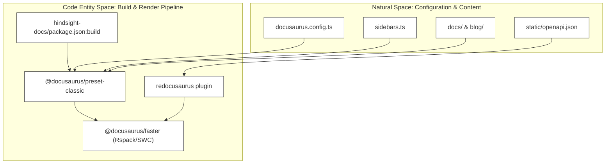
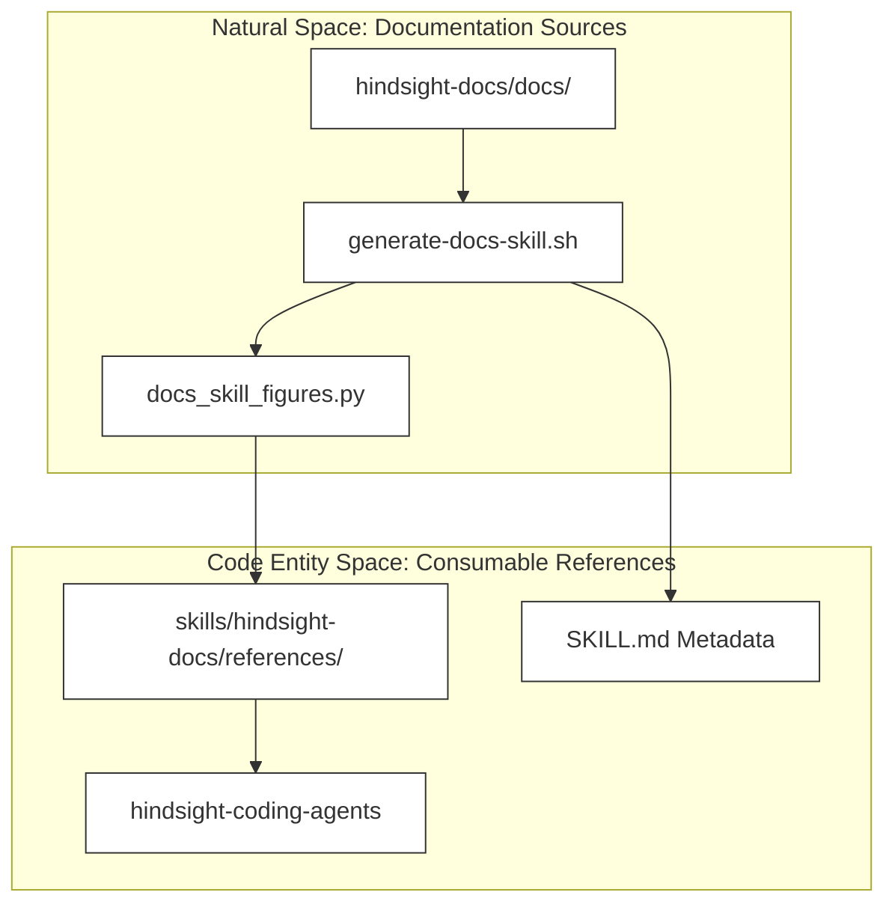

<!-- source: DeepWiki mcp.deepwiki.com · repo vectorize-io/hindsight · page 1.2 Documentation and Skills Sites · fetched 2026-10-27 -->

# Documentation and Skills Sites

Relevant source files

The following files were used as context for generating this wiki page:

- [hindsight-docs/blog/2026-10-21-nemotron-3-5-embed-in-hindsight.md](hindsight-docs/blog/2026-10-21-nemotron-3-5-embed-in-hindsight.md)
- [hindsight-docs/blog/authors.yml](hindsight-docs/blog/authors.yml)
- [hindsight-docs/docs/developer/index.mdx](hindsight-docs/docs/developer/index.mdx)
- [hindsight-docs/docusaurus.config.ts](hindsight-docs/docusaurus.config.ts)
- [hindsight-docs/package.json](hindsight-docs/package.json)
- [hindsight-docs/sidebars.ts](hindsight-docs/sidebars.ts)
- [hindsight-docs/src/css/custom.css](hindsight-docs/src/css/custom.css)
- [hindsight-docs/src/pages/best-practices.mdx](hindsight-docs/src/pages/best-practices.mdx)
- [hindsight-docs/src/pages/faq.mdx](hindsight-docs/src/pages/faq.mdx)
- [hindsight-docs/src/theme/DocSidebarItem/Link/index.tsx](hindsight-docs/src/theme/DocSidebarItem/Link/index.tsx)
- [hindsight-docs/static/img/blog/nemotron-3-5-embed-beam-100k.png](hindsight-docs/static/img/blog/nemotron-3-5-embed-beam-100k.png)
- [hindsight-docs/static/img/blog/nemotron-3-5-embed-beam-1m.png](hindsight-docs/static/img/blog/nemotron-3-5-embed-beam-1m.png)
- [hindsight-docs/static/img/blog/nemotron-3-5-embed-languages-table.png](hindsight-docs/static/img/blog/nemotron-3-5-embed-languages-table.png)
- [hindsight-docs/static/img/blog/nemotron-3-5-embed-latency.png](hindsight-docs/static/img/blog/nemotron-3-5-embed-latency.png)
- [hindsight-docs/static/img/blog/nemotron-3-5-embed-leaderboard.png](hindsight-docs/static/img/blog/nemotron-3-5-embed-leaderboard.png)
- [hindsight-docs/static/img/blog/nemotron-3-5-embed-locomo.png](hindsight-docs/static/img/blog/nemotron-3-5-embed-locomo.png)
- [hindsight-docs/static/img/blog/nemotron-3-5-embed-multilingual.png](hindsight-docs/static/img/blog/nemotron-3-5-embed-multilingual.png)
- [hindsight-docs/static/img/blog/nemotron-3-5-embed-passages-locomo.png](hindsight-docs/static/img/blog/nemotron-3-5-embed-passages-locomo.png)
- [hindsight-docs/static/img/blog/nemotron-3-5-embed-results-table.png](hindsight-docs/static/img/blog/nemotron-3-5-embed-results-table.png)
- [hindsight-docs/static/img/social-card.png](hindsight-docs/static/img/social-card.png)
- [hindsight-docs/versioned_docs/version-0.10/developer/index.mdx](hindsight-docs/versioned_docs/version-0.10/developer/index.mdx)
- [package-lock.json](package-lock.json)
- [package.json](package.json)
- [skills/hindsight-docs/references/best-practices.md](skills/hindsight-docs/references/best-practices.md)
- [skills/hindsight-docs/references/developer/index.md](skills/hindsight-docs/references/developer/index.md)

## Purpose and Scope

This page covers the technical architecture and tooling behind Hindsight's documentation ecosystem. It details the Docusaurus-based `hindsight-docs` site, the structured AI-agent-consumable reference directory (`skills/`), automated generation pipelines, and the interactive figure tooling used to produce documentation diagrams and assets.

---

## 1. Docusaurus Documentation Engine (`hindsight-docs`)

The primary documentation site is located in the `hindsight-docs` package and built using Docusaurus v3 `[hindsight-docs/package.json:17-34]()`. It integrates core documentation, versioning frameworks, blogs, custom CSS themes, and an OpenAPI reference viewer via `redocusaurus` `[hindsight-docs/docusaurus.config.ts:160-197]()`.

### Configuration and Build Performance

The site configuration (`[hindsight-docs/docusaurus.config.ts:17-157]()`) sets up site metadata, internationalization, head tags, and optimization flags. To accelerate local builds and continuous integration, Docusaurus Faster is partially enabled (`[hindsight-docs/docusaurus.config.ts:22-38]()`):
- **Enabled Features**: SWC JS loader, Lightning CSS minifier, MDX cross-compiler cache, Rspack bundler, and Rspack persistent cache.
- **Disabled Features**: SWC JS minimizer and SSG worker threads are disabled to prevent runtime failures in Redoc where the `Prism` global variable is expected during static generation of `/api-reference` `[hindsight-docs/docusaurus.config.ts:30-37]()`.

The `package.json` for `hindsight-docs` defines scripts for Docusaurus operations such as `start`, `build`, `deploy`, and `clear` `[hindsight-docs/package.json:5-15]()`. The `build` script performs validation steps including `check-code-parity.mjs`, `check-integration-seo.mjs`, `check-integrations.mjs`, and `check-mock-bank.mjs` `[hindsight-docs/package.json:8]()`.

### Navigation, Sidebars, and Blogs

Documentation structure is governed by sidebar configurations (`[hindsight-docs/sidebars.ts:1-237]()`), dividing content into Architecture, API References, Security, Clients, Integrations, and Cloud & Enterprise. The integrations category dynamically injects entries from a registry at render time (`[hindsight-docs/sidebars.ts:209-216]()`).

The blog system (`[hindsight-docs/docusaurus.config.ts:147-153]()`) uses authors defined in `[hindsight-docs/blog/authors.yml:1-79]()` to publish release announcements, technical deep dives, and changelogs.

*Figure 1: Documentation build pipeline mapping configuration entities to compilation runtimes.*

Sources: `[hindsight-docs/docusaurus.config.ts:1-197]`, `[hindsight-docs/sidebars.ts:1-237]`, `[hindsight-docs/package.json:1-61]`, `[hindsight-docs/blog/authors.yml:1-80]`

---

## 2. AI-Agent Consumable References (`skills/`)

To support coding agents and automated workflows, Hindsight maintains a structured knowledge directory under `skills/hindsight-docs/`. This directory contains markdown files optimized for LLMs and agent harnesses, providing concise API and architecture references `[skills/hindsight-docs/references/developer/index.md:1-123]()`.

### Reference Organization and Generation

The `skills/` directory mirrors the documentation architecture, translating guides, API specifications, and architectural overviews into compact markdown formats. 
- **Synchronization Scripts**: Shell and Python scripts (`generate-docs-skill.sh` and `docs_skill_figures.py`) keep agent skills in sync with upstream documentation changes.
- **Metadata**: Each skill directory contains `SKILL.md` descriptors defining invocation parameters, metadata, and validation policies.

*Figure 2: Data flow for generating AI agent reference skills from core documentation.*

Sources: `[skills/hindsight-docs/references/developer/index.md:1-123]`, `[hindsight-docs/package.json:1-61]`

---

## 3. Documentation Figures and Interfig Tooling

Interactive flow figures, animated sequence diagrams, and social export assets are supported by `hindsight-interfig` (`[hindsight-interfig/README.md:1-91]()`), which integrates directly into `hindsight-docs` via custom components like `Figure` (`[hindsight-docs/docs/developer/index.mdx:14]()`).

### Architecture of Interfig

`interfig` provides a React component library (`Flow`, `MiniGraph`) where layout trees, edges, and step-by-step beats are defined (`[hindsight-interfig/README.md:1-91]()`):
- **Layout Tree**: Defines parent-child relationships, display directions, grouping frames, and box attributes.
- **Edges & Beats**: Connects nodes with identifiers, loop routing, and step data payloads.
- **Export Pipeline**: The export script drives headless Chromium via Playwright, paired with Vite (`[hindsight-interfig/scripts/export.mjs:1-178]()`), to capture step animations and transcode raw frames into video assets.

Sources: `[hindsight-docs/package.json:1-61]`, `[hindsight-docs/docs/developer/index.mdx:14]`

---

