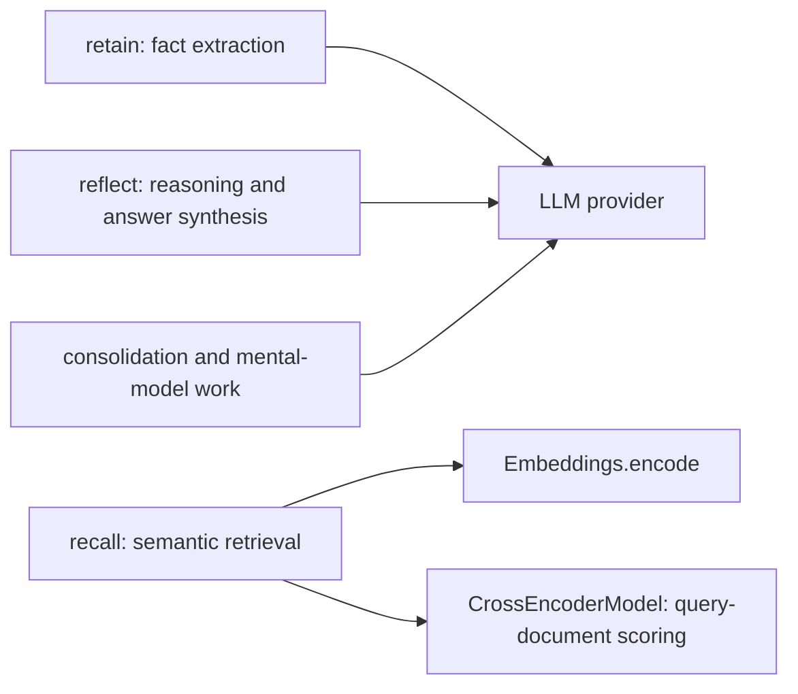
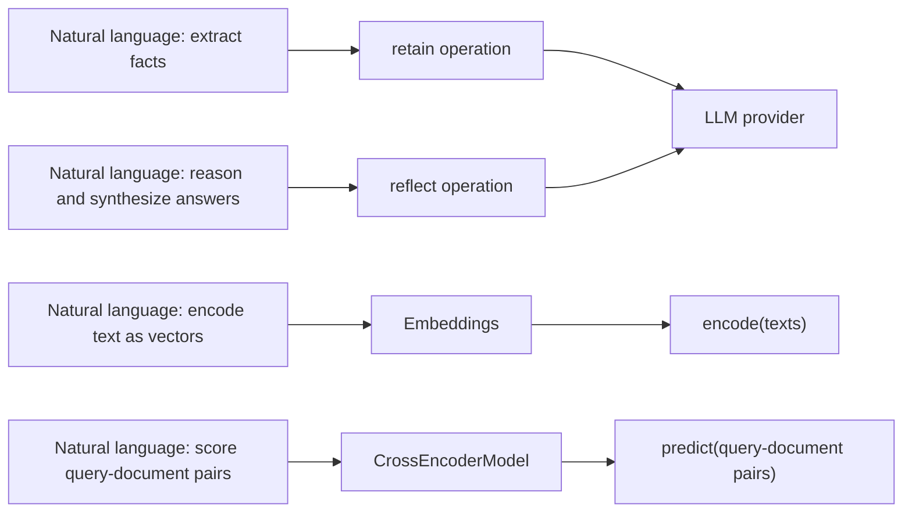
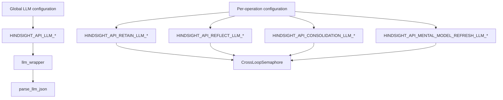
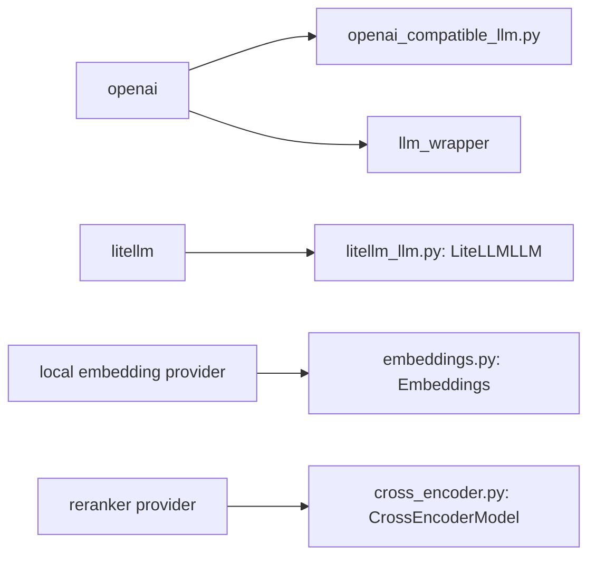

<!-- source: DeepWiki mcp.deepwiki.com · repo vectorize-io/hindsight · page 10 ML and AI Components · fetched 2026-10-27 -->

# ML and AI Components

Relevant source files

The following files were used as context for generating this wiki page:

- [.env.example](.env.example)
- [hindsight-api-slim/hindsight_api/config.py](hindsight-api-slim/hindsight_api/config.py)
- [hindsight-api-slim/hindsight_api/engine/cross_encoder.py](hindsight-api-slim/hindsight_api/engine/cross_encoder.py)
- [hindsight-api-slim/hindsight_api/engine/embeddings.py](hindsight-api-slim/hindsight_api/engine/embeddings.py)
- [hindsight-api-slim/hindsight_api/engine/llm_wrapper.py](hindsight-api-slim/hindsight_api/engine/llm_wrapper.py)
- [hindsight-api-slim/hindsight_api/engine/providers/litellm_llm.py](hindsight-api-slim/hindsight_api/engine/providers/litellm_llm.py)
- [hindsight-api-slim/hindsight_api/engine/providers/openai_compatible_llm.py](hindsight-api-slim/hindsight_api/engine/providers/openai_compatible_llm.py)
- [hindsight-api-slim/tests/test_litellm_sdk_embeddings.py](hindsight-api-slim/tests/test_litellm_sdk_embeddings.py)
- [hindsight-api-slim/tests/test_openai_compatible_response_hardening.py](hindsight-api-slim/tests/test_openai_compatible_response_hardening.py)
- [hindsight-docs/docs/developer/configuration.mdx](hindsight-docs/docs/developer/configuration.mdx)
- [hindsight-docs/docs/developer/models.mdx](hindsight-docs/docs/developer/models.mdx)
- [hindsight-docs/src/data/llmProviders.json](hindsight-docs/src/data/llmProviders.json)
- [hindsight-embed/hindsight_embed/env.example](hindsight-embed/hindsight_embed/env.example)
- [skills/hindsight-docs/references/developer/configuration.md](skills/hindsight-docs/references/developer/configuration.md)
- [skills/hindsight-docs/references/developer/models.md](skills/hindsight-docs/references/developer/models.md)
- [skills/hindsight-docs/references/faq.md](skills/hindsight-docs/references/faq.md)

## Purpose and scope

This page introduces Hindsight’s ML/AI architecture: LLMs provide reasoning and generation, embedding models produce vectors for semantic retrieval, and cross-encoders refine candidate ranking. It also outlines how configuration and provider choice fit together. For implementation details, see the child pages linked below. [skills/hindsight-docs/references/developer/models.md:4-18]()

Sources: [skills/hindsight-docs/references/developer/models.md:4-18]()

---

## Architecture Overview

Hindsight separates these model roles so that reasoning, vectorization, and ranking can be configured and evolved independently. LLMs support tasks such as fact extraction and answer synthesis; embeddings support semantic search; cross-encoders score query–document pairs to rerank candidates. [skills/hindsight-docs/references/developer/models.md:8-18]() [hindsight-api-slim/hindsight_api/engine/embeddings.py:146-187]() [hindsight-api-slim/hindsight_api/engine/cross_encoder.py:141-145]()

**Diagram: Memory operations mapped to ML components**

Sources: [skills/hindsight-docs/references/developer/models.md:16-18]() [hindsight-api-slim/hindsight_api/engine/embeddings.py:146-187]() [hindsight-api-slim/hindsight_api/engine/cross_encoder.py:141-145]()

The shared interfaces let the system use different providers behind each model role. The available configuration is not identical across roles: LLM calls have global and operation-specific settings, while embedding and reranker configuration is exposed through their own provider abstractions and settings. [hindsight-api-slim/hindsight_api/engine/llm_wrapper.py:59-105]() [hindsight-api-slim/hindsight_api/engine/embeddings.py:146-187]() [hindsight-api-slim/hindsight_api/engine/cross_encoder.py:141-175]()

**Diagram: Natural-language tasks bridged to code entities**

Sources: [skills/hindsight-docs/references/developer/models.md:8-18]() [hindsight-api-slim/hindsight_api/engine/embeddings.py:166-187]() [hindsight-api-slim/hindsight_api/engine/cross_encoder.py:141-175]()

---

## LLM Providers and Configuration

LLMs are used for reasoning and generation tasks, including fact extraction, entity resolution, mental-model consolidation, and answer synthesis. Hindsight supports multiple provider adapters, including OpenAI-compatible endpoints, OpenAI Responses, Anthropic, Gemini and Vertex AI, LiteLLM, and local options. For the provider list and adapter details, see [LLM Provider Adapters](#10.2). [skills/hindsight-docs/references/developer/models.md:16-61]()

Configuration can be global or operation-specific. The wrapper maintains a process-wide concurrency limit and can apply additional limits for operations such as `retain`, `reflect`, `consolidation`, and `mental_model_refresh`. The global limit still applies when an operation-specific limit is configured. For precedence, routing, retries, parsing, and detailed configuration, see [LLM Configuration and Wrapper](#10.1). [hindsight-api-slim/hindsight_api/engine/llm_wrapper.py:59-105]()

**Diagram: LLM configuration concepts mapped to code**

Sources: [hindsight-api-slim/hindsight_api/engine/llm_wrapper.py:59-105]() [hindsight-api-slim/hindsight_api/engine/llm_wrapper.py:107-158]() [hindsight-api-slim/hindsight_api/config.py:152-170]() [.env.example:25-46]()

---

## Embedding Models

Embedding providers convert text into vectors used for semantic search. The `Embeddings` abstraction exposes initialization, a provider name and dimension, and an asynchronous `encode(texts)` method. The dimension is detected at initialization so that the database schema can match model output. [hindsight-api-slim/hindsight_api/engine/embeddings.py:146-187]()

Available choices include local and remote providers. The documented default model is `BAAI/bge-small-en-v1.5`; provider options include SentenceTransformers, ONNX, TEI, OpenAI, Cohere, LiteLLM, Gemini, and ZeroEntropy. See [Embedding Models](#10.3) for provider behavior, batching, retries, and migration considerations. [skills/hindsight-docs/references/developer/models.md:8-12]() [hindsight-api-slim/hindsight_api/engine/embeddings.py:30-64]()

Sources: [hindsight-api-slim/hindsight_api/engine/embeddings.py:146-187]() [hindsight-api-slim/hindsight_api/engine/embeddings.py:30-64]() [skills/hindsight-docs/references/developer/models.md:8-12]()

---

## Cross-Encoder Rerankers

A cross-encoder scores query–document pairs to rerank search candidates. Hindsight exposes this role through the `CrossEncoderModel` abstraction, which includes provider identification and model initialization. The documented default is `cross-encoder/ms-marco-MiniLM-L-6-v2`. [hindsight-api-slim/hindsight_api/engine/cross_encoder.py:141-175]() [skills/hindsight-docs/references/developer/models.md:8-15]()

Reranker choices include local and hosted options. See [Cross-Encoder Rerankers](#10.4) for provider-specific behavior, candidate handling, score interpretation, and local inference considerations. [hindsight-api-slim/hindsight_api/engine/cross_encoder.py:26-77]()

Sources: [hindsight-api-slim/hindsight_api/engine/cross_encoder.py:141-175]() [hindsight-api-slim/hindsight_api/engine/cross_encoder.py:26-77]() [skills/hindsight-docs/references/developer/models.md:8-15]()

---

## Provider Configuration Matrix

The provider role determines the kind of work being configured: LLM providers generate or reason over text, embedding providers produce vectors, and cross-encoders score candidate pairs. Hindsight also supports a range of LLM adapters; any OpenAI-compatible API and many LiteLLM-supported providers can be used through those routes. See [Provider Configuration Matrix](#10.5) for a comparative view of supported options and trade-offs. [skills/hindsight-docs/references/developer/models.md:20-61]()

**Diagram: Configuration and adapter names mapped to code entities**

Sources: [hindsight-api-slim/hindsight_api/engine/providers/openai_compatible_llm.py:1-20]() [hindsight-api-slim/hindsight_api/engine/providers/litellm_llm.py:1-12]() [hindsight-api-slim/hindsight_api/engine/llm_wrapper.py:1-3]() [hindsight-api-slim/hindsight_api/engine/embeddings.py:146-187]() [hindsight-api-slim/hindsight_api/engine/cross_encoder.py:141-175]()

| Component | Primary role | Configuration and provider guidance |
|---|---|---|
| LLM | Extraction, reasoning, and generation | Global settings with operation-specific overrides; see [LLM Configuration and Wrapper](#10.1) and [LLM Provider Adapters](#10.2). [hindsight-api-slim/hindsight_api/engine/llm_wrapper.py:59-105]() |
| Embeddings | Vectorization for semantic search | Provider abstraction with model dimension detection; see [Embedding Models](#10.3). [hindsight-api-slim/hindsight_api/engine/embeddings.py:146-187]() |
| Cross-encoder | Candidate scoring and reranking | Query–document scoring abstraction; see [Cross-Encoder Rerankers](#10.4). [hindsight-api-slim/hindsight_api/engine/cross_encoder.py:141-175]() |

Sources: [hindsight-api-slim/hindsight_api/engine/llm_wrapper.py:59-105]() [hindsight-api-slim/hindsight_api/engine/embeddings.py:146-187]() [hindsight-api-slim/hindsight_api/engine/cross_encoder.py:141-175]()

---

## Further Reading

- [LLM Configuration and Wrapper](#10.1) — Global and operation-specific settings, concurrency, parsing, and provider routing.
- [LLM Provider Adapters](#10.2) — Provider-specific integrations and capabilities.
- [Embedding Models](#10.3) — Embedding backends and operational details.
- [Cross-Encoder Rerankers](#10.4) — Reranking backends and behavior.
- [Provider Configuration Matrix](#10.5) — Provider comparison and configuration guidance.

Sources: [hindsight-api-slim/hindsight_api/engine/llm_wrapper.py:59-105]() [hindsight-api-slim/hindsight_api/engine/embeddings.py:146-187]() [hindsight-api-slim/hindsight_api/engine/cross_encoder.py:141-175]()

---

