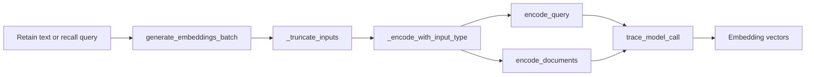
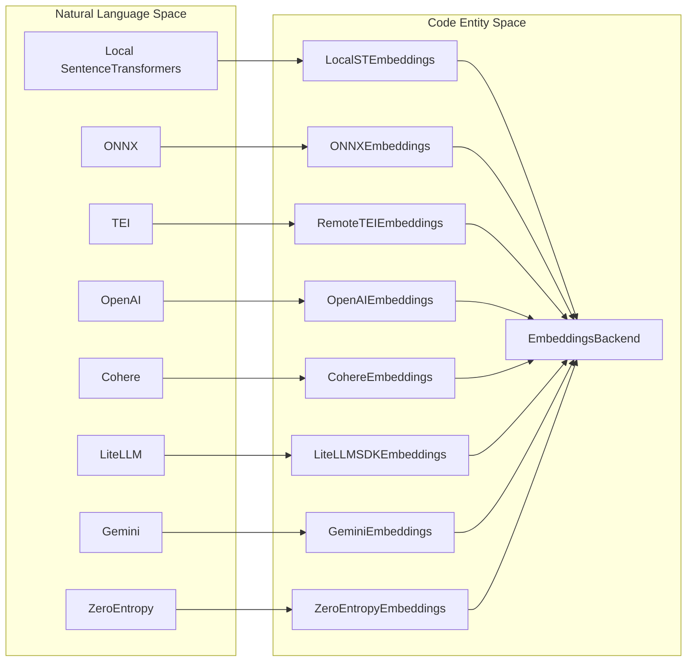
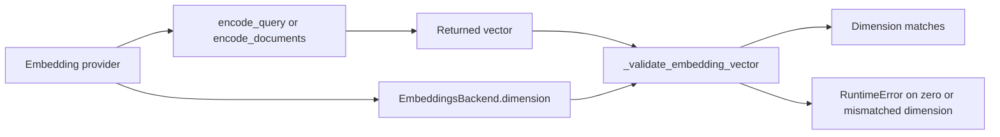
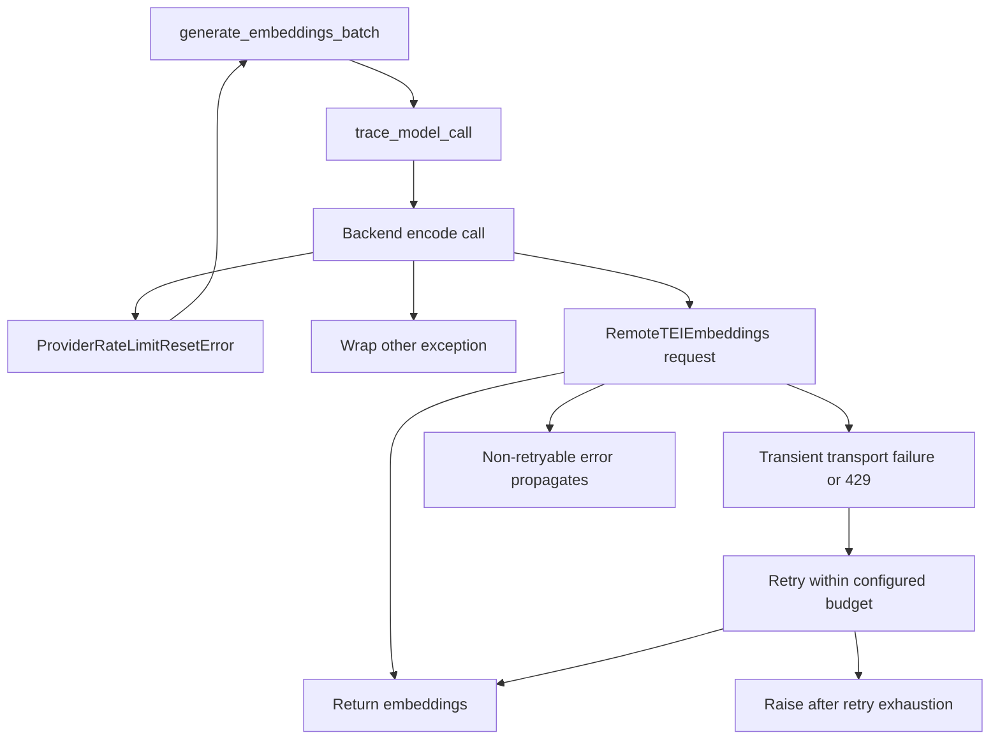

<!-- source: DeepWiki mcp.deepwiki.com · repo vectorize-io/hindsight · page 10.3 Embedding Models · fetched 2026-10-27 -->

# Embedding Models

Relevant source files

The following files were used as context for generating this wiki page:

- [hindsight-api-slim/hindsight_api/_vector_index.py](hindsight-api-slim/hindsight_api/_vector_index.py)
- [hindsight-api-slim/hindsight_api/alembic/versions/2eee35aa3cfc_case_insensitive_entities_trgm_index.py](hindsight-api-slim/hindsight_api/alembic/versions/2eee35aa3cfc_case_insensitive_entities_trgm_index.py)
- [hindsight-api-slim/hindsight_api/alembic/versions/5a366d414dce_initial_schema.py](hindsight-api-slim/hindsight_api/alembic/versions/5a366d414dce_initial_schema.py)
- [hindsight-api-slim/hindsight_api/alembic/versions/a2b3c4d5e6f7_add_text_signals_column.py](hindsight-api-slim/hindsight_api/alembic/versions/a2b3c4d5e6f7_add_text_signals_column.py)
- [hindsight-api-slim/hindsight_api/alembic/versions/a4b5c6d7e8f9_fix_per_bank_vector_index_type.py](hindsight-api-slim/hindsight_api/alembic/versions/a4b5c6d7e8f9_fix_per_bank_vector_index_type.py)
- [hindsight-api-slim/hindsight_api/alembic/versions/b8c9d0e1f2a3_vchord_cosine_opclass.py](hindsight-api-slim/hindsight_api/alembic/versions/b8c9d0e1f2a3_vchord_cosine_opclass.py)
- [hindsight-api-slim/hindsight_api/alembic/versions/d5e6f7a8b9c0_add_bank_internal_id_and_per_bank_hnsw.py](hindsight-api-slim/hindsight_api/alembic/versions/d5e6f7a8b9c0_add_bank_internal_id_and_per_bank_hnsw.py)
- [hindsight-api-slim/hindsight_api/alembic/versions/d6e7f8a9b0c1_drop_documents_metadata_column.py](hindsight-api-slim/hindsight_api/alembic/versions/d6e7f8a9b0c1_drop_documents_metadata_column.py)
- [hindsight-api-slim/hindsight_api/alembic/versions/h3i4j5k6l7m8_merge_heads_and_add_unit_entities_index.py](hindsight-api-slim/hindsight_api/alembic/versions/h3i4j5k6l7m8_merge_heads_and_add_unit_entities_index.py)
- [hindsight-api-slim/hindsight_api/alembic/versions/n9i0j1k2l3m4_learnings_and_pinned_reflections.py](hindsight-api-slim/hindsight_api/alembic/versions/n9i0j1k2l3m4_learnings_and_pinned_reflections.py)
- [hindsight-api-slim/hindsight_api/engine/retain/embedding_coalescer.py](hindsight-api-slim/hindsight_api/engine/retain/embedding_coalescer.py)
- [hindsight-api-slim/hindsight_api/engine/retain/embedding_processing.py](hindsight-api-slim/hindsight_api/engine/retain/embedding_processing.py)
- [hindsight-api-slim/hindsight_api/engine/retain/embedding_utils.py](hindsight-api-slim/hindsight_api/engine/retain/embedding_utils.py)
- [hindsight-api-slim/hindsight_api/engine/search/reranking.py](hindsight-api-slim/hindsight_api/engine/search/reranking.py)
- [hindsight-api-slim/hindsight_api/engine/tei_retry.py](hindsight-api-slim/hindsight_api/engine/tei_retry.py)
- [hindsight-api-slim/hindsight_api/engine/token_encoding.py](hindsight-api-slim/hindsight_api/engine/token_encoding.py)
- [hindsight-api-slim/tests/test_coarse_date_spans.py](hindsight-api-slim/tests/test_coarse_date_spans.py)
- [hindsight-api-slim/tests/test_combined_scoring.py](hindsight-api-slim/tests/test_combined_scoring.py)
- [hindsight-api-slim/tests/test_delta_editorial_fusion.py](hindsight-api-slim/tests/test_delta_editorial_fusion.py)
- [hindsight-api-slim/tests/test_embedding_coalescer.py](hindsight-api-slim/tests/test_embedding_coalescer.py)
- [hindsight-api-slim/tests/test_embeddings_max_input_tokens.py](hindsight-api-slim/tests/test_embeddings_max_input_tokens.py)
- [hindsight-api-slim/tests/test_embeddings_request_concurrency.py](hindsight-api-slim/tests/test_embeddings_request_concurrency.py)
- [hindsight-api-slim/tests/test_fact_extraction_quality.py](hindsight-api-slim/tests/test_fact_extraction_quality.py)
- [hindsight-api-slim/tests/test_gemini_deadline_retry.py](hindsight-api-slim/tests/test_gemini_deadline_retry.py)
- [hindsight-api-slim/tests/test_graph_entity_fanout_cap.py](hindsight-api-slim/tests/test_graph_entity_fanout_cap.py)
- [hindsight-api-slim/tests/test_link_utils.py](hindsight-api-slim/tests/test_link_utils.py)
- [hindsight-api-slim/tests/test_quality_integration.py](hindsight-api-slim/tests/test_quality_integration.py)
- [hindsight-api-slim/tests/test_reranker_failover_chain.py](hindsight-api-slim/tests/test_reranker_failover_chain.py)
- [hindsight-api-slim/tests/test_reranker_score_normalization.py](hindsight-api-slim/tests/test_reranker_score_normalization.py)
- [hindsight-api-slim/tests/test_reranking_proof_count.py](hindsight-api-slim/tests/test_reranking_proof_count.py)
- [hindsight-api-slim/tests/test_retain_chunks_embedding_batching.py](hindsight-api-slim/tests/test_retain_chunks_embedding_batching.py)
- [hindsight-api-slim/tests/test_retain_orchestrator_mapping.py](hindsight-api-slim/tests/test_retain_orchestrator_mapping.py)
- [hindsight-api-slim/tests/test_tei_cross_encoder.py](hindsight-api-slim/tests/test_tei_cross_encoder.py)
- [hindsight-api-slim/tests/test_tei_embeddings.py](hindsight-api-slim/tests/test_tei_embeddings.py)
- [hindsight-api-slim/tests/test_tei_retry.py](hindsight-api-slim/tests/test_tei_retry.py)
- [hindsight-api-slim/tests/test_vector_index.py](hindsight-api-slim/tests/test_vector_index.py)

## Purpose and Scope

This page describes how Hindsight turns text into vectors for memory storage and search. It covers the embedding interface and provider families, dimension handling, batching, retries, input-token limits, and the operational implications of changing embedding models. Embeddings are distinct from LLMs used for reasoning and from rerankers used to score retrieved candidates. [hindsight-api-slim/hindsight_api/engine/retain/embedding_utils.py:15-27]() [hindsight-api-slim/hindsight_api/engine/retain/embedding_utils.py:114-150]()

Sources: [hindsight-api-slim/hindsight_api/engine/retain/embedding_utils.py:15-27](), [hindsight-api-slim/hindsight_api/engine/retain/embedding_utils.py:114-150]()

## Embedding Interface and Data Flow

The retain/recall-facing `EmbeddingsBackend` protocol requires a `dimension` property and separate `encode_query` and `encode_documents` methods. The distinction lets a backend apply different query and passage handling where supported. `generate_embeddings_batch` selects the method from the `input_type` argument, applies the configured input cap when enabled, and wraps the provider call in model-call tracing. [hindsight-api-slim/hindsight_api/engine/retain/embedding_utils.py:15-27]() [hindsight-api-slim/hindsight_api/engine/retain/embedding_utils.py:106-150]()

Provider implementations supply the actual encoding behavior. Remote providers perform asynchronous HTTP calls; in-process providers are responsible for moving CPU-bound model work off the event loop. [hindsight-api-slim/hindsight_api/engine/retain/embedding_utils.py:117-122]()

**Diagram: Text input through the embedding utility**

Sources: [hindsight-api-slim/hindsight_api/engine/retain/embedding_utils.py:61-94](), [hindsight-api-slim/hindsight_api/engine/retain/embedding_utils.py:106-150]()

**Natural Language Space to Code Entity Space: provider families**

The diagram maps the provider families documented for this page to their corresponding implementation names from the existing page. The supplied implementation excerpt directly establishes the common backend protocol and TEI regression-test class; detailed provider implementation locations are cited where available in the existing page content. [hindsight-api-slim/hindsight_api/engine/retain/embedding_utils.py:18-27]() [hindsight-api-slim/tests/test_tei_embeddings.py:17-35]()

Sources: [hindsight-api-slim/hindsight_api/engine/retain/embedding_utils.py:18-27](), [hindsight-api-slim/tests/test_tei_embeddings.py:17-35](), [hindsight-api-slim/hindsight_api/engine/embeddings.py:400-570](), [hindsight-api-slim/hindsight_api/engine/embeddings.py:800-1275]()

## Provider Families

The backend protocol abstracts provider-specific implementation details behind `dimension`, `encode_query`, and `encode_documents`. The existing provider inventory includes local SentenceTransformers and ONNX implementations, remote TEI, OpenAI, Cohere, LiteLLM, Gemini, and ZeroEntropy. Provider-specific settings and API details belong to the concrete implementation; the shared batch utility applies the same input-token policy before calling any backend. [hindsight-api-slim/hindsight_api/engine/retain/embedding_utils.py:18-27]() [hindsight-api-slim/hindsight_api/engine/retain/embedding_utils.py:131-145]()

| Provider family | Implementation name | Execution pattern or provider-specific detail |
|---|---|---|
| Local SentenceTransformers | `LocalSTEmbeddings` | In-process inference; local execution details depend on model and device configuration. [hindsight-api-slim/hindsight_api/engine/embeddings.py:400-570]() |
| ONNX | `ONNXEmbeddings` | Local model implementation. [hindsight-api-slim/hindsight_api/engine/embeddings.py:400-570]() |
| TEI | `RemoteTEIEmbeddings` | Remote HTTP provider; tests exercise encoding against an HTTP stub. [hindsight-api-slim/tests/test_tei_embeddings.py:17-35]() |
| OpenAI | `OpenAIEmbeddings` | Remote provider implementation. [hindsight-api-slim/hindsight_api/engine/embeddings.py:800-1070]() |
| Cohere | `CohereEmbeddings` | Remote provider implementation. [hindsight-api-slim/hindsight_api/engine/embeddings.py:800-1070]() |
| LiteLLM | `LiteLLMSDKEmbeddings` | SDK-backed provider implementation. [hindsight-api-slim/hindsight_api/engine/embeddings.py:800-1070]() |
| Gemini | `GeminiEmbeddings` | Google Gemini/Vertex embedding implementation. [hindsight-api-slim/hindsight_api/engine/embeddings.py:1075-1175]() |
| ZeroEntropy | `ZeroEntropyEmbeddings` | Dedicated provider implementation. [hindsight-api-slim/hindsight_api/engine/embeddings.py:1178-1275]() |

Sources: [hindsight-api-slim/hindsight_api/engine/retain/embedding_utils.py:18-27](), [hindsight-api-slim/tests/test_tei_embeddings.py:17-35](), [hindsight-api-slim/hindsight_api/engine/embeddings.py:400-570](), [hindsight-api-slim/hindsight_api/engine/embeddings.py:800-1275]()

## Dimension Detection and Vector Validation

The backend protocol exposes `dimension` as the expected vector size. The shared retain utility validates individual vectors: a zero-length vector or one whose length differs from the expected dimension raises `RuntimeError`. This catches malformed or incompatible provider output at the boundary rather than allowing an invalid vector to proceed silently. [hindsight-api-slim/hindsight_api/engine/retain/embedding_utils.py:18-27]() [hindsight-api-slim/hindsight_api/engine/retain/embedding_utils.py:97-103]()

The TEI regression-test setup illustrates one test path: it marks a `RemoteTEIEmbeddings` instance initialized and sets its dimension to two before exercising encoding. That is test setup, not evidence that all providers detect dimensions the same way. [hindsight-api-slim/tests/test_tei_embeddings.py:24-35]()

**Natural Language Space to Code Entity Space: vector-size contract**

Sources: [hindsight-api-slim/hindsight_api/engine/retain/embedding_utils.py:18-27](), [hindsight-api-slim/hindsight_api/engine/retain/embedding_utils.py:97-111]()

### Migration implications

Embedding dimensions are part of the storage compatibility contract: Hindsight expects vectors to match the backend’s declared dimension, and the utility raises an error when they do not. A provider or model change can also change the vector space even when the dimension remains the same; operationally, stored vectors and newly generated vectors must be treated as a compatible set before relying on similarity search. The supplied excerpts establish validation behavior but do not show the migration implementation or a complete re-embedding procedure. [hindsight-api-slim/hindsight_api/engine/retain/embedding_utils.py:18-27]() [hindsight-api-slim/hindsight_api/engine/retain/embedding_utils.py:97-103]()

| Change | Compatibility concern |
|---|---|
| Output dimension changes | Vectors that do not match the configured dimension fail validation; storage schema compatibility must be checked. [hindsight-api-slim/hindsight_api/engine/retain/embedding_utils.py:97-103]() |
| Provider or model changes | Matching dimensions alone do not establish that old and new vectors share a compatible embedding space. |
| Configured dimension override | Provider output must still match the expected dimension or validation raises an error. [hindsight-api-slim/hindsight_api/engine/retain/embedding_utils.py:97-103]() |

Sources: [hindsight-api-slim/hindsight_api/engine/retain/embedding_utils.py:18-27](), [hindsight-api-slim/hindsight_api/engine/retain/embedding_utils.py:97-103]()

## Batching and Coalescing

`generate_embeddings_batch` accepts a list of texts and returns vectors in the same order as its inputs. Its shared path makes one `encode_query` or `encode_documents` call for the batch and traces the call with the input type and number of texts. Provider implementations may impose their own request-size or batching constraints. [hindsight-api-slim/hindsight_api/engine/retain/embedding_utils.py:106-145]()

The repository also includes `embedding_coalescer.py` and a corresponding test file. Their presence identifies a coalescing mechanism in the retain path; implementation details such as queue timing, thresholds, and concurrency are not shown in the supplied excerpts. [hindsight-api-slim/hindsight_api/engine/retain/embedding_coalescer.py]() [hindsight-api-slim/tests/test_embedding_coalescer.py]()

The retain orchestrator tests cover positional alignment between processed facts and returned unit IDs, as well as rejecting a length mismatch. This is separate from provider vector validation: callers must preserve the association between each text/fact and its resulting embedding through the retain pipeline. [hindsight-api-slim/tests/test_retain_orchestrator_mapping.py:66-102]()

Sources: [hindsight-api-slim/hindsight_api/engine/retain/embedding_utils.py:106-145](), [hindsight-api-slim/hindsight_api/engine/retain/embedding_coalescer.py](), [hindsight-api-slim/tests/test_embedding_coalescer.py](), [hindsight-api-slim/tests/test_retain_orchestrator_mapping.py:66-102]()

## Retry Logic and Fault Tolerance

`generate_embeddings_batch` treats `ProviderRateLimitResetError` specially and re-raises it unchanged. Its comment identifies this exception as a control signal that allows a worker to park an operation until the indicated reset time. Other exceptions are wrapped as `Failed to generate batch embeddings`, preserving the original exception as their cause. [hindsight-api-slim/hindsight_api/engine/retain/embedding_utils.py:138-150]()

TEI has separate transport retry behavior. Regression tests show that dropped connections, truncated response bodies, a bad file descriptor, and HTTP 429 can be retried; persistent dropped connections exhaust the configured retry budget, while a non-retryable `EACCES` error propagates without retry. A `Retry-After` header is passed into the retry-delay logic. [hindsight-api-slim/tests/test_tei_embeddings.py:60-90]() [hindsight-api-slim/tests/test_tei_embeddings.py:109-150]() [hindsight-api-slim/tests/test_tei_embeddings.py:154-180]()

**Diagram: Batch error handling and TEI retry path**

Sources: [hindsight-api-slim/hindsight_api/engine/retain/embedding_utils.py:138-150](), [hindsight-api-slim/tests/test_tei_embeddings.py:60-90](), [hindsight-api-slim/tests/test_tei_embeddings.py:109-168]()

## Maximum Input Tokens

The input cap is read from `get_config().embeddings_max_input_tokens`. When the value is not `None` and the batch is non-empty, `generate_embeddings_batch` truncates each input before any provider’s `encode` method is called. A `None` value disables this shared truncation step. [hindsight-api-slim/hindsight_api/engine/retain/embedding_utils.py:131-137]()

`_truncate_inputs` accounts for the backend tokenizer when it exposes a non-empty `tokenizer_encoding`. It also subtracts the token cost of an optional query or passage prefix before truncating, since the prefix may be added after this shared cap. If truncation occurs, the utility logs the number of affected inputs and the configured environment-variable name, `HINDSIGHT_API_EMBEDDINGS_MAX_INPUT_TOKENS`. [hindsight-api-slim/hindsight_api/engine/retain/embedding_utils.py:30-58]() [hindsight-api-slim/hindsight_api/engine/retain/embedding_utils.py:61-94]()

This provider-agnostic boundary protects remote APIs that reject oversized text and ensures that decorated input—such as a joined name and content string—is measured as a whole when passed to the utility. [hindsight-api-slim/hindsight_api/engine/retain/embedding_utils.py:64-79]()

Sources: [hindsight-api-slim/hindsight_api/engine/retain/embedding_utils.py:30-58](), [hindsight-api-slim/hindsight_api/engine/retain/embedding_utils.py:61-94](), [hindsight-api-slim/hindsight_api/engine/retain/embedding_utils.py:131-137]()

## Operational Summary

| Concern | Shared behavior |
|---|---|
| Query versus document encoding | `input_type` selects `encode_query` or `encode_documents`. [hindsight-api-slim/hindsight_api/engine/retain/embedding_utils.py:106-111]() |
| Token limits | A configured maximum is applied before provider encoding. [hindsight-api-slim/hindsight_api/engine/retain/embedding_utils.py:131-137]() |
| Prefixes and tokenizers | Optional backend tokenizer and query/passage prefix capabilities affect the effective truncation budget. [hindsight-api-slim/hindsight_api/engine/retain/embedding_utils.py:30-58]() |
| Dimension integrity | Empty vectors and vectors with an unexpected length raise `RuntimeError`. [hindsight-api-slim/hindsight_api/engine/retain/embedding_utils.py:97-103]() |
| Rate-limit control signal | `ProviderRateLimitResetError` is re-raised rather than wrapped. [hindsight-api-slim/hindsight_api/engine/retain/embedding_utils.py:146-148]() |
| TEI transient errors | Tests cover bounded retries for transient transport conditions and HTTP 429. [hindsight-api-slim/tests/test_tei_embeddings.py:60-90]() [hindsight-api-slim/tests/test_tei_embeddings.py:138-168]() |
| Dimension or model change | Check vector-storage compatibility and plan for consistent vectors; dimension validation alone does not establish model-space compatibility. [hindsight-api-slim/hindsight_api/engine/retain/embedding_utils.py:97-103]() |

Sources: [hindsight-api-slim/hindsight_api/engine/retain/embedding_utils.py:30-58](), [hindsight-api-slim/hindsight_api/engine/retain/embedding_utils.py:97-111](), [hindsight-api-slim/hindsight_api/engine/retain/embedding_utils.py:131-150](), [hindsight-api-slim/tests/test_tei_embeddings.py:60-90](), [hindsight-api-slim/tests/test_tei_embeddings.py:138-168]()

---

