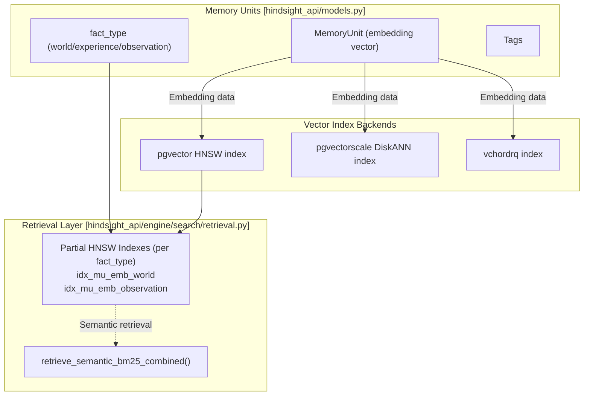
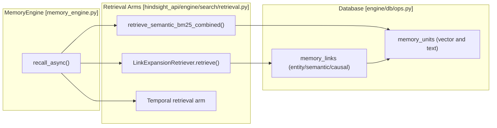

<!-- source: DeepWiki mcp.deepwiki.com · repo vectorize-io/hindsight · page 11 Performance and Optimization · fetched 2026-10-27 -->

# Performance and Optimization

Relevant source files

The following files were used as context for generating this wiki page:

- [.github/workflows/perf-test.yml](.github/workflows/perf-test.yml)
- [hindsight-api-slim/tests/test_observation_expansion_scoring.py](hindsight-api-slim/tests/test_observation_expansion_scoring.py)
- [hindsight-dev/benchmarks/perf/README.md](hindsight-dev/benchmarks/perf/README.md)
- [hindsight-dev/benchmarks/perf/recall_perf.py](hindsight-dev/benchmarks/perf/recall_perf.py)
- [hindsight-dev/benchmarks/perf/system_perf.py](hindsight-dev/benchmarks/perf/system_perf.py)
- [scripts/benchmarks/publish-locomo-results.sh](scripts/benchmarks/publish-locomo-results.sh)
- [scripts/benchmarks/publish-perf-results.sh](scripts/benchmarks/publish-perf-results.sh)

This page provides a high-level overview of key performance considerations and optimization strategies for Hindsight deployments. It covers vector index selection and its impact on retrieval latency, reranking and recall strategies, tuning of token budgets, consolidation frequency for background processing, and monitoring approaches to maintain performance health.

For detailed benchmark data, latency measurements, and scalability analysis, see the child page [Performance Characteristics](#11.1). For monitoring setup and observability best practices, see [Monitoring and Observability](#11.2). For multilingual performance considerations, see [Multilingual Support](#11.3).

---

## Vector Index Selection and Backend Considerations

Hindsight supports multiple PostgreSQL vector index backends, each optimized for specific scale and workload scenarios. The choice of vector index backend significantly affects recall latency, throughput, and resource usage as memory banks grow.

### Index Backends

- **pgvector with HNSW index:**  
  The default backend for small to medium-sized banks, using partial HNSW indexes partitioned by `fact_type` (e.g., world, observation). It optimizes query planner behavior to avoid sequential scans beyond approximately 10,000 memory units, at which point the planner switches from sequential scan to an efficient HNSW index scan [hindsight-dev/benchmarks/perf/system_perf.py:141-145]().

- **pgvectorscale with DiskANN:**  
  Designed for very large vector stores (millions of embeddings), this backend provides approximate nearest neighbor (ANN) search with significantly reduced disk and memory footprint. It achieves lower recall latency and operating cost at scale compared to pgvector.

- **vchord and vchordrq:**  
  Specialized backends supporting advanced vector search and BM25 combination, particularly suited for high-dimensional embeddings and multilingual text search.

### Relation to Code Entities and Vector Storage

Sources: [hindsight-dev/benchmarks/perf/system_perf.py:70-160](), [hindsight-api-slim/hindsight_api/engine/retain/link_utils.py:10-15]()

---

## Retrieval Strategies and Reranking (TEMPR Architecture)

Hindsight employs a parallel multi-strategy retrieval framework named **TEMPR** (Temporal, Entity, Memory, Parallel Retrieval). The retrieval system simultaneously executes multiple complementary retrieval arms to maximize recall quality and minimize latency:

- **Semantic Retrieval:** Performs dense vector similarity search leveraging the configured vector index (pgvector HNSW, pgvectorscale DiskANN, etc.).
- **BM25 Text Search:** Classic lexical scoring complements semantic search by matching keyword occurrences.
- **Graph Traversal (Entity Link Expansion):** Traverses entity and memory links to expand recall candidates contextually.
- **Temporal Search:** Uses temporal constraints and filtering to prioritize recent or temporally relevant facts.

### Parallel Retrieval Flow in Code

### Key Optimizations

- **Recall Budgeting:** Recall query complexity and candidate set size are controlled using recall budgets (LOW, MID, HIGH). These budgets cap graph traversal fanout and the number of candidates considered for reranking to meet latency goals.
- **Reciprocal Rank Fusion (RRF):** Results from the diverse retrieval arms are merged with RRF to leverage strengths of each.
- **Cross-Encoder Reranking:** The top candidates post-fusion are reranked using a cross-encoder model for precision improvements.
- **Token Budget Filtering:** Recall results are filtered to meet token budget constraints for downstream LLM input limits.
- **Link Capping:** During retrieval, the number of temporal and semantic links per memory unit is limited to reduce join sizes and query cost.

Sources: [hindsight-dev/benchmarks/perf/recall_perf.py:22-29](), [hindsight-api-slim/tests/test_observation_expansion_scoring.py:52-111]()

---

## Token Budget Tuning and Result Ordering

Controlling the size of recall payloads is crucial to stay within LLM token limits and optimize cost.

- Hindsight enforces strict **token budget caps** on recall results to guarantee that prompts remain within size constraints.
- Recall results are **ordered** to prioritize the most relevant and informative facts first, enabling graceful truncation if necessary.
- Logical consistency is maintained by **preserving input order of chunks and entities**, which benefits downstream reasoning and reduces loss of critical context.
- Automated performance and scale test frameworks (such as `perf-test`) validate query latency and budget adherence under various data volumes [hindsight-dev/benchmarks/perf/README.md:1-25]().

Sources: [hindsight-dev/benchmarks/perf/README.md:1-25]()

---

## Consolidation Frequency and Background Processing

Consolidation synthesizes observations from underlying facts into aggregated knowledge, enabling efficient recall and reflection.

### Background Worker and Deadlock Mitigation

- Consolidation and graph maintenance run asynchronously in background worker services.
- To mitigate deadlocks arising from concurrent writes (especially on graph maintenance queues and entity cooccurrences), Hindsight employs robust retry mechanisms:
  - Sorted insert/update operations to keep lock acquisition order consistent [hindsight-dev/benchmarks/perf/README.md:26-51]().
  - Exponential backoff retries around deadlock exceptions to maintain high escape rates under concurrency [hindsight-dev/benchmarks/perf/README.md:26-51]().
- These patterns are stress-tested via dedicated contention benchmarks like `graph-maintenance-contention` [hindsight-dev/benchmarks/perf/README.md:26-51]().

### Optimization Points

- Consolidation jobs batch workloads and retry on contention to maintain throughput.
- Retain pipelines batch input chunking and embedding generation to minimize overhead.
- Continuous integration pipelines (`perf-test.yml`) monitor regression across releases [/.github/workflows/perf-test.yml:1-70]().

Sources: [.github/workflows/perf-test.yml:1-70](), [hindsight-dev/benchmarks/perf/README.md:26-51]()

---

## Monitoring and Observability

Hindsight exposes a comprehensive observability stack geared towards performance monitoring and operational awareness:

- **Prometheus metrics endpoint `/metrics`:** Exposes detailed counters and histograms covering API requests, embedding, reranker calls, retrieval latencies, and token usage.
- **Prebuilt Grafana dashboards:** Located in `monitoring/grafana`, dashboards visualize recall latency breakouts, consolidation throughput, operation statuses, and token usage trends.
- **Tracing and Context Propagation:** Full context propagation traces LLM calls, background tasks, and database queries for deep diagnostics.
- **LLM Trace Capture:** Captures input/output tokens and prompt contents to pinpoint LLM call cost and performance.
- **Control Plane Integration:** The Control Plane UI surfaces operation status, async task queues, and performance health summaries.

For configuration details and setup instructions, see the child page [Monitoring and Observability](#11.2).

Sources: [scripts/benchmarks/publish-perf-results.sh:1-57]()

---

## Summary

Performance optimization in Hindsight hinges on coordinated tuning of several components:

- **Vector Index Backend:** Select pgvector HNSW for small/medium banks, and pgvectorscale DiskANN for large-scale deployments to balance latency and cost.
- **Multi-Arm Retrieval (TEMPR):** Parallel retrieval across semantic, lexical, graph, and temporal arms combined with reranking reduces recall latency while maximizing quality.
- **Token Budget Management:** Control recall payload sizes via ordering and hard budget caps to optimize LLM invocation cost and stability.
- **Asynchronous Consolidation:** Efficient, resilient consolidation and graph maintenance under concurrency prevent deadlocks and maintain throughput.
- **Continuous Monitoring:** Prometheus and Grafana integration provide visibility into latency, resource usage, and operation status.

Together, these elements ensure Hindsight performs efficiently across varied scales and deployments.

---

## Child Pages

- [Performance Characteristics](#11.1) — Detailed benchmark results including latency vs scale, recall throughput by budget level, reranking impact, and large-scale consolidation throughput.
- [Monitoring and Observability](#11.2) — Setup and best practices for Prometheus metrics, Grafana dashboards, tracing, and operation status tracking.
- [Multilingual Support](#11.3) — Technical overview of multilingual retrieval and embedding support, language detection, and cross-lingual recall considerations.

---

Sources:  
- [.github/workflows/perf-test.yml:1-70]()  
- [hindsight-dev/benchmarks/perf/system_perf.py:70-160]()  
- [hindsight-dev/benchmarks/perf/recall_perf.py:22-29]()  
- [hindsight-dev/benchmarks/perf/README.md:1-51]()  
- [hindsight-api-slim/tests/test_observation_expansion_scoring.py:52-111]()  
- [scripts/benchmarks/publish-perf-results.sh:1-57]()

---

