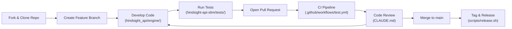
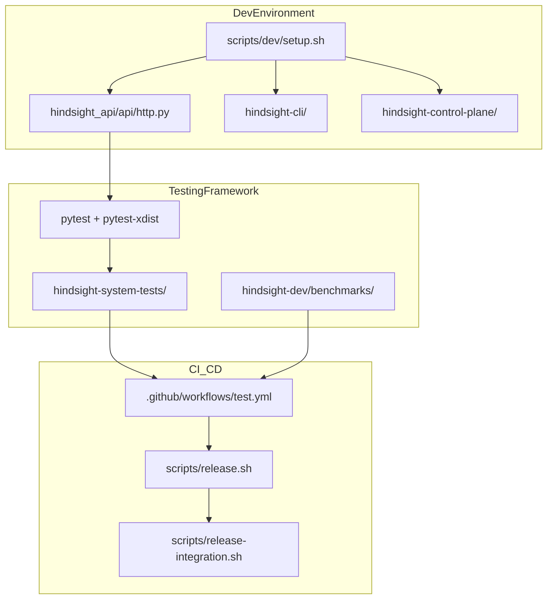

<!-- source: DeepWiki mcp.deepwiki.com · repo vectorize-io/hindsight · page 12 Contributing · fetched 2026-10-27 -->

# Contributing

<details>
<summary>Relevant source files</summary>

The following files were used as context for generating this wiki page:

- [.claude/skills/code-review/SKILL.md](.claude/skills/code-review/SKILL.md)
- [.gitignore](.gitignore)
- [CLAUDE.md](CLAUDE.md)
- [hindsight-api-slim/tests/test_document_tracking.py](hindsight-api-slim/tests/test_document_tracking.py)
- [hindsight-clients/go/model_document_response.go](hindsight-clients/go/model_document_response.go)
- [hindsight-clients/python/tests/test_mental_model_query_mapping.py](hindsight-clients/python/tests/test_mental_model_query_mapping.py)

</details>


This page provides a high-level overview for contributors to Hindsight. It covers the key aspects of the contribution process including the code of conduct, development setup, `CLAUDE.md` agent conventions, `.claude` skills (`code-review`, `ship-it`, `figure`, `hs-release`), testing requirements, the pull request process, and an introduction to adding new providers or integrations.

For detailed, step-by-step instructions on specific sub-topics, see the child pages:
- [Adding a New Integration](#12.1) — Scaffolding, registry entries, and release workflows.
- [Changelog and Release Notes](#12.2) — Automation, changelog pages, and versioning.

---

## Development Workflow Overview

Hindsight development follows a fork-and-pull-request model supported by automated testing and CI pipelines defined in `.github/workflows/test.yml:1-11]()`. Contributors fork the repository, create feature branches, implement changes following `CLAUDE.md:1-40]()` guidelines, and open pull requests that undergo automated testing and code review.

```mermaid
graph LR
    FORK["Fork Repository"]
    CLONE["Clone Locally"]
    BRANCH["Create Feature Branch"]
    CODE["Write Code + Tests"]
    COMMIT["Commit Changes"]
    PR["Open Pull Request"]
    CI["CI Pipeline<br/>(.github/workflows/test.yml)"]
    REVIEW["Code Review<br/>(CLAUDE.md)"]
    MERGE["Merge to main"]
    TAG["Create Tag<br/>(scripts/release.sh)"]
    RELEASE["Automated Release<br/>(.github/workflows/release.yml)"]
    
    FORK --> CLONE
    CLONE --> BRANCH
    BRANCH --> CODE
    CODE --> COMMIT
    COMMIT --> PR
    PR --> CI
    CI --> REVIEW
    REVIEW --> CODE
    REVIEW --> MERGE
    MERGE --> TAG
    TAG --> RELEASE
```



**Sources:**  
[.github/workflows/test.yml:1-11](), [scripts/release.sh:1-38](), [CLAUDE.md:1-40]()

---

## Development Setup

### Prerequisites

Local development requires Python 3.11+, `uv`, Node.js 20+, `npm`, Rust stable, and Docker [CLAUDE.md:16-39](), [docker/standalone/Dockerfile:1-70]().

### Bootstrapping

To bootstrap your environment, run the setup script located at `scripts/dev/setup.sh:1-179]()`:

```bash
./scripts/dev/setup.sh
```

This idempotent script installs toolchains, creates `.env` files, configures git hooks, installs Python and Node workspace dependencies, downloads local ML models, and builds the TypeScript SDK and Rust CLI [scripts/dev/setup.sh:1-179]().

### Local Development Commands

Common tasks are executed via development scripts and `uv` commands [CLAUDE.md:12-77]():
- `./scripts/dev/start.sh` — Start API server and Control Plane UI concurrently [CLAUDE.md:15-18]()
- `./scripts/dev/start-api.sh` — Start FastAPI server only [CLAUDE.md:21-24]()
- `cd hindsight-api-slim && uv run pytest tests/` — Run API test suites [CLAUDE.md:25-27]()
- `cd hindsight-api-slim && uv run ruff check .` — Run linter [CLAUDE.md:34-36]()

**Sources:**  
[CLAUDE.md:12-77](), [.github/workflows/test.yml:1-124](), [scripts/dev/setup.sh:1-179]()

---

## Code of Conduct and CLAUDE.md Conventions

Contributions must adhere to the conventions outlined in `CLAUDE.md:22-125]()` and `.claude/skills/code-review/SKILL.md:1-90]()`. Key rules include:
- **Python Style**: CPython 3.11+ baseline, strict type hints, async throughout (`asyncpg`, FastAPI), Pydantic models for request/response data [.claude/skills/code-review/SKILL.md:1-39]().
- **No Raw Dicts**: Use Pydantic `BaseModel` or dataclasses for structured data; never pass untyped dictionaries internally [.claude/skills/code-review/SKILL.md:30-38]().
- **API and Data Access**: No direct database access or SQL queries inside API routers (`api/http.py`). Handlers must delegate persistence and queries to `MemoryEngine` [.claude/skills/code-review/SKILL.md:99-102]().
- **Pagination**: Every list endpoint that grows with data must implement `limit` and `offset` pagination [.claude/skills/code-review/SKILL.md:103]().

**Sources:**  
[CLAUDE.md:22-125](), [.claude/skills/code-review/SKILL.md:1-90]()

---

## AI Agent Skills (`.claude` Skills)

Hindsight maintains AI agent skills under `.claude/skills/` to standardize development tasks:
- `code-review`: Quality and standard checking [.claude/skills/code-review/SKILL.md:1-5]()
- `ship-it`: Merge readiness criteria
- `figure`: Visual and diagram creation guidelines
- `hs-release`: Release and version bump procedures

**Sources:**  
[.claude/skills/code-review/SKILL.md:1-5](), [CLAUDE.md:1-10]()

---

## Testing Requirements

Unit and integration tests reside primarily in `hindsight-api-slim/tests/` and are executed via `pytest` [CLAUDE.md:25-33](). System integration tests run against stub providers in `hindsight-system-tests/` [CLAUDE.md:64-72](). All new features and bug fixes require corresponding test coverage.

**Sources:**  
[CLAUDE.md:25-40](), [.github/workflows/test.yml:13-152]()

---

## Pull Request Process

Contributors open pull requests after running local tests and linters. CI checks run automated test suites, type checks (`uv run ty check`), and linters (`ruff`). Reviewers verify code against `CLAUDE.md` and `.claude/skills/code-review/SKILL.md` before approval and merging [CLAUDE.md:1-40](), [.claude/skills/code-review/SKILL.md:1-90]().

**Sources:**  
[CLAUDE.md:1-40]()

---

## Adding New Integrations

Adding framework or agent integrations involves scaffolding packages within `hindsight-integrations/`, updating registry files (`hindsight-docs/src/data/integrations.json`), adding changelog entries, and writing comprehensive tests. 

For full details, see the child page [Adding a New Integration](#12.1).

**Sources:**  
[hindsight-docs/src/data/integrations.json:1-10]()

---

## Changelog and Release Notes

Changelog generation is automated via Python scripts (`hindsight-dev/hindsight_dev/generate_changelog.py`) that categorize changes by volume tiers and package scopes. 

For full details, see the child page [Changelog and Release Notes](#12.2).

**Sources:**  
[hindsight-dev/hindsight_dev/generate_changelog.py:1-20]()

---

## Bridging Natural Language Contribution Intent to Code Entities

### Contribution Workflow to Code Entity Flow



### Key Development Tools to Codebase Components



**Sources:**  
[CLAUDE.md:1-125](), [.claude/skills/code-review/SKILL.md:1-90](), [scripts/dev/setup.sh:1-179](), [scripts/release.sh:1-205](), [scripts/release-integration.sh:1-193]()

---

