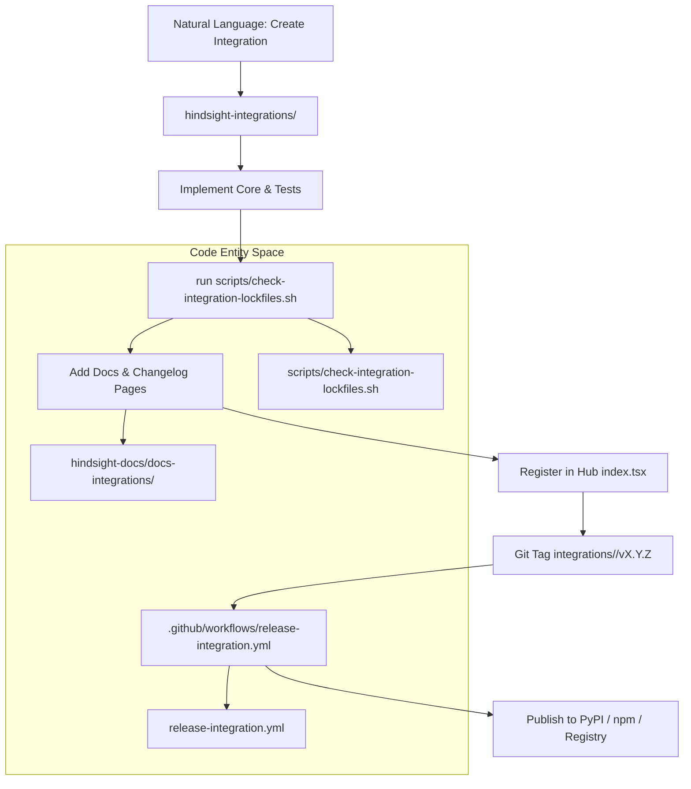
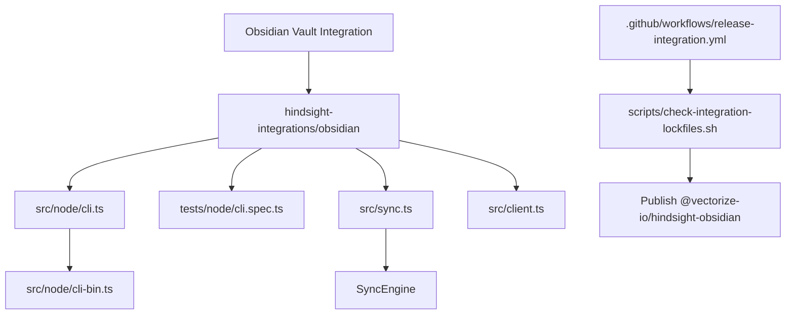

<!-- source: DeepWiki mcp.deepwiki.com · repo vectorize-io/hindsight · page 12.1 Adding a New Integration · fetched 2026-10-27 -->

# Adding a New Integration

<details>
<summary>Relevant source files</summary>

The following files were used as context for generating this wiki page:

- [.github/workflows/release-integration.yml](.github/workflows/release-integration.yml)
- [hindsight-docs/docs-integrations/claude-code.md](hindsight-docs/docs-integrations/claude-code.md)
- [hindsight-docs/docs-integrations/obsidian.md](hindsight-docs/docs-integrations/obsidian.md)
- [hindsight-docs/src/components/IntegrationsBanner.tsx](hindsight-docs/src/components/IntegrationsBanner.tsx)
- [hindsight-docs/src/components/PageHero.module.css](hindsight-docs/src/components/PageHero.module.css)
- [hindsight-docs/src/components/PageHero.tsx](hindsight-docs/src/components/PageHero.tsx)
- [hindsight-docs/src/lib/coding-agent-harnesses.ts](hindsight-docs/src/lib/coding-agent-harnesses.ts)
- [hindsight-docs/src/lib/integrations.ts](hindsight-docs/src/lib/integrations.ts)
- [hindsight-docs/src/pages/integrations/index.module.css](hindsight-docs/src/pages/integrations/index.module.css)
- [hindsight-docs/src/pages/integrations/index.tsx](hindsight-docs/src/pages/integrations/index.tsx)
- [hindsight-integrations/obsidian/.gitignore](hindsight-integrations/obsidian/.gitignore)
- [hindsight-integrations/obsidian/LICENSE](hindsight-integrations/obsidian/LICENSE)
- [hindsight-integrations/obsidian/README.md](hindsight-integrations/obsidian/README.md)
- [hindsight-integrations/obsidian/src/chat-view.ts](hindsight-integrations/obsidian/src/chat-view.ts)
- [hindsight-integrations/obsidian/src/chat.ts](hindsight-integrations/obsidian/src/chat.ts)
- [hindsight-integrations/obsidian/src/client.ts](hindsight-integrations/obsidian/src/client.ts)
- [hindsight-integrations/obsidian/src/main.ts](hindsight-integrations/obsidian/src/main.ts)
- [hindsight-integrations/obsidian/src/node/cli-bin.ts](hindsight-integrations/obsidian/src/node/cli-bin.ts)
- [hindsight-integrations/obsidian/src/node/cli.ts](hindsight-integrations/obsidian/src/node/cli.ts)
- [hindsight-integrations/obsidian/src/node/fetch-transport.ts](hindsight-integrations/obsidian/src/node/fetch-transport.ts)
- [hindsight-integrations/obsidian/src/node/json-index.ts](hindsight-integrations/obsidian/src/node/json-index.ts)
- [hindsight-integrations/obsidian/src/settings.ts](hindsight-integrations/obsidian/src/settings.ts)
- [hindsight-integrations/obsidian/src/sync.ts](hindsight-integrations/obsidian/src/sync.ts)
- [hindsight-integrations/obsidian/src/types.ts](hindsight-integrations/obsidian/src/types.ts)
- [hindsight-integrations/obsidian/tests/chat.spec.ts](hindsight-integrations/obsidian/tests/chat.spec.ts)
- [hindsight-integrations/obsidian/tests/client.spec.ts](hindsight-integrations/obsidian/tests/client.spec.ts)
- [hindsight-integrations/obsidian/tests/node/cli.spec.ts](hindsight-integrations/obsidian/tests/node/cli.spec.ts)
- [hindsight-integrations/obsidian/tests/node/json-index.spec.ts](hindsight-integrations/obsidian/tests/node/json-index.spec.ts)
- [hindsight-integrations/obsidian/tests/node/reconcile-integration.spec.ts](hindsight-integrations/obsidian/tests/node/reconcile-integration.spec.ts)
- [hindsight-integrations/obsidian/tests/node/watch.spec.ts](hindsight-integrations/obsidian/tests/node/watch.spec.ts)
- [hindsight-integrations/obsidian/tests/sync.spec.ts](hindsight-integrations/obsidian/tests/sync.spec.ts)
- [scripts/check-integration-lockfiles.sh](scripts/check-integration-lockfiles.sh)
- [skills/hindsight-docs/references/sdks/integrations/claude-code.md](skills/hindsight-docs/references/sdks/integrations/claude-code.md)
- [skills/hindsight-docs/references/sdks/integrations/obsidian.md](skills/hindsight-docs/references/sdks/integrations/obsidian.md)
- [skills/hindsight-docs/references/sdks/integrations/strands.md](skills/hindsight-docs/references/sdks/integrations/strands.md)

</details>


This page provides a step-by-step guide for developers contributing new integrations to the Hindsight codebase. It covers package scaffolding, lockfile integrity checks, documentation and changelog generation, registry entries, integration testing, and automated publishing via the GitHub Actions release workflow.

---

## Purpose and Scope

Adding a new integration to Hindsight involves introducing a dedicated package under the `hindsight-integrations/` directory, structured for Python, TypeScript, or plugin distributions. A complete integration must pass lockfile validation (`scripts/check-integration-lockfiles.sh`), include documentation and changelog pages, register in the integration catalog, include tests, and configure automated releases through `.github/workflows/release-integration.yml`.

---

## 1. Package Scaffolding

Integrations are organized under `hindsight-integrations/` based on their target language or ecosystem runtime:
- **Python integrations** require a `pyproject.toml` configuration and use `uv` for dependency management and wheel builds [/.github/workflows/release-integration.yml:40-68]().
- **TypeScript integrations** require a `package.json` file, standard scripts (`build`), and a `package-lock.json` [/.github/workflows/release-integration.yml:44-45]().
- **Plugin integrations** (such as CLI extensions or IDE plugins like Obsidian) use platform-specific manifests and distribution scripts.

Sources: [/.github/workflows/release-integration.yml:33-49]()

---

## 2. Lockfile Checks

To prevent dependency drift and build failures during publishing, TypeScript integrations must maintain a valid `package-lock.json` that resolves packages from the public registry rather than local workspace symlinks or file paths.

The CI environment executes `scripts/check-integration-lockfiles.sh` to verify that no dependencies point to `file:` paths, workspace symlinks (`link: true`), or relative directories [scripts/check-integration-lockfiles.sh:1-113](). If an integration depends on monorepo packages like `hindsight-client`, its lockfile must be generated cleanly using registry resolutions.

```bash
# How to regenerate a clean lockfile for a TypeScript integration:
cd hindsight-integrations/<your-integration>
rm -rf node_modules package-lock.json
npm install
```

Sources: [scripts/check-integration-lockfiles.sh:1-113](), [/.github/workflows/release-integration.yml:97-100]()

---

## 3. Documentation and Changelog Pages

Every integration requires user-facing documentation and a versioned changelog page:
- Documentation pages reside under `hindsight-docs/docs-integrations/` or mirror into agent-consumable skill references.
- Changelog pages track semantic version releases and link back to the integration codebase.

Sources: [hindsight-docs/docs-integrations/claude-code.md:1-42](), [skills/hindsight-docs/references/sdks/integrations/claude-code.md:1-35]()

---

## 4. Registry Entry and Catalog Hub

Integrations are exposed in the browse hub UI (`hindsight-docs/src/pages/integrations/index.tsx`), which categorizes official and community offerings [hindsight-docs/src/pages/integrations/index.tsx:1-167](). Ensure your integration is registered in the metadata lookup so users can filter by category, view changelogs, and access setup instructions.

Sources: [hindsight-docs/src/pages/integrations/index.tsx:1-167]()

---

## 5. Testing

Integrations must include automated tests verifying their client interactions, data transformations, and lifecycle flows:
- Python packages use `pytest` under `tests/`.
- TypeScript packages use `vitest` under test directories like `hindsight-integrations/obsidian/tests/` [hindsight-integrations/obsidian/tests/node/cli.spec.ts:1-10]().

Sources: [hindsight-integrations/obsidian/tests/node/cli.spec.ts:1-194]()

---

## 6. Release-Integration Workflow

Releases are fully automated via `.github/workflows/release-integration.yml`, triggered by git tags matching `integrations/**` [/.github/workflows/release-integration.yml:1-7](). 

The workflow performs the following steps:
1. **Extracts metadata**: Parses the tag string to determine the integration name and version [/.github/workflows/release-integration.yml:21-31]().
2. **Detects type**: Inspects the directory for `pyproject.toml` (Python) or `package.json` (TypeScript), defaulting to plugin format otherwise [/.github/workflows/release-integration.yml:33-48]().
3. **Builds and Publishes**:
   - Python: Sets up `uv`, builds wheels, and publishes to PyPI via trusted publishing [/.github/workflows/release-integration.yml:52-74]().
   - TypeScript: Validates lockfiles using `scripts/check-integration-lockfiles.sh`, installs workspace dependencies, runs builds, and publishes to npm [/.github/workflows/release-integration.yml:88-123]().

Sources: [/.github/workflows/release-integration.yml:1-159]()

---

## 7. Integration Lifecycle Architecture


*Diagram: Natural Language to release automation workflow mapping.*

Sources: [/.github/workflows/release-integration.yml:1-159](), [scripts/check-integration-lockfiles.sh:1-113]()

---

## 8. Example Integration: Obsidian Plugin

The Obsidian integration (`hindsight-integrations/obsidian`) serves as a comprehensive example of a TypeScript integration combining a plugin frontend with a headless synchronization CLI (`hindsight-obsidian-sync`) [hindsight-integrations/obsidian/src/node/cli.ts:1-70]().


*Diagram: Code Entity Mapping for the Obsidian integration package.*

Sources: [hindsight-integrations/obsidian/src/node/cli.ts:1-180](), [hindsight-integrations/obsidian/tests/node/cli.spec.ts:1-194](), [/.github/workflows/release-integration.yml:1-159]()

---

