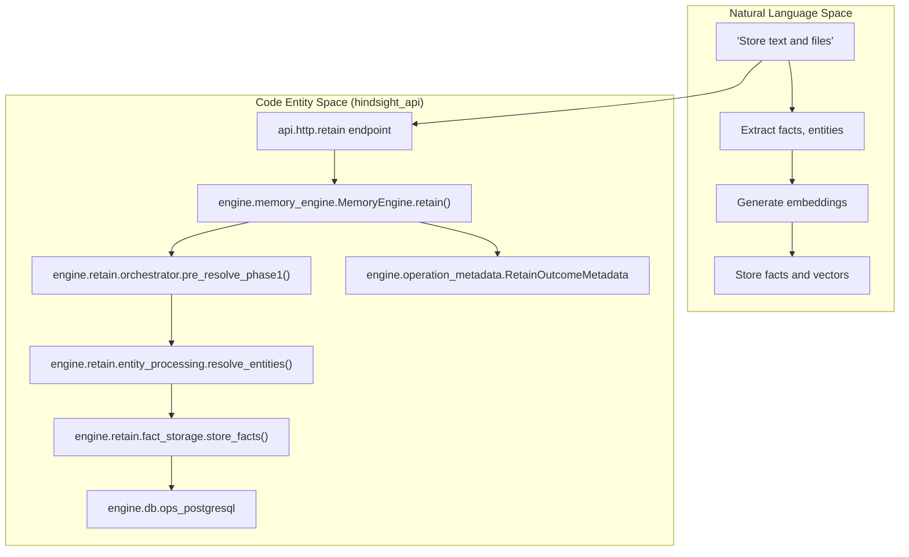
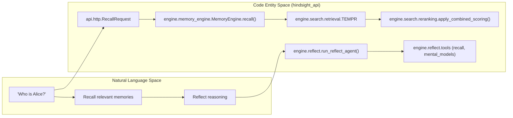

<!-- source: DeepWiki mcp.deepwiki.com · repo vectorize-io/hindsight · page 13 Glossary · fetched 2026-10-27 -->

# Glossary

Relevant source files

The following files were used as context for generating this wiki page:

- [.env.example](.env.example)
- [hindsight-api-slim/hindsight_api/api/http.py](hindsight-api-slim/hindsight_api/api/http.py)
- [hindsight-api-slim/hindsight_api/config.py](hindsight-api-slim/hindsight_api/config.py)
- [hindsight-api-slim/hindsight_api/engine/cross_encoder.py](hindsight-api-slim/hindsight_api/engine/cross_encoder.py)
- [hindsight-api-slim/hindsight_api/engine/db/ops.py](hindsight-api-slim/hindsight_api/engine/db/ops.py)
- [hindsight-api-slim/hindsight_api/engine/db/ops_oracle.py](hindsight-api-slim/hindsight_api/engine/db/ops_oracle.py)
- [hindsight-api-slim/hindsight_api/engine/db/ops_postgresql.py](hindsight-api-slim/hindsight_api/engine/db/ops_postgresql.py)
- [hindsight-api-slim/hindsight_api/engine/embeddings.py](hindsight-api-slim/hindsight_api/engine/embeddings.py)
- [hindsight-api-slim/hindsight_api/engine/graph_maintenance.py](hindsight-api-slim/hindsight_api/engine/graph_maintenance.py)
- [hindsight-api-slim/hindsight_api/engine/llm_wrapper.py](hindsight-api-slim/hindsight_api/engine/llm_wrapper.py)
- [hindsight-api-slim/hindsight_api/engine/memories/pg/graph.py](hindsight-api-slim/hindsight_api/engine/memories/pg/graph.py)
- [hindsight-api-slim/hindsight_api/engine/memory_engine.py](hindsight-api-slim/hindsight_api/engine/memory_engine.py)
- [hindsight-api-slim/hindsight_api/engine/providers/litellm_llm.py](hindsight-api-slim/hindsight_api/engine/providers/litellm_llm.py)
- [hindsight-api-slim/hindsight_api/engine/providers/openai_compatible_llm.py](hindsight-api-slim/hindsight_api/engine/providers/openai_compatible_llm.py)
- [hindsight-api-slim/hindsight_api/engine/retain/bank_utils.py](hindsight-api-slim/hindsight_api/engine/retain/bank_utils.py)
- [hindsight-api-slim/hindsight_api/engine/retain/fact_storage.py](hindsight-api-slim/hindsight_api/engine/retain/fact_storage.py)
- [hindsight-api-slim/hindsight_api/engine/retain/orchestrator.py](hindsight-api-slim/hindsight_api/engine/retain/orchestrator.py)
- [hindsight-api-slim/hindsight_api/engine/retain/types.py](hindsight-api-slim/hindsight_api/engine/retain/types.py)
- [hindsight-api-slim/tests/test_delta_retain.py](hindsight-api-slim/tests/test_delta_retain.py)
- [hindsight-api-slim/tests/test_document_body_accumulation.py](hindsight-api-slim/tests/test_document_body_accumulation.py)
- [hindsight-api-slim/tests/test_ensure_bank_exists_optimization.py](hindsight-api-slim/tests/test_ensure_bank_exists_optimization.py)
- [hindsight-api-slim/tests/test_full_recall_temporal_window.py](hindsight-api-slim/tests/test_full_recall_temporal_window.py)
- [hindsight-api-slim/tests/test_graph_maintenance.py](hindsight-api-slim/tests/test_graph_maintenance.py)
- [hindsight-api-slim/tests/test_graph_maintenance_queue_race.py](hindsight-api-slim/tests/test_graph_maintenance_queue_race.py)
- [hindsight-api-slim/tests/test_graph_maintenance_submit_dedup.py](hindsight-api-slim/tests/test_graph_maintenance_submit_dedup.py)
- [hindsight-api-slim/tests/test_litellm_sdk_embeddings.py](hindsight-api-slim/tests/test_litellm_sdk_embeddings.py)
- [hindsight-api-slim/tests/test_openai_compatible_response_hardening.py](hindsight-api-slim/tests/test_openai_compatible_response_hardening.py)
- [hindsight-api-slim/tests/test_retain_store_owned_no_connection.py](hindsight-api-slim/tests/test_retain_store_owned_no_connection.py)
- [hindsight-api-slim/tests/test_store_owned_retain_parity.py](hindsight-api-slim/tests/test_store_owned_retain_parity.py)
- [hindsight-cli/src/api.rs](hindsight-cli/src/api.rs)
- [hindsight-clients/go/api/openapi.yaml](hindsight-clients/go/api/openapi.yaml)
- [hindsight-clients/go/model_create_bank_alias_request.go](hindsight-clients/go/model_create_bank_alias_request.go)
- [hindsight-clients/python/.openapi-generator/FILES](hindsight-clients/python/.openapi-generator/FILES)
- [hindsight-clients/python/hindsight_client_api/__init__.py](hindsight-clients/python/hindsight_client_api/__init__.py)
- [hindsight-clients/python/hindsight_client_api/models/__init__.py](hindsight-clients/python/hindsight_client_api/models/__init__.py)
- [hindsight-clients/python/hindsight_client_api/models/create_bank_alias_request.py](hindsight-clients/python/hindsight_client_api/models/create_bank_alias_request.py)
- [hindsight-clients/typescript/generated/sdk.gen.ts](hindsight-clients/typescript/generated/sdk.gen.ts)
- [hindsight-clients/typescript/generated/types.gen.ts](hindsight-clients/typescript/generated/types.gen.ts)
- [hindsight-control-plane/src/lib/api.ts](hindsight-control-plane/src/lib/api.ts)
- [hindsight-docs/docs/developer/configuration.mdx](hindsight-docs/docs/developer/configuration.mdx)
- [hindsight-docs/docs/developer/models.mdx](hindsight-docs/docs/developer/models.mdx)
- [hindsight-docs/src/data/llmProviders.json](hindsight-docs/src/data/llmProviders.json)
- [hindsight-docs/static/openapi.json](hindsight-docs/static/openapi.json)
- [hindsight-embed/hindsight_embed/env.example](hindsight-embed/hindsight_embed/env.example)
- [hindsight-system-tests/tests/test_50_banks_and_config.py](hindsight-system-tests/tests/test_50_banks_and_config.py)
- [skills/hindsight-docs/references/developer/configuration.md](skills/hindsight-docs/references/developer/configuration.md)
- [skills/hindsight-docs/references/developer/models.md](skills/hindsight-docs/references/developer/models.md)
- [skills/hindsight-docs/references/faq.md](skills/hindsight-docs/references/faq.md)
- [skills/hindsight-docs/references/openapi.json](skills/hindsight-docs/references/openapi.json)

This wiki page defines codebase-specific terms, jargon, and abbreviations used throughout the Hindsight repository. It serves as a technical reference to bridge high-level biomimetic memory concepts with their corresponding classes, functions, and database schemas in the codebase.

---

## Core Operations

### Retain

The ingestion pipeline responsible for absorbing unstructured text or files into a Memory Bank. This involves input parsing, chunking, LLM-based fact extraction, entity resolution, embedding generation, and persistent storage using either append or delta modes.

- **Implementation**: Orchestrated primarily by `MemoryEngine.retain` in `hindsight_api.engine.memory_engine`, coordinating extraction, entity resolution, and database writes [hindsight-api-slim/hindsight_api/engine/memory_engine.py:1-213](), with execution heavily managed by `engine.retain.orchestrator` [hindsight-api-slim/hindsight_api/engine/retain/orchestrator.py:1-189]().
- **Delta Retain**: An incremental retain mode that processes only new or modified document slices to optimize update latency.
- **Memory Defense**: A security extension that inspects incoming text for secret leaks, prompt injection, or size anomalies, enforcing allow, redact, or block rules [hindsight-api-slim/hindsight_api/engine/retain/orchestrator.py:18-50]().

Sources: [hindsight-api-slim/hindsight_api/engine/memory_engine.py:1-213](), [hindsight-api-slim/hindsight_api/engine/retain/orchestrator.py:1-189]()

---

### Recall

The retrieval subsystem that queries stored memory units and observations using a multi-strategy approach (TEMPR) combining semantic vectors, BM25 text search, graph traversal, and temporal filters.

- **Implementation**: Executed via `MemoryEngine.recall`, which applies query budgeting, filtering, and scoring algorithms to return ranked memories and entities [hindsight-api-slim/hindsight_api/engine/memory_engine.py:120-190]().

Sources: [hindsight-api-slim/hindsight_api/engine/memory_engine.py:120-190]()

---

### Reflect

An autonomous multi-step reasoning loop that leverages recall, mental models, directives, and bank disposition traits to synthesize structured responses or execute complex agentic workflows.

- **Implementation**: Driven by reflection routines and agent runners in the engine layer, utilizing modular tools like `tool_recall`, `tool_search_mental_models`, and `tool_search_observations` [hindsight-api-slim/hindsight_api/engine/memory_engine.py:185-210]().

Sources: [hindsight-api-slim/hindsight_api/engine/memory_engine.py:185-210]()

---

## Memory Concepts

### Memory Bank

A logical isolation boundary containing stored memories, configuration overrides, missions, dispositions, and entity registries.

- **Implementation**: Represented as rows in the `banks` table, managed via `MemoryEngine` bank utilities supporting cloning, aliasing, and stats caching [hindsight-api-slim/hindsight_api/engine/memory_engine.py:95-116]().

Sources: [hindsight-api-slim/hindsight_api/engine/memory_engine.py:95-116]()

---

### Fact Types

Memories stored in Hindsight are categorized into distinct fact types:
- **World Facts**: General, objective knowledge extracted from inputs.
- **Experience Facts**: Episodic, event-bound memories tied to specific occurrences.
- **Observations**: Higher-level synthesized insights produced by background consolidation.

Sources: [hindsight-api-slim/hindsight_api/engine/memory_engine.py:45-50]()

---

### Observation

Synthetic memory entries synthesized by the background consolidation loop by merging, clustering, and deduplicating related facts over time.

Sources: [hindsight-api-slim/hindsight_api/engine/memory_engine.py:45-50]()

---

### Mental Model / Knowledge Page

A cached reflection representing a structured, continuously updated knowledge synthesis of specific domains or entities within a bank.

- **Implementation**: Stored in the `mental_models` table, refreshed automatically or via explicit calls using the reflect pipeline [hindsight-api-slim/hindsight_api/engine/memory_engine.py:190-196]().

Sources: [hindsight-api-slim/hindsight_api/engine/memory_engine.py:190-196]()

---

### Disposition

A set of numeric personality traits (such as skepticism, literalism, and empathy) configured per bank that steer prompt assembly, memory weighting, and reasoning style during reflect operations.

Sources: [hindsight-api-slim/hindsight_api/engine/memory_engine.py:100-115]()

---

### Mission

A natural language specification defining a bank's core purpose or a consolidation task's objective, steering both extraction and reflection prompts.

Sources: [skills/hindsight-docs/references/developer/models.md]()

---

## Retrieval and Storage Jargon

### TEMPR

The composite multi-strategy retrieval architecture acronym:
- **T**emporal: Window filtering by occurrence time.
- **E**ntity: Graph traversal via entity links and spreading activation.
- **M**eaning: Semantic vector similarity search via `pgvector` / `DiskANN`.
- **P**roximity: Spatiotemporal and contextual closeness weighting.
- **R**ank: Fusion of scoring streams using Reciprocal Rank Fusion (RRF).

Sources: [hindsight-api-slim/hindsight_api/engine/memory_engine.py:4-10]()

---

### RRF (Reciprocal Rank Fusion)

A rank-aggregation algorithm that combines ordered lists from multiple retrieval arms into a single unified relevance score without requiring raw score normalization.

Sources: [hindsight-api-slim/hindsight_api/engine/memory_engine.py:130-140]()

---

### HNSW & DiskANN

- **HNSW**: Hierarchical Navigable Small World, an in-memory Approximate Nearest Neighbor index provided by `pgvector`.
- **DiskANN**: Disk-based vector index accessed through `pgvectorscale` for scaling to large vector volumes.

Sources: [skills/hindsight-docs/references/developer/configuration.md:1-50]()

---

### pg0

An embedded PostgreSQL distribution bundled with Hindsight for zero-configuration local development, activated via `HINDSIGHT_API_DATABASE_URL=pg0`.

Sources: [skills/hindsight-docs/references/developer/configuration.md:23-35]()

---

### Consolidation

A background maintenance routine that synthesizes observations from disparate facts, deduplicates redundant records, and updates knowledge representations.

Sources: [hindsight-api-slim/hindsight_api/engine/memory_engine.py:45-50]()

---

### Entity Resolution

The pipeline stage during retain that identifies entity mentions (PERSON, ORG, LOCATION), resolves them to canonical names using trigram matching, and maintains entity co-occurrence and causal links via the `Graph Maintenance Queue`.

Sources: [hindsight-api-slim/hindsight_api/engine/graph_maintenance.py:1-50]()

---

### Tag Groups & Tagging System

A boolean-logic tag filtering mechanism (`any`, `all`, `strict`) applied to memories, mental models, and retrieval scopes for fine-grained multi-tenant and multi-user visibility isolation.

Sources: [hindsight-api-slim/hindsight_api/api/http.py:180-218]()

---

### Slim vs Full Packages

- **hindsight-api-slim**: Minimal core engine without heavy local ML dependencies, designed for cloud deployments.
- **hindsight-api**: Full engine package embedding local models and cross-encoders.
- **hindsight-all / hindsight-all-slim / hindsight-all-npm**: Bundled distributions and Node.js wrappers for embedded and CLI environments.

Sources: [skills/hindsight-docs/references/developer/configuration.md:1-20]()

---

## Architecture & Configuration Jargon

### ConfigResolver & StaticConfigProxy

- **ConfigResolver**: Merges global, tenant, and bank-level configuration hierarchies.
- **StaticConfigProxy**: A read-only proxy wrapping `HindsightConfig` that forbids access to bank-configurable fields from global scopes, enforcing explicit bank-resolved lookups.

Sources: [hindsight-api-slim/hindsight_api/config.py:60-90]()

---

### CrossLoopSemaphore & Cache Affinity

- **CrossLoopSemaphore**: Concurrency limiter bounding parallel LLM provider calls per scope.
- **Cache Affinity**: Mechanisms pinning requests to provider prompt caches using provider-specific headers or keys (`xai_conv_id`, `openai_prompt_cache_key`).

Sources: [hindsight-api-slim/hindsight_api/config.py:74-86](), [hindsight-api-slim/hindsight_api/engine/providers/openai_compatible_llm.py:40-46]()

---

### DataAccessOps & Fold Plan

- **DataAccessOps**: Database abstraction layer decoupling business logic from SQL dialect differences (PostgreSQL vs Oracle).
- **Fold Plan**: Retain pipeline batching logic that coalesces append and delta updates.

Sources: [hindsight-api-slim/hindsight_api/engine/retain/orchestrator.py:61-138]()

---

### Additional Engine Terms

- **Append Monotonicity**: Ensuring appended records maintain strict logical ordering without backward mutation.
- **Degenerate Fact**: Empty or malformed facts filtered out during extraction validation.
- **Spreading Activation**: Graph search heuristic propagating activation through entity links with exponential decay.
- **Delta Retain**: Incremental update strategy processing only modified document slices.

Sources: [hindsight-api-slim/hindsight_api/engine/memory_engine.py:4-10](), [hindsight-api-slim/hindsight_api/engine/retain/orchestrator.py:1-50]()

---

## Ecosystem & Integration Jargon

- **Harness**: Adapters connecting Hindsight with external coding agents (Claude Code, Codex, OpenCode, Cursor).
- **Knowledge Tools**: SDK wrappers exposing memory primitives as agent-consumable tools.
- **Marker**: Provenance annotations tracked during ingestion.
- **Transcript**: Parsed conversation logs ingested into memory banks.
- **SecretRef**: Externalized secret references resolved at runtime.
- **DaemonEmbedManager & ProfileManager**: Lifecycle and profile controllers for embedded mode (`hindsight-embed`).
- **Curation State**: Metadata tracking memory validity and invalidation.
- **Volume Tiers**: Storage classification schemes for migration and optimization.

Sources: [hindsight-embed/hindsight_embed/daemon_embed_manager.py:1-44](), [hindsight-embed/hindsight_embed/profile_manager.py:1-30]()

---

# Diagrams

Diagram: Memory Ingestion Natural Language to Code Entity Mapping

Sources: [hindsight-api-slim/hindsight_api/engine/memory_engine.py:180-210](), [hindsight-api-slim/hindsight_api/engine/retain/orchestrator.py:1-170]()

Diagram: Retrieval and Reasoning Flow Mapping

Sources: [hindsight-api-slim/hindsight_api/engine/memory_engine.py:120-190]()

---

# Summary Table of Key Terms

| Term | Description | Code/File Reference |
|---|---|---|
| Memory Bank | Isolated container for memories and config | `memory_engine.py:95-116` |
| Retain | Ingestion pipeline for facts and documents | `memory_engine.py:180-210`, `retain/orchestrator.py` |
| Recall | Multi-strategy retrieval subsystem (TEMPR) | `memory_engine.py:120-190` |
| Reflect | Autonomous reasoning loop with tools | `memory_engine.py:185-210` |
| Observation | Synthetic insight derived from consolidation | `memory_engine.py:45-50` |
| Mental Model | Auto-refreshed cached knowledge page | `memory_engine.py:190-196` |
| TEMPR | Composite retrieval architecture | `memory_engine.py:4-10` |
| RRF | Reciprocal Rank Fusion ranking algorithm | `memory_engine.py:130-140` |
| ConfigResolver | Hierarchical configuration manager | `config.py:60-90` |
| DaemonEmbedManager | Embedded daemon lifecycle controller | `hindsight_embed/daemon_embed_manager.py` |

Sources: [hindsight-api-slim/hindsight_api/engine/memory_engine.py:1-213](), [hindsight-api-slim/hindsight_api/config.py:60-90](), [hindsight-embed/hindsight_embed/daemon_embed_manager.py:1-44]()

---

# References

- [`hindsight-api-slim/hindsight_api/engine/memory_engine.py`]()
- [`hindsight-api-slim/hindsight_api/config.py`]()
- [`hindsight-api-slim/hindsight_api/engine/retain/orchestrator.py`]()
- [`skills/hindsight-docs/references/developer/configuration.md`]()
- [`hindsight-embed/hindsight_embed/daemon_embed_manager.py`]()
- [`hindsight-embed/hindsight_embed/profile_manager.py`]()