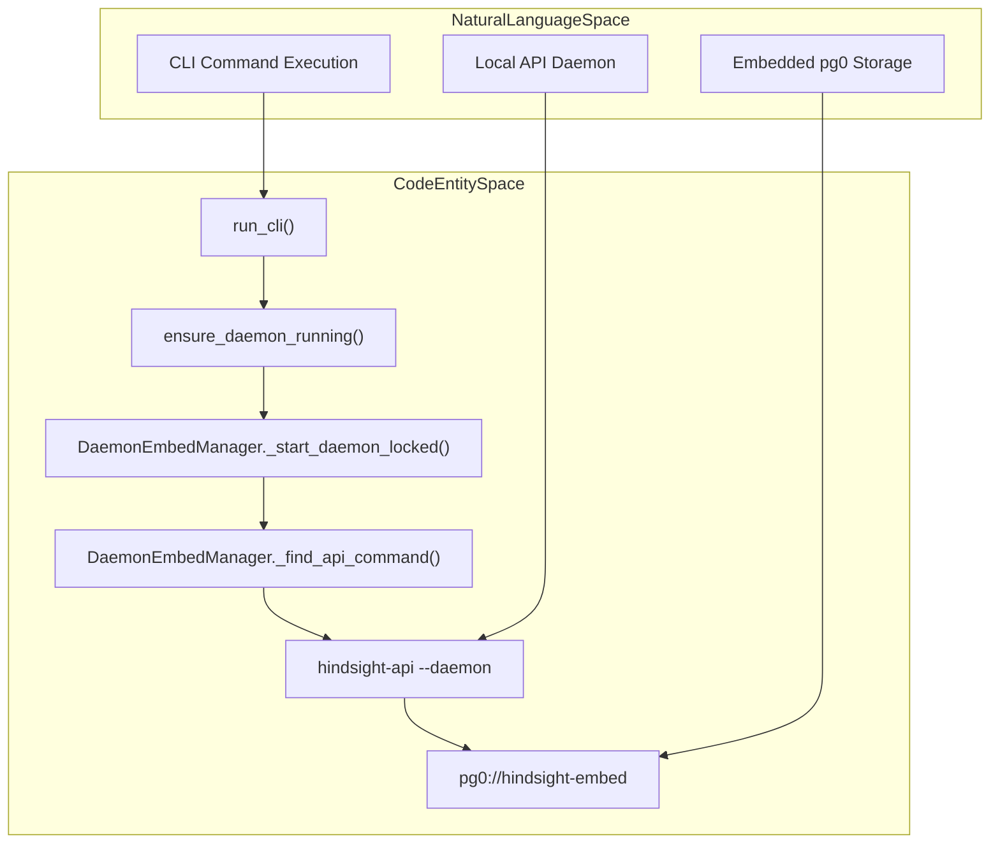
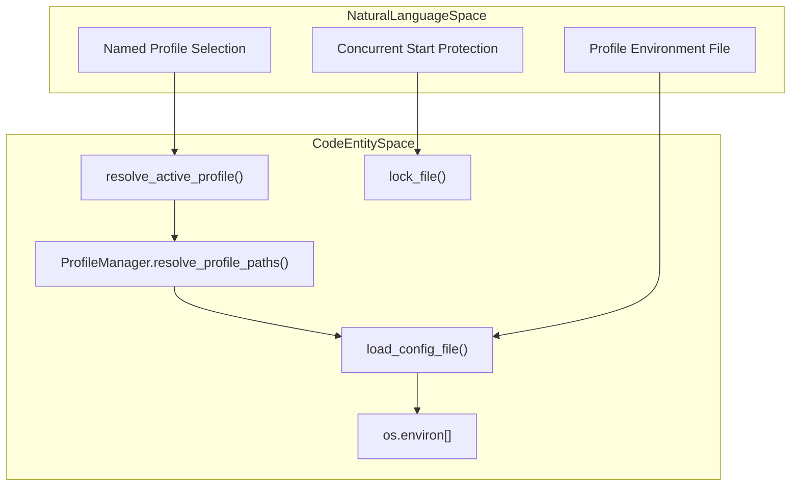
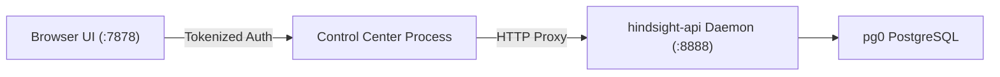
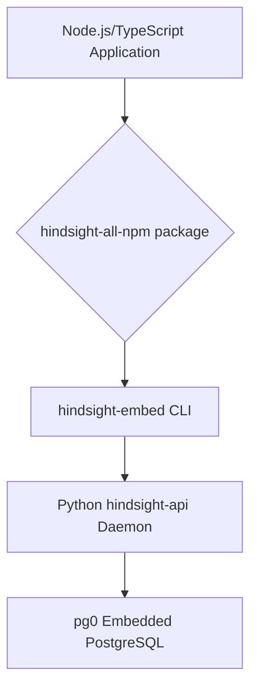

<!-- source: DeepWiki mcp.deepwiki.com · repo vectorize-io/hindsight · page 2.3 Embedded Mode Setup · fetched 2026-10-27 -->

# Embedded Mode Setup

Relevant source files

The following files were used as context for generating this wiki page:

- [hindsight-api-slim/hindsight_api/daemon.py](hindsight-api-slim/hindsight_api/daemon.py)
- [hindsight-api-slim/tests/test_daemonize.py](hindsight-api-slim/tests/test_daemonize.py)
- [hindsight-clients/python/tests/test_retain_async_kwarg.py](hindsight-clients/python/tests/test_retain_async_kwarg.py)
- [hindsight-clients/typescript/tests/deno_setup.ts](hindsight-clients/typescript/tests/deno_setup.ts)
- [hindsight-clients/typescript/tests/main_operations.test.ts](hindsight-clients/typescript/tests/main_operations.test.ts)
- [hindsight-docs/docs/sdks/embed.md](hindsight-docs/docs/sdks/embed.md)
- [hindsight-embed/README.md](hindsight-embed/README.md)
- [hindsight-embed/hindsight_embed/cli.py](hindsight-embed/hindsight_embed/cli.py)
- [hindsight-embed/hindsight_embed/control_center/server.py](hindsight-embed/hindsight_embed/control_center/server.py)
- [hindsight-embed/hindsight_embed/control_center/service.py](hindsight-embed/hindsight_embed/control_center/service.py)
- [hindsight-embed/hindsight_embed/daemon_client.py](hindsight-embed/hindsight_embed/daemon_client.py)
- [hindsight-embed/hindsight_embed/daemon_embed_manager.py](hindsight-embed/hindsight_embed/daemon_embed_manager.py)
- [hindsight-embed/hindsight_embed/embed_manager.py](hindsight-embed/hindsight_embed/embed_manager.py)
- [hindsight-embed/hindsight_embed/env_template.py](hindsight-embed/hindsight_embed/env_template.py)
- [hindsight-embed/hindsight_embed/profile_manager.py](hindsight-embed/hindsight_embed/profile_manager.py)
- [hindsight-embed/test.sh](hindsight-embed/test.sh)
- [hindsight-embed/tests/test_cli_forwarding.py](hindsight-embed/tests/test_cli_forwarding.py)
- [hindsight-embed/tests/test_control_center.py](hindsight-embed/tests/test_control_center.py)
- [hindsight-embed/tests/test_daemon_client.py](hindsight-embed/tests/test_daemon_client.py)
- [hindsight-embed/tests/test_embed_manager.py](hindsight-embed/tests/test_embed_manager.py)
- [hindsight-embed/tests/test_env_template.py](hindsight-embed/tests/test_env_template.py)
- [hindsight-embed/tests/test_profile_daemon_config.py](hindsight-embed/tests/test_profile_daemon_config.py)
- [hindsight-embed/tests/test_profile_integration.py](hindsight-embed/tests/test_profile_integration.py)
- [hindsight-embed/tests/test_profile_manager.py](hindsight-embed/tests/test_profile_manager.py)
- [skills/hindsight-docs/references/sdks/embed.md](skills/hindsight-docs/references/sdks/embed.md)

This page details the implementation and operational architecture of the `hindsight-embed` package, its auto-daemon spawning mechanism, configuration persistence via `~/.hindsight/embed` [hindsight-embed/hindsight_embed/cli.py:39-40](), the `ProfileManager` [hindsight-embed/hindsight_embed/profile_manager.py:1-6](), the browser-based control center UI, idle timeout semantics [hindsight-embed/hindsight_embed/daemon_embed_manager.py:74-74](), the programmatic `HindsightEmbedded` and `HindsightServer` classes, and the Node.js `hindsight-all-npm` bridge.

---

## Auto-Daemon Architecture

The `hindsight-embed` package implements a zero-configuration client-daemon architecture. When a CLI command or SDK client executes, it determines whether a local instance of `hindsight-api` is running. If no instance is active, it spawns the background server process automatically.

### Code Entity Mapping: Daemon Lifecycle & Spawning

**Auto-Daemon Execution Flow:**
1. **Invocation**: The user invokes a CLI command (e.g., `hindsight-embed retain`) [hindsight-embed/hindsight_embed/cli.py:8-11]() or initializes `HindsightEmbedded` [hindsight-embed/hindsight_embed/daemon_client.py:42-60]().
2. **Liveness Check**: `DaemonEmbedManager.is_running()` probes loopback interfaces (`127.0.0.1` and `::1`) on the profile's allocated port [hindsight-embed/hindsight_embed/daemon_embed_manager.py:118-119]().
3. **Spawning**: If inactive, `_start_daemon_locked()` resolves the executable via `_find_api_command()` and executes `hindsight-api --daemon` using cross-platform detached process options [hindsight-embed/hindsight_embed/daemon_embed_manager.py:34-43]().
4. **Command Forwarding**: Once the health probe (`/health`) returns 200 OK, the request is dispatched via HTTP to the local listener [hindsight-docs/docs/sdks/embed.md:15-18]().

Sources: [hindsight-embed/hindsight_embed/daemon_embed_manager.py:34-123](), [hindsight-embed/hindsight_embed/daemon_client.py:28-100](), [hindsight-docs/docs/sdks/embed.md:10-20]()

---

## Configuration via `~/.hindsight/embed` and Profile Manager

Embedded mode isolates profiles inside `~/.hindsight/` [hindsight-embed/hindsight_embed/cli.py:39-40]() and `~/.hindsight/profiles/` [hindsight-embed/tests/test_profile_daemon_config.py:36-40](). Each profile maintains its own environment variables file, port allocation, and exclusive file lock (`*.lock`) [hindsight-embed/hindsight_embed/profile_manager.py:1-5]().

### Code Entity Mapping: Profile Management & Config Resolution

**Configuration Loading Rules:**
- **Active Profile Resolution**: `resolve_active_profile()` inspects the `--profile` CLI flag, environment variables, and active session markers [hindsight-embed/hindsight_embed/cli.py:73-88]().
- **Config Parsing**: `load_config_file()` reads the profile-specific `.env` file (`~/.hindsight/profiles/<profile>.env` or `~/.hindsight/embed`) without falling back to default when a named profile is targeted [hindsight-embed/hindsight_embed/cli.py:73-88]().
- **Environment Precedence**: Explicit process environment variables take precedence over settings loaded from profile files [hindsight-embed/hindsight_embed/cli.py:84-88]().
- **Exclusive File Locking**: `lock_file()` and `unlock_file()` provide cross-platform exclusive locking (`fcntl` on POSIX [hindsight-embed/hindsight_embed/profile_manager.py:76-87](), `msvcrt` on Windows [hindsight-embed/hindsight_embed/profile_manager.py:89-108]()) with exponential backoff to prevent race conditions during concurrent daemon initialization [hindsight-embed/hindsight_embed/profile_manager.py:46-54]().

### Summary of Embedded Environment Variables

| Variable | Description | Default |
|----------|-------------|---------|
| `HINDSIGHT_API_LLM_PROVIDER` | LLM provider (`openai`, `groq`, `gemini`, etc.) | `openai` [hindsight-embed/hindsight_embed/cli.py:114-114]() |
| `HINDSIGHT_API_LLM_API_KEY` | Authentication key for LLM provider | — |
| `HINDSIGHT_API_LLM_MODEL` | Target model name | Provider-specific [hindsight-embed/hindsight_embed/cli.py:16-16]() |
| `HINDSIGHT_EMBED_DAEMON_IDLE_TIMEOUT` | Seconds of inactivity before auto-exit | `0` (disabled) [hindsight-embed/hindsight_embed/daemon_embed_manager.py:74-74]() |
| `HINDSIGHT_EMBED_API_DATABASE_URL` | Database URL override | `pg0://hindsight-embed` [hindsight-embed/hindsight_embed/cli.py:19-19]() |
| `HINDSIGHT_EMBED_CONTROL_PORT` | Port for control center web app | `7878` [hindsight-embed/hindsight_embed/cli.py:23-23]() |
| `HINDSIGHT_EMBED_LOCK_TIMEOUT` | Max wait time in seconds for profile lock | `300.0` [hindsight-embed/hindsight_embed/profile_manager.py:51-51]() |

Sources: [hindsight-embed/hindsight_embed/cli.py:67-120](), [hindsight-embed/hindsight_embed/profile_manager.py:46-183](), [hindsight-embed/tests/test_profile_daemon_config.py:28-96]()

---

## Control Center UI

The local control center provides a browser-based dashboard for supervising daemons, inspecting configuration profiles, managing memory banks, and monitoring runtime operations [hindsight-docs/docs/sdks/embed.md:87-97]().

**Control Center Lifecycle & Storage:**
- **Launch Command**: Started via `hindsight-embed control start` [hindsight-docs/docs/sdks/embed.md:91-91]() or `start_ui()` [hindsight-embed/hindsight_embed/daemon_client.py:93-107]().
- **Access Control**: Stores a local access token in `~/.hindsight/control.token` and writes operational logs to `~/.hindsight/control.log` [hindsight-docs/docs/sdks/embed.md:97-97]().
- **Process Isolation**: The control center runs independently of the memory daemon; stopping or restarting the web UI does not terminate the underlying `hindsight-api` daemon process [hindsight-docs/docs/sdks/embed.md:112-113]().

Sources: [hindsight-embed/hindsight_embed/daemon_client.py:93-152](), [hindsight-docs/docs/sdks/embed.md:85-113]()

---

## Idle Timeout Behavior

The embedded daemon includes lifecycle monitoring to manage local system resources:

1. **Timeout Configuration**: Controlled by `HINDSIGHT_EMBED_DAEMON_IDLE_TIMEOUT` [hindsight-embed/hindsight_embed/daemon_embed_manager.py:74-74]().
2. **Behavior States**:
   - `0` (Default): Disabled. The daemon runs indefinitely until manually stopped, ensuring long-running processes, batch retain jobs, or consolidation routines are never interrupted [hindsight-docs/docs/sdks/embed.md:152-153]().
   - `>0`: Specifies an idle inactivity threshold in seconds. When exceeded without incoming HTTP requests, the daemon initiates a graceful self-termination.
3. **Manual Control**: Daemons can be queried or stopped explicitly via `hindsight-embed daemon status` and `hindsight-embed daemon stop` [hindsight-docs/docs/sdks/embed.md:158-166]().

Sources: [hindsight-embed/hindsight_embed/daemon_embed_manager.py:74-74](), [hindsight-docs/docs/sdks/embed.md:150-166]()

---

## Programmatic Embedded Mode: `hindsight-all` (`HindsightEmbedded` and `HindsightServer`)

The `hindsight-all` package exposes programmatic Python classes that encapsulate the same auto-daemon architecture utilized by the `hindsight-embed` CLI.

### `HindsightEmbedded` and `HindsightServer` Classes

`HindsightEmbedded` inherits full client functionality while automating daemon provisioning and profile attachment.

- **Lazy Initialization**: Parameters are recorded without spawning processes immediately. The daemon starts lazily on the first method execution.
- **Thread Safety**: Uses reentrant locks to coordinate simultaneous client threads during initial startup.
- **Selective Inheritance**: Parameters left as `None` are omitted from the daemon config payload, allowing inheritance from profile `.env` files or the parent shell environment without overwriting existing settings with defaults.

Sources: [hindsight-embed/hindsight_embed/daemon_client.py:28-60](), [hindsight-embed/hindsight_embed/daemon_embed_manager.py:34-123]()

---

## Node.js Embedded Support (`hindsight-all-npm`)

The `hindsight-all-npm` package brings identical local-first daemon management to the Node.js and TypeScript ecosystem.

- **Wrapper Architecture**: The `hindsight-all-npm` package internally invokes the `hindsight-embed` CLI to spawn and manage the underlying Python `hindsight-api` binary and `pg0` database instance transparently.
- **API Parity**: Exposes equivalent asynchronous methods for `retain`, `recall`, and `reflect` in TypeScript, mirroring the Python client [hindsight-clients/typescript/tests/main_operations.test.ts:22-149]().
- **Zero Configuration**: Automatically resolves local port binding (`127.0.0.1:8888`) and configures `pg0`-backed persistent storage without manual container orchestration.

Sources: [hindsight-clients/typescript/tests/main_operations.test.ts:1-25](), [hindsight-docs/docs/sdks/embed.md:10-29]()

---

