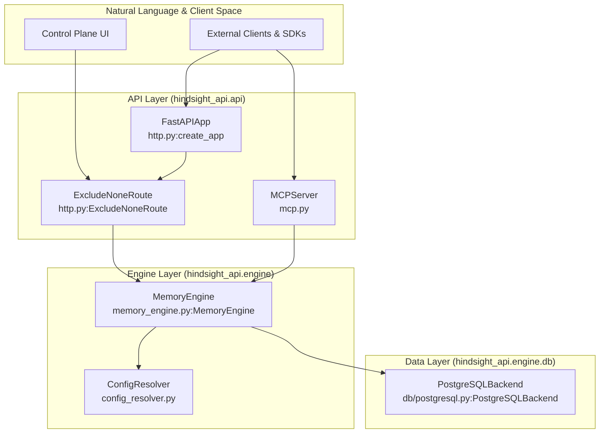
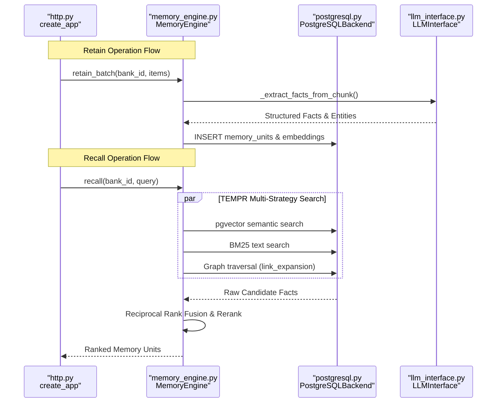

<!-- source: DeepWiki mcp.deepwiki.com · repo vectorize-io/hindsight · page 3 System Architecture · fetched 2026-10-27 -->

# System Architecture

Relevant source files

The following files were used as context for generating this wiki page:

- [hindsight-api-slim/hindsight_api/api/http.py](hindsight-api-slim/hindsight_api/api/http.py)
- [hindsight-api-slim/hindsight_api/engine/memory_engine.py](hindsight-api-slim/hindsight_api/engine/memory_engine.py)
- [hindsight-cli/src/api.rs](hindsight-cli/src/api.rs)
- [hindsight-clients/go/api/openapi.yaml](hindsight-clients/go/api/openapi.yaml)
- [hindsight-clients/python/.openapi-generator/FILES](hindsight-clients/python/.openapi-generator/FILES)
- [hindsight-clients/python/hindsight_client_api/__init__.py](hindsight-clients/python/hindsight_client_api/__init__.py)
- [hindsight-clients/python/hindsight_client_api/models/__init__.py](hindsight-clients/python/hindsight_client_api/models/__init__.py)
- [hindsight-clients/typescript/generated/sdk.gen.ts](hindsight-clients/typescript/generated/sdk.gen.ts)
- [hindsight-clients/typescript/generated/types.gen.ts](hindsight-clients/typescript/generated/types.gen.ts)
- [hindsight-control-plane/src/lib/api.ts](hindsight-control-plane/src/lib/api.ts)
- [hindsight-docs/static/openapi.json](hindsight-docs/static/openapi.json)
- [skills/hindsight-docs/references/openapi.json](skills/hindsight-docs/references/openapi.json)

This page provides a comprehensive technical overview of Hindsight's multi-layered architecture, combining a FastAPI server, a memory engine orchestrator, PostgreSQL with vector extensions, external LLM/embedding/reranking providers, and an optional background worker service.

As a PARENT page, this overview outlines the big picture and links to detailed child pages for each subsystem:
- Component Overview → See [Component Overview](#3.1)
- Memory Engine → See [Memory Engine](#3.2)
- Data Model and Schema → See [Data Model and Schema](#3.3)
- Retrieval System (TEMPR Multi-Strategy) → See [Retrieval System (TEMPR Multi-Strategy)](#3.4)
- Background Worker and Task System → See [Background Worker and Task System](#3.5)
- Multi-tenancy and Authentication → See [Multi-tenancy and Authentication](#3.6)
- Extension System → See [Extension System](#3.7)
- Vector and Text Search Backends → See [Vector and Text Search Backends](#3.8)
- Configuration Hierarchy → See [Configuration Hierarchy](#3.9)
- Database Abstraction and Oracle Support → See [Database Abstraction and Oracle Support](#3.10)
- Memory Defense and Security → See [Memory Defense and Security](#3.11)
- Admin CLI, Backup and Bank Transfer → See [Admin CLI, Backup and Bank Transfer](#3.12)

Sources: [hindsight-api-slim/hindsight_api/engine/memory_engine.py:1-10](), [hindsight-api-slim/hindsight_api/api/http.py:1-15]()

---

## System Layers and Code Entity Mapping

Hindsight's architecture bridges natural language users and clients to the internal code entities that implement its memory system. Below is a diagram illustrating the major layers and important code symbols with exact source references.

Title: **Hindsight Architecture and Code Entity Mapping**

Sources: [hindsight-api-slim/hindsight_api/api/http.py:1-40](), [hindsight-api-slim/hindsight_api/engine/memory_engine.py:10-55]()

---

## Core Components Overview

The main components constituting Hindsight's backend runtime are summarized in the table below. Each plays a critical role in providing core memory features, handling API requests, managing data persistence, or integrating with external AI services. For detailed component-level maps, see [Component Overview](#3.1).

| Component           | Primary Symbol / Class       | Code Path                              | Role / Purpose                                                                                               |
|---------------------|-----------------------------|---------------------------------------|-------------------------------------------------------------------------------------------------------------|
| **API Application**  | `create_app`                 | `hindsight_api/api/http.py`            | FastAPI application factory and route registration for HTTP API [hindsight-api-slim/hindsight_api/api/http.py:1-10]()                           |
| **Response Routing** | `ExcludeNoneRoute`           | `hindsight_api/api/http.py`            | Custom FastAPI APIRoute override which omits null fields to maintain wire compatibility [hindsight-api-slim/hindsight_api/api/http.py:162-165]() |
| **MCP Server**       | `MCPServer`                  | `hindsight_api/api/mcp.py`             | Model Context Protocol server for tool integrations and agent orchestration                                  |
| **Engine Orchestrator**| `MemoryEngine`              | `hindsight_api/engine/memory_engine.py`| Central orchestrator coordinating retain, recall, and reflect lifecycle operations [hindsight-api-slim/hindsight_api/engine/memory_engine.py:170-190]()  |
| **Database Backend** | `PostgreSQLBackend`          | `hindsight_api/engine/db/postgresql.py`| Database connection pool, schema management, vector extension integrations                                    |
| **LLM Interface**    | `LLMInterface`               | `hindsight_api/engine/llm_interface.py`| Abstraction wrapping external LLM, embedding, and reranker providers                                        |
| **Audit Subsystem**  | `AuditLogger`                | `hindsight_api/engine/audit.py`        | Contextual logging and auditing of API calls and memory operations                                          |

Sources: [hindsight-api-slim/hindsight_api/api/http.py:1-165](), [hindsight-api-slim/hindsight_api/engine/memory_engine.py:60-190]()

---

## Memory Operations Data Flow

The high-level request handling and processing flow covers external input, API routing, engine orchestration, retrieval from storage, interaction with LLMs/embedding providers, and final response generation.

The sequence diagram below captures the execution path for **retain** and **recall** operations across core modules.

Title: **Retain and Recall Data Flow across Code Modules**

Sources: [hindsight-api-slim/hindsight_api/api/http.py:1-50](), [hindsight-api-slim/hindsight_api/engine/memory_engine.py:1-30]()

---

## Multi-Tenancy and Configuration Hierarchy

Hindsight supports multi-tenancy by using PostgreSQL schema isolation with async-safe context variables for per-request schema and bank identification:
- `_current_schema` stores the PostgreSQL schema associated with the current tenant [hindsight-api-slim/hindsight_api/engine/memory_engine.py:92-94]()
- `_current_bank_id` tracks the bank in which the current operation executes for cost attribution and scoping [hindsight-api-slim/hindsight_api/engine/memory_engine.py:97-100]()

Configuration is layered and hierarchical, resolving from global defaults to tenant overrides to bank-specific settings via `ConfigResolver` and `StaticConfigProxy`.

For details, see [Multi-tenancy and Authentication](#3.6) and [Configuration Hierarchy](#3.9).

Sources: [hindsight-api-slim/hindsight_api/engine/memory_engine.py:90-99]()

---

## Subsystem Navigation

For deeper technical specifications, refer to the child pages:
1. Component Overview → See [Component Overview](#3.1)
2. Memory Engine → See [Memory Engine](#3.2)
3. Data Model and Schema → See [Data Model and Schema](#3.3)
4. Retrieval System (TEMPR Multi-Strategy) → See [Retrieval System (TEMPR Multi-Strategy)](#3.4)
5. Background Worker and Task System → See [Background Worker and Task System](#3.5)
6. Multi-tenancy and Authentication → See [Multi-tenancy and Authentication](#3.6)
7. Extension System → See [Extension System](#3.7)
8. Vector and Text Search Backends → See [Vector and Text Search Backends](#3.8)
9. Configuration Hierarchy → See [Configuration Hierarchy](#3.9)
10. Database Abstraction and Oracle Support → See [Database Abstraction and Oracle Support](#3.10)
11. Memory Defense and Security → See [Memory Defense and Security](#3.11)
12. Admin CLI, Backup and Bank Transfer → See [Admin CLI, Backup and Bank Transfer](#3.12)

Sources: [hindsight-api-slim/hindsight_api/engine/memory_engine.py:1-10]()

---

