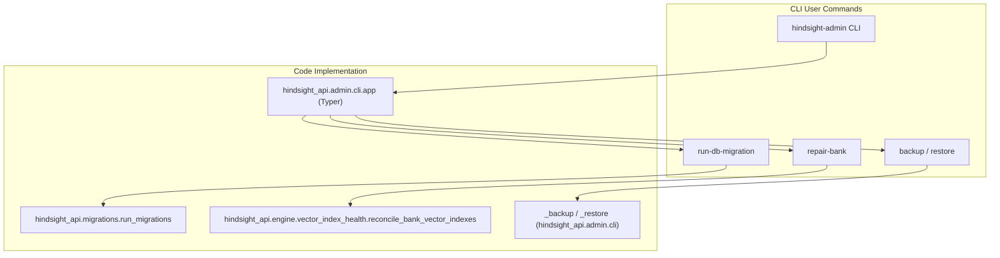
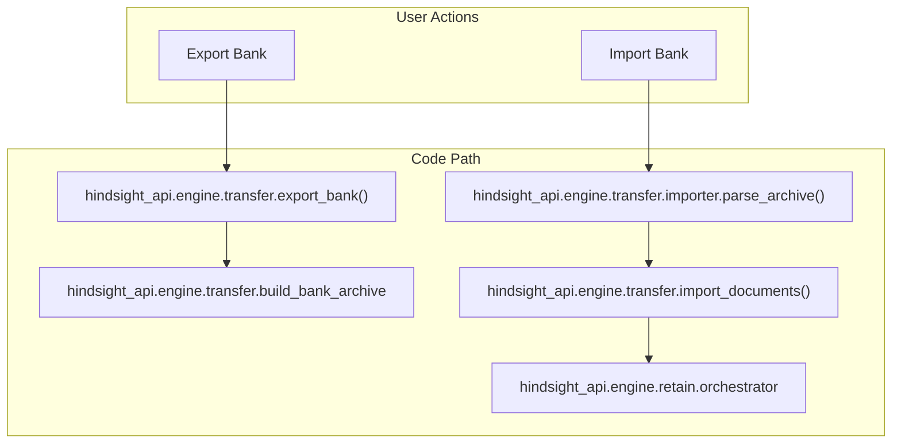
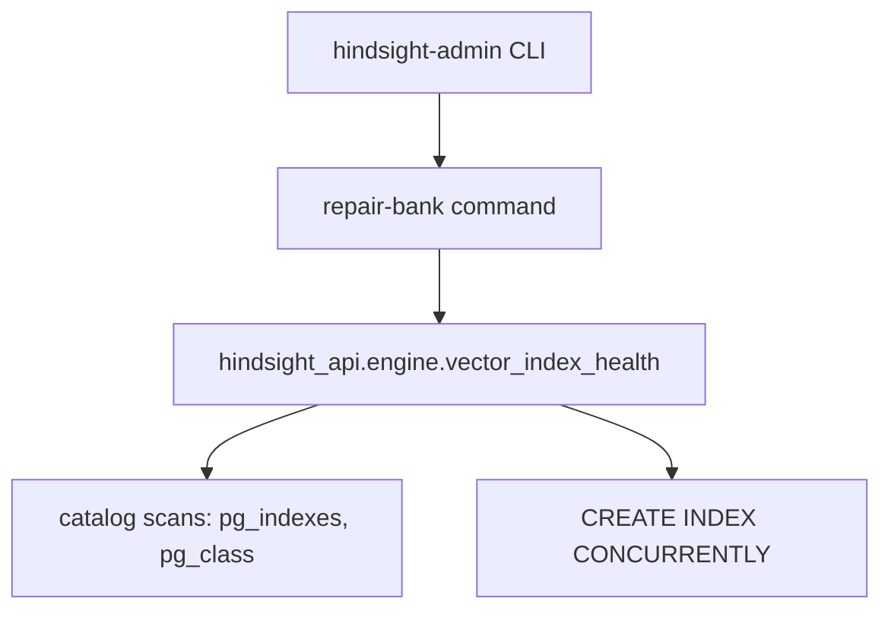
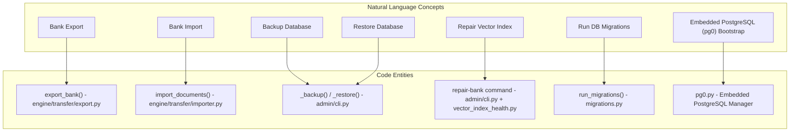
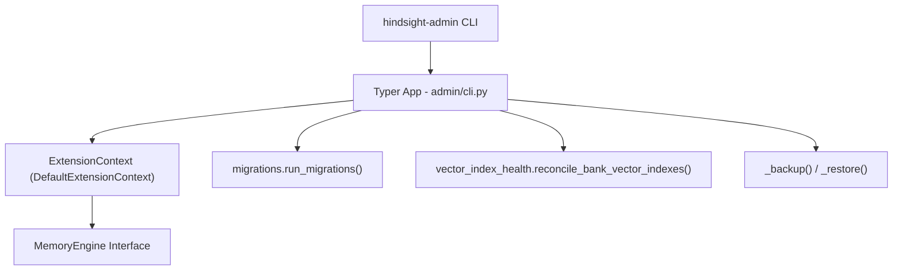

<!-- source: DeepWiki mcp.deepwiki.com · repo vectorize-io/hindsight · page 3.12 Admin CLI, Backup and Bank Transfer · fetched 2026-10-27 -->

# Admin CLI, Backup and Bank Transfer

<details>
<summary>Relevant source files</summary>

The following files were used as context for generating this wiki page:

- [hindsight-api-slim/hindsight_api/admin/cli.py](hindsight-api-slim/hindsight_api/admin/cli.py)
- [hindsight-api-slim/hindsight_api/alembic/versions/e8c1a4f7b2d9_drop_global_memory_units_vector_indexes.py](hindsight-api-slim/hindsight_api/alembic/versions/e8c1a4f7b2d9_drop_global_memory_units_vector_indexes.py)
- [hindsight-api-slim/hindsight_api/engine/memories/base.py](hindsight-api-slim/hindsight_api/engine/memories/base.py)
- [hindsight-api-slim/hindsight_api/engine/memories/pg/consolidation.py](hindsight-api-slim/hindsight_api/engine/memories/pg/consolidation.py)
- [hindsight-api-slim/hindsight_api/engine/memories/pg/reads.py](hindsight-api-slim/hindsight_api/engine/memories/pg/reads.py)
- [hindsight-api-slim/hindsight_api/engine/memories/postgres.py](hindsight-api-slim/hindsight_api/engine/memories/postgres.py)
- [hindsight-api-slim/hindsight_api/engine/transfer/__init__.py](hindsight-api-slim/hindsight_api/engine/transfer/__init__.py)
- [hindsight-api-slim/hindsight_api/engine/transfer/export.py](hindsight-api-slim/hindsight_api/engine/transfer/export.py)
- [hindsight-api-slim/hindsight_api/engine/transfer/importer.py](hindsight-api-slim/hindsight_api/engine/transfer/importer.py)
- [hindsight-api-slim/hindsight_api/engine/transfer/schema.py](hindsight-api-slim/hindsight_api/engine/transfer/schema.py)
- [hindsight-api-slim/hindsight_api/engine/vector_index_health.py](hindsight-api-slim/hindsight_api/engine/vector_index_health.py)
- [hindsight-api-slim/hindsight_api/extensions/base.py](hindsight-api-slim/hindsight_api/extensions/base.py)
- [hindsight-api-slim/hindsight_api/extensions/context.py](hindsight-api-slim/hindsight_api/extensions/context.py)
- [hindsight-api-slim/hindsight_api/extensions/loader.py](hindsight-api-slim/hindsight_api/extensions/loader.py)
- [hindsight-api-slim/hindsight_api/migrations.py](hindsight-api-slim/hindsight_api/migrations.py)
- [hindsight-api-slim/tests/test_admin_backup_restore.py](hindsight-api-slim/tests/test_admin_backup_restore.py)
- [hindsight-api-slim/tests/test_admin_bank_transfer.py](hindsight-api-slim/tests/test_admin_bank_transfer.py)
- [hindsight-api-slim/tests/test_admin_rename_bank.py](hindsight-api-slim/tests/test_admin_rename_bank.py)
- [hindsight-api-slim/tests/test_ann_iterative_scan.py](hindsight-api-slim/tests/test_ann_iterative_scan.py)
- [hindsight-api-slim/tests/test_consolidation_current_tags.py](hindsight-api-slim/tests/test_consolidation_current_tags.py)
- [hindsight-api-slim/tests/test_consolidation_embedding_validation.py](hindsight-api-slim/tests/test_consolidation_embedding_validation.py)
- [hindsight-api-slim/tests/test_document_transfer.py](hindsight-api-slim/tests/test_document_transfer.py)
- [hindsight-api-slim/tests/test_ensure_vector_no_global_index.py](hindsight-api-slim/tests/test_ensure_vector_no_global_index.py)
- [hindsight-api-slim/tests/test_extension_alembic_tree.py](hindsight-api-slim/tests/test_extension_alembic_tree.py)
- [hindsight-api-slim/tests/test_hnsw_indexes.py](hindsight-api-slim/tests/test_hnsw_indexes.py)
- [hindsight-api-slim/tests/test_hnsw_indexes_store_owned.py](hindsight-api-slim/tests/test_hnsw_indexes_store_owned.py)
- [hindsight-api-slim/tests/test_memories_extension.py](hindsight-api-slim/tests/test_memories_extension.py)
- [hindsight-api-slim/tests/test_migrations_parallel_schemas.py](hindsight-api-slim/tests/test_migrations_parallel_schemas.py)
- [hindsight-api-slim/tests/test_observation_expansion_single_fetch.py](hindsight-api-slim/tests/test_observation_expansion_single_fetch.py)
- [hindsight-api-slim/tests/test_repair_bank_vector_indexes.py](hindsight-api-slim/tests/test_repair_bank_vector_indexes.py)
- [hindsight-api-slim/tests/test_retain_consolidation_deadlock.py](hindsight-api-slim/tests/test_retain_consolidation_deadlock.py)
- [hindsight-api-slim/tests/test_transfer_observation_source_liveness.py](hindsight-api-slim/tests/test_transfer_observation_source_liveness.py)
- [hindsight-api-slim/tests/test_transfer_restore_rows_oracle.py](hindsight-api-slim/tests/test_transfer_restore_rows_oracle.py)
- [hindsight-api-slim/tests/test_transfer_store_owned_import.py](hindsight-api-slim/tests/test_transfer_store_owned_import.py)
- [hindsight-api-slim/tests/test_transfer_streaming_import.py](hindsight-api-slim/tests/test_transfer_streaming_import.py)
- [hindsight-docs/docs/developer/admin-cli.md](hindsight-docs/docs/developer/admin-cli.md)
- [skills/hindsight-docs/references/developer/admin-cli.md](skills/hindsight-docs/references/developer/admin-cli.md)

</details>


This page documents the technical architecture of the `hindsight-admin` CLI, the LLM-free bank export and import engine (`hindsight_api.engine.transfer`), database-level backup and restore flows using PostgreSQL binary `COPY`, vector index health reconciliation and repair routines, and the `pg0` embedded PostgreSQL bootstrap mechanism.

---

## 1. Admin CLI Architecture (`hindsight-admin`)

The `hindsight-admin` administrative utility (`hindsight_api/admin/cli.py`) provides PostgreSQL-only database-level management tools for Hindsight deployments. It connects **directly to PostgreSQL** using `asyncpg`, bypassing the HTTP API and ORM layers for low-level operations such as backups, restores, migration runs, worker status inspection, and vector index repairs [hindsight-api-slim/hindsight_api/admin/cli.py:1-48]().

The CLI reads the same environment configuration as the API server (e.g., `HINDSIGHT_API_DATABASE_URL`) and is intended to be run on the same host or container with direct network access to the PostgreSQL instance [hindsight-docs/docs/developer/admin-cli.md:15-38]().

Because of its direct use of PostgreSQL-specific features like binary `COPY`, `TRUNCATE CASCADE`, concurrent index builds, and advisory locks, the CLI **does not support Oracle backends** [hindsight-api-slim/hindsight_api/admin/cli.py:1-5]().

### Key Commands

- `run-db-migration`: Run Alembic database migrations on one or multiple tenant schemas.
- `backup` and `restore`: Export and import all persistent data via efficient binary dump/restore.
- `repair-bank`: Verify and concurrently rebuild partial vector indexes per `(bank, fact_type)`.
- Other maintenance commands: worker status, vector index cleanup, etc.

### Architecture Diagram



Sources:
- `hindsight-api-slim/hindsight_api/admin/cli.py:1-48`
- `hindsight-docs/docs/developer/admin-cli.md:1-38`

---

## 2. Bank Export and Import (`engine/transfer`)

The `hindsight_api.engine.transfer` package enables LLM-free export and import of documents and bank data between Hindsight banks or instances, allowing data movement without re-running expensive LLM fact extraction [hindsight-api-slim/hindsight_api/engine/transfer/__init__.py:1-60]().

### 2.1 Export Pipeline

The export (`export_bank`) serializes bank data such as documents, extracted facts (without database IDs or embeddings), mental models, directives, webhooks, and attachments into a ZIP archive structured as:

```
manifest.json              -- TransferManifest metadata
documents/<zero-padded>.json -- One file per document (TransferDocument)
observations.json?           -- Optionally consolidated observations
blobs/                       -- Attachment raw bytes
data/<table>.json            -- Operational and history rows
```

- Embeddings and vector search columns like `embedding` and `search_vector` are deliberately **excluded or stripped** to force re-embedding on import by the target bank's active embedding model.
- Entities, co-occurrences, and causal links are **not exported** as tables but rebuilt on import by entity resolution and causal recovery.
- Derived or operational tables (`async_operations`, `audit_log`, `llm_requests`, etc.) are included with their JSON data verbatim when requested by scope.

The export reads tables via the memory store backend (Postgres or others) at a low level but omits costly embedding or LLM operations [hindsight-api-slim/hindsight_api/engine/transfer/export.py:1-127](), [hindsight-api-slim/hindsight_api/engine/transfer/schema.py:1-161]().

### 2.2 Import Pipeline

The import (`import_documents`) replay the deterministic retain pipeline stages (fact storage and embedding, entity resolution, link building) against the target bank without calling any LLM [hindsight-api-slim/hindsight_api/engine/transfer/importer.py:1-186]().

Steps include:

- Validating and parsing the transferred ZIP archive (`parse_archive`).
- Rebuilding extracted facts from archive data and re-embedding them in batches sized by bank embedding limits (`_EMBED_BATCH_SIZE = 128`).
- Re-resolving canonical named entities in the target bank.
- Reconstructing causal relations and semantic/temporal links relative to the target bank's existing memories.
- Replaying observations and mental models while remapping IDs as needed.

This replay ensures that the transferred facts integrate consistently without costly LLM inference, preserving facts and maintaining link consistency [hindsight-api-slim/hindsight_api/engine/transfer/importer.py:1-160]().

### Pipeline Diagram



Sources:
- `hindsight-api-slim/hindsight_api/engine/transfer/__init__.py:1-60`
- `hindsight-api-slim/hindsight_api/engine/transfer/export.py:1-128`
- `hindsight-api-slim/hindsight_api/engine/transfer/importer.py:1-160`
- `hindsight-api-slim/hindsight_api/engine/transfer/schema.py:1-161`

---

## 3. Database Backup and Restore Flows

The admin CLI provides **database-level backup and restore** features operating directly on PostgreSQL tables using **binary PostgreSQL COPY streams** for speed and reliability [hindsight-api-slim/hindsight_api/admin/cli.py:1-178]().

### 3.1 Backup Table Ordering

The list `BACKUP_TABLES` defines all backed-up tables in strict **foreign-key dependency order** to avoid referential integrity conflicts:

| Order | Table Name                  | Notes                                                  |
|-------|-----------------------------|--------------------------------------------------------|
| 1     | `banks`                     | Bank configuration root                                |
| 2     | `bank_aliases`              | Aliases (excluded on import to avoid id collisions)   |
| 3     | `attachments`               | Binary file attachments                                |
| 4     | `documents`                 | Source documents                                       |
| 5     | `entities`                  | Resolved entities                                     |
| 6     | `chunks`                    | Document text chunks                                  |
| 7     | `memory_units`              | Extracted facts + vector embeddings                    |
| 8-24  | Tables such as `mental_models`, `directives`, `async_operations`, etc. | Various history, maintenance, and support tables    |

Restore calls `TRUNCATE <tables> CASCADE` in reverse order and streams back data ordered by dependencies to maintain foreign key invariants [hindsight-api-slim/hindsight_api/admin/cli.py:49-87]().

### 3.2 Binary COPY Stream Field Stripping

Restores handle schema drift gracefully by stripping binary `COPY` fields corresponding to dropped columns:

- The `_strip_binary_copy_fields` function decodes the PostgreSQL binary COPY format, dropping fields by positional index when target tables lack columns present in the backup [hindsight-api-slim/hindsight_api/admin/cli.py:121-168]().
- This prevents mismatches between binary streams and current table definitions during restore, allowing upgrade/migration safety.

### 3.3 Sequence Synchronization

Identity columns backed by PostgreSQL sequences are synchronized after restore:

- `_sync_owned_sequences` finds tables with identity sequences.
- For each, it queries the max ID loaded and sets the sequence restart point accordingly without leaving gaps.
- Ensures auto-increment counters resume safely after database data replacement [hindsight-api-slim/tests/test_admin_backup_restore.py:30-53,120-144]().

Sources:
- `hindsight-api-slim/hindsight_api/admin/cli.py:49-178`
- `hindsight-api-slim/tests/test_admin_backup_restore.py:30-144`

---

## 4. Vector Index Health and Repair Routines

Partial **per-`(bank, fact_type)` vector indexes** accelerate recall queries by limiting similarity search scope in `memory_units` [hindsight-api-slim/hindsight_api/engine/vector_index_health.py]().

### 4.1 Repair Bank Command

Banks populated or restored outside normal flows can miss these partial indexes, causing slower global scans and under-returned results.

The `repair-bank` CLI command detects and repairs missing or invalid indexes:

- Inspects system catalogs for per-bank partial index existence and validity.
- Uses `CREATE INDEX CONCURRENTLY` to rebuild indexes without blocking live traffic.
- Safe to run repeatedly and concurrently with API operation.
- No-op on banks using single global indexes or store-owned memories without `memory_units` rows.

### 4.2 Behavior and Safety

- Dropped, orphaned, or invalid indexes are identified precisely, not just by name.
- Idempotent, so operational scripts can integrate it to keep vector index health.
- Returns exit codes to signal success, partial repair, or failures requiring operator attention [hindsight-docs/docs/developer/admin-cli.md:71-127](), [hindsight-api-slim/tests/test_repair_bank_vector_indexes.py:1-60]().

### Overview Diagram



Sources:
- `hindsight-api-slim/hindsight_api/engine/vector_index_health.py:1-50`
- `hindsight-api-slim/tests/test_repair_bank_vector_indexes.py:1-60`
- `hindsight-docs/docs/developer/admin-cli.md:71-127`

---

## 5. `pg0` Embedded PostgreSQL Bootstrap

The `pg0` embedded PostgreSQL runtime supports **zero-configuration local development** by bundling a PostgreSQL instance inside Hindsight [hindsight-api-slim/hindsight_api/admin/cli.py:38](), [hindsight-api-slim/hindsight_api/pg0.py]().

### Key Properties

- Detects connection URLs with the `pg0://` scheme and bootstraps the embedded DB instance on demand.
- Manages configuration via local state directories (e.g., `~/.hindsight/pg0`).
- Accepts tuning parameters like `shared_buffers` and `max_connections` via connection URL query parameters.
- Automatically starts the embedded instance before the API server or admin CLI commands run.
- Enables seamless development without external dependencies or manual database setup.

### Usage

- By default, the `HINDSIGHT_API_DATABASE_URL` points to `pg0` during development.
- Admin CLI commands and API server transparently use the embedded runtime when configured.

Sources:
- `hindsight-api-slim/hindsight_api/admin/cli.py:38`
- `hindsight-api-slim/hindsight_api/pg0.py`

---

### Additional Diagram: Mapping Domain Concepts to Code Entities



Sources:
- `hindsight-api-slim/hindsight_api/admin/cli.py:1-178`
- `hindsight-api-slim/hindsight_api/engine/transfer/export.py:1-128`
- `hindsight-api-slim/hindsight_api/engine/transfer/importer.py:1-160`
- `hindsight-api-slim/hindsight_api/migrations.py:1-60`
- `hindsight-api-slim/hindsight_api/engine/vector_index_health.py:1-50`

---

### Additional Diagram: Admin CLI Workflow With Memory Engine and Extensions



Sources:
- `hindsight-api-slim/hindsight_api/admin/cli.py:1-48`
- `hindsight-api-slim/hindsight_api/migrations.py:1-1695`
- `hindsight-api-slim/hindsight_api/engine/vector_index_health.py:1-50`

---

## References

| Topic                                  | Code Location / File                                      |
|--------------------------------------|-----------------------------------------------------------|
| `hindsight-admin` CLI main            | `hindsight-api-slim/hindsight_api/admin/cli.py:1-178`     |
| Bank export and import engine         | `hindsight-api-slim/hindsight_api/engine/transfer/`       |
| Backup/Restore flow                   | `hindsight-api-slim/hindsight_api/admin/cli.py`           |
| Vector index health and repair        | `hindsight-api-slim/hindsight_api/engine/vector_index_health.py` |
| Backup/Restore tests                  | `hindsight-api-slim/tests/test_admin_backup_restore.py`   |
| Vector index repair tests             | `hindsight-api-slim/tests/test_repair_bank_vector_indexes.py` |
| pg0 embedded PostgreSQL bootstrap     | `hindsight-api-slim/hindsight_api/pg0.py`                  |
| Admin CLI developer docs               | `hindsight-docs/docs/developer/admin-cli.md`               |

---

