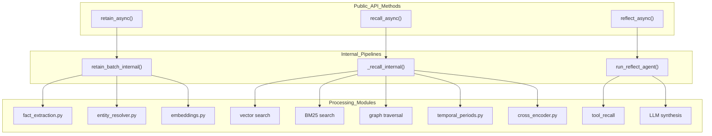

<!-- source: DeepWiki mcp.deepwiki.com · repo vectorize-io/hindsight · page 3.2 Memory Engine · fetched 2026-10-27 -->

# Memory Engine

<details>
<summary>Relevant source files</summary>

The following files were used as context for generating this wiki page:

- [hindsight-api-slim/hindsight_api/api/http.py](hindsight-api-slim/hindsight_api/api/http.py)
- [hindsight-api-slim/hindsight_api/engine/chinese_temporal_periods.py](hindsight-api-slim/hindsight_api/engine/chinese_temporal_periods.py)
- [hindsight-api-slim/hindsight_api/engine/local_device.py](hindsight-api-slim/hindsight_api/engine/local_device.py)
- [hindsight-api-slim/hindsight_api/engine/memory_engine.py](hindsight-api-slim/hindsight_api/engine/memory_engine.py)
- [hindsight-api-slim/hindsight_api/engine/query_analyzer.py](hindsight-api-slim/hindsight_api/engine/query_analyzer.py)
- [hindsight-api-slim/hindsight_api/engine/search/temporal_extraction.py](hindsight-api-slim/hindsight_api/engine/search/temporal_extraction.py)
- [hindsight-api-slim/hindsight_api/engine/temporal_language_detection.py](hindsight-api-slim/hindsight_api/engine/temporal_language_detection.py)
- [hindsight-api-slim/hindsight_api/engine/temporal_periods.py](hindsight-api-slim/hindsight_api/engine/temporal_periods.py)
- [hindsight-api-slim/tests/data/query_analyzer_golden.json](hindsight-api-slim/tests/data/query_analyzer_golden.json)
- [hindsight-api-slim/tests/query_analyzer_bench.py](hindsight-api-slim/tests/query_analyzer_bench.py)
- [hindsight-api-slim/tests/query_analyzer_corpus.py](hindsight-api-slim/tests/query_analyzer_corpus.py)
- [hindsight-api-slim/tests/test_jina_mlx_release.py](hindsight-api-slim/tests/test_jina_mlx_release.py)
- [hindsight-api-slim/tests/test_local_device.py](hindsight-api-slim/tests/test_local_device.py)
- [hindsight-api-slim/tests/test_local_model_alignment.py](hindsight-api-slim/tests/test_local_model_alignment.py)
- [hindsight-api-slim/tests/test_local_model_build_lock.py](hindsight-api-slim/tests/test_local_model_build_lock.py)
- [hindsight-api-slim/tests/test_query_analyzer.py](hindsight-api-slim/tests/test_query_analyzer.py)
- [hindsight-api-slim/tests/test_temporal_default_reference_utc.py](hindsight-api-slim/tests/test_temporal_default_reference_utc.py)
- [hindsight-api-slim/tests/test_temporal_extraction.py](hindsight-api-slim/tests/test_temporal_extraction.py)
- [hindsight-api-slim/tests/test_temporal_language_detection_threading.py](hindsight-api-slim/tests/test_temporal_language_detection_threading.py)
- [hindsight-cli/src/api.rs](hindsight-cli/src/api.rs)
- [hindsight-clients/go/api/openapi.yaml](hindsight-clients/go/api/openapi.yaml)
- [hindsight-clients/python/.openapi-generator/FILES](hindsight-clients/python/.openapi-generator/FILES)
- [hindsight-clients/python/hindsight_client_api/__init__.py](hindsight-clients/python/hindsight_client_api/__init__.py)
- [hindsight-clients/python/hindsight_client_api/models/__init__.py](hindsight-clients/python/hindsight_client_api/models/__init__.py)
- [hindsight-clients/typescript/generated/sdk.gen.ts](hindsight-clients/typescript/generated/sdk.gen.ts)
- [hindsight-clients/typescript/generated/types.gen.ts](hindsight-clients/typescript/generated/types.gen.ts)
- [hindsight-control-plane/src/lib/api.ts](hindsight-control-plane/src/lib/api.ts)
- [hindsight-docs/static/openapi.json](hindsight-docs/static/openapi.json)
- [skills/hindsight-docs/references/openapi.json](skills/hindsight-docs/references/openapi.json)

</details>


## Purpose and Scope

This page provides a technical deep dive into `MemoryEngine` (`[hindsight-api-slim/hindsight_api/engine/memory_engine.py:1-494]()`), the central orchestrator for all memory operations within Hindsight. It covers the orchestrator pattern, the coordination of the `retain`, `recall`, and `reflect` pipelines, and the orchestration of underlying helper modules including `llm_wrapper`, `embeddings`, `cross_encoder`, `entity_resolver`, and `query_analyzer`.

Sources: `[hindsight-api-slim/hindsight_api/engine/memory_engine.py:1-494]()`

---

## Architecture and Orchestrator Pattern

### Overview

The `MemoryEngine` encapsulates the orchestrator pattern that directs the flow of data through specialized submodules. Its methods provide a unified API to execute the three core operations — retain, recall, and reflect — while delegating sub-tasks such as fact extraction, vector generation, entity resolution, and temporal/query parsing to dedicated subsystems.

### Natural Language to Code Entity Mapping: Orchestration Flow

```mermaid
graph TB
    subgraph "NaturalLanguageSpace"
        NL_Store["\"Store Memory / Retain\""]
        NL_Search["\"Recall / Semantic & Graph Search\""]
        NL_Reflect["\"Reflect / Autonomous Agent Reasoning\""]
    end

    subgraph "CodeEntitySpace"
        CE_Retain["\"MemoryEngine.retain_async()\"\n(hindsight_api/engine/memory_engine.py:1131)"]
        CE_Recall["\"MemoryEngine.recall_async()\"\n(hindsight_api/engine/memory_engine.py:1633)"]
        CE_Reflect["\"MemoryEngine.reflect_async()\"\n(hindsight_api/engine/memory_engine.py:1923)"]
        
        CE_LLM["\"LLMInterface / llm_wrapper\"\n(hindsight_api/engine/llm_wrapper.py:50)"]
        CE_Embed["\"Embeddings\"\n(hindsight_api/engine/embeddings.py)"]
        CE_Cross["\"CrossEncoderModel\"\n(hindsight_api/engine/cross_encoder.py)"]
        CE_Entity["\"EntityResolver\"\n(hindsight_api/engine/entity_resolver.py:1)"]
        CE_Query["\"QueryAnalyzer\"\n(hindsight_api/engine/query_analyzer.py:1)"]
    end

    NL_Store --> CE_Retain
    NL_Search --> CE_Recall
    NL_Reflect --> CE_Reflect

    CE_Retain --> CE_LLM
    CE_Retain --> CE_Entity
    CE_Retain --> CE_Embed

    CE_Recall --> CE_Embed
    CE_Recall --> CE_Query
    CE_Recall --> CE_Cross

    CE_Reflect --> CE_LLM
    CE_Reflect --> CE_Recall
```

**Key Responsibilities of `MemoryEngine`:**

| Responsibility | Implementation Details | Code Reference |
|---|---|---|
| Initialization | Creates DB connection pool, initializes submodules, runs database migrations | `[hindsight-api-slim/hindsight_api/engine/memory_engine.py:238-494]()` |
| Multi-tenancy | Maintains schema context per request, validates tenant access | `[hindsight-api-slim/hindsight_api/engine/memory_engine.py:520-551]()` |
| Operation Routing | Dispatches requests to retain, recall, and reflect pipelines | `[hindsight-api-slim/hindsight_api/engine/memory_engine.py:1131-1453]()` |
| Component Coordination | Manages LLM configs, embedding lifecycles, and rerankers | `[hindsight-api-slim/hindsight_api/engine/memory_engine.py:388-464]()` |
| Async Task Management | Submits background jobs like consolidation and file processing | `[hindsight-api-slim/hindsight_api/engine/memory_engine.py:553-826]()` |

Sources: `[hindsight-api-slim/hindsight_api/engine/memory_engine.py:227-494]()`, `[hindsight-api-slim/hindsight_api/config.py:1-250]()`

---

## Initialization and Configuration

### Constructor and Configuration

The constructor instantiates `MemoryEngine` with configuration parameters sourced from `HindsightConfig` (`[hindsight-api-slim/hindsight_api/config.py:141-250]()`). It sets up the asynchronous database connection pool, initializes vector storage settings, and configures distinct LLM profiles for different operations.

### Per-Operation LLM Configuration Hierarchy

The engine separates LLM behavior across different operational domains to optimize latency and cost:

| LLM Config | Purpose | Fallback | Code Reference |
|---|---|---|---|
| `_llm_config` | Global default configuration | Environment or defaults | `[hindsight-api-slim/hindsight_api/engine/memory_engine.py:388-397]()` |
| `_retain_llm_config` | Fact extraction during retain | `_llm_config` | `[hindsight-api-slim/hindsight_api/engine/memory_engine.py:400-419]()` |
| `_reflect_llm_config` | Reasoning loops during reflect | `_llm_config` | `[hindsight-api-slim/hindsight_api/engine/memory_engine.py:421-440]()` |
| `_consolidation_llm_config` | Observation synthesis and mental models | `_llm_config` | `[hindsight-api-slim/hindsight_api/engine/memory_engine.py:442-461]()` |

Sources: `[hindsight-api-slim/hindsight_api/engine/memory_engine.py:238-494]()`, `[hindsight-api-slim/hindsight_api/config.py:1-250]()`

---

## Module Coordination

The engine coordinates specialized subsystems to process raw text into structured graph and vector elements, and to answer queries using multi-strategy retrieval.

### Natural Language to Code Entity Space Mapping: Submodule Integration

```mermaid
graph TB
    subgraph "NaturalLanguageSpace"
        NL_RawInput["\"Raw Text / Prompt / Query\""]
        NL_ParsedQuery["\"Temporal & Semantic Intent\""]
        NL_ExtractedFacts["\"Structured World & Experience Facts\""]
    end

    subgraph "CodeEntitySpace"
        ME_Orchestrator["\"MemoryEngine (memory_engine.py)\""]
        
        QA["\"QueryAnalyzer\n(hindsight_api/engine/query_analyzer.py:1)\""]
        ER["\"EntityResolver\n(hindsight_api/engine/entity_resolver.py:1)\""]
        EM["\"Embeddings\n(hindsight_api/engine/embeddings.py)\""]
        CE["\"CrossEncoderModel\n(hindsight_api/engine/cross_encoder.py)\""]
        LLM["\"llm_wrapper / LLMInterface\n(hindsight_api/engine/llm_wrapper.py:50)\""]
    end

    NL_RawInput --> ME_Orchestrator
    ME_Orchestrator --> QA
    ME_Orchestrator --> ER
    ME_Orchestrator --> EM
    ME_Orchestrator --> CE
    ME_Orchestrator --> LLM

    QA --> NL_ParsedQuery
    LLM --> NL_ExtractedFacts
    ER --> NL_ExtractedFacts
```

### Submodule Roles

- **`llm_wrapper`**: Provides an abstraction over LLM providers with automatic retry, concurrency throttling via `CrossLoopSemaphore`, JSON schema validation, and tracing (`[hindsight-api-slim/hindsight_api/engine/llm_wrapper.py:50-115]()`).
- **`embeddings`**: Converts chunks and queries into dense vectors using local models (SentenceTransformers/ONNX) or remote APIs (`[hindsight-api-slim/hindsight_api/engine/embeddings.py:1-100]()`).
- **`cross_encoder`**: Performs reranking of recall candidates to maximize precision (`[hindsight-api-slim/hindsight_api/engine/cross_encoder.py:1-120]()`).
- **`entity_resolver`**: Handles entity canonicalization via trigram similarity matching (`[hindsight-api-slim/hindsight_api/engine/entity_resolver.py:82-93]()`).
- **`query_analyzer`**: Extracts temporal boundaries and query intent from natural language strings (`[hindsight-api-slim/hindsight_api/engine/query_analyzer.py:1-50]()`).

Sources: `[hindsight-api-slim/hindsight_api/engine/memory_engine.py:374-494]()`, `[hindsight-api-slim/hindsight_api/engine/llm_wrapper.py:50-115]()`, `[hindsight-api-slim/hindsight_api/engine/entity_resolver.py:1-150]()`, `[hindsight-api-slim/hindsight_api/engine/query_analyzer.py:1-50]()`

---

## Core Operation Methods

### Overview

`MemoryEngine` exposes core asynchronous methods that execute Hindsight's primary workflows.



### Method Summary

| Method | Description | Code Reference |
|---|---|---|
| `retain_async()` | Processes text input through chunking, extraction, entity resolution, and vectorization. | `[hindsight-api-slim/hindsight_api/engine/memory_engine.py:1131-1186]()` |
| `recall_async()` | Executes 4-way parallel retrieval (vector, BM25, graph traversal, temporal) with reranking. | `[hindsight-api-slim/hindsight_api/engine/memory_engine.py:1633-1921]()` |
| `reflect_async()` | Runs autonomous agent reasoning loops with tool calls and mental model integration. | `[hindsight-api-slim/hindsight_api/engine/memory_engine.py:1923-2109]()` |

Sources: `[hindsight-api-slim/hindsight_api/engine/memory_engine.py:1131-2109]()`, `[hindsight-api-slim/hindsight_api/engine/query_analyzer.py:1-50]()`

---

## Multi-Tenancy and Schema Isolation

Tenant and bank separation is implemented via PostgreSQL schema isolation coupled with task-local context variables.

| Component | Role | Code Reference |
|---|---|---|
| `_current_schema` | Async context variable storing the active schema | `[hindsight-api-slim/hindsight_api/engine/memory_engine.py:80]()` |
| `get_current_schema()` | Helper retrieving active schema with fallback | `[hindsight-api-slim/hindsight_api/engine/memory_engine.py:136-142]()` |
| `fq_table()` | Prefixes table names with current schema | `[hindsight-api-slim/hindsight_api/engine/memory_engine.py:188-197]()` |
| `_authenticate_tenant()` | Validates access and populates schema context | `[hindsight-api-slim/hindsight_api/engine/memory_engine.py:520-551]()` |

Sources: `[hindsight-api-slim/hindsight_api/engine/memory_engine.py:70-170]()`, `[hindsight-api-slim/hindsight_api/engine/memory_engine.py:520-551]()`

---

