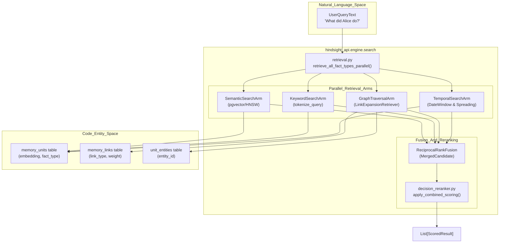
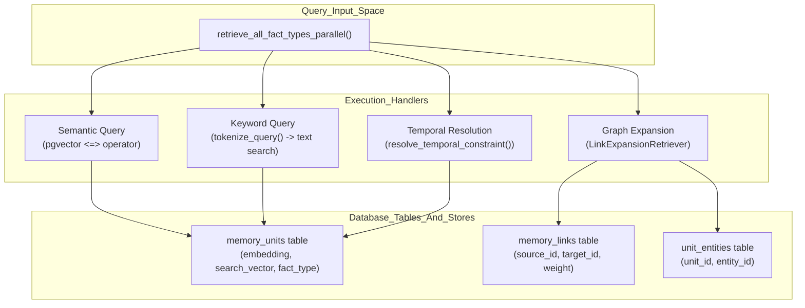

<!-- source: DeepWiki mcp.deepwiki.com · repo vectorize-io/hindsight · page 3.4 Retrieval System (TEMPR Multi-Strategy) · fetched 2026-10-27 -->

# Retrieval System (TEMPR Multi-Strategy)

Relevant source files

The following files were used as context for generating this wiki page:

- [hindsight-api-slim/hindsight_api/engine/db/oracle.py](hindsight-api-slim/hindsight_api/engine/db/oracle.py)
- [hindsight-api-slim/hindsight_api/engine/db/postgresql.py](hindsight-api-slim/hindsight_api/engine/db/postgresql.py)
- [hindsight-api-slim/hindsight_api/engine/decision_model.py](hindsight-api-slim/hindsight_api/engine/decision_model.py)
- [hindsight-api-slim/hindsight_api/engine/search/decision_reranker.py](hindsight-api-slim/hindsight_api/engine/search/decision_reranker.py)
- [hindsight-api-slim/hindsight_api/engine/search/graph_retrieval.py](hindsight-api-slim/hindsight_api/engine/search/graph_retrieval.py)
- [hindsight-api-slim/hindsight_api/engine/search/recall_boost.py](hindsight-api-slim/hindsight_api/engine/search/recall_boost.py)
- [hindsight-api-slim/hindsight_api/engine/search/retrieval.py](hindsight-api-slim/hindsight_api/engine/search/retrieval.py)
- [hindsight-api-slim/hindsight_api/engine/search/types.py](hindsight-api-slim/hindsight_api/engine/search/types.py)
- [hindsight-api-slim/hindsight_api/engine/sql/base.py](hindsight-api-slim/hindsight_api/engine/sql/base.py)
- [hindsight-api-slim/hindsight_api/engine/sql/oracle.py](hindsight-api-slim/hindsight_api/engine/sql/oracle.py)
- [hindsight-api-slim/hindsight_api/engine/sql/postgresql.py](hindsight-api-slim/hindsight_api/engine/sql/postgresql.py)
- [hindsight-api-slim/tests/test_config_validation.py](hindsight-api-slim/tests/test_config_validation.py)
- [hindsight-api-slim/tests/test_db_abstraction.py](hindsight-api-slim/tests/test_db_abstraction.py)
- [hindsight-api-slim/tests/test_decision_model_config.py](hindsight-api-slim/tests/test_decision_model_config.py)
- [hindsight-api-slim/tests/test_decision_reranker.py](hindsight-api-slim/tests/test_decision_reranker.py)
- [hindsight-api-slim/tests/test_enable_text_search_flag.py](hindsight-api-slim/tests/test_enable_text_search_flag.py)
- [hindsight-api-slim/tests/test_knowledge_bm25_dispatch.py](hindsight-api-slim/tests/test_knowledge_bm25_dispatch.py)
- [hindsight-api-slim/tests/test_knowledge_search_text_search_disabled.py](hindsight-api-slim/tests/test_knowledge_search_text_search_disabled.py)
- [hindsight-api-slim/tests/test_multilingual_bm25.py](hindsight-api-slim/tests/test_multilingual_bm25.py)
- [hindsight-api-slim/tests/test_oracle_integration.py](hindsight-api-slim/tests/test_oracle_integration.py)
- [hindsight-api-slim/tests/test_recall_boost.py](hindsight-api-slim/tests/test_recall_boost.py)
- [hindsight-api-slim/tests/test_recall_boost_pipeline.py](hindsight-api-slim/tests/test_recall_boost_pipeline.py)
- [hindsight-api-slim/tests/test_recall_scoring_time.py](hindsight-api-slim/tests/test_recall_scoring_time.py)
- [hindsight-api-slim/tests/test_reranker_typesafe.py](hindsight-api-slim/tests/test_reranker_typesafe.py)
- [hindsight-api-slim/tests/test_temporal_arm_ordering.py](hindsight-api-slim/tests/test_temporal_arm_ordering.py)
- [hindsight-api-slim/tests/test_temporal_recall_selection.py](hindsight-api-slim/tests/test_temporal_recall_selection.py)
- [hindsight-docs/docs/developer/retain.md](hindsight-docs/docs/developer/retain.md)
- [hindsight-docs/docs/developer/retrieval.md](hindsight-docs/docs/developer/retrieval.md)
- [hindsight-docs/src/pages/changelog/integrations/zcode.md](hindsight-docs/src/pages/changelog/integrations/zcode.md)
- [skills/hindsight-docs/references/changelog/integrations/zcode.md](skills/hindsight-docs/references/changelog/integrations/zcode.md)
- [skills/hindsight-docs/references/developer/retain.md](skills/hindsight-docs/references/developer/retain.md)
- [skills/hindsight-docs/references/developer/retrieval.md](skills/hindsight-docs/references/developer/retrieval.md)
- [skills/hindsight-docs/references/sdks/integrations/zcode.md](skills/hindsight-docs/references/sdks/integrations/zcode.md)

The purpose of this page is to detail Hindsight's 4-way parallel retrieval system—known as TEMPR (Temporal, Entity, Memory, Procedural/Semantic Recall)—which coordinates semantic search (`pgvector`), BM25 text search, graph traversal (`link_expansion`/MPFP), and temporal search. It covers Reciprocal Rank fusion (RRF), cross-encoder reranking, recall boosts, token budget filtering, and search tracing.

---

## 1. Architecture Overview

When an agent or user invokes `recall()`, Hindsight delegates the retrieval process to `retrieve_all_fact_types_parallel` in `hindsight_api.engine.search.retrieval`. Rather than committing to a single search strategy upfront, the system concurrently executes four complementary retrieval arms. Their outputs are unified, scored using Reciprocal Rank Fusion (RRF), enhanced via neural cross-encoder reranking and multiplicative recall boosts, and filtered against a token budget.

### System Flow: Natural Language to Code Entities (Macro View)

Sources: [hindsight-api-slim/hindsight_api/engine/search/retrieval.py:129-166](), [hindsight-docs/docs/developer/retrieval.md:1-125]()

---

## 2. Four Parallel Retrieval Strategies

Each search strategy targets specific retrieval requirements, ensuring coverage whether the query relies on semantic conceptualization, exact keyword tokens, structural graph relationships, or temporal windows.

### 2.1 Semantic Search (pgvector)
Semantic search computes vector similarity between the query embedding string and stored item embeddings in `memory_units`. 
- Dedicated HNSW indexes per fact type (e.g., `idx_mu_emb_world`, `idx_mu_emb_experience`) isolate vector indexes to maximize selectivity.
- Executed via unified store routines coordinated by `retrieve_all_fact_types_parallel` [hindsight-api-slim/hindsight_api/engine/search/retrieval.py:129-166]().

### 2.2 BM25 Text Search
Keyword retrieval processes exact tokens using pluggable backends selected via configuration. Queries are normalized and tokenized via `tokenize_query` [hindsight-api-slim/hindsight_api/engine/search/retrieval.py:28-35]().
- Supported backends include `native` (`tsvector`), `vchord`, `pg_textsearch`, `pgroonga`, and `pg_search` (ParadeDB) [hindsight-docs/docs/developer/retrieval.md:55-65]().
- Dispatches are handled dynamically via SQL dialect layers such as `KnowledgeBm25Arm` in `hindsight_api.engine.sql.postgresql` [hindsight-api-slim/hindsight_api/engine/sql/postgresql.py:14-33]().

### 2.3 Graph Traversal (Link Expansion)
Graph traversal uses `LinkExpansionRetriever` to discover indirectly related memories by following relational edges in `memory_links` and `unit_entities` [hindsight-api-slim/hindsight_api/engine/search/graph_retrieval.py:1-50]().
- Seeds are established via semantic lookup before walking graph edges (co-occurrence, causal, and semantic neighbor links).
- Fanout limits constrain complexity across expansion steps.

### 2.4 Temporal Search
Temporal search parses natural language time constraints into structured `TemporalWindow` objects via `resolve_temporal_constraint` [hindsight-api-slim/hindsight_api/engine/search/retrieval.py:100-127]().
- Filters memories overlapping the target window.
- Distributes candidates across time buckets to ensure representative historical coverage rather than clustering on dense sub-intervals [hindsight-docs/docs/developer/retrieval.md:96-98]().

### Strategy-to-Code Execution Mapping

Sources: [hindsight-api-slim/hindsight_api/engine/search/retrieval.py:28-166](), [hindsight-api-slim/hindsight_api/engine/sql/postgresql.py:14-75](), [hindsight-docs/docs/developer/retrieval.md:31-100]()

---

## 3. Result Fusion and Cross-Encoder Reranking

### Reciprocal Rank Fusion (RRF)
To reconcile heterogeneous scales and scoring metrics across the four arms, Hindsight uses Reciprocal Rank Fusion.
- RRF combines ranks rather than raw scores, summing inverse rank values ($1 / (\text{rank} + k)$).
- Consensus across multiple search arms elevates a candidate's fused standing.

### Neural Reranking & Recall Boosts
Following RRF, candidate subsets (up to 300 items) pass through `apply_combined_scoring` in `hindsight_api.engine.search.decision_reranker` [hindsight-api-slim/hindsight_api/engine/search/decision_reranker.py:1-50]().
- **Recency Decay:** Mapped via freshness functions reducing score weights over age in days.
- **Temporal Proximity:** Small positive adjustments for items near a temporal window midpoint.
- **Evidence Proof Count:** Logarithmic boosts for consolidated observations supported by extensive source evidence.

Sources: [hindsight-api-slim/hindsight_api/engine/search/decision_reranker.py:1-80](), [skills/hindsight-docs/references/developer/retrieval.md:15-21]()

---

## 4. Token Budget Filtering and Search Tracing

### Token Budget Management
Unlike conventional search engines returning a fixed count of top-$k$ results, Hindsight packs results against an agent's prompt context capacity:
- Candidates are sorted best-first by final fused and reranked scores.
- Memory text tokens accumulate until the configured `max_tokens` threshold (default `4096`) is exhausted [hindsight-docs/docs/developer/retrieval.md:129-135]().

### Search Tracing
Execution inspection is supported through tracing utilities in `tracer.py`, capturing arm timings, raw scores, consensus counts, and token tallies for review within the Control Plane UI [hindsight-docs/docs/developer/retrieval.md:140-145]().

Sources: [hindsight-docs/docs/developer/retrieval.md:129-145](), [skills/hindsight-docs/references/developer/retrieval.md:15-21]()

---

