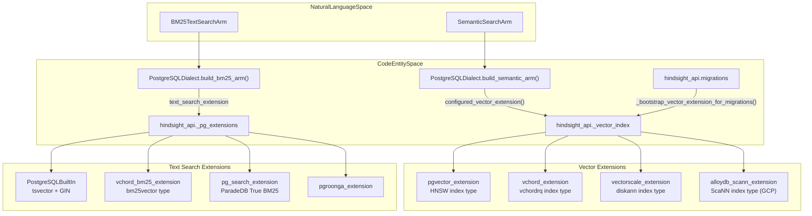
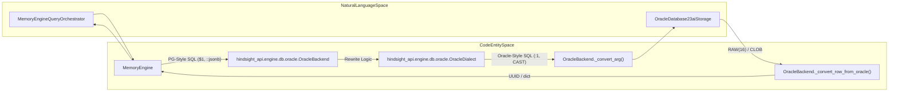

<!-- source: DeepWiki mcp.deepwiki.com · repo vectorize-io/hindsight · page 3.8 Vector and Text Search Backends · fetched 2026-10-27 -->

# Vector and Text Search Backends

Relevant source files

The following files were used as context for generating this wiki page:

- [.env.example](.env.example)
- [hindsight-api-slim/hindsight_api/config.py](hindsight-api-slim/hindsight_api/config.py)
- [hindsight-api-slim/hindsight_api/engine/cross_encoder.py](hindsight-api-slim/hindsight_api/engine/cross_encoder.py)
- [hindsight-api-slim/hindsight_api/engine/db/oracle.py](hindsight-api-slim/hindsight_api/engine/db/oracle.py)
- [hindsight-api-slim/hindsight_api/engine/db/postgresql.py](hindsight-api-slim/hindsight_api/engine/db/postgresql.py)
- [hindsight-api-slim/hindsight_api/engine/embeddings.py](hindsight-api-slim/hindsight_api/engine/embeddings.py)
- [hindsight-api-slim/hindsight_api/engine/llm_wrapper.py](hindsight-api-slim/hindsight_api/engine/llm_wrapper.py)
- [hindsight-api-slim/hindsight_api/engine/providers/litellm_llm.py](hindsight-api-slim/hindsight_api/engine/providers/litellm_llm.py)
- [hindsight-api-slim/hindsight_api/engine/providers/openai_compatible_llm.py](hindsight-api-slim/hindsight_api/engine/providers/openai_compatible_llm.py)
- [hindsight-api-slim/hindsight_api/engine/search/graph_retrieval.py](hindsight-api-slim/hindsight_api/engine/search/graph_retrieval.py)
- [hindsight-api-slim/hindsight_api/engine/search/retrieval.py](hindsight-api-slim/hindsight_api/engine/search/retrieval.py)
- [hindsight-api-slim/hindsight_api/engine/search/types.py](hindsight-api-slim/hindsight_api/engine/search/types.py)
- [hindsight-api-slim/hindsight_api/engine/sql/base.py](hindsight-api-slim/hindsight_api/engine/sql/base.py)
- [hindsight-api-slim/hindsight_api/engine/sql/oracle.py](hindsight-api-slim/hindsight_api/engine/sql/oracle.py)
- [hindsight-api-slim/hindsight_api/engine/sql/postgresql.py](hindsight-api-slim/hindsight_api/engine/sql/postgresql.py)
- [hindsight-api-slim/tests/test_config_validation.py](hindsight-api-slim/tests/test_config_validation.py)
- [hindsight-api-slim/tests/test_db_abstraction.py](hindsight-api-slim/tests/test_db_abstraction.py)
- [hindsight-api-slim/tests/test_enable_text_search_flag.py](hindsight-api-slim/tests/test_enable_text_search_flag.py)
- [hindsight-api-slim/tests/test_knowledge_bm25_dispatch.py](hindsight-api-slim/tests/test_knowledge_bm25_dispatch.py)
- [hindsight-api-slim/tests/test_knowledge_search_text_search_disabled.py](hindsight-api-slim/tests/test_knowledge_search_text_search_disabled.py)
- [hindsight-api-slim/tests/test_litellm_sdk_embeddings.py](hindsight-api-slim/tests/test_litellm_sdk_embeddings.py)
- [hindsight-api-slim/tests/test_multilingual_bm25.py](hindsight-api-slim/tests/test_multilingual_bm25.py)
- [hindsight-api-slim/tests/test_openai_compatible_response_hardening.py](hindsight-api-slim/tests/test_openai_compatible_response_hardening.py)
- [hindsight-api-slim/tests/test_oracle_integration.py](hindsight-api-slim/tests/test_oracle_integration.py)
- [hindsight-api-slim/tests/test_temporal_recall_selection.py](hindsight-api-slim/tests/test_temporal_recall_selection.py)
- [hindsight-docs/docs/developer/configuration.mdx](hindsight-docs/docs/developer/configuration.mdx)
- [hindsight-docs/docs/developer/models.mdx](hindsight-docs/docs/developer/models.mdx)
- [hindsight-docs/src/data/llmProviders.json](hindsight-docs/src/data/llmProviders.json)
- [hindsight-embed/hindsight_embed/env.example](hindsight-embed/hindsight_embed/env.example)
- [skills/hindsight-docs/references/developer/configuration.md](skills/hindsight-docs/references/developer/configuration.md)
- [skills/hindsight-docs/references/developer/models.md](skills/hindsight-docs/references/developer/models.md)
- [skills/hindsight-docs/references/faq.md](skills/hindsight-docs/references/faq.md)

Purpose and scope: This page compares vector extension options (`pgvector` HNSW, `pgvectorscale` DiskANN, `vchord` vchordrq) and text search options (native `tsvector`, `vchord` BM25, `pg_textsearch`, `pgroonga`) available in Hindsight. It details performance characteristics, selection guidance, and deployment configurations utilizing specialized docker-compose variants.

---

## Architecture Overview

The retrieval system executes parallel search strategies. Vector and text search backends provide the database infrastructure for two of these strategies: semantic search (via vector indexes) and BM25 keyword search (via text indexes).

Title: "RetrievalStrategyToBackendMapping"

Sources: [hindsight-api-slim/hindsight_api/alembic/versions/5a366d414dce_initial_schema.py:108-156](), [hindsight-api-slim/hindsight_api/engine/sql/postgresql.py:124-173](), [hindsight-api-slim/hindsight_api/_vector_index.py:10-50](), [hindsight-api-slim/hindsight_api/_pg_extensions.py:38-50]()

---

## Backend Selection Architecture

The search backend selection is driven by environment variables:

- Vector search backend via `HINDSIGHT_API_VECTOR_EXTENSION`:
  - Supported values: `pgvector` (default), `vchord`, `pgvectorscale`, `scann` [hindsight-api-slim/hindsight_api/_vector_index.py:14-15]()
- Text search backend via `HINDSIGHT_API_TEXT_SEARCH_EXTENSION`:
  - Supported values: `native` (default), `vchord`, `pg_textsearch`, `pgroonga`, `pg_search` [hindsight-api-slim/hindsight_api/engine/sql/postgresql.py:31-122]()

These variables control which PostgreSQL extensions and indexing strategies are used at runtime and during schema migrations.

Sources: [hindsight-api-slim/hindsight_api/_vector_index.py:10-25](), [hindsight-api-slim/hindsight_api/_pg_extensions.py:38-50]()

---

## Vector Search Backends

Vector search backends implement dense vector similarity search over the `embedding` column of the `memory_units` table. They enable semantic recall by indexing embeddings produced by the configured embedding provider.

### Backend Comparison

| Backend       | Index Type       | Best For                      | Memory Use           | Extension(s)                  |
|---------------|------------------|-------------------------------|---------------------|------------------------------|
| **pgvector**  | HNSW             | Small to medium datasets       | High (in-memory)    | `vector`                     |
| **vchord**    | vchordrq         | High-dimensional embeddings   | Medium             | `vchord`                    |
| **pgvectorscale** | DiskANN       | Large-scale datasets (10M+)    | Low (disk-based)    | `vector`, `vectorscale`      |
| **scann**     | ScaNN (GCP AlloyDB) | AlloyDB cloud-native index  | Low                 | `alloydb_scann`              |

**Notes:**
- `pgvector` uses HNSW indexing with high recall and latency tunable via session parameters [hindsight-api-slim/hindsight_api/_vector_index.py:28-49]().
- `vchord` employs a custom vchordrq index type with operator classes bound 1:1 to cosine operators [hindsight-api-slim/hindsight_api/_vector_index.py:28-49]().
- `pgvectorscale` integrates Microsoft DiskANN, optimized for disk-based approximate nearest neighbors [hindsight-api-slim/hindsight_api/_vector_index.py:28-49]().
- `scann` is specific to AlloyDB on Google Cloud, integrating Google's ScaNN index technology [hindsight-api-slim/hindsight_api/_vector_index.py:28-49]().

Sources: [hindsight-api-slim/hindsight_api/_vector_index.py:28-49]()

### Index Implementation Details

The Postgres dialect SQL fragments abstract distance and similarity computations:

- Vector distance uses `<=>` (cosine distance) operator casting parameter as `vector` [hindsight-api-slim/hindsight_api/engine/sql/postgresql.py:128-133]().
- Similarity is implemented as `1 - (embedding <=> query)` or negated distances for BM25 forms [hindsight-api-slim/hindsight_api/engine/sql/postgresql.py:128-133]().
- The `ann_search_tuning_settings()` function maps profile names like `"low_latency"` or `"high_recall"` to extension GUC settings, e.g., `hnsw.ef_search`, mainly for `pgvector` HNSW tuning [hindsight-api-slim/hindsight_api/_vector_index.py:109-114]().
- Vchord disables GUC overrides for probes to let indices control this tuning, avoiding session-wide mismatches [hindsight-api-slim/hindsight_api/_vector_index.py:118-124]().

### Per-Bank Vector Indexes

Hindsight supports per-bank partial vector indexes to improve multi-tenant scalability and query performance, especially for `pgvector`, `vchord`, and `pgvectorscale` [hindsight-api-slim/hindsight_api/_vector_index.py:151-155]().

The extension bootstrapper ensures that all vector-related extensions (`vector`, `vchord`, `vectorscale`, `alloydb_scann`) and `pg_trgm` for text search are installed in the `public` schema during migrations, maintaining extension availability under schema isolation [hindsight-api-slim/hindsight_api/_pg_extensions.py:38-50]().

Sources: [hindsight-api-slim/hindsight_api/_vector_index.py:109-156](), [hindsight-api-slim/hindsight_api/_pg_extensions.py:38-50]()

---

## Text Search Backends

Hindsight supports several text search backends to enable keyword-based retrieval with BM25 ranking or similar scoring. The text search backend applies to both the memory recall BM25 arm and mental models knowledge page search.

### Supported Backends

| Backend         | Type/Extension                                 | Key Features                        | Notes                                  |
|-----------------|------------------------------------------------|-----------------------------------|----------------------------------------|
| **native**      | PostgreSQL built-in `tsvector` + GIN indexes   | `ts_rank_cd` ranking, `@@` operator | Defaults to 'english' config for knowledge pages |
| **pg_search**   | ParadeDB extension implementing true BM25      | Boolean arrays with `paradedb.score` | Query fans across multiple fields (`name`, `content`) |
| **vchord**      | `vchord_bm25` extension with BM25 vector type  | `<&>` operator, `to_bm25query()`  | Requires explicit `tokenize()` at write-time |
| **pgroonga**    | Multilingual text search with expression indexes | Uses `pgroonga_tokenize()` and `pgroonga_score()` | Score fallback avoids selecting non-indexed results |

### Implementation Highlights

- The native backend uses a generated column for `mental_models.search_vector` with an English dictionary, and SQL uses `ts_rank_cd(mm.search_vector, to_tsquery('english', $3))` for ordering and `@@` for matching [hindsight-api-slim/hindsight_api/engine/sql/postgresql.py:45-53]().
- ParadeDB (`pg_search`) executes BM25 queries via `paradedb.score(id)` and a boolean array built from multiple text columns, enhancing recall coverage for knowledge pages [hindsight-api-slim/hindsight_api/engine/sql/postgresql.py:71-91]().
- Vchord uses negative cosine distance `<&>` over the `bm25vector` search_vector for scoring; it gates results by requiring a score `> 0` [hindsight-api-slim/hindsight_api/engine/sql/postgresql.py:113-121]().
- Pgroonga's multilingual search performs tokenization and scoring with `pgroonga_tokenize()` and orders results deterministically with `pgroonga_score()` plus ID tiebreakers [hindsight-api-slim/hindsight_api/engine/sql/postgresql.py:54-70]().

### Knowledge Page Text Search Adaptations

The knowledge pages full-text search uses a separate `mental_models` table with two columns (`name` and `content`). The indexing strategy is consistent with the configured backend, but only `vchord` requires tokenizing on writing to maintain the `search_vector` column; other backends use generated or pre-indexed columns [hindsight-api-slim/hindsight_api/engine/sql/postgresql.py:130-143]().

Sources: [hindsight-api-slim/hindsight_api/engine/sql/postgresql.py:31-143]()

---

## Storage Alternatives: Oracle Database

For enterprise deployments requiring Oracle, Hindsight includes an Oracle backend leveraging `python-oracledb` in thin mode. This backend implements the same business logic and APIs over Oracle 23ai's native vector and text indexing features [hindsight-api-slim/hindsight_api/engine/db/oracle.py:1-190]().

Title: "OracleBackendDataFlowAndTranslation"

Sources: [hindsight-api-slim/hindsight_api/engine/db/oracle.py:1-190](), [hindsight-api-slim/hindsight_api/engine/sql/base.py:10-235]()

### Features and Compatibility

- **Vector Search**: Uses native Oracle vector distance expressions such as `VECTOR_DISTANCE(col, :1, COSINE)` for cosine similarity [hindsight-api-slim/hindsight_api/engine/sql/base.py:66-95]().
- **Text Search**: Implements Oracle Text (`CTXSYS.CONTEXT`) full-text indexes and `CONTAINS()` queries with relevance `SCORE()` adapted by the Oracle dialect [hindsight-api-slim/hindsight_api/engine/sql/postgresql.py:101-112]().
- **SQL Translation**: The backend transparently rewrites PostgreSQL-style parameter markers (`$1`) and type casts (`::jsonb`) into Oracle-style bind variables (`:1`) and casts (`CAST(... AS ...)`), using regex transformation [hindsight-api-slim/hindsight_api/engine/db/oracle.py:55-130](). UUIDs are converted to Oracle `RAW(16)` binary format for storage [hindsight-api-slim/hindsight_api/engine/db/oracle.py:55-130]().
- **Session Settings**: Handles translation and application of session parameters and extensions at pool acquisition to maintain semantic equivalence [hindsight-api-slim/hindsight_api/engine/db/oracle.py:1-190]().
- **Driver**: Runs with `python-oracledb` (thin mode) without Oracle client dependencies [hindsight-api-slim/hindsight_api/engine/db/oracle.py:1-190]().

Oracle integration is verified through comprehensive tests that ensure parity with PostgreSQL behavior [hindsight-api-slim/tests/test_oracle_integration.py:80-170]().

Sources: [hindsight-api-slim/hindsight_api/engine/db/oracle.py:1-190](), [hindsight-api-slim/tests/test_oracle_integration.py:80-170]()

---

## Docker-Compose Variants and Backend Selection Guidance

Hindsight provides specialized docker-compose YAML variants to simplify deployment using different backend combinations which reflect common production patterns:

- `docker-compose.tei.yml`: Basic setup with PostgreSQL and `pgvector` for vector indexing, native `tsvector` full-text search.
- `docker-compose.vchord.yml`: Uses `vchord` vector and `vchord_bm25` text extensions for higher dimensional and BM25 vector ranking.
- `docker-compose.pg_search.yml`: Combines `pgvector` vectors with the ParadeDB `pg_search` BM25 extension for advanced BM25 ranking.
- `docker-compose.pgvectorscale.yml`: Provides `pgvectorscale` DiskANN extension for large-scale vector indexing alongside native or declared text search extensions.

When selecting the vector or text backend in your environment:

- Prioritize `pgvector` for simplicity, local development, and medium-scale uses.
- Choose `vchord` or `pgvectorscale` for high recall or larger vector spaces; `pgvectorscale` especially for 10M+ vector rows on disk-backed indexes.
- Use `pg_search` or `pgroonga` for advanced full-text BM25 ranking and multilingual support.
- On AlloyDB (GCP), `scann` is the recommended vector backend.

Configuration environment variables `HINDSIGHT_API_VECTOR_EXTENSION` and `HINDSIGHT_API_TEXT_SEARCH_EXTENSION` control backend selection and must be set appropriately to match your Postgres extensions installed by migration or overlays.

Sources: [hindsight-api-slim/hindsight_api/_vector_index.py:10-50](), [hindsight-api-slim/hindsight_api/engine/sql/postgresql.py:31-122]()

---

## Summary and Recommendations

| Aspect              | pgvector                          | vchord                          | pgvectorscale                   | scann (AlloyDB)                 |
|---------------------|----------------------------------|--------------------------------|--------------------------------|--------------------------------|
| Vector Index Type   | HNSW, memory-intensive            | vchordrq, operator-class-based | DiskANN, disk-backed            | ScaNN, Google Cloud proprietary |
| Performance         | Good for <10M vectors             | Good recall, high dim support  | Scales to >10M vectors          | Cloud optimized, fast           |
| Memory Usage        | High                             | Medium                        | Low                           | Low                            |
| Configuration       | Set `HINDSIGHT_API_VECTOR_EXTENSION=pgvector` | `vchord`                    | `pgvectorscale`                | `scann`                       |

| Text Search Backend   | native tsvector                  | vchord BM25                    | pg_search (ParadeDB)           | pgroonga                      |
|----------------------|---------------------------------|-------------------------------|-------------------------------|-------------------------------|
| Search Type          | GIN + tsvector, simple BM25     | BM25vector with tokenized data | True BM25 indexing             | Multilingual extension          |
| Query Syntax         | ts_rank_cd + @@ operator         | <&> operator and to_bm25query  | paradedb.boolean() array search | pgroonga_tokenize() + score    |
| Use Case             | Default, stable                  | Integrated with vchord vectors | More precise BM25 needs         | Multilingual and non-standard text processing|

Consult the docker-compose variants in the codebase deployment paths for sample deployment setups matching each backend for testing and production use.

Sources: [hindsight-api-slim/hindsight_api/_vector_index.py:10-50](), [hindsight-api-slim/hindsight_api/engine/sql/postgresql.py:31-143]()

---

## Further Reading

- Retrieval system architecture: [3.4]()
- Vector indexing implementation: [hindsight-api-slim/hindsight_api/_vector_index.py:1-160]()
- PostgreSQL text and vector SQL dialects: [hindsight-api-slim/hindsight_api/engine/sql/postgresql.py:1-173]()
- Oracle backend and dialect for vector and text: [hindsight-api-slim/hindsight_api/engine/db/oracle.py:1-190]()

Sources: [hindsight-api-slim/hindsight_api/_vector_index.py:1-160](), [hindsight-api-slim/hindsight_api/engine/sql/postgresql.py:1-173](), [hindsight-api-slim/hindsight_api/engine/db/oracle.py:1-190]()

---

