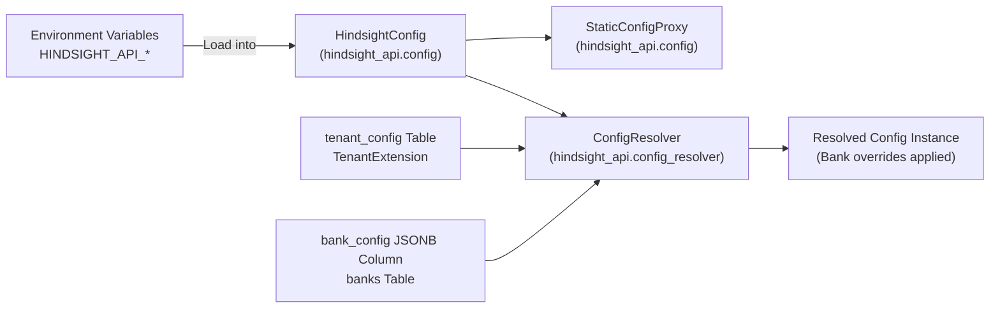
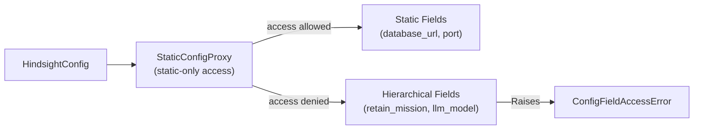
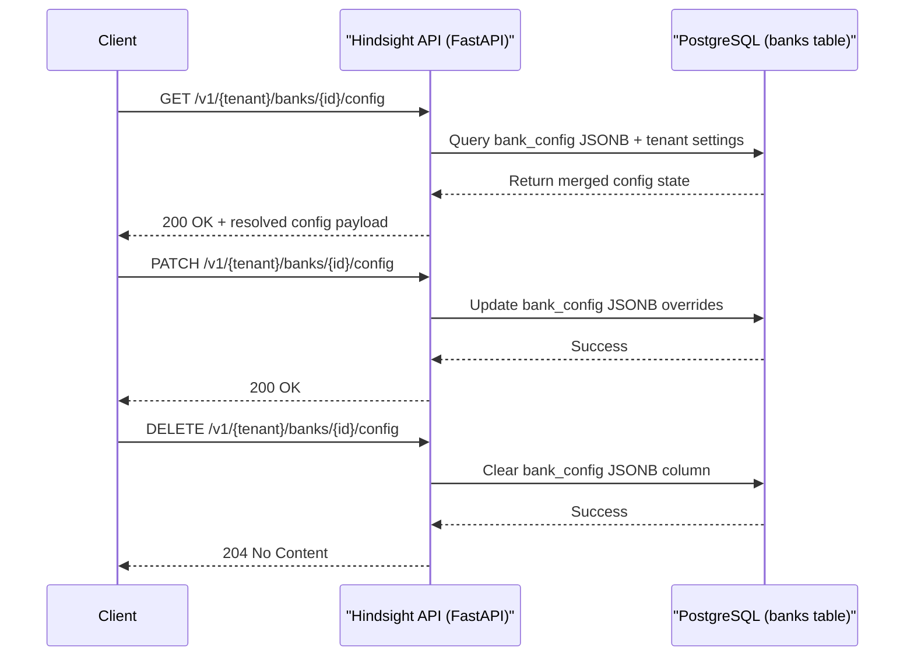

<!-- source: DeepWiki mcp.deepwiki.com · repo vectorize-io/hindsight · page 3.9 Configuration Hierarchy · fetched 2026-10-27 -->

# Configuration Hierarchy

<details>
<summary>Relevant source files</summary>

The following files were used as context for generating this wiki page:

- [.env.example](.env.example)
- [hindsight-api-slim/hindsight_api/config.py](hindsight-api-slim/hindsight_api/config.py)
- [hindsight-api-slim/hindsight_api/config_resolver.py](hindsight-api-slim/hindsight_api/config_resolver.py)
- [hindsight-api-slim/hindsight_api/engine/cross_encoder.py](hindsight-api-slim/hindsight_api/engine/cross_encoder.py)
- [hindsight-api-slim/hindsight_api/engine/embeddings.py](hindsight-api-slim/hindsight_api/engine/embeddings.py)
- [hindsight-api-slim/hindsight_api/engine/llm_wrapper.py](hindsight-api-slim/hindsight_api/engine/llm_wrapper.py)
- [hindsight-api-slim/hindsight_api/engine/memories/__init__.py](hindsight-api-slim/hindsight_api/engine/memories/__init__.py)
- [hindsight-api-slim/hindsight_api/engine/providers/litellm_llm.py](hindsight-api-slim/hindsight_api/engine/providers/litellm_llm.py)
- [hindsight-api-slim/hindsight_api/engine/providers/openai_compatible_llm.py](hindsight-api-slim/hindsight_api/engine/providers/openai_compatible_llm.py)
- [hindsight-api-slim/hindsight_api/engine/retain/attachment_store.py](hindsight-api-slim/hindsight_api/engine/retain/attachment_store.py)
- [hindsight-api-slim/hindsight_api/engine/storage/__init__.py](hindsight-api-slim/hindsight_api/engine/storage/__init__.py)
- [hindsight-api-slim/tests/test_attachment_lifecycle.py](hindsight-api-slim/tests/test_attachment_lifecycle.py)
- [hindsight-api-slim/tests/test_attachments_store_owned.py](hindsight-api-slim/tests/test_attachments_store_owned.py)
- [hindsight-api-slim/tests/test_bank_info_cache_invalidation.py](hindsight-api-slim/tests/test_bank_info_cache_invalidation.py)
- [hindsight-api-slim/tests/test_bank_templates.py](hindsight-api-slim/tests/test_bank_templates.py)
- [hindsight-api-slim/tests/test_hierarchical_config.py](hindsight-api-slim/tests/test_hierarchical_config.py)
- [hindsight-api-slim/tests/test_http_api_integration.py](hindsight-api-slim/tests/test_http_api_integration.py)
- [hindsight-api-slim/tests/test_litellm_sdk_embeddings.py](hindsight-api-slim/tests/test_litellm_sdk_embeddings.py)
- [hindsight-api-slim/tests/test_openai_compatible_response_hardening.py](hindsight-api-slim/tests/test_openai_compatible_response_hardening.py)
- [hindsight-api-slim/tests/test_retain_attachment_ingress.py](hindsight-api-slim/tests/test_retain_attachment_ingress.py)
- [hindsight-api-slim/tests/test_retain_multimodal_extraction.py](hindsight-api-slim/tests/test_retain_multimodal_extraction.py)
- [hindsight-clients/go/api_bank_templates.go](hindsight-clients/go/api_bank_templates.go)
- [hindsight-clients/go/model_bank_template_config.go](hindsight-clients/go/model_bank_template_config.go)
- [hindsight-clients/python/hindsight_client_api/api/bank_templates_api.py](hindsight-clients/python/hindsight_client_api/api/bank_templates_api.py)
- [hindsight-clients/python/hindsight_client_api/models/bank_template_config.py](hindsight-clients/python/hindsight_client_api/models/bank_template_config.py)
- [hindsight-docs/docs/developer/configuration.mdx](hindsight-docs/docs/developer/configuration.mdx)
- [hindsight-docs/docs/developer/models.mdx](hindsight-docs/docs/developer/models.mdx)
- [hindsight-docs/src/data/llmProviders.json](hindsight-docs/src/data/llmProviders.json)
- [hindsight-docs/static/bank-template-schema.json](hindsight-docs/static/bank-template-schema.json)
- [hindsight-embed/hindsight_embed/env.example](hindsight-embed/hindsight_embed/env.example)
- [hindsight-system-tests/tests/test_93_attachments.py](hindsight-system-tests/tests/test_93_attachments.py)
- [skills/hindsight-docs/references/developer/configuration.md](skills/hindsight-docs/references/developer/configuration.md)
- [skills/hindsight-docs/references/developer/models.md](skills/hindsight-docs/references/developer/models.md)
- [skills/hindsight-docs/references/faq.md](skills/hindsight-docs/references/faq.md)

</details>


## Purpose and Scope

This page documents Hindsight's three-tier configuration system, which allows operational settings to be overridden at the **system** (environment variables), **tenant** (per-organization), and **bank** (per-memory-bank) levels. This architecture enables multi-tenant deployments where different banks can use different LLM providers, extraction missions, and disposition traits without requiring code changes or server restarts.

For a complete reference of available environment variables, see the configuration reference `[skills/hindsight-docs/references/developer/configuration.md:1-29]`. For details on how tenants are isolated, see section 3.6.

---

## Configuration Architecture Overview

Hindsight’s configuration system distinguishes between **static** infrastructure settings and **hierarchical** operational settings. This distinction is enforced by the `StaticConfigProxy` class `[hindsight-api-slim/hindsight_api/config.py:62-91]`, which prevents developers from accidentally accessing bank-configurable (hierarchical) fields from the global config context, thus avoiding silent use of defaults when bank overrides exist.

### Configuration Tiers

| Tier | Storage | Scope | Precedence Priority |
|---|---|---|---|
| **System** | Environment variables (`.env` or process env) | Global server-wide | 3 (Lowest) |
| **Tenant** | `tenant_config` table (accessed via `TenantExtension`) | Per-organization | 2 |
| **Bank** | JSONB `bank_config` column in `banks` table | Per-memory-bank isolation | 1 (Highest) |

Static configuration fields remain fixed at the system level, while hierarchical fields can be overridden per tenant or bank.



**Title:** Configuration Resolution Architecture — Mapping System Components to `HindsightConfig`, `StaticConfigProxy`, and `ConfigResolver`

Sources:  
`[hindsight-api-slim/hindsight_api/config.py:61-112]()`  
`[hindsight-api-slim/hindsight_api/config_resolver.py:1-174]()`

---

## Hierarchical vs Static Fields

`HindsightConfig` marks config fields using two decorator helpers to differentiate override behavior `[hindsight-api-slim/hindsight_api/config.py:93-112]`:

- `hierarchical(default_value)`: Marks fields that are **bank-configurable**, allowing per-tenant and per-bank overrides stored in the database `[hindsight-api-slim/hindsight_api/config.py:94-101]`.  
  Examples include: retain missions, retrieval settings, and token limits.
  
- `static(default_value)`: Marks fields that are **static and global**, affecting the whole server and cannot be overridden in tenants or banks `[hindsight-api-slim/hindsight_api/config.py:103-112]`.  
  Examples: database connection URLs, port bindings, and worker concurrency parameters.

The `StaticConfigProxy` raises a `ConfigFieldAccessError` when any hierarchical field is accessed from global config directly `[hindsight-api-slim/hindsight_api/config.py:56-90]`.

Sources:  
`[hindsight-api-slim/hindsight_api/config.py:55-111]()`

---

## Configuration Resolution Flow and Logic

The `ConfigResolver` class is responsible for resolving the full merged configuration for a given bank and request context. It follows a strict priority cascade:

1. **System Config**: Base defaults loaded from environment variables and server settings (`HindsightConfig`).
2. **Tenant Configuration**: Overrides fetched from a per-tenant configuration source via the `TenantExtension` interface.
3. **Bank Configuration**: JSON overrides stored in the `bank_config` field of the `banks` table.

Resolution calls follow this pattern:

```python
resolved_config = ConfigResolver.resolve_full_config(bank_id, request_context)
```

- Loads bank-specific config JSON from the database.
- Merges with tenant-level config if available.
- Fills absent fields from system config (`HindsightConfig`).
- Returns a fully resolved, typed config instance with hierarchical fields set.

Sources:  
`[hindsight-api-slim/hindsight_api/config_resolver.py:1-174]()`

---

## StaticConfigProxy

To avoid accidental leakage of hierarchical config into global code paths, `StaticConfigProxy` wraps `HindsightConfig` and only allows access to static fields `[hindsight-api-slim/hindsight_api/config.py:62-91]`.

Attempting to access a hierarchical field from `StaticConfigProxy` causes a `ConfigFieldAccessError` with a descriptive message guiding developers to use `ConfigResolver` for bank-specific settings `[hindsight-api-slim/hindsight_api/config.py:74-88]`.



**Title:** `StaticConfigProxy` Access Guard — Differentiating Static Fields from Hierarchical Fields

Sources:  
`[hindsight-api-slim/hindsight_api/config.py:61-90]()`

---

## Bank Templates

Bank templates allow operators to define reusable sets of hierarchical configuration fields for quick replication of commonly used bank configurations.

These templates bundle:
- Mission statements (retain and reflect)
- LLM parameters and model selectors
- Retrieval tuning strategies
- Disposition traits (e.g., skepticism, empathy)

Templates can be applied when creating banks via the API or CLI, enabling rapid provisioning with desired behaviors.

Sources:  
`[hindsight-api-slim/hindsight_api/engine/interface.py]()`  

---

## Environment Variable Precedence and Naming

All environment variables for the API service start with the prefix `HINDSIGHT_API_*` `[skills/hindsight-docs/references/developer/configuration.md:10-15]`. Variables define global system-level config which serve as base defaults.

Examples of per-operation environment variables:
- `HINDSIGHT_API_RETAIN_LLM_MODEL` `[.env.example:1-40]()`
- `HINDSIGHT_API_REFLECT_LLM_MODEL` `[.env.example:1-40]()`
- `HINDSIGHT_API_CONSOLIDATION_LLM_MODEL` `[.env.example:1-40]()`

If per-operation variables are missing, the fallback is `HINDSIGHT_API_LLM_MODEL`.

To maximize developer ergonomics, environment keys are normalized when read into Python dataclasses `[hindsight-api-slim/hindsight_api/config.py:114-149]`:
- Stripped of prefix if present
- Converted to lowercase snake_case for uniform access in the codebase

Sources:  
`[hindsight-api-slim/hindsight_api/config.py:114-149]()`  
`[.env.example:1-85]()`  
`[skills/hindsight-docs/references/developer/configuration.md:14-29]()`

---

## Bank Configuration API

Bank-specific overrides for hierarchical fields are managed through the `/config` sub-resource on the Bank API.

| Method | Endpoint | Purpose |
|---|---|---|
| `GET` | `/v1/{tenant}/banks/{id}/config` | Returns the fully resolved bank config and explicit overrides |
| `PATCH` | `/v1/{tenant}/banks/{id}/config` | Partially update one or more hierarchical config fields |
| `DELETE` | `/v1/{tenant}/banks/{id}/config` | Clear all bank-specific overrides, reverting to tenant/system defaults |

This API enables runtime modification and inspection of bank behavior without restarts or code changes.



**Title:** Bank Configuration API Request Flow — Interacting with the `/config` Sub-Resource via FastAPI

Sources:  
`[hindsight-api-slim/tests/test_http_api_integration.py:107-180]()`  
`[skills/hindsight-docs/references/developer/configuration.md:1-25]()`

---

## Per-Operation LLM Configuration and Concurrency Management

Hindsight supports configuring different LLM models for each core operation (`retain`, `reflect`, `consolidation`) with environment variables like `HINDSIGHT_API_RETAIN_LLM_MODEL`.

Concurrency limits for LLM calls use global and per-operation semaphores implemented via `CrossLoopSemaphore` `[hindsight-api-slim/hindsight_api/engine/llm_wrapper.py:59-106]`:

- `_global_llm_semaphore`: Limits total concurrent LLM calls for the process `[hindsight-api-slim/hindsight_api/engine/llm_wrapper.py:67-68]`.
- Per-operation semaphores (configurable via `HINDSIGHT_API_<OPERATION>_LLM_MAX_CONCURRENT`) to allocate slots for background or interactive operations separately `[hindsight-api-slim/hindsight_api/engine/llm_wrapper.py:71-102]`.

Sources:  
`[hindsight-api-slim/hindsight_api/engine/llm_wrapper.py:58-149]()`  
`[.env.example:1-123]()`

---

## Summary

Hindsight provides a robust hierarchical configuration system enabling multi-tenant flexibility and per-bank customization. Key architectural points:
- Configuration fields are strictly classified as **static** or **hierarchical** `[hindsight-api-slim/hindsight_api/config.py:93-112]`.
- Configuration is resolved via `ConfigResolver` merging environment variables, tenant configs, and bank overrides.
- `StaticConfigProxy` protects accidental misuse of hierarchical fields in global config contexts `[hindsight-api-slim/hindsight_api/config.py:62-90]`.
- Bank templates simplify provisioning of banks with common configuration profiles.
- The bank config API provides runtime patching and retrieval of per-bank settings.

Sources:  
- `[hindsight-api-slim/hindsight_api/config.py:1-170]()`  
- `[hindsight-api-slim/hindsight_api/config_resolver.py:1-174]()`  
- `[skills/hindsight-docs/references/developer/configuration.md:1-98]()`

---

