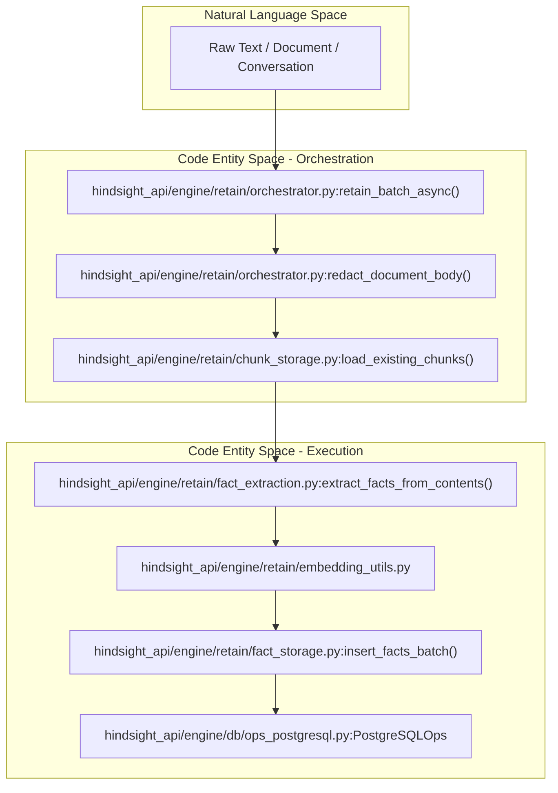
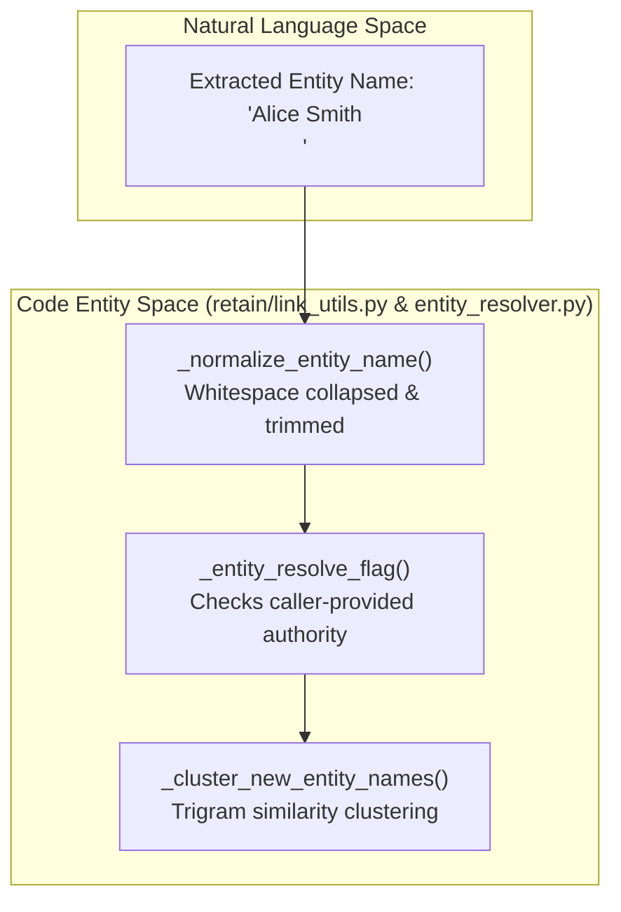

<!-- source: DeepWiki mcp.deepwiki.com · repo vectorize-io/hindsight · page 4.1 Retain - Storing Memories · fetched 2026-10-27 -->

# Retain - Storing Memories

Relevant source files

The following files were used as context for generating this wiki page:

- [hindsight-api-slim/hindsight_api/engine/chunk_ids.py](hindsight-api-slim/hindsight_api/engine/chunk_ids.py)
- [hindsight-api-slim/hindsight_api/engine/db/ops.py](hindsight-api-slim/hindsight_api/engine/db/ops.py)
- [hindsight-api-slim/hindsight_api/engine/db/ops_oracle.py](hindsight-api-slim/hindsight_api/engine/db/ops_oracle.py)
- [hindsight-api-slim/hindsight_api/engine/db/ops_postgresql.py](hindsight-api-slim/hindsight_api/engine/db/ops_postgresql.py)
- [hindsight-api-slim/hindsight_api/engine/graph_maintenance.py](hindsight-api-slim/hindsight_api/engine/graph_maintenance.py)
- [hindsight-api-slim/hindsight_api/engine/memories/pg/graph.py](hindsight-api-slim/hindsight_api/engine/memories/pg/graph.py)
- [hindsight-api-slim/hindsight_api/engine/retain/bank_utils.py](hindsight-api-slim/hindsight_api/engine/retain/bank_utils.py)
- [hindsight-api-slim/hindsight_api/engine/retain/chunk_storage.py](hindsight-api-slim/hindsight_api/engine/retain/chunk_storage.py)
- [hindsight-api-slim/hindsight_api/engine/retain/fact_extraction.py](hindsight-api-slim/hindsight_api/engine/retain/fact_extraction.py)
- [hindsight-api-slim/hindsight_api/engine/retain/fact_storage.py](hindsight-api-slim/hindsight_api/engine/retain/fact_storage.py)
- [hindsight-api-slim/hindsight_api/engine/retain/orchestrator.py](hindsight-api-slim/hindsight_api/engine/retain/orchestrator.py)
- [hindsight-api-slim/hindsight_api/engine/retain/types.py](hindsight-api-slim/hindsight_api/engine/retain/types.py)
- [hindsight-api-slim/tests/consolidation_actions.py](hindsight-api-slim/tests/consolidation_actions.py)
- [hindsight-api-slim/tests/test_batch_api.py](hindsight-api-slim/tests/test_batch_api.py)
- [hindsight-api-slim/tests/test_batch_api_integration.py](hindsight-api-slim/tests/test_batch_api_integration.py)
- [hindsight-api-slim/tests/test_batch_api_validation.py](hindsight-api-slim/tests/test_batch_api_validation.py)
- [hindsight-api-slim/tests/test_causal_relation_offsets.py](hindsight-api-slim/tests/test_causal_relation_offsets.py)
- [hindsight-api-slim/tests/test_chunk_id_legacy_documents.py](hindsight-api-slim/tests/test_chunk_id_legacy_documents.py)
- [hindsight-api-slim/tests/test_chunk_ids.py](hindsight-api-slim/tests/test_chunk_ids.py)
- [hindsight-api-slim/tests/test_chunk_storage_delete_ordering.py](hindsight-api-slim/tests/test_chunk_storage_delete_ordering.py)
- [hindsight-api-slim/tests/test_consolidation_batch_atomicity.py](hindsight-api-slim/tests/test_consolidation_batch_atomicity.py)
- [hindsight-api-slim/tests/test_consolidation_temporal_merge.py](hindsight-api-slim/tests/test_consolidation_temporal_merge.py)
- [hindsight-api-slim/tests/test_delta_retain.py](hindsight-api-slim/tests/test_delta_retain.py)
- [hindsight-api-slim/tests/test_document_body_accumulation.py](hindsight-api-slim/tests/test_document_body_accumulation.py)
- [hindsight-api-slim/tests/test_ensure_bank_exists_optimization.py](hindsight-api-slim/tests/test_ensure_bank_exists_optimization.py)
- [hindsight-api-slim/tests/test_experience_fact_type_passthrough.py](hindsight-api-slim/tests/test_experience_fact_type_passthrough.py)
- [hindsight-api-slim/tests/test_fact_extraction_retry.py](hindsight-api-slim/tests/test_fact_extraction_retry.py)
- [hindsight-api-slim/tests/test_fireworks_batch_integration.py](hindsight-api-slim/tests/test_fireworks_batch_integration.py)
- [hindsight-api-slim/tests/test_fk_violation_is_retryable.py](hindsight-api-slim/tests/test_fk_violation_is_retryable.py)
- [hindsight-api-slim/tests/test_full_recall_temporal_window.py](hindsight-api-slim/tests/test_full_recall_temporal_window.py)
- [hindsight-api-slim/tests/test_gemini_batch_integration.py](hindsight-api-slim/tests/test_gemini_batch_integration.py)
- [hindsight-api-slim/tests/test_graph_maintenance.py](hindsight-api-slim/tests/test_graph_maintenance.py)
- [hindsight-api-slim/tests/test_graph_maintenance_queue_race.py](hindsight-api-slim/tests/test_graph_maintenance_queue_race.py)
- [hindsight-api-slim/tests/test_graph_maintenance_submit_dedup.py](hindsight-api-slim/tests/test_graph_maintenance_submit_dedup.py)
- [hindsight-api-slim/tests/test_integrity_violation_not_retried.py](hindsight-api-slim/tests/test_integrity_violation_not_retried.py)
- [hindsight-api-slim/tests/test_list_banks_non_sql_store.py](hindsight-api-slim/tests/test_list_banks_non_sql_store.py)
- [hindsight-api-slim/tests/test_llm_strict_schema.py](hindsight-api-slim/tests/test_llm_strict_schema.py)
- [hindsight-api-slim/tests/test_load_large_batch.py](hindsight-api-slim/tests/test_load_large_batch.py)
- [hindsight-api-slim/tests/test_multi_llm_batch.py](hindsight-api-slim/tests/test_multi_llm_batch.py)
- [hindsight-api-slim/tests/test_reflect_tracing.py](hindsight-api-slim/tests/test_reflect_tracing.py)
- [hindsight-api-slim/tests/test_retain.py](hindsight-api-slim/tests/test_retain.py)
- [hindsight-api-slim/tests/test_retain_pipeline_cancellation.py](hindsight-api-slim/tests/test_retain_pipeline_cancellation.py)
- [hindsight-api-slim/tests/test_retain_store_owned_no_connection.py](hindsight-api-slim/tests/test_retain_store_owned_no_connection.py)
- [hindsight-api-slim/tests/test_store_owned_retain_parity.py](hindsight-api-slim/tests/test_store_owned_retain_parity.py)
- [hindsight-clients/go/model_create_bank_alias_request.go](hindsight-clients/go/model_create_bank_alias_request.go)
- [hindsight-clients/python/hindsight_client_api/models/create_bank_alias_request.py](hindsight-clients/python/hindsight_client_api/models/create_bank_alias_request.py)
- [hindsight-system-tests/tests/test_50_banks_and_config.py](hindsight-system-tests/tests/test_50_banks_and_config.py)

## Purpose and Scope

This page documents the **retain pipeline**, the core ingestion engine of Hindsight. Retain transforms unstructured content—text, files, or conversation JSON—into structured, searchable memories. Unlike simple vector databases that store raw chunks, Hindsight's retain process intelligently analyzes content to extract meaningful facts, identify entities, and build a connected knowledge graph [hindsight-api-slim/hindsight_api/engine/retain/orchestrator.py:1-5]().

The pipeline is designed to be **idempotent** through `document_id` tracking and supports high-throughput batching with automatic sub-batching for large datasets [hindsight-api-slim/hindsight_api/engine/retain/orchestrator.py:100-136]().

---

## Retain Pipeline Architecture

The retain operation is orchestrated by `orchestrator.py`, which coordinates specialized modules. The pipeline is split into phases to optimize performance and prevent database lock contention during expensive LLM or vector operations [hindsight-api-slim/hindsight_api/engine/retain/orchestrator.py:1-12]().

### Pipeline Flow: Natural Language to Code Entity Space

**Sources:** [hindsight-api-slim/hindsight_api/engine/retain/orchestrator.py:1-12](), [hindsight-api-slim/hindsight_api/engine/retain/fact_extraction.py:1-10](), [hindsight-api-slim/hindsight_api/engine/retain/fact_storage.py:65-102](), [hindsight-api-slim/hindsight_api/engine/db/ops_postgresql.py:62-78]()

---

## Content Input, Chunking, and Memory Defense

### Content and Context

The retain API accepts content input conforming to the `RetainContentDict` type, which includes:

- **content:** Raw string content or JSON document to process [hindsight-api-slim/hindsight_api/engine/retain/types.py:112-116]()
- **context:** Optional situational labels guiding extraction [hindsight-api-slim/hindsight_api/engine/retain/types.py:117]()
- **event_date:** Datetime anchoring temporal references [hindsight-api-slim/hindsight_api/engine/retain/types.py:118]()
- **metadata:** Optional string-to-string key-value pairs with null values dropped [hindsight-api-slim/hindsight_api/engine/retain/types.py:119]() and [hindsight-api-slim/hindsight_api/metadata_utils.py]()
- **update_mode:** Controls if content replaces or appends when a document ID exists, values "replace" (default) or "append" [hindsight-api-slim/hindsight_api/engine/retain/types.py:133-138]()

### Chunking and Document Bodies

- **JSON conversation merges:** Conversations encoded as JSON arrays are merged safely across append operations via `merge_json_array_parts()` to prevent serialization corruption [hindsight-api-slim/hindsight_api/engine/retain/orchestrator.py:145-163]()
- **Plain text documents:** Joined via `join_document_parts()` for replacement and append modes [hindsight-api-slim/hindsight_api/engine/retain/orchestrator.py:165-168]()

### Memory Defense Integration

Before processing or persistence, raw document bodies are passed through the Memory Defense pipeline to redact or block content violating security policies defined per bank. This is implemented in `redact_document_body()` which applies redactions or raises a `MemoryDefenseAllBlockedError` if the entire batch is blocked [hindsight-api-slim/hindsight_api/engine/retain/orchestrator.py:177-189](). This ensures sensitive data is not stored.

**Sources:** [hindsight-api-slim/hindsight_api/engine/retain/orchestrator.py:45-189](), [hindsight-api-slim/hindsight_api/engine/retain/types.py:112-138]()

---

## Fact Extraction

Hindsight decomposes unstructured text into atomic **Memory Units** via `fact_extraction.py`.

### Fact Model and Temporal Inferences

Extracted facts adhere to the `Fact` Pydantic model:

- **fact:** Combined fact text encapsulating what happened, when, where, who, and why [hindsight-api-slim/hindsight_api/engine/retain/fact_extraction.py:178-179]()
- **fact_type:** Either `"world"` or `"experience"`, reflecting the perspective [hindsight-api-slim/hindsight_api/engine/retain/fact_extraction.py:180]()
- **Temporal fields:** Optionally extracted start/end datetimes [hindsight-api-slim/hindsight_api/engine/retain/fact_extraction.py:182-183]()
- **Entity list:** Extracted entities associated with the fact, normalized [hindsight-api-slim/hindsight_api/engine/retain/fact_extraction.py:191]()

Temporal references missing from the LLM output are inferred via `_infer_temporal_date()`, mapping phrases like "last night", "yesterday", or "next week" to absolute ISO datetime strings using the anchor `event_date` [hindsight-api-slim/hindsight_api/engine/retain/fact_extraction.py:97-132]().

### Extraction Resilience and Auto-Split

Because large chunks can trigger LLM output length errors, the pipeline supports recursive chunk splitting with `_split_chunk_for_output_retry()` preserving JSON array boundaries to avoid malformed output during retries. Very small sub-chunks below a minimum floor are dropped to prevent infinite recursion.

Batch API integration is supported for high throughput fact extraction, using async polling to retrieve batch results and allowing crash recovery [hindsight-api-slim/tests/test_fact_extraction_retry.py:22-106](), [hindsight-api-slim/tests/test_batch_api.py:90-117]().

**Sources:** [hindsight-api-slim/hindsight_api/engine/retain/fact_extraction.py:97-192](), [hindsight-api-slim/tests/test_fact_extraction_retry.py:22-106](), [hindsight-api-slim/tests/test_batch_api.py:90-117]()

---

## Entity Resolution

Entity mentions extracted by the facts undergo normalization and deduplication with trigram similarity clustering to unify variants and aliases. This ensures graph coherence.

### Entity Resolution: Natural Language to Code Mapping

**Sources:** [hindsight-api-slim/hindsight_api/engine/retain/link_utils.py:32-72](), [hindsight-api-slim/hindsight_api/engine/entity_resolver.py:61-112]()

---

## Embedding Generation and Packing

Memory units include vector embeddings generated by configured embedding providers. These vectors are stored efficiently:

- Embeddings are packed into native `array("f")` for lower heap overhead and contiguous memory layout, achieving up to 7.6x memory savings compared to Python lists [hindsight-api-slim/hindsight_api/engine/retain/types.py:20-30]().
- For Postgres (pgvector), embeddings are serialized as string literals (`'[0.1,0.2,...]'`) with `%.9g` formatting to preserve exact bit patterns tied to float32 representation [hindsight-api-slim/hindsight_api/engine/retain/types.py:64-110]().

**Sources:** [hindsight-api-slim/hindsight_api/engine/retain/types.py:20-110]()

---

## Fact Storage, Append/Delta Modes, and Fold Coalescing

Fact persistence is abstracted through the `MemoriesExtension` interface. The default implementation `PostgresMemories` inserts rows into the core tables but other store implementations can be plugged in [hindsight-api-slim/hindsight_api/engine/memories/base.py:1-129]().

### Append and Delta Operations

- **Replace mode (default):** When a retain call includes a `document_id` and uses `"replace"` mode, the existing document bodies, chunks, memory units, and related links are deleted and replaced atomically to maintain correctness [hindsight-api-slim/hindsight_api/engine/retain/fact_storage.py:187-220](), [hindsight-api-slim/hindsight_api/engine/retain/chunk_storage.py:115-166]().
- **Append mode:** Instead of deleting, the incoming content is appended to existing document text (via `append_document_body()`), and retain processes only the delta increment, preserving prior facts. This suits conversation turns or streaming additions [hindsight-api-slim/hindsight_api/engine/retain/orchestrator.py:171-182]().

### Fold Coalescing

Fact folding groups semantically related facts during consolidation to reduce noise and improve recall relevance. This involves marking facts as folded or aggregated, and fold state is maintained by consolidation jobs outside retain but respected by it.

**Sources:** [hindsight-api-slim/hindsight_api/engine/db/ops.py:1-17](), [hindsight-api-slim/hindsight_api/engine/retain/fact_storage.py:187-220](), [hindsight-api-slim/hindsight_api/engine/retain/chunk_storage.py:115-166](), [hindsight-api-slim/hindsight_api/engine/retain/orchestrator.py:171-182]()

---

## Link Creation and Graph Maintenance

To enable multi-strategy retrieval, retain creates various inter-memory links:

- **Temporal links:** Connect facts within defined temporal windows calculated by `_within_batch_temporal_links()` and capped per unit with `_cap_links_per_unit()` to minimize write amplification and deadlocks [hindsight-api-slim/hindsight_api/engine/retain/link_utils.py:86-139]().
- **Semantic links:** During Phase 2, cosine similarity between embeddings is computed with NumPy to build dense vector links, avoiding expensive and lock-prone k-NN index calls [hindsight-api-slim/tests/test_link_utils.py:107-137](), facilitating efficient event graph construction.
- **Deadlock prevention:** Links are inserted respecting a canonical sorted order (`_lock_order_key`) to serialize concurrent inserts on commonly contended indexes, avoiding PostgreSQL deadlocks [hindsight-api-slim/hindsight_api/engine/retain/link_utils.py:94-112]().

Entity co-occurrence and causal relation edges are also maintained, feeding graph-based recall strategies.

**Sources:** [hindsight-api-slim/hindsight_api/engine/retain/link_utils.py:86-139](), [hindsight-api-slim/tests/test_link_utils.py:107-137]()

---

## Async Consolidation and Stale Observations

- When facts are replaced or removed, **stale observations** derived from those facts are deleted to keep mental models and aggregation consistent [hindsight-api-slim/hindsight_api/engine/retain/fact_storage.py:146-184]().
- Graph maintenance queues track orphaned entities and facts to prune or relink them asynchronously [hindsight-api-slim/hindsight_api/engine/retain/chunk_storage.py:145-164]().

This decoupling ensures high throughput retain operations without blocking on expensive graph cleanup or consolidation jobs.

**Sources:** [hindsight-api-slim/hindsight_api/engine/retain/fact_storage.py:146-184](), [hindsight-api-slim/hindsight_api/engine/retain/chunk_storage.py:145-164]()

---

# Summary

The retain pipeline is a robust, modular system that ingests documents or conversations, applies security redactions, chunks content, extracts structured facts with rich temporal and entity information using LLMs, generates embeddings, and persists facts with careful concurrency and graph maintenance considerations. Its append and delta modes support both snapshot and streaming content workflows. By bridging natural language input to structured, richly-linked memory units, retain underpins Hindsight's intelligent long-term memory capabilities.

# Additional Diagrams

### Natural Language Space to Retain Orchestration and Fact Extraction

```mermaid
graph LR
    DocText["Raw document text or conversation JSON"]
    BankConfig["Bank configuration (disposition, mission, defense policies)"]
    RetainOrch["retain/orchestrator.py:retain_batch_async()"]
    MemoryDefense["retain/orchestrator.py:redact_document_body()"]
    ChunkHandler["retain/chunk_storage.py:load_existing_chunks() / chunk_documents()"]
    FactExtractor["retain/fact_extraction.py:extract_facts_from_contents()"]
    EmbeddingsGen["retain/embedding_utils.py:embedding generation and packing"]
    FactStorage["retain/fact_storage.py:insert_facts_batch()"]
    StoreOps["engine/db/ops_postgresql.py:PostgreSQLOps / OracleOps, memories interface"]
    
    DocText --> RetainOrch
    BankConfig --> RetainOrch
    RetainOrch --> MemoryDefense
    MemoryDefense --> ChunkHandler
    ChunkHandler --> FactExtractor
    FactExtractor --> EmbeddingsGen
    EmbeddingsGen --> FactStorage
    FactStorage --> StoreOps
```

### Entity Normalization and Resolution Workflow

**Sources:** [hindsight-api-slim/hindsight_api/engine/retain/orchestrator.py:1-189](), [hindsight-api-slim/hindsight_api/engine/retain/fact_extraction.py:1-192](), [hindsight-api-slim/hindsight_api/engine/retain/fact_storage.py:1-193](), [hindsight-api-slim/hindsight_api/engine/retain/link_utils.py:1-150](), [hindsight-api-slim/hindsight_api/engine/entity_resolver.py:1-150](), [hindsight-api-slim/hindsight_api/engine/memories/base.py:1-129]()

---

