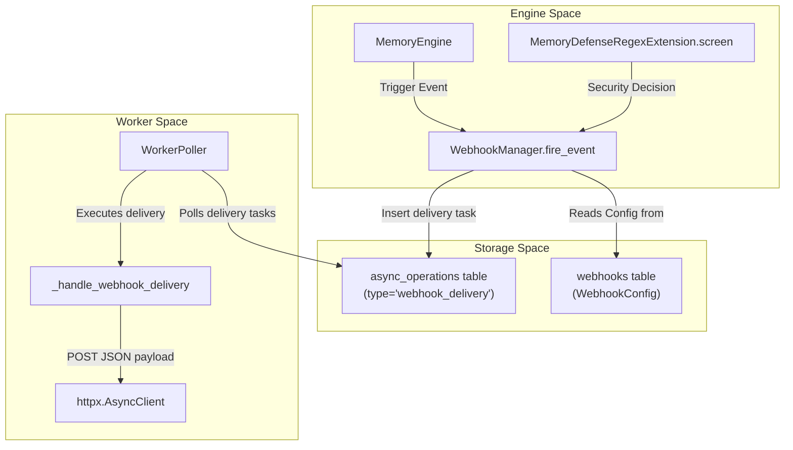
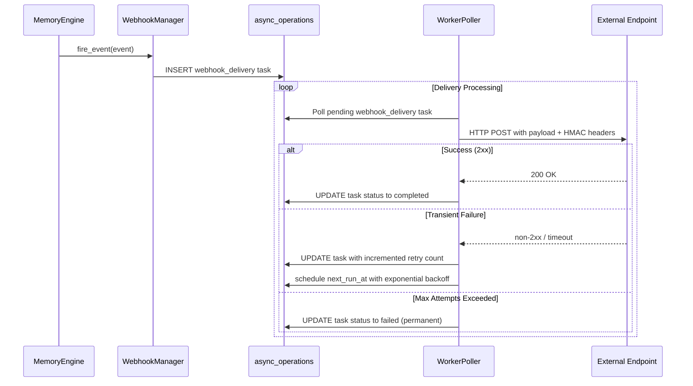

<!-- source: DeepWiki mcp.deepwiki.com · repo vectorize-io/hindsight · page 4.11 Webhooks and Event Notifications · fetched 2026-10-27 -->

# Webhooks and Event Notifications

<details>
<summary>Relevant source files</summary>

The following files were used as context for generating this wiki page:

- [hindsight-api-slim/hindsight_api/webhooks/manager.py](hindsight-api-slim/hindsight_api/webhooks/manager.py)
- [hindsight-api-slim/hindsight_api/webhooks/models.py](hindsight-api-slim/hindsight_api/webhooks/models.py)
- [hindsight-api-slim/tests/test_webhooks.py](hindsight-api-slim/tests/test_webhooks.py)
- [hindsight-clients/go/model_webhook_delivery_response.go](hindsight-clients/go/model_webhook_delivery_response.go)
- [hindsight-clients/python/hindsight_client_api/models/webhook_delivery_response.py](hindsight-clients/python/hindsight_client_api/models/webhook_delivery_response.py)
- [hindsight-docs/docs/developer/api/webhooks.mdx](hindsight-docs/docs/developer/api/webhooks.mdx)
- [skills/hindsight-docs/references/developer/api/webhooks.md](skills/hindsight-docs/references/developer/api/webhooks.md)

</details>


This document details Hindsight's webhook system for real-time event notifications. Webhooks enable external systems to react to memory operations (`retain`, `consolidation`, and security events) without polling the API.

---

## Overview and Core Principles

Hindsight fires webhook events when memory operations complete or specific security triggers occur. Webhooks are registered per memory bank and deliver JSON payloads to HTTP endpoints. The system guarantees at-least-once delivery using a transactional outbox pattern, ensuring reliability even during server restarts.

**Key technical characteristics:**

- **Atomic Persistence**: Events are inserted into the database within the same transaction as the primary memory operation (`fire_event_with_conn`), ensuring the outbox is always consistent with system state. This is critical for durable event delivery without loss or duplication [hindsight-api-slim/hindsight_api/webhooks/manager.py:158-163](), [hindsight-api-slim/tests/test_webhooks.py:76-151]().

- **Reliable Delivery**: Failed delivery attempts are retried with exponential backoff according to a predefined delay schedule: `[5, 300, 1800, 7200, 18000]` seconds (seconds represent 5s, 5m, 30m, 2h, 5h respectively). After 6 failed attempts (1 initial + 5 retries), the delivery is marked as permanently failed [hindsight-api-slim/hindsight_api/webhooks/manager.py:20-24]().

- **HMAC Signing**: To guarantee payload authenticity, webhook payloads are signed using SHA-256 HMAC with the configured secret. There are two signature headers supported: 
  - `X-Hindsight-Signature` & `X-Hub-Signature-256` (identical body-only signatures);
  - `X-Hindsight-Signature-V2` (timestamped signature to enable replay protection) [hindsight-api-slim/hindsight_api/webhooks/manager.py:54-75](). 

- **Asynchronous Processing with Outbox Pattern**: Webhook delivery tasks are recorded in the `async_operations` table in the same transaction as the primary event. A background worker polls these tasks and performs HTTP POST delivery with automatic retries on failure. This decouples delivery from primary API latency [hindsight-api-slim/hindsight_api/webhooks/manager.py:35-42]().

Sources: [hindsight-api-slim/hindsight_api/webhooks/manager.py:20-24](), [hindsight-api-slim/hindsight_api/webhooks/manager.py:35-42](), [hindsight-api-slim/hindsight_api/webhooks/manager.py:54-75](), [hindsight-api-slim/hindsight_api/webhooks/manager.py:158-163](), [hindsight-api-slim/tests/test_webhooks.py:76-151]()

---

## System Architecture and Data Flow

The webhook system spans three logical spaces: the memory engine triggers events, the storage layer persists webhook configurations and delivery tasks, and the background worker service performs HTTP delivery.



1. **MemoryEngine** or extensions like **MemoryDefenseRegexExtension** detect events or security triggers.
2. These components call **WebhookManager.fire_event**, which loads webhook configurations (`webhooks`) and inserts webhook delivery tasks into `async_operations` inside a single transaction.
3. The **WorkerPoller** service regularly polls `async_operations` for pending webhook delivery tasks.
4. Upon picking up a task, **_handle_webhook_delivery** attempts to POST to the configured endpoint using `httpx.AsyncClient`, applying HMAC signatures where a secret was configured.
5. Failed deliveries are updated with retry counts and rescheduled according to retry delays; once maximum attempts are exceeded, the task is marked failed.

Sources: [hindsight-api-slim/hindsight_api/webhooks/manager.py:35-102]()

---

## Event Types and Data Models

Webhooks support multiple event types, modeled as `WebhookEventType` and detailed by corresponding Pydantic data models [hindsight-api-slim/hindsight_api/webhooks/models.py:9-83]():

| Event Type                  | Description                                                                                     | Data Model                | Key Fields                                                                                                                                                                  |
|-----------------------------|-------------------------------------------------------------------------------------------------|---------------------------|----------------------------------------------------------------------------------------------------------------------------------------------------------------------------|
| `retain.completed`           | Fired once per document when a retain operation completes (sync or async).                      | `RetainEventData`         | `document_id` (optional), `tags` (optional list of strings), `memory_unit_count` (int or null; 0 indicates fact extraction returned no memories)                             |
| `consolidation.completed`   | Fired after the consolidation engine synthesizes new observations for a bank.                   | `ConsolidationEventData`  | Counts of `observations_created`, `observations_updated`, `observations_deleted` (all int or null), `error_message` (optional string for failures)                          |
| `memory_defense.triggered`  | Generated when the Memory Defense policy triggers on retained content (redact or block action). | `MemoryDefenseEventData`  | `action` ("redact" or "block"), `detector` (string), `document_id` (optional), `matched_types` (list of pattern labels), `message` (string), optional SIEM fields like `hits` |

### Pydantic Models Summary

- **`WebhookEvent`**: Root event model encapsulating the event type, bank id, unique operation id, status, timestamp, and typed `data` payload.
- **Typed `data` payloads**:
  - `ConsolidationEventData`
  - `RetainEventData`
  - `MemoryDefenseEventData` (includes `MemoryDefenseHit` per matched secret or PII)

These models define the exact JSON shape delivered to endpoint URLs on webhook invocation.

Sources: [hindsight-api-slim/hindsight_api/webhooks/models.py:9-83]()

---

## Configuration and Management

Webhooks are configured either globally (via environment variables on server startup) or per-bank (persisted in the `webhooks` database table). The `WebhookManager` class consolidates these sources when dispatching events.

### WebhookConfig Model

The configuration model `WebhookConfig` defines the subscription details:

| Field       | Description                                                |
|-------------|------------------------------------------------------------|
| `id`        | Unique webhook configuration ID (string)                  |
| `bank_id`   | Memory bank ID (nullable, `null` for global webhooks)     |
| `url`       | Target HTTP endpoint URL receiving webhook POSTs          |
| `secret`    | Optional shared secret used to sign requests (HMAC)       |
| `event_types` | List of webhook event strings to subscribe (e.g. `"retain.completed"`) |
| `enabled`   | Boolean toggle flag for activation                         |
| `http_config` | Custom HTTP options such as method (POST), headers, and timeout (default 30s) |

### Webhook Management

- Webhook configurations can be created, read, updated, and deleted via REST API or control plane UI.
- For each event type, multiple webhooks may be registered.
- The system filters enabled webhooks whose `event_types` include the fired event.
- HTTP config allows customization like additional headers or query parameters, but does **not** permit overriding security headers (`X-Hindsight-Signature`).

Sources: [hindsight-api-slim/hindsight_api/webhooks/models.py:85-101](), [hindsight-api-slim/hindsight_api/webhooks/manager.py:35-53]()

---

## Delivery Lifecycle and Retry Execution

Webhook delivery is managed asynchronously using the outbox pattern integrated with the `async_operations` table. Below is the sequence outlining task creation, polling, delivery attempts, and retry logic:



### Retry Schedule Constants

- Retry delays defined as:

| Attempt           | Delay after failure    |
|-------------------|-----------------------|
| 1 (initial)       | 0 (immediate)         |
| 2                 | 5 seconds             |
| 3                 | 5 minutes             |
| 4                 | 30 minutes            |
| 5                 | 2 hours               |
| 6                 | 5 hours               |
| 7+                | Permanent failure     |

Formally expressed as `RETRY_DELAYS = [5, 300, 1800, 7200, 18000]` seconds and `MAX_ATTEMPTS = 6` [hindsight-api-slim/hindsight_api/webhooks/manager.py:20-24]().

- Delivery timeout defaults to 30 seconds, configurable per webhook instance via `http_config`.

- If the task permanently fails, it can be monitored via async operation status APIs.

Sources: [hindsight-api-slim/hindsight_api/webhooks/manager.py:20-24](), [hindsight-api-slim/tests/test_webhooks.py:119-127]()

---

## Payload Security and HMAC Signatures

Hindsight supports two styles of HMAC-SHA256 signatures for webhook payload verification. These protect receivers from malicious payload forging and replay attacks.

| Header                      | Description                                                            |
|-----------------------------|------------------------------------------------------------------------|
| `X-Hindsight-Event`         | Event type string, e.g. `"retain.completed"` (always set)             |
| `X-Hindsight-Signature`     | `sha256=<hex>` HMAC using body-only bytes with the webhook secret     |
| `X-Hub-Signature-256`       | Same as `X-Hindsight-Signature`, for compatibility with GitHub style   |
| `X-Hindsight-Signature-V2`  | Timestamped signature `t=<unix_seconds>,v1=<hex>` over `<t>.<body>`    |

### Details

- **Body-only signature (`X-Hindsight-Signature` / `X-Hub-Signature-256`)** signs just the raw request body bytes to verify authenticity. This signature is computed by `WebhookManager._sign_payload()` [hindsight-api-slim/hindsight_api/webhooks/manager.py:54-61]().

- **Timestamped signature (`X-Hindsight-Signature-V2`)** includes a UNIX timestamp signed together with the body to prevent replay exploits. The format is `"t=<timestamp>,v1=<hmac>"`, where the HMAC covers `"<timestamp>.<raw body>"`. This is computed by `WebhookManager._sign_payload_v2()` [hindsight-api-slim/hindsight_api/webhooks/manager.py:63-75]().

- Receivers should verify signatures using constant-time comparison and preferably enforce freshness with timestamp verification over a configured tolerance window (commonly 5 minutes). Code snippets for verification are provided in the documentation [skills/hindsight-docs/references/developer/api/webhooks.md:26-64]().

- The system prevents overriding these security headers via custom HTTP header config to avoid spoofing.

Sources: [hindsight-api-slim/hindsight_api/webhooks/manager.py:54-75](), [skills/hindsight-docs/references/developer/api/webhooks.md:26-64]()

---

# Summary

Hindsight’s webhook system provides a robust event notification mechanism with guaranteed delivery semantics and payload authenticity. By integrating transactional outbox persistence and exponential backoff retry in the worker, it ensures reliable broadcast of memory operation events and security incidents to external systems.

The system supports multiple event types and fine-grained per-bank configuration. Payload security is enforced using strong HMAC signing schemes, including replay protection options.

These design choices make webhooks a dependable extension point for real-time integrations, alerting, and orchestration beyond the core API interactions.

---

# References to Code Files

- Webhook core logic and retry constants: `hindsight-api-slim/hindsight_api/webhooks/manager.py:1-163`  
- Webhook event and config models: `hindsight-api-slim/hindsight_api/webhooks/models.py:1-102`  
- Webhook delivery tests (unit and integration): `hindsight-api-slim/tests/test_webhooks.py:1-182`  
- Webhook API documentation reference: `skills/hindsight-docs/references/developer/api/webhooks.md:1-152`  

---

# Diagrams Connecting Natural Language Terms to Code Entities

```mermaid
graph LR
  "MemoryEngine" -->|Calls| "WebhookManager.fire_event"
  "MemoryDefenseRegexExtension" -->|When policy triggers| "WebhookManager.fire_event"
  
  "WebhookManager" -->|Reads config from| "Webhooks table (DB)"
  "WebhookManager" -->|Inserts tasks to| "async_operations (DB)"

  style "MemoryEngine" fill:#f9f,stroke:#333,stroke-width:1px
  style "WebhookManager.fire_event" fill:#ccf,stroke:#333,stroke-width:1px
  style "MemoryDefenseRegexExtension" fill:#fcf,stroke:#333,stroke-width:1px
  style "Webhooks table (DB)" fill:#cff,stroke:#333,stroke-width:1px
  style "async_operations (DB)" fill:#cff,stroke:#333,stroke-width:1px
```

```mermaid
graph LR
  subgraph "Worker Service"
    WP["WorkerPoller"]
    HD["_handle_webhook_delivery"]
    HC["httpx.AsyncClient"]
  end

  WP -->|"Polls webhook_delivery tasks"| "async_operations (DB)"
  HD -->|"Executes POST requests"| HC
  HC -->|"Calls External Webhook Endpoint"| EP["External HTTP Server"]
```

Sources: [hindsight-api-slim/hindsight_api/webhooks/manager.py:35-162](), [hindsight-api-slim/tests/test_webhooks.py:1-182]()

---

