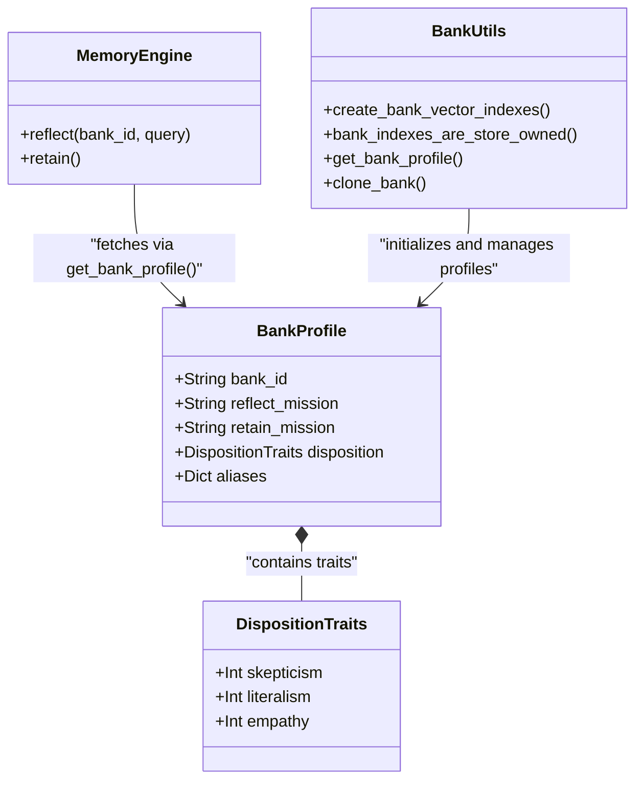
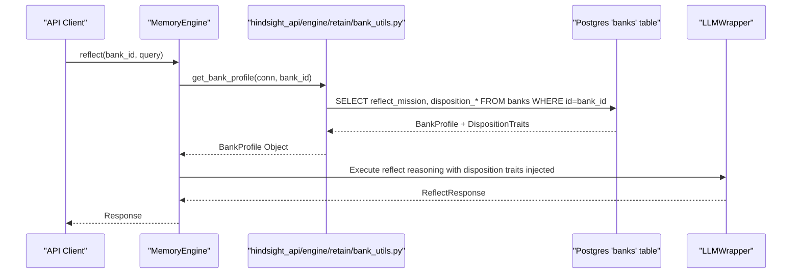

<!-- source: DeepWiki mcp.deepwiki.com · repo vectorize-io/hindsight · page 4.4 Memory Banks and Personality · fetched 2026-10-27 -->

# Memory Banks and Personality

<details>
<summary>Relevant source files</summary>

The following files were used as context for generating this wiki page:

- [hindsight-api-slim/hindsight_api/engine/db/ops.py](hindsight-api-slim/hindsight_api/engine/db/ops.py)
- [hindsight-api-slim/hindsight_api/engine/db/ops_oracle.py](hindsight-api-slim/hindsight_api/engine/db/ops_oracle.py)
- [hindsight-api-slim/hindsight_api/engine/db/ops_postgresql.py](hindsight-api-slim/hindsight_api/engine/db/ops_postgresql.py)
- [hindsight-api-slim/hindsight_api/engine/graph_maintenance.py](hindsight-api-slim/hindsight_api/engine/graph_maintenance.py)
- [hindsight-api-slim/hindsight_api/engine/memories/pg/graph.py](hindsight-api-slim/hindsight_api/engine/memories/pg/graph.py)
- [hindsight-api-slim/hindsight_api/engine/retain/bank_utils.py](hindsight-api-slim/hindsight_api/engine/retain/bank_utils.py)
- [hindsight-api-slim/hindsight_api/engine/retain/fact_storage.py](hindsight-api-slim/hindsight_api/engine/retain/fact_storage.py)
- [hindsight-api-slim/hindsight_api/engine/retain/orchestrator.py](hindsight-api-slim/hindsight_api/engine/retain/orchestrator.py)
- [hindsight-api-slim/hindsight_api/engine/retain/types.py](hindsight-api-slim/hindsight_api/engine/retain/types.py)
- [hindsight-api-slim/tests/test_delta_retain.py](hindsight-api-slim/tests/test_delta_retain.py)
- [hindsight-api-slim/tests/test_document_body_accumulation.py](hindsight-api-slim/tests/test_document_body_accumulation.py)
- [hindsight-api-slim/tests/test_ensure_bank_exists_optimization.py](hindsight-api-slim/tests/test_ensure_bank_exists_optimization.py)
- [hindsight-api-slim/tests/test_full_recall_temporal_window.py](hindsight-api-slim/tests/test_full_recall_temporal_window.py)
- [hindsight-api-slim/tests/test_graph_maintenance.py](hindsight-api-slim/tests/test_graph_maintenance.py)
- [hindsight-api-slim/tests/test_graph_maintenance_queue_race.py](hindsight-api-slim/tests/test_graph_maintenance_queue_race.py)
- [hindsight-api-slim/tests/test_graph_maintenance_submit_dedup.py](hindsight-api-slim/tests/test_graph_maintenance_submit_dedup.py)
- [hindsight-api-slim/tests/test_retain_store_owned_no_connection.py](hindsight-api-slim/tests/test_retain_store_owned_no_connection.py)
- [hindsight-api-slim/tests/test_store_owned_retain_parity.py](hindsight-api-slim/tests/test_store_owned_retain_parity.py)
- [hindsight-clients/go/model_create_bank_alias_request.go](hindsight-clients/go/model_create_bank_alias_request.go)
- [hindsight-clients/python/hindsight_client_api/models/create_bank_alias_request.py](hindsight-clients/python/hindsight_client_api/models/create_bank_alias_request.py)
- [hindsight-docs/docs/developer/api/memory-banks.mdx](hindsight-docs/docs/developer/api/memory-banks.mdx)
- [hindsight-docs/versioned_docs/version-1.0/developer/api/memory-banks.mdx](hindsight-docs/versioned_docs/version-1.0/developer/api/memory-banks.mdx)
- [hindsight-system-tests/tests/test_50_banks_and_config.py](hindsight-system-tests/tests/test_50_banks_and_config.py)
- [skills/hindsight-docs/references/developer/api/memory-banks.md](skills/hindsight-docs/references/developer/api/memory-banks.md)

</details>


This page defines **memory banks** as isolation boundaries within the Hindsight system, detailing their configuration, mission statements, aliasing, cloning, stats caching, and disposition traits—skepticism, literalism, and empathy. It further explains how those disposition traits shape the `reflect` reasoning cycles.

## Overview and Scope

A **memory bank** is the fundamental storage and isolation boundary in Hindsight [hindsight-docs/docs/developer/api/memory-banks.mdx:7-41]().

- Each bank is identified by a unique `bank_id`.
- It contains all associated memories, documents, entities, mental models, directives, and related graph data.
- Banks are completely isolated from each other, ensuring no cross-contamination of data.
- Writing to a non-existent bank triggers bank profile creation automatically [hindsight-api-slim/hindsight_api/engine/retain/fact_storage.py:127-145]().
- Reading from a non-existent bank returns an HTTP 404 error to fail loudly and explicitly [hindsight-docs/docs/developer/api/memory-banks.mdx:36-41]().

The bank serves as the root namespace and trust domain, managing all contextual state and configuration for the contained AI agent as it retains, recalls, and reflects over memories.

Sources:
- [hindsight-docs/docs/developer/api/memory-banks.mdx:7-41]()
- [skills/hindsight-docs/references/developer/api/memory-banks.md:8-27]()
- [hindsight-api-slim/hindsight_api/engine/retain/fact_storage.py:127-145]()

---

## Bank Profile and Data Model

Bank profiles encapsulate the identity, mutable configuration overrides, and disposition traits of each memory bank. The schema and management utilities reside primarily in the `bank_utils.py` module [hindsight-api-slim/hindsight_api/engine/retain/bank_utils.py:1-30]().

The disposition traits are bundled in a `DispositionTraits` model which includes:

- `skepticism`: Level of doubt regarding information reliability (1–5).
- `literalism`: Degree of taking input at face value versus reading between the lines.
- `empathy`: How much the model weighs human feelings and context.

These are stored in the `banks` table along with mission strings and other configuration.


**Diagram: Bank Profile Data Model and Interactions**

Sources:
- [hindsight-api-slim/hindsight_api/engine/retain/bank_utils.py:1-30]()
- [hindsight-api-slim/hindsight_api/engine/response_models.py:21-22]()

---

## Bank Aliases

The system supports **aliases**—alternative identifiers mapped to the canonical `bank_id` [hindsight-docs/docs/developer/api/memory-banks.mdx:64-96]().

- Endpoints accepting `bank_id` can transparently accept aliases.
- Aliases enable zero-downtime name migrations and gradual client transitions.
- Each alias includes metadata such as `primary` to signal control plane display preference without altering the foundational bank key used for audit and access controls.

This aliasing system ensures flexible namespace migration without duplicating underlying storage.

Sources:
- [hindsight-docs/docs/developer/api/memory-banks.mdx:64-96]()
- [skills/hindsight-docs/references/developer/api/memory-banks.md:58-90]()

---

## Bank Configuration and Retain Missions

Each memory bank provides configuration options that guide how data is retained and extracted during ingestion:

- **`retain_mission`**: a natural language prompt injected into fact extraction steps to focus retention on topics or ignore irrelevant clutter [hindsight-docs/docs/developer/api/memory-banks.mdx:101-108]().
- **`retain_extraction_mode`**: controls fact extraction behavior; modes include `concise`, `verbose`, `custom`, `verbatim`, and `chunks` [hindsight-docs/docs/developer/api/memory-banks.mdx:111-122]().
- **`retain_chunk_size`**: maximum characters per content chunk to be considered in fact extraction (default `3000`) [hindsight-docs/docs/developer/api/memory-banks.mdx:127-129]().
- Other flags control observation consolidation, BM25 text indexing, temporal and graph retrieval arms, and re-ranking behavior.

Configuration overrides are stored per bank and override tenant/global defaults dynamically [hindsight-docs/docs/developer/api/memory-banks.mdx:97-135]().

Sources:
- [hindsight-docs/docs/developer/api/memory-banks.mdx:97-135]()
- [skills/hindsight-docs/references/developer/api/memory-banks.md:91-134]()

---

## Disposition Traits System and Reflect Integration

Hindsight models agent personality in the three **Disposition Traits**, each ranging from 1 (low) to 5 (high) [hindsight-api-slim/hindsight_api/engine/response_models.py:21-22]():

- **Skepticism**: Trusting to skeptical stance toward information reliability.
- **Literalism**: Flexible interpretation vs. strict literal adherence.
- **Empathy**: Detached logic vs. user-sentiment-aware reasoning.

During a `reflect` operation, the engine loads the bank profile and applies these traits to modulate the LLM's system prompt or reasoning strategy. This manifests as adjusted prompt injection or internal task directives steering the model's style of evaluation and synthesis.


**Diagram: Disposition Traits in Reflect Operation Flow**

### Trait Impact Matrix

| Trait       | Scale | Low (1) Behavioral Impact                              | High (5) Behavioral Impact                             |
|-------------|-------|-------------------------------------------------------|-------------------------------------------------------|
| **Skepticism**  | 1–5   | Trusts memories, accepts facts at face value         | Critical, seeks contradictions and verification       |
| **Literalism**  | 1–5   | Flexible, infers intent beyond literal text            | Precise, adheres strictly to explicit details          |
| **Empathy**     | 1–5   | Detached, optimizes logical/technical correctness      | Prioritizes user sentiments and human context          |

Sources:
- [hindsight-api-slim/hindsight_api/engine/response_models.py:21-22]()

---

## Per-Bank Vector Indexes and Storage Architecture

To scale recall performance and maintain strong isolation, Hindsight creates **per-bank partial vector indexes** on the core fact types `world`, `experience`, and `observation` [hindsight-api-slim/hindsight_api/engine/retain/bank_utils.py:32-37]().

These vector indexes use a deterministic naming convention based on the bank's internal ID and fact type:

```
idx_mu_emb_{fact_type_prefix}_{16char_internal_id}
```
where `fact_type_prefix` is one of `"worl"`, `"expr"`, or `"obsv"` corresponding to the fact types [hindsight-api-slim/hindsight_api/engine/retain/bank_utils.py:33-47]().

The indexes are created eagerly by default during bank creation if size thresholds do not defer them. Otherwise, they are built through background maintenance operations [hindsight-api-slim/hindsight_api/engine/retain/bank_utils.py:103-119]().

```mermaid
flowchart TD
    BankCreation["Bank Creation"] -->|create_bank_vector_indexes()| BankUtils["hindsight_api/engine/retain/bank_utils.py"]
    BankUtils -->|per_bank_indexes_are_eager() == true| VectorIndexCreation["Vector Index Creation"]
    VectorIndexCreation --> DBCreateIndex["CREATE INDEX idx_mu_emb_{type}_{uid} ON memory_units WHERE bank_id = '...' AND fact_type = '...'"]
    BankUtils -->|if per_bank_indexes_are_eager() == false| DeferredMaintenance["Deferred to vector_index_maintenance worker"]
```
**Diagram: Per-Bank Vector Index Creation Flow**

Hindsight also supports "store-owned" banks, where memories are backed by an external storage extension instead of Postgres tables. For these banks:

- Vector indexes are not created on `memory_units` to avoid empty indexes that bloat query planning time [hindsight-api-slim/hindsight_api/engine/retain/bank_utils.py:58-73]().
- The system detects store ownership dynamically per bank and adjusts indexing behavior accordingly [hindsight-api-slim/hindsight_api/engine/retain/bank_utils.py:98-100]().

This architecture balances isolation, multi-tenant efficiency, and extensibility [hindsight-api-slim/hindsight_api/engine/retain/bank_utils.py:58-101]().

Sources:
- [hindsight-api-slim/hindsight_api/engine/retain/bank_utils.py:32-144]()
- [hindsight-api-slim/hindsight_api/engine/memories/base.py:1-40]()

---

# Summary

Memory banks in Hindsight serve as comprehensive, isolated knowledge compartments with full configuration, mission steering, and distinct persona traits. They support aliasing for flexible naming and cloning for templated deployments. Their per-bank vector indexes underpin fast retrieval, respecting the extension system's storage abstractions.

Disposition traits profoundly influence the `reflect` operation, modulating the reasoning style of LLM responses. The combination of structured bank profiles, config overrides, aliasing, and extension-aware storage form a robust backbone for personalized, scalable agent memory.

---

# References

- `bank_utils.py` [hindsight-api-slim/hindsight_api/engine/retain/bank_utils.py:1-144]()
- Memory Banks docs [hindsight-docs/docs/developer/api/memory-banks.mdx:7-135]()
- Disposition trait integration [hindsight-api-slim/hindsight_api/engine/response_models.py:21-22]()
- Memories store base interface [hindsight-api-slim/hindsight_api/engine/memories/base.py:1-40]()

---

