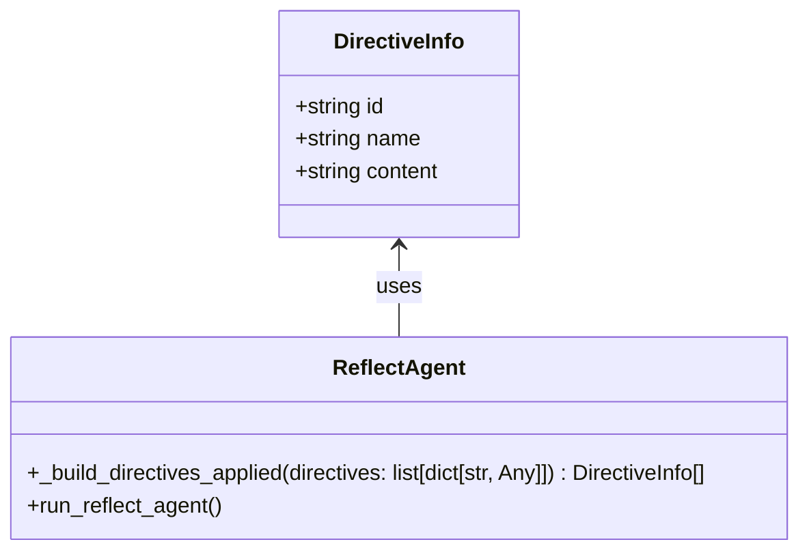
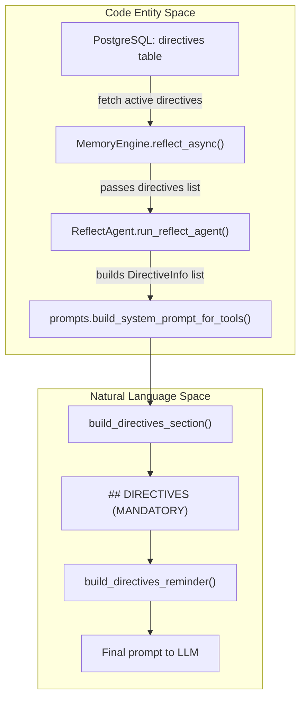
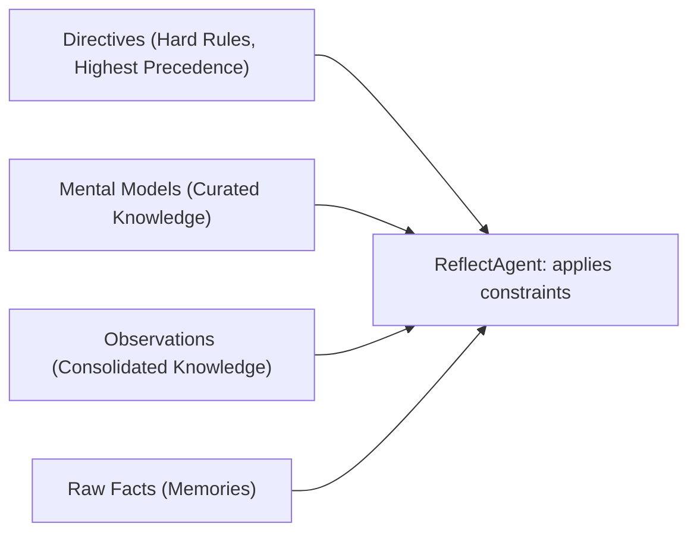
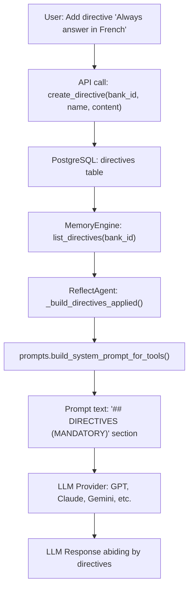

<!-- source: DeepWiki mcp.deepwiki.com · repo vectorize-io/hindsight · page 4.6 Directives · fetched 2026-10-27 -->

# Directives

<details>
<summary>Relevant source files</summary>

The following files were used as context for generating this wiki page:

- [hindsight-api-slim/hindsight_api/engine/llm_interface.py](hindsight-api-slim/hindsight_api/engine/llm_interface.py)
- [hindsight-api-slim/hindsight_api/engine/providers/gemini_cache.py](hindsight-api-slim/hindsight_api/engine/providers/gemini_cache.py)
- [hindsight-api-slim/hindsight_api/engine/providers/gemini_llm.py](hindsight-api-slim/hindsight_api/engine/providers/gemini_llm.py)
- [hindsight-api-slim/hindsight_api/engine/reflect/agent.py](hindsight-api-slim/hindsight_api/engine/reflect/agent.py)
- [hindsight-api-slim/hindsight_api/engine/reflect/presentation.py](hindsight-api-slim/hindsight_api/engine/reflect/presentation.py)
- [hindsight-api-slim/hindsight_api/engine/reflect/prompts.py](hindsight-api-slim/hindsight_api/engine/reflect/prompts.py)
- [hindsight-api-slim/hindsight_api/engine/reflect/structured_doc.py](hindsight-api-slim/hindsight_api/engine/reflect/structured_doc.py)
- [hindsight-api-slim/hindsight_api/engine/reflect/tools_schema.py](hindsight-api-slim/hindsight_api/engine/reflect/tools_schema.py)
- [hindsight-api-slim/tests/test_gemini_cache.py](hindsight-api-slim/tests/test_gemini_cache.py)
- [hindsight-api-slim/tests/test_gemini_implicit_cache_ratio.py](hindsight-api-slim/tests/test_gemini_implicit_cache_ratio.py)
- [hindsight-api-slim/tests/test_multilingual.py](hindsight-api-slim/tests/test_multilingual.py)
- [hindsight-api-slim/tests/test_reflect_agent.py](hindsight-api-slim/tests/test_reflect_agent.py)
- [hindsight-api-slim/tests/test_reflect_cites_real_ids.py](hindsight-api-slim/tests/test_reflect_cites_real_ids.py)
- [hindsight-api-slim/tests/test_reflect_document_answer.py](hindsight-api-slim/tests/test_reflect_document_answer.py)
- [hindsight-api-slim/tests/test_reflect_presentation.py](hindsight-api-slim/tests/test_reflect_presentation.py)
- [hindsight-api-slim/tests/test_reflect_prompt_builder.py](hindsight-api-slim/tests/test_reflect_prompt_builder.py)
- [hindsight-api-slim/tests/test_reflect_split_synthesis.py](hindsight-api-slim/tests/test_reflect_split_synthesis.py)
- [hindsight-api-slim/tests/test_retain_reflect_output_language.py](hindsight-api-slim/tests/test_retain_reflect_output_language.py)
- [hindsight-api-slim/tests/test_structured_doc.py](hindsight-api-slim/tests/test_structured_doc.py)
- [hindsight-system-evals/evals/test_03_retain_language.py](hindsight-system-evals/evals/test_03_retain_language.py)
- [hindsight-system-tests/tests/test_39_refresh_document_shape.py](hindsight-system-tests/tests/test_39_refresh_document_shape.py)
- [hindsight-system-tests/tests/test_42_disposition.py](hindsight-system-tests/tests/test_42_disposition.py)

</details>


Directives are hard rules that constrain how the memory system operates during `reflect` operations. Unlike memories or mental models, which provide information, directives enforce specific behaviors, guidelines, or constraints that the LLM must follow when generating responses. They are injected into the system prompt of the reflection agent, giving them precedence over retrieved facts and synthesized knowledge.

---

## Purpose and Scope

Directives serve as explicit instructions that are injected into every reflect operation for a given bank. They enable you to:

- **Enforce response formatting**: e.g., "Always respond in JSON format".
- **Apply personality constraints**: e.g., "Never use exclamation marks".
- **Implement safety guardrails**: e.g., "Do not provide medical advice".
- **Define operational boundaries**: e.g., "Only reference facts from the last 30 days".
- **Control behavior based on language**: e.g., "Always respond in French".

Directives are applied **before** the LLM generates its response, giving them higher authority than information from memories or mental models. In the `reflect` hierarchy, directives act as the immutable "Constitution" of the memory bank.

Sources: [hindsight-api-slim/hindsight_api/engine/reflect/prompts.py:49-58](), [hindsight-api-slim/hindsight_api/engine/reflect/agent.py:24-36]()

---

## Directive Structure

Directives are stored as structured entities that allow fine-grained control over their application. They are scoped to specific banks and can be assigned priority ordering to control injection sequence.

### Data Model and Classes

In code, directives are represented as `DirectiveInfo` objects encapsulating essential metadata and content:



| Field    | Type    | Purpose                                    | Default  |
|----------|---------|--------------------------------------------|----------|
| `id`     | string  | Unique identifier for the directive.       | Auto-generated |
| `name`   | string  | Human-readable label for the directive.    | Required |
| `content`| string  | The actual rule text injected into prompts | Required |

The implementation uses the factory method `_build_directives_applied` in the `ReflectAgent` to convert raw directive dicts from the store into a list of `DirectiveInfo` for prompt injection.

Sources: [hindsight-api-slim/hindsight_api/engine/reflect/agent.py:132-145]()

---

## Implementation and Data Flow

### CRUD Operations for Directives

Directives are stored in the database and managed through CRUD APIs exposed by the `MemoryEngine`. Typical operations include:

- **Create Directive**: Inserts a new directive tied to a bank.
- **List Directives**: Returns all directives active for a bank.
- **Update Directive**: Modify content or activation status.
- **Delete Directive**: Remove a directive from a bank.

These methods are implemented and tested via API handlers and backend calls, ensuring directives can be created, updated, and deleted as part of bank configuration.

### Reflect Operation Integration

During a `reflect` call, the `MemoryEngine` queries the datastore for all **active** directives associated with the bank and passes them to the `ReflectAgent`. The agent then converts them into prompt text sections that act as **hard constraints** on the reasoning process.



Sources: [hindsight-api-slim/hindsight_api/engine/reflect/agent.py:132-145](), [hindsight-api-slim/hindsight_api/engine/reflect/prompts.py:49-90](), [hindsight-api-slim/hindsight_api/engine/reflect/prompts.py:92-119]()

---

### Prompt Text Generation for Directives

Directives are injected into the system prompt in two places:

1.  **At the top of the prompt** within a section explicitly titled:

    ```
    ## DIRECTIVES (MANDATORY)

    These are hard rules you MUST follow in ALL responses:

    - <directive 1 text>
    - <directive 2 text>
    ...

    NEVER violate these directives, even if other context suggests otherwise.
    IMPORTANT: Do NOT explain or justify how you handled directives in your answer. Just follow them silently.
    ```

2.  **At the end of the prompt as a reminder**, enumerating the rules again and warning the model:

    ```
    ## REMINDER: MANDATORY DIRECTIVES

    Before responding, ensure your answer complies with ALL of these directives:

    1. <directive 1 text>
    2. <directive 2 text>
    ...

    Your response will be REJECTED if it violates any directive above.
    Do NOT include any commentary about how you handled directives - just follow them.
    ```

These double injections reinforce the importance and hard precedence of directives in the prompt structure.

Sources: [hindsight-api-slim/hindsight_api/engine/reflect/prompts.py:60-90](), [hindsight-api-slim/hindsight_api/engine/reflect/prompts.py:92-119]()

---

### Priority and Precedence

The prompt design explicitly communicates that these directives are **mandatory rules** that supersede all other context, including:

-   Memories retrieved through recall
-   Synthesized knowledge from mental models and observations
-   Default language or behavioral rules hardcoded in the prompt

The reflect prompt contains a **language rule** instructing the LLM to respond in the user's language, but this rule is intentionally marked with lower precedence than directives, so any language directives override the default.

Sources: [hindsight-api-slim/hindsight_api/engine/reflect/prompts.py:127-133](), [hindsight-api-slim/hindsight_api/engine/reflect/prompts.py:60-90]()

---

## Integration and Precedence Hierarchy

Directives act as the highest precedence constraints in the `reflect` operation, shaping the final system prompt given to the LLM.

The hierarchy of knowledge and rules during reflection is:

1.  **Directives** (hard, mandatory constraints, highest precedence)
2.  **Mental Models** (curated knowledge pages, used first for high-quality synthesis)
3.  **Observations** (auto-consolidated knowledge, reflecting recent knowledge)
4.  **Raw Facts (Memories)** (ground-truth data retrieved via recall, base layer)

The reflection agent's tool-calling loop performs hierarchical retrieval from mental models, then observations, and finally facts, with directives always injected upfront as hard prompt rules.



Sources: [hindsight-api-slim/hindsight_api/engine/reflect/agent.py:4-8](), [hindsight-api-slim/hindsight_api/engine/reflect/prompts.py:4-8]()

---

## Example Diagram: From Natural Language Instructions to Code Entities and Prompt Injection



---

## Summary

-   Directives are hard, mandatory rules injected into every reflect prompt to steer LLM behavior.
-   They have higher priority over memories, observations, and mental models.
-   CRUD operations on directives manage their lifecycle via the API and database.
-   The `ReflectAgent` builds prompt sections from active directives including a mandatory rules header and a final reminder, reinforcing strict compliance.
-   Directives enable enforcing formatting, safety, personality, language, and operational constraints as core properties of the memory bank.

Sources:
- [hindsight-api-slim/hindsight_api/engine/reflect/prompts.py:49-90]()
- [hindsight-api-slim/hindsight_api/engine/reflect/prompts.py:92-119]()
- [hindsight-api-slim/hindsight_api/engine/reflect/agent.py:132-145]()

---

