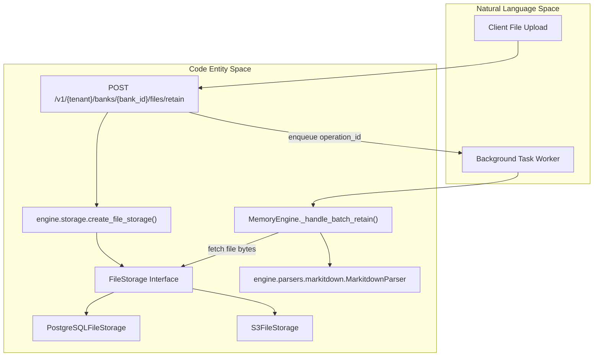
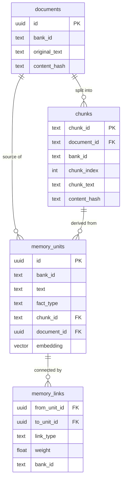
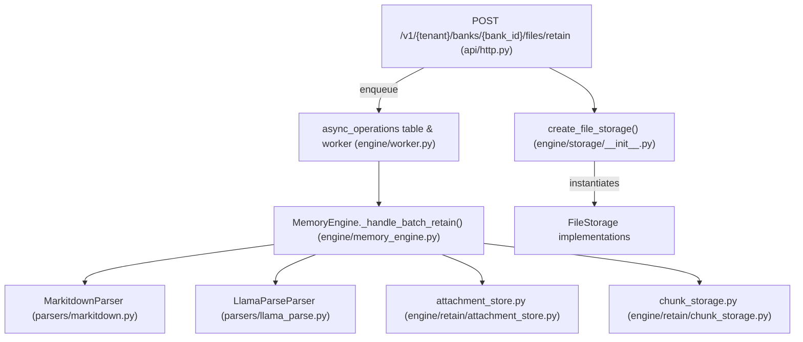
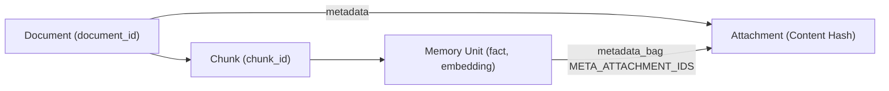

<!-- source: DeepWiki mcp.deepwiki.com · repo vectorize-io/hindsight · page 4.9 Documents, Attachments and File Processing · fetched 2026-10-27 -->

# Documents, Attachments and File Processing

<details>
<summary>Relevant source files</summary>

The following files were used as context for generating this wiki page:

- [hindsight-api-slim/hindsight_api/config_resolver.py](hindsight-api-slim/hindsight_api/config_resolver.py)
- [hindsight-api-slim/hindsight_api/engine/memories/__init__.py](hindsight-api-slim/hindsight_api/engine/memories/__init__.py)
- [hindsight-api-slim/hindsight_api/engine/parsers/markitdown.py](hindsight-api-slim/hindsight_api/engine/parsers/markitdown.py)
- [hindsight-api-slim/hindsight_api/engine/retain/attachment_store.py](hindsight-api-slim/hindsight_api/engine/retain/attachment_store.py)
- [hindsight-api-slim/hindsight_api/engine/storage/__init__.py](hindsight-api-slim/hindsight_api/engine/storage/__init__.py)
- [hindsight-api-slim/tests/test_attachment_lifecycle.py](hindsight-api-slim/tests/test_attachment_lifecycle.py)
- [hindsight-api-slim/tests/test_attachments_store_owned.py](hindsight-api-slim/tests/test_attachments_store_owned.py)
- [hindsight-api-slim/tests/test_bank_info_cache_invalidation.py](hindsight-api-slim/tests/test_bank_info_cache_invalidation.py)
- [hindsight-api-slim/tests/test_bank_templates.py](hindsight-api-slim/tests/test_bank_templates.py)
- [hindsight-api-slim/tests/test_file_retain.py](hindsight-api-slim/tests/test_file_retain.py)
- [hindsight-api-slim/tests/test_hierarchical_config.py](hindsight-api-slim/tests/test_hierarchical_config.py)
- [hindsight-api-slim/tests/test_http_api_integration.py](hindsight-api-slim/tests/test_http_api_integration.py)
- [hindsight-api-slim/tests/test_markitdown_parser.py](hindsight-api-slim/tests/test_markitdown_parser.py)
- [hindsight-api-slim/tests/test_reflect_tokenizer_lazy_load.py](hindsight-api-slim/tests/test_reflect_tokenizer_lazy_load.py)
- [hindsight-api-slim/tests/test_retain_attachment_ingress.py](hindsight-api-slim/tests/test_retain_attachment_ingress.py)
- [hindsight-api-slim/tests/test_retain_multimodal_extraction.py](hindsight-api-slim/tests/test_retain_multimodal_extraction.py)
- [hindsight-clients/go/api_bank_templates.go](hindsight-clients/go/api_bank_templates.go)
- [hindsight-clients/python/hindsight_client_api/api/bank_templates_api.py](hindsight-clients/python/hindsight_client_api/api/bank_templates_api.py)
- [hindsight-control-plane/src/lib/pending-uploads.ts](hindsight-control-plane/src/lib/pending-uploads.ts)
- [hindsight-control-plane/tests/lib/pending-uploads.test.ts](hindsight-control-plane/tests/lib/pending-uploads.test.ts)
- [hindsight-system-tests/tests/test_63_file_upload_failures.py](hindsight-system-tests/tests/test_63_file_upload_failures.py)
- [hindsight-system-tests/tests/test_93_attachments.py](hindsight-system-tests/tests/test_93_attachments.py)

</details>


This page explains Hindsight's system for file upload, storage, conversion, metadata management, and ingestion. Files such as PDFs, Office documents, images, audio, and structured text formats are converted to markdown and retained as memories through an asynchronous pipeline that preserves document tracking, attachments, and relationships.

---

## 1. File Upload and Storage Architecture

When files are uploaded to a memory bank via file-retain endpoints, they are persisted using a configurable `FileStorage` abstraction before being processed by background worker tasks that extract and retain facts asynchronously [hindsight-api-slim/tests/test_file_retain.py:106-125]().

### Storage Backends

The storage backend is created via `create_file_storage(...)` in `engine/storage/__init__.py`, supporting:
- Native PostgreSQL storage using the BYTEA type (`PostgreSQLFileStorage`)
- AWS S3 (`S3FileStorage`)
- Google Cloud Storage (`GCSFileStorage`)
- Azure Blob Storage (`AzureFileStorage`)
- Custom external implementations via extension loading

### Key Management and Storage Key Generation

Storage keys are generated with tenant, bank, document ID, and filename hierarchy to prevent collisions across tenants and banks sharing a bucket. The function `bank_storage_prefix(...)` provides a prefix:
```
tenants/{tenant}/banks/{bank_id}/files/{document_id}/
```
and `key_segment(...)` encodes arbitrary strings to safe path segments. This avoids key collisions even when multiple files share the same filename or document ID in the same batch [hindsight-api-slim/tests/test_file_retain.py:211-222]().

### Processing Flow

Uploaded files are enqueued as asynchronous operations. The background worker fetches file bytes from the storage backend and runs them through a selected parser, converting raw bytes to markdown for downstream ingestion and chunking.

### Diagram: File Ingestion and Storage Data Flow


**Sources:** [hindsight-api-slim/hindsight_api/engine/storage/__init__.py:44-122](), [hindsight-api-slim/tests/test_file_retain.py:106-225]()

---

## 2. Parser Selection and Markdown Conversion

Hindsight uses a pluggable parser abstraction (`FileParser`) to convert uploaded files into markdown text suitable for memory ingestion. The primary parser in the default deployment is `MarkitdownParser`, which wraps Microsoft's `markitdown` library [hindsight-api-slim/hindsight_api/engine/parsers/markitdown.py:73-90]().

### Supported Formats by MarkitdownParser

- PDF (`.pdf`)
- Microsoft Office formats: Word (`.docx`, `.doc`), PowerPoint (`.pptx`, `.ppt`), Excel (`.xlsx`, `.xls`)
- Images (`.jpg`, `.jpeg`, `.png`), with optional OpenAI-compatible OCR and vision models via the parser's OCR mode [hindsight-api-slim/hindsight_api/engine/parsers/markitdown.py:40-71]()
- Audio files (`.mp3`, `.wav`) with built-in transcription support
- Structured text: JSON (`.json`, `.jsonl`), Jupyter Notebooks (`.ipynb`), CSV (`.csv`), HTML (`.html`, `.htm`), plain text and markdown (`.txt`, `.md`)

### Lazy Import and OCR Configuration

To reduce startup latency, the `markitdown` heavy dependencies (e.g., `lxml`, `BeautifulSoup`) are imported lazily on first conversion. OCR functionality, which requires OpenAI-compatible vision models, is enabled via configuration flags and is validated at parser construction time. OCR client initialization (OpenAI SDK import, client construction) is deferred until OCR is used on the first convert call [hindsight-api-slim/hindsight_api/engine/parsers/markitdown.py:92-177]().

### UTF-8 Handling

`markitdown` detects character sets by sampling the initial byte chunk. This leads to mis-detection of UTF-8 files with long ASCII prefixes being interpreted as ASCII, causing decode errors. Hindsight explicitly passes a UTF-8 hint for known text-heavy extensions to mitigate this. Additionally, downstream code coerces buffer-protocol inputs to `bytes` to avoid workaround crashes from incomplete buffer implementations [hindsight-api-slim/hindsight_api/engine/parsers/markitdown.py:20-37](), [hindsight-api-slim/tests/test_markitdown_parser.py:68-85]().

**Sources:**
- [hindsight-api-slim/hindsight_api/engine/parsers/markitdown.py:20-177]()
- [hindsight-api-slim/tests/test_markitdown_parser.py:68-85]()

---

## 3. Attachment Lifecycle and Store-Owned Attachments

Documents may contain embedded attachments such as images, figures, or audio. These attachments have a well-defined lifecycle, tracked through document metadata and fact attributions.

### Attachment Attribution and Metadata

- Facts extracted during retain carry attachment IDs in their metadata bags, under the key `META_ATTACHMENT_IDS`. These IDs are deduplicated and maintained across write cycles [hindsight-api-slim/tests/test_attachments_store_owned.py:67-83]().

- Documents store attachment filenames and context in JSON serialized fields (`DOC_META_ATTACHMENT_FILENAMES`), enabling attachment enumeration and retrieval alongside document text [hindsight-api-slim/tests/test_attachments_store_owned.py:115-128]().

### Store-Owned Attachment Handling

Some bank implementations own their memories store and do not use the `memory_units` table, so attachments must be carried directly from the memory store. This avoids expensive query planning and locking from reading `memory_units.attachment_ids` for every recall in multi-tenant databases [hindsight-api-slim/tests/test_attachments_store_owned.py:1-20]().

### Blob Reclamation and Document Ownership

- Attachments belong strictly to exactly one document. Multiple documents carrying the same content hash carry separate copies of the bytes. Deleting one document deletes only its own attachments.

- Re-ingesting a document without an attachment causes the attachment to be deleted (reclaimed).
- Deleting a bank or clearing its documents also causes all associated attachments to be reclaimed from storage [hindsight-api-slim/tests/test_attachment_lifecycle.py:78-150]().

**Sources:**
- [hindsight-api-slim/tests/test_attachments_store_owned.py:1-128]()
- [hindsight-api-slim/tests/test_attachment_lifecycle.py:78-150]()
- [hindsight-api-slim/hindsight_api/engine/memories/__init__.py:17-39]()
- [hindsight-api-slim/hindsight_api/engine/retain/attachment_store.py:1-100]()

---

## 4. Document, Chunk, and Memory Relationships

Hindsight maintains a strong schema coupling between documents, their chunks, extracted facts, and graph relationships.

### Primary Entities and Their Relationships



- **Documents** store the original markdown and content hash, and are scoped by bank.

- **Chunks** are contiguous segments of the document's content, each with a SHA256 hash (`compute_chunk_hash()`) used for delta detection to optimize re-retain operations.

- **Memory Units** are extracted facts linked to their chunks and documents; each carries embeddings.

- **Memory Links** represent semantic or causal edges between memory units for graph-based retrieval.

### Deletion Ordering and Deadlock Avoidance

Deleting chunks cascades to facts and links; the `delete_chunks_by_ids(...)` function efficiently gathers related memory IDs, enqueues observation prunes and graph maintenance in a transactional manner before removing facts and links [hindsight-api-slim/hindsight_api/engine/retain/chunk_storage.py:115-165](). To prevent deadlocks and avoid slow queries, joins to memory units use indexed foreign keys instead of scalar disjunctions OR:

- Join pattern:
  ```sql
  JOIN target_units tu ON tu.id = ml.from_unit_id
  UNION
  JOIN target_units tu ON tu.id = ml.to_unit_id
  ```
  instead of "ml.from_unit_id = ANY(...)" OR "ml.to_unit_id = ANY(...)".

This pattern is proven by tests to avoid deadlocks in concurrent delete scenarios [hindsight-api-slim/tests/test_chunk_storage_delete_ordering.py:28-79]().

**Sources:**
- [hindsight-api-slim/hindsight_api/engine/retain/chunk_storage.py:22-165]()
- [hindsight-api-slim/tests/test_chunk_storage_delete_ordering.py:28-79]()

---

## 5. Update Modes and Async Operation Handling

### Document Retain Modes

- **Replace Mode (default)**: Uploading a document with an existing `document_id` deletes prior chunks, facts, and links, then re-ingests all content anew.

- **Delta Retain**: When replacing, `load_existing_chunks(...)` compares new chunk hashes against stored hashes for idempotency [hindsight-api-slim/hindsight_api/engine/retain/chunk_storage.py:36-59](). Unchanged chunks skip fact extraction and embedding, preserving stable memory unit IDs and saving LLM compute.

- **Append Mode**: Concatenates new content to existing text, preserving prior chunks and facts, useful for incremental memory accumulation [hindsight-api-slim/tests/test_retain_append_mode.py:24-27]().

### Async Operation Retry Logic

File retain and chunk retain operations run asynchronously via background workers and create async operation records.

- Deterministic database consistency failure errors (`UniqueViolationError` on primary keys) cause immediate task failure without retries, as retries would deterministically fail again [hindsight-api-slim/tests/test_integrity_violation_not_retried.py:61-106]().

- Transient race conditions such as foreign key violations may occur during eventual consistency windows and are treated as retriable, as the actual conflicting statement may commit after the worker's initial attempt [hindsight-api-slim/tests/test_fk_violation_is_retryable.py:40-100]().

**Sources:**
- [hindsight-api-slim/hindsight_api/engine/retain/chunk_storage.py:36-59]()
- [hindsight-api-slim/tests/test_retain_append_mode.py:24-27]()
- [hindsight-api-slim/tests/test_integrity_violation_not_retried.py:61-106]()
- [hindsight-api-slim/tests/test_fk_violation_is_retryable.py:40-100]()

---

# Summary

Hindsight's document and file processing system offers robust multi-format ingestion via configurable parsers, an extensible storage backend, accurate attachment tracking with lifecycle management, and strong relational integrity through chunk and memory unit coordination. Combined with async processing with deliberately engineered retry and error policies, the system ensures correctness, efficiency, and auditability of memories sourced from rich external documents and files.

# Appendices

### Key Code Entities



### Document → Chunk → Memory Unit → Attachment Flow



---

**Sources:**

- [hindsight-api-slim/tests/test_file_retain.py:106-225]()
- [hindsight-api-slim/hindsight_api/engine/storage/__init__.py:44-122]()
- [hindsight-api-slim/hindsight_api/engine/parsers/markitdown.py:20-177]()
- [hindsight-api-slim/tests/test_markitdown_parser.py:68-85]()
- [hindsight-api-slim/tests/test_attachments_store_owned.py:1-128]()
- [hindsight-api-slim/tests/test_attachment_lifecycle.py:78-150]()
- [hindsight-api-slim/hindsight_api/engine/retain/chunk_storage.py:22-165]()
- [hindsight-api-slim/tests/test_chunk_storage_delete_ordering.py:28-79]()
- [hindsight-api-slim/tests/test_retain_append_mode.py:24-27]()
- [hindsight-api-slim/tests/test_integrity_violation_not_retried.py:61-106]()
- [hindsight-api-slim/tests/test_fk_violation_is_retryable.py:40-100]()

---

