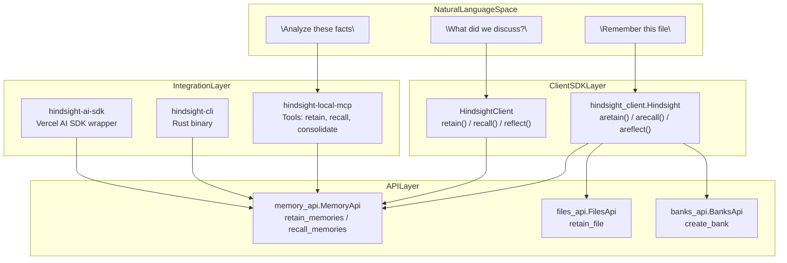
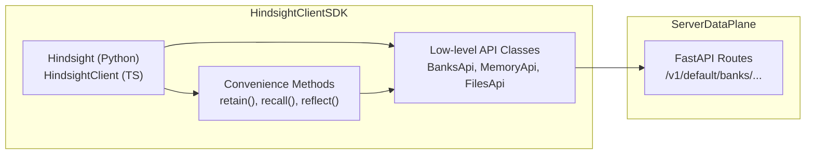

<!-- source: DeepWiki mcp.deepwiki.com · repo vectorize-io/hindsight · page 5 Client SDKs and Integrations · fetched 2026-10-27 -->

# Client SDKs and Integrations

Relevant source files

The following files were used as context for generating this wiki page:

- [hindsight-api-slim/tests/test_format_facts_for_prompt.py](hindsight-api-slim/tests/test_format_facts_for_prompt.py)
- [hindsight-clients/python/hindsight_client/__init__.py](hindsight-clients/python/hindsight_client/__init__.py)
- [hindsight-clients/python/hindsight_client/hindsight_client.py](hindsight-clients/python/hindsight_client/hindsight_client.py)
- [hindsight-clients/python/tests/test_main_operations.py](hindsight-clients/python/tests/test_main_operations.py)
- [hindsight-clients/python/tests/test_prompt_formatting.py](hindsight-clients/python/tests/test_prompt_formatting.py)
- [hindsight-clients/python/tests/test_version.py](hindsight-clients/python/tests/test_version.py)
- [hindsight-clients/typescript/src/index.ts](hindsight-clients/typescript/src/index.ts)
- [hindsight-clients/typescript/tests/prompt_formatting.test.ts](hindsight-clients/typescript/tests/prompt_formatting.test.ts)

This page provides an overview of the multi-language client ecosystem and integration methods available for interacting with Hindsight. The system follows an **API-first design philosophy**, leveraging an OpenAPI specification as the primary source for generating type-safe SDKs across multiple languages including Python, TypeScript, Go, and Rust. This ensures consistency and interoperability across client libraries and integrations.

## Integration Methods Overview

Hindsight offers several primary integration methods that cater to a broad range of usage scenarios, from direct client libraries for application development to specialized protocols for agent integrations:

| Integration | Package / Repository | Primary Use Case | Detailed Docs |
|---|---|---|---|
| **Python Client** | `hindsight-client` | Python applications, AI agents (CrewAI, PydanticAI, AG2) | [Python Client](#5.1) |
| **TypeScript Client** | `@vectorize-io/hindsight-client` | Web applications, Next.js, Vercel AI SDK | [TypeScript Client](#5.2) |
| **Rust CLI** | `hindsight` binary | Terminal usage, shell scripts, TUI | [Rust CLI](#5.3) |
| **Embedded CLI** | `hindsight-embed` | Local-first development, zero-config auto-daemon | [Embedded CLI (hindsight-embed)](#5.4) |
| **MCP Server** | `hindsight-local-mcp` | Model Context Protocol tools for Claude, Cline, Zed, IDEs | [MCP Integration](#5.5) |
| **Coding Agent Integrations** | `hindsight-coding-agents` | Integrations for Claude Code, Codex, Cursor, Copilot CLI, and others | [Coding Agent Integrations](#5.6) |
| **OpenClaw Plugin** | `hindsight-openclaw` | Auto-memory plugin specifically for OpenClaw agents | [OpenClaw Plugin](#5.7) |
| **Skills and Agent SDK**| `hindsight-tools` / `hindsight-agent-sdk` | AI agent skill system and harness-agnostic knowledge tools | [Skills and Agent Knowledge Tools](#5.8) |
| **Framework Integrations** | Various (`@vectorize-io/hindsight-ai-sdk`, etc.) | Python and TypeScript framework integrations e.g., Vercel, LangGraph | [Framework Integrations](#5.9)|
| **Additional Integrations** | Various | Integrations with tools like Obsidian, Zapier, n8n, OpenHands, GitHub Copilot etc. | [Additional Integrations](#5.10) |

Sources: [hindsight-clients/python/hindsight_client/hindsight_client.py:23-61](), [hindsight-clients/typescript/src/index.ts:28-84]()

## System Integration Architecture

The following diagram illustrates the overall integration flow, connecting user or agent intents expressed in natural language to the internal code entities that process them. It spans client SDKs, integration layers, and the underlying API routes.

### Diagram: Hindsight Integration Flow

Sources: [hindsight-clients/python/hindsight_client/hindsight_client.py:83-172](), [hindsight-clients/typescript/src/index.ts:158-195]()

## SDK Generation and Consistency

Hindsight employs an automated client-generation pipeline to maintain strict parity and consistency across its multi-language client libraries:

1.  **Source of Truth**: The official OpenAPI 3.1 specification (`openapi.json`) defines the entire HTTP API contract.
2.  **Code Generation**:
    * Python clients are generated into the `hindsight_client_api` package.
    * TypeScript clients use the `@hey-api/openapi-ts` tool to generate typed SDK methods and types.
    * Go and Rust clients also derive from the same OpenAPI spec.
3.  **High-Level Wrappers**: To simplify interactions for developers, idiomatic wrapper classes encapsulate the low-level generated client code:
    * Python: `hindsight_client.Hindsight` class provides synchronous and asynchronous methods that wrap the generated API calls.
    * TypeScript: `HindsightClient` class offers an async-first interface with type safety.

### SDK Wrapper Comparison

| Feature | Python (`Hindsight`) | TypeScript (`HindsightClient`) |
|---|---|---|
| Primary Class | `hindsight_client.Hindsight` (see client API) | `HindsightClient` |
| Async Support | Yes, via async methods (`aretain`, `arecall`, `areflect`) and sync wrappers | Yes, async/promises only |
| Sync Support | Yes, sync wrappers use `_run_async` internally | No |
| Authentication | API key Bearer token via header | `apiKey` option for Bearer token |
| Low-level Access | Exposed via properties (`client.documents`, `client.banks`, etc.) | Exposed via `client` instance with APIs |

Sources: [hindsight-clients/python/hindsight_client/hindsight_client.py:83-112](), [hindsight-clients/typescript/src/index.ts:158-195]()

## Core Client Operations

All client SDKs and integrations revolve around the three fundamental biomimetic memory operations of Hindsight:

1.  **Retain** — Store new information, either textual content or attachments.
    - Python: `Hindsight.retain(bank_id, content, ...)` and async `aretain()` methods.
    - TypeScript: `HindsightClient.retain(bankId, content, ...)`
2.  **Recall** — Query for relevant memories and context.
    - Python: `Hindsight.recall(bank_id, query, ...)` and async `arecall()`.
    - TypeScript: `HindsightClient.recall(bankId, query, ...)`
3.  **Reflect** — Perform multi-step reasoning using bank personality, directives, and mental models to generate answers.
    - Python: `Hindsight.reflect(bank_id, query, ...)` and async `areflect()`.
    - TypeScript: `HindsightClient.reflect(bankId, query, ...)`

### Client Interaction Model

The next diagram shows the relationship between the wrapper SDK classes, the generated low-level API classes, and the backend server routes.

### Diagram: Client Method Resolution

Sources: [hindsight-clients/python/hindsight_client/hindsight_client.py:83-112](), [hindsight-clients/typescript/src/index.ts:158-195]()

## Child Pages

For full implementation details, usage instructions, and API references for specific clients and integrations, please refer to the following pages:

*   **[Python Client](#5.1)** — Detailed docs on the Python `Hindsight` class: initialization, synchronous and asynchronous methods (`retain`, `recall`, `reflect`), batch operations, mental model and directive management, bank configuration, and the generated `hindsight_client_api`.
*   **[TypeScript Client](#5.2)** — Documentation of the TypeScript `HindsightClient` class: asynchronous usage patterns, type definitions, and environment support including Next.js, Node.js, and browsers.
*   **[Rust CLI](#5.3)** — The Rust command-line interface: commands, configuration, knowledge sync daemon, terminal UI, and the underlying Rust client library.
*   **[Embedded CLI (hindsight-embed)](#5.4)** — The embedded CLI tool: zero-config auto-daemon spawning, profile management, control center UI, and lifecycle management.
*   **[MCP Integration](#5.5)** — The Model Context Protocol server: exposed tools, filtering, authentication, routing, and local MCP mode.
*   **[Coding Agent Integrations](#5.6)** — Overview of coding agent integrations: common `hindsight-coding-agents` package and harness-specific plugins.
*   **[OpenClaw Plugin](#5.7)** — In-depth coverage of the OpenClaw auto-memory plugin: lifecycle hooks, session handling, queueing, and setup tooling.
*   **[Skills and Agent Knowledge Tools](#5.8)** — AI agent skill system and harness-agnostic knowledge tools.
*   **[Framework Integrations](#5.9)** — Python and TypeScript framework integrations: LiteLLM, LangGraph, LlamaIndex, OpenAI Agents, AutoGen/AG2, CrewAI, PydanticAI, and more.
*   **[Additional Integrations](#5.10)** — Other integrations supporting numerous third-party tools and ecosystems.

Sources: [hindsight-clients/python/hindsight_client/hindsight_client.py:23-61](), [hindsight-clients/typescript/src/index.ts:28-84]()

---

This page establishes the foundational understanding of the Hindsight client SDKs and integrations, providing links to deep-dives and usage specifics in the child pages. The API-first design ensures the ecosystem is robust, consistent, and extensible for diverse user needs and platform requirements.

---

